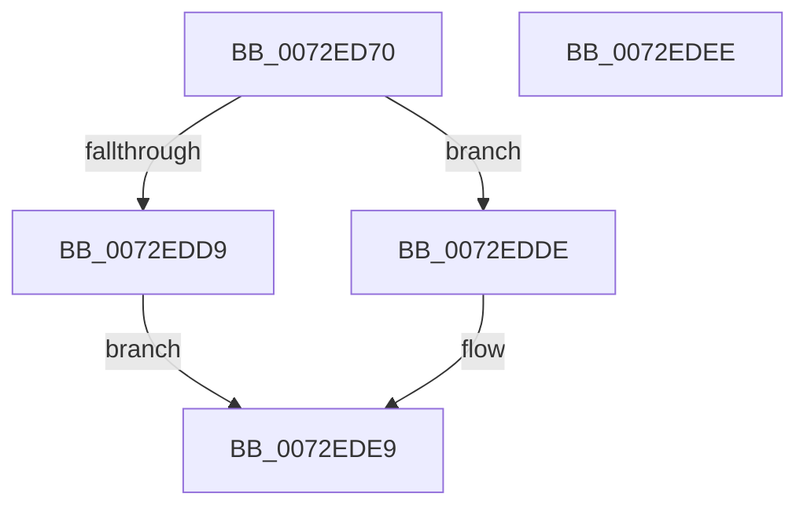

# IopGenericScoreRequirement

- RVA: `0x0072ED70`–`0x0072EDEF` (길이 `127` bytes)
- VA: `0x000000014072ED70`
- 실행 섹션: `PAGE`
- PDB 이름 있음: `예`; PDB Function 태그: `아니요`
- unwind 정보 RVA: `0x000C4794`
- 디코드: `36`개 명령, `127/127` bytes 표시
- 미해석 바이트: `0` (있으면 어셈블리에 `.byte`로 보존)

> 이 문서는 커널 이미지의 기계어와 PDB 기호를 분석해 생성했습니다. 4번과 5번은 함수 원형과 자료형을 바이너리 사용 방식에서 추정한 C 해석이며 원본 소스 복구 결과는 아닙니다.

## 1. Dependencies

- 직접 호출 지점: **1**; 고유 호출 대상: **1**
- 직접 호출자로 확인된 함수: **0**
- RIP 상대 이미지 참조: **0**

### Outgoing calls
- `0x0072ED92` → [RtlIoDecodeMemIoResource](../../text/5E/RtlIoDecodeMemIoResource_function_005E7D80.md) (function, `0x005E7D80`)

### Direct callers
- 이 함수 시작 RVA로 연결되는 직접 call은 확인되지 않았습니다. 간접 호출은 완전히 역산할 수 없습니다.

### Static image references
- 디코드된 RIP-relative 메모리 참조가 없습니다.

## 2. Other-region calls and transfers

- 다른 실행 섹션으로 향하는 call: **1**
  - `0x0072ED92` → [RtlIoDecodeMemIoResource](../../text/5E/RtlIoDecodeMemIoResource_function_005E7D80.md) (`PAGE` → `.text`)
- 별도 외부 분기/꼬리 이동을 확인하지 못했습니다.

## 3. Assembly (complete function range)

```asm
0072ED70  48 8B C4                        mov rax, rsp
0072ED73  48 83 EC 28                     sub rsp, 0x28
0072ED77  48 83 60 20 00                  and qword ptr [rax + 0x20], 0
0072ED7C  4C 8D 48 20                     lea r9, [rax + 0x20]
0072ED80  48 83 60 10 00                  and qword ptr [rax + 0x10], 0
0072ED85  4C 8D 40 18                     lea r8, [rax + 0x18]
0072ED89  48 83 60 18 00                  and qword ptr [rax + 0x18], 0
0072ED8E  48 8D 50 10                     lea rdx, [rax + 0x10]
0072ED92  E8 E9 8F EB FF                  call 0x1405e7d80
0072ED97  4C 8B 4C 24 38                  mov r9, qword ptr [rsp + 0x38]
0072ED9C  4C 8B C0                        mov r8, rax
0072ED9F  48 8B 54 24 40                  mov rdx, qword ptr [rsp + 0x40]
0072EDA4  41 BA 01 00 00 00               mov r10d, 1
0072EDAA  48 8B 44 24 48                  mov rax, qword ptr [rsp + 0x48]
0072EDAF  4D 85 C9                        test r9, r9
0072EDB2  4D 0F 44 CA                     cmove r9, r10
0072EDB6  48 FF CA                        dec rdx
0072EDB9  49 03 D1                        add rdx, r9
0072EDBC  49 8D 49 FF                     lea rcx, [r9 - 1]
0072EDC0  48 F7 D1                        not rcx
0072EDC3  48 23 D1                        and rdx, rcx
0072EDC6  48 2B C2                        sub rax, rdx
0072EDC9  33 D2                           xor edx, edx
0072EDCB  49 2B C0                        sub rax, r8
0072EDCE  49 03 C2                        add rax, r10
0072EDD1  49 F7 F1                        div r9
0072EDD4  49 03 C2                        add rax, r10
0072EDD7  79 05                           jns 0x14072edde
0072EDD9  83 C8 FF                        or eax, 0xffffffff
0072EDDC  EB 0B                           jmp 0x14072ede9
0072EDDE  B9 FF FF FF 7F                  mov ecx, 0x7fffffff
0072EDE3  48 3B C1                        cmp rax, rcx
0072EDE6  0F 4F C1                        cmovg eax, ecx
0072EDE9  48 83 C4 28                     add rsp, 0x28
0072EDED  C3                              ret
0072EDEE  CC                              int3
```

## 4. C-style interpretation (structured pseudocode)

```c
__int64 __fastcall IopGenericScoreRequirement(void)
{
    __int64 result;
    __int64 v_rsp;
    unsigned __int64 v_stack_p10;
    unsigned __int64 v_stack_p18;
    unsigned __int64 v_stack_p20;

    v_rsp = (v_rsp) - (40);
    result = RtlIoDecodeMemIoResource(a1, v_rsp + 16, v_rsp + 24, v_rsp + 32);
    a4 = v_stack_p10;
    if (v_stack_p10 == 0) { a4 = 1; }
    a2 = (v_stack_p18) - 1;
    a2 = (a2) + (a4);
    a1 = ~(a4 - 1);
    a2 = (a2) & (a1);
    result = (v_stack_p20) - (a2);
    a2 = 0;
    result = (result) - (result);
    result = (result) + (1);
    result = (result) + (1);
    if (!sign_flag) goto loc_0072EDDE;
    result = (unsigned int)((result) | (0xFFFFFFFFULL));
    goto loc_0072EDE9;
loc_0072EDDE:
    if (result > ((unsigned int)(0x7FFFFFFFULL))) { result = (unsigned int)((unsigned int)(0x7FFFFFFFULL)); }
loc_0072EDE9:
    v_rsp = (v_rsp) + (40);
    return result;
}
```

## 5. (Beta) C Style

```c
void IopGenericScoreRequirement(void)
{
    int64_t result;
    int64_t local_rsp;
    uint64_t v_stack_p10;
    uint64_t v_stack_p18;
    uint64_t v_stack_p20;

    local_rsp = (local_rsp) - (40);
    result = RtlIoDecodeMemIoResource(a1, local_rsp + 16, local_rsp + 24, local_rsp + 32);
    a4 = v_stack_p10;
    if (v_stack_p10 == 0) { a4 = 1; }
    a2 = (v_stack_p18) - 1;
    a2 = (a2) + (a4);
    a1 = ~(a4 - 1);
    a2 = (a2) & (a1);
    result = (v_stack_p20) - (a2);
    a2 = 0;
    result = (result) - (result);
    result = (result) + (1);
    result = (result) + (1);
    if (!sign_flag) goto loc_0072EDDE;
    result = (uint32_t)((result) | (0xFFFFFFFFULL));
    goto loc_0072EDE9;
loc_0072EDDE:
    if (result > ((uint32_t)(0x7FFFFFFFULL))) { result = (uint32_t)((uint32_t)(0x7FFFFFFFULL)); }
loc_0072EDE9:
    local_rsp = (local_rsp) + (40);
    return result;
}
```

## 6. Execution-region graph

[열기: 2D/3D 그래프와 함수 탐색 컨트롤 패널](../../../control-panel.html?section=page&rva=0x0072ED70&view=graph)

- 2D 그래프는 위에서 아래로 흐르고, 3D 그래프는 빈 공간을 드래그해 회전합니다. Shift+드래그는 이동, 휠은 확대·축소, 함수 노드 선택은 대상 보고서 이동입니다.

### Static fallback


