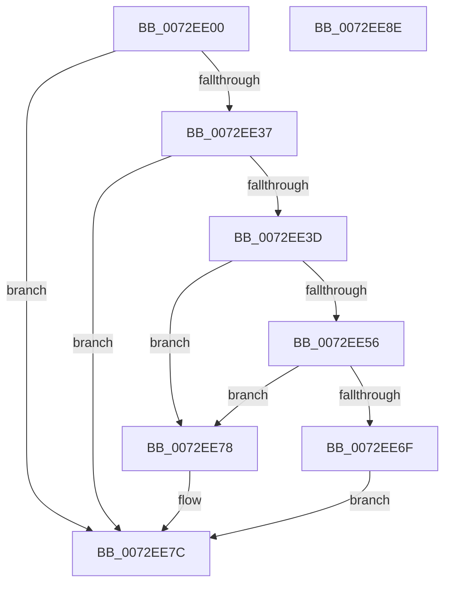

# IopGenericTranslateOrdering

- RVA: `0x0072EE00`–`0x0072EE8F` (길이 `143` bytes)
- VA: `0x000000014072EE00`
- 실행 섹션: `PAGE`
- PDB 이름 있음: `예`; PDB Function 태그: `아니요`
- unwind 정보 RVA: `0x000C88C4`
- 디코드: `44`개 명령, `143/143` bytes 표시
- 미해석 바이트: `0` (있으면 어셈블리에 `.byte`로 보존)

> 이 문서는 커널 이미지의 기계어와 PDB 기호를 분석해 생성했습니다. 4번과 5번은 함수 원형과 자료형을 바이너리 사용 방식에서 추정한 C 해석이며 원본 소스 복구 결과는 아닙니다.

## 1. Dependencies

- 직접 호출 지점: **2**; 고유 호출 대상: **1**
- 직접 호출자로 확인된 함수: **0**
- RIP 상대 이미지 참조: **0**

### Outgoing calls
- `0x0072EE4D` → [IopTranslateBusAddress](IopTranslateBusAddress_function_0072F598.md) (function, `0x0072F598`)
- `0x0072EE66` → [IopTranslateBusAddress](IopTranslateBusAddress_function_0072F598.md) (function, `0x0072F598`)

### Direct callers
- 이 함수 시작 RVA로 연결되는 직접 call은 확인되지 않았습니다. 간접 호출은 완전히 역산할 수 없습니다.

### Static image references
- 디코드된 RIP-relative 메모리 참조가 없습니다.

## 2. Other-region calls and transfers

- 다른 실행 섹션으로 향하는 call: **0**
- 별도 외부 분기/꼬리 이동을 확인하지 못했습니다.

## 3. Assembly (complete function range)

```asm
0072EE00  48 8B C4                        mov rax, rsp
0072EE03  48 89 58 18                     mov qword ptr [rax + 0x18], rbx
0072EE07  48 89 70 20                     mov qword ptr [rax + 0x20], rsi
0072EE0B  57                              push rdi
0072EE0C  48 83 EC 20                     sub rsp, 0x20
0072EE10  0F 10 02                        movups xmm0, xmmword ptr [rdx]
0072EE13  C6 40 08 00                     mov byte ptr [rax + 8], 0
0072EE17  48 8B F2                        mov rsi, rdx
0072EE1A  C6 40 10 00                     mov byte ptr [rax + 0x10], 0
0072EE1E  48 8B D9                        mov rbx, rcx
0072EE21  0F 11 01                        movups xmmword ptr [rcx], xmm0
0072EE24  0F 10 4A 10                     movups xmm1, xmmword ptr [rdx + 0x10]
0072EE28  0F 11 49 10                     movups xmmword ptr [rcx + 0x10], xmm1
0072EE2C  40 8A 7A 01                     mov dil, byte ptr [rdx + 1]
0072EE30  8D 47 FF                        lea eax, [rdi - 1]
0072EE33  A8 F9                           test al, 0xf9
0072EE35  75 45                           jne 0x14072ee7c
0072EE37  40 80 FF 05                     cmp dil, 5
0072EE3B  74 3F                           je 0x14072ee7c
0072EE3D  4C 8D 41 10                     lea r8, [rcx + 0x10]
0072EE41  40 8A D7                        mov dl, dil
0072EE44  48 8B 4E 10                     mov rcx, qword ptr [rsi + 0x10]
0072EE48  4C 8D 4C 24 30                  lea r9, [rsp + 0x30]
0072EE4D  E8 46 07 00 00                  call 0x14072f598
0072EE52  85 C0                           test eax, eax
0072EE54  78 22                           js 0x14072ee78
0072EE56  48 8B 4E 18                     mov rcx, qword ptr [rsi + 0x18]
0072EE5A  4C 8D 43 18                     lea r8, [rbx + 0x18]
0072EE5E  4C 8D 4C 24 38                  lea r9, [rsp + 0x38]
0072EE63  40 8A D7                        mov dl, dil
0072EE66  E8 2D 07 00 00                  call 0x14072f598
0072EE6B  85 C0                           test eax, eax
0072EE6D  78 09                           js 0x14072ee78
0072EE6F  8A 44 24 30                     mov al, byte ptr [rsp + 0x30]
0072EE73  88 43 01                        mov byte ptr [rbx + 1], al
0072EE76  EB 04                           jmp 0x14072ee7c
0072EE78  C6 43 01 00                     mov byte ptr [rbx + 1], 0
0072EE7C  48 8B 5C 24 40                  mov rbx, qword ptr [rsp + 0x40]
0072EE81  33 C0                           xor eax, eax
0072EE83  48 8B 74 24 48                  mov rsi, qword ptr [rsp + 0x48]
0072EE88  48 83 C4 20                     add rsp, 0x20
0072EE8C  5F                              pop rdi
0072EE8D  C3                              ret
0072EE8E  CC                              int3
```

## 4. C-style interpretation (structured pseudocode)

```c
__int64 __fastcall IopGenericTranslateOrdering(__int64 a1, __int64 a2)
{
    __int64 result;
    __int64 v_rsp;
    unsigned __int64 v_stack_p10;
    unsigned __int64 v_stack_p18;
    unsigned __int64 v_stack_p20;
    unsigned __int64 v_stack_p8;

    *(unsigned __int64 *)(v_rsp + 24) = v_rbx;
    *(unsigned __int64 *)(v_rsp + 32) = v_rsi;
    v_rsp = (v_rsp) - (32);
    *(unsigned __int8 *)(v_rsp + 8) = 0;
    *(unsigned __int8 *)(v_rsp + 16) = 0;
    *(unsigned __int64 *)(a1) = v_xmm0;
    *(unsigned __int64 *)(a1 + 16) = v_xmm1;
    if ((((unsigned __int8)(*(unsigned __int8 *)(a2 + 1) - 1)) & (249)) != 0) goto loc_0072EE7C;
    if (((unsigned __int8)(*(unsigned __int8 *)(a2 + 1))) == 5) goto loc_0072EE7C;
    result = IopTranslateBusAddress(*(unsigned __int64 *)(a2 + 16), (unsigned __int8)(*(unsigned __int8 *)(a2 + 1)), a1 + 16, v_stack_p8);
    if (sign_flag) goto loc_0072EE78;
    result = IopTranslateBusAddress(*(unsigned __int64 *)(a2 + 24), (unsigned __int8)(*(unsigned __int8 *)(a2 + 1)), a1 + 24, v_stack_p10);
    if (sign_flag) goto loc_0072EE78;
    *(unsigned __int8 *)(a1 + 1) = (unsigned __int8)(v_stack_p8);
    goto loc_0072EE7C;
loc_0072EE78:
    *(unsigned __int8 *)(a1 + 1) = 0;
loc_0072EE7C:
    result = 0;
    v_rsp = (v_rsp) + (32);
    return result;
}
```

## 5. (Beta) C Style

```c
int64_t IopGenericTranslateOrdering(void *Arg1, void *Arg2)
{
    uint8_t *arg1 = (uint8_t *)Arg1;
    uint8_t *arg2 = (uint8_t *)Arg2;

    int64_t result;
    int64_t local_rsp;
    uint64_t v_stack_p10;
    uint64_t v_stack_p18;
    uint64_t v_stack_p20;
    uint64_t v_stack_p8;

    *(uint64_t *)(local_rsp + 0x18) = local_rbx;
    *(uint64_t *)(local_rsp + 0x20) = local_rsi;
    local_rsp = (local_rsp) - (32);
    *(uint8_t *)(local_rsp + 0x8) = 0;
    *(uint8_t *)(local_rsp + 0x10) = 0;
    *(uint64_t *)(arg1) = v_xmm0;
    *(uint64_t *)(arg1 + 0x10) = v_xmm1;
    if ((((uint8_t)(*(uint8_t *)(arg2 + 0x1) - 1)) & (249)) != 0) goto loc_0072EE7C;
    if (((uint8_t)(*(uint8_t *)(arg2 + 0x1))) == 5) goto loc_0072EE7C;
    result = IopTranslateBusAddress(*(uint64_t *)(arg2 + 0x10), (uint8_t)(*(uint8_t *)(arg2 + 0x1)), Arg1 + 16, v_stack_p8);
    if (sign_flag) goto loc_0072EE78;
    result = IopTranslateBusAddress(*(uint64_t *)(arg2 + 0x18), (uint8_t)(*(uint8_t *)(arg2 + 0x1)), Arg1 + 24, v_stack_p10);
    if (sign_flag) goto loc_0072EE78;
    *(uint8_t *)(arg1 + 0x1) = (uint8_t)(v_stack_p8);
    goto loc_0072EE7C;
loc_0072EE78:
    *(uint8_t *)(arg1 + 0x1) = 0;
loc_0072EE7C:
    result = 0;
    local_rsp = (local_rsp) + (32);
    return result;
}
```

### 관측된 메모리 오프셋

구조체 형식이 확인되지 않은 접근은 인자 기준의 오프셋으로만 기록했습니다.

| 기준 인자 | 오프셋 표현 | 폭 (bit) | 접근 |
|---|---:|---:|---|
| `Arg1` | `+ 0x0` | `128` | `R` |
| `Arg1` | `+ 0x1` | `8` | `W` |
| `Arg1` | `+ 0x10` | `64` | `R` |
| `Arg1` | `+ 0x10` | `128` | `R` |
| `Arg1` | `+ 0x18` | `64` | `R` |
| `Arg2` | `+ 0x0` | `128` | `R` |
| `Arg2` | `+ 0x1` | `8` | `R` |
| `Arg2` | `+ 0x10` | `64` | `R` |
| `Arg2` | `+ 0x10` | `128` | `R` |
| `Arg2` | `+ 0x18` | `64` | `R` |

## 6. Execution-region graph

[열기: 2D/3D 그래프와 함수 탐색 컨트롤 패널](../../../control-panel.html?section=page&rva=0x0072EE00&view=graph)

- 2D 그래프는 위에서 아래로 흐르고, 3D 그래프는 빈 공간을 드래그해 회전합니다. Shift+드래그는 이동, 휠은 확대·축소, 함수 노드 선택은 대상 보고서 이동입니다.

### Static fallback


