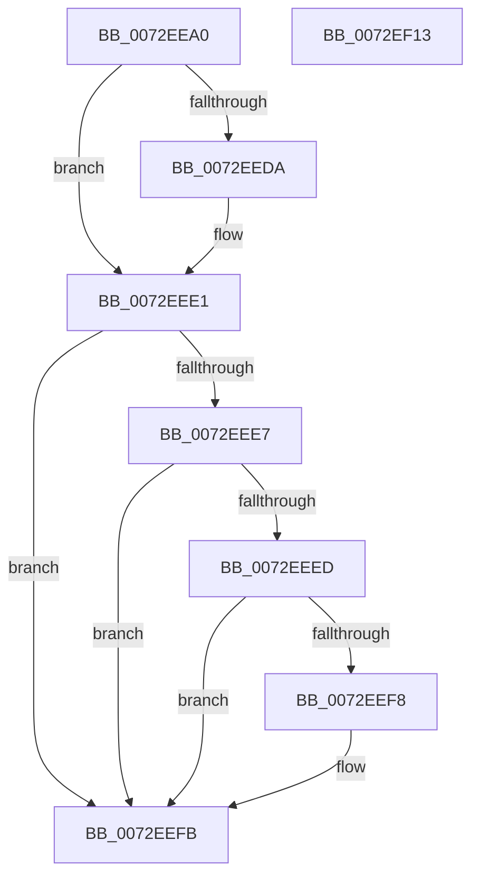

# IopGenericUnpackRequirement

- RVA: `0x0072EEA0`–`0x0072EF14` (길이 `116` bytes)
- VA: `0x000000014072EEA0`
- 실행 섹션: `PAGE`
- PDB 이름 있음: `예`; PDB Function 태그: `아니요`
- unwind 정보 RVA: `0x0006F978`
- 디코드: `33`개 명령, `116/116` bytes 표시
- 미해석 바이트: `0` (있으면 어셈블리에 `.byte`로 보존)

> 이 문서는 커널 이미지의 기계어와 PDB 기호를 분석해 생성했습니다. 4번과 5번은 함수 원형과 자료형을 바이너리 사용 방식에서 추정한 C 해석이며 원본 소스 복구 결과는 아닙니다.

## 1. Dependencies

- 직접 호출 지점: **1**; 고유 호출 대상: **1**
- 직접 호출자로 확인된 함수: **0**
- RIP 상대 이미지 참조: **0**

### Outgoing calls
- `0x0072EECC` → [RtlIoDecodeMemIoResource](../../text/5E/RtlIoDecodeMemIoResource_function_005E7D80.md) (function, `0x005E7D80`)

### Direct callers
- 이 함수 시작 RVA로 연결되는 직접 call은 확인되지 않았습니다. 간접 호출은 완전히 역산할 수 없습니다.

### Static image references
- 디코드된 RIP-relative 메모리 참조가 없습니다.

## 2. Other-region calls and transfers

- 다른 실행 섹션으로 향하는 call: **1**
  - `0x0072EECC` → [RtlIoDecodeMemIoResource](../../text/5E/RtlIoDecodeMemIoResource_function_005E7D80.md) (`PAGE` → `.text`)
- 별도 외부 분기/꼬리 이동을 확인하지 못했습니다.

## 3. Assembly (complete function range)

```asm
0072EEA0  48 89 5C 24 08                  mov qword ptr [rsp + 8], rbx
0072EEA5  48 89 74 24 10                  mov qword ptr [rsp + 0x10], rsi
0072EEAA  48 89 7C 24 18                  mov qword ptr [rsp + 0x18], rdi
0072EEAF  41 56                           push r14
0072EEB1  48 83 EC 20                     sub rsp, 0x20
0072EEB5  48 8B 74 24 50                  mov rsi, qword ptr [rsp + 0x50]
0072EEBA  49 8B D9                        mov rbx, r9
0072EEBD  4D 8B C8                        mov r9, r8
0072EEC0  4D 8B F0                        mov r14, r8
0072EEC3  4C 8B C2                        mov r8, rdx
0072EEC6  48 8B F9                        mov rdi, rcx
0072EEC9  48 8B D6                        mov rdx, rsi
0072EECC  E8 AF 8E EB FF                  call 0x1405e7d80
0072EED1  48 89 03                        mov qword ptr [rbx], rax
0072EED4  48 83 3E 00                     cmp qword ptr [rsi], 0
0072EED8  75 07                           jne 0x14072eee1
0072EEDA  48 C7 06 01 00 00 00            mov qword ptr [rsi], 1
0072EEE1  80 7F 01 03                     cmp byte ptr [rdi + 1], 3
0072EEE5  75 14                           jne 0x14072eefb
0072EEE7  F6 47 04 10                     test byte ptr [rdi + 4], 0x10
0072EEEB  74 0E                           je 0x14072eefb
0072EEED  B8 FF FF FF 00                  mov eax, 0xffffff
0072EEF2  48 39 47 18                     cmp qword ptr [rdi + 0x18], rax
0072EEF6  7E 03                           jle 0x14072eefb
0072EEF8  49 89 06                        mov qword ptr [r14], rax
0072EEFB  48 8B 5C 24 30                  mov rbx, qword ptr [rsp + 0x30]
0072EF00  33 C0                           xor eax, eax
0072EF02  48 8B 74 24 38                  mov rsi, qword ptr [rsp + 0x38]
0072EF07  48 8B 7C 24 40                  mov rdi, qword ptr [rsp + 0x40]
0072EF0C  48 83 C4 20                     add rsp, 0x20
0072EF10  41 5E                           pop r14
0072EF12  C3                              ret
0072EF13  CC                              int3
```

## 4. C-style interpretation (structured pseudocode)

```c
__int64 __fastcall IopGenericUnpackRequirement(__int64 a1, __int64 a2, __int64 a3, __int64 a4, __int64 a5)
{
    __int64 result;
    __int64 v_rsp;
    unsigned __int64 v_stack_p10;
    unsigned __int64 v_stack_p18;
    unsigned __int64 v_stack_p8;

    v_stack_p8 = v_rbx;
    v_stack_p10 = v_rsi;
    v_stack_p18 = v_rdi;
    v_rsp = (v_rsp) - (32);
    result = RtlIoDecodeMemIoResource(a1, a5, a2, a3);
    *(unsigned __int64 *)(a4) = result;
    if ((*(unsigned __int64 *)(a5)) == 0) {
        *(unsigned __int64 *)(a5) = 1;
    }
    if ((*(unsigned __int8 *)(a1 + 1)) != 3) goto loc_0072EEFB;
    if (((*(unsigned __int8 *)(a1 + 4)) & (16)) == 0) goto loc_0072EEFB;
    if ((*(unsigned __int64 *)(a1 + 24)) >= = ((unsigned int)(0xFFFFFFULL))) {
        *(unsigned __int64 *)(a3) = (unsigned int)(0xFFFFFFULL);
    }
    result = 0;
    v_rsp = (v_rsp) + (32);
    return result;
}
```

## 5. (Beta) C Style

```c
int64_t IopGenericUnpackRequirement(void *Arg1, int64_t Arg2, void *Arg3, void *Arg4, void *Arg5)
{
    uint8_t *arg1 = (uint8_t *)Arg1;
    uint8_t *arg3 = (uint8_t *)Arg3;
    uint8_t *arg4 = (uint8_t *)Arg4;
    uint8_t *arg5 = (uint8_t *)Arg5;

    int64_t result;
    int64_t local_rsp;
    uint64_t v_stack_p10;
    uint64_t v_stack_p18;
    uint64_t v_stack_p8;

    v_stack_p8 = local_rbx;
    v_stack_p10 = local_rsi;
    v_stack_p18 = local_rdi;
    local_rsp = (local_rsp) - (32);
    result = RtlIoDecodeMemIoResource(Arg1, Arg5, Arg2, Arg3);
    *(uint64_t *)(arg4) = result;
    if ((*(uint64_t *)(arg5)) == 0) {
        *(uint64_t *)(arg5) = 1;
    }
    if ((*(uint8_t *)(arg1 + 0x1)) != 3) goto loc_0072EEFB;
    if (((*(uint8_t *)(arg1 + 0x4)) & (16)) == 0) goto loc_0072EEFB;
    if ((*(uint64_t *)(arg1 + 0x18)) >= = ((uint32_t)(0xFFFFFFULL))) {
        *(uint64_t *)(arg3) = (uint32_t)(0xFFFFFFULL);
    }
    result = 0;
    local_rsp = (local_rsp) + (32);
    return result;
}
```

### 관측된 메모리 오프셋

구조체 형식이 확인되지 않은 접근은 인자 기준의 오프셋으로만 기록했습니다.

| 기준 인자 | 오프셋 표현 | 폭 (bit) | 접근 |
|---|---:|---:|---|
| `Arg1` | `+ 0x1` | `8` | `R` |
| `Arg1` | `+ 0x4` | `8` | `R` |
| `Arg1` | `+ 0x18` | `64` | `R` |
| `Arg3` | `+ 0x0` | `64` | `W` |
| `Arg4` | `+ 0x0` | `64` | `W` |
| `Arg5` | `+ 0x0` | `64` | `R` |
| `Arg5` | `+ 0x0` | `64` | `W` |

## 6. Execution-region graph

[열기: 2D/3D 그래프와 함수 탐색 컨트롤 패널](../../../control-panel.html?section=page&rva=0x0072EEA0&view=graph)

- 2D 그래프는 위에서 아래로 흐르고, 3D 그래프는 빈 공간을 드래그해 회전합니다. Shift+드래그는 이동, 휠은 확대·축소, 함수 노드 선택은 대상 보고서 이동입니다.

### Static fallback


