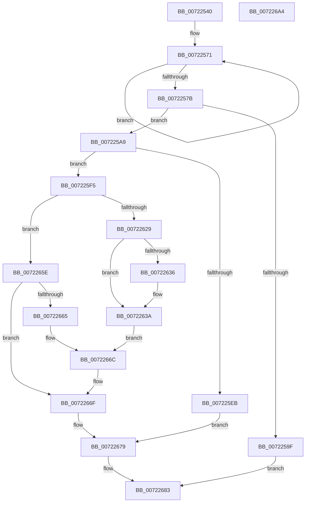

# IopGetEnvironmentVariableSysEnv

- RVA: `0x00722540`–`0x007226A5` (길이 `357` bytes)
- VA: `0x0000000140722540`
- 실행 섹션: `PAGE`
- PDB 이름 있음: `예`; PDB Function 태그: `아니요`
- unwind 정보 RVA: `0x000BD2A0`
- 디코드: `100`개 명령, `357/357` bytes 표시
- 미해석 바이트: `0` (있으면 어셈블리에 `.byte`로 보존)

> 이 문서는 커널 이미지의 기계어와 PDB 기호를 분석해 생성했습니다. 4번과 5번은 함수 원형과 자료형을 바이너리 사용 방식에서 추정한 C 해석이며 원본 소스 복구 결과는 아닙니다.

## 1. Dependencies

- 직접 호출 지점: **7**; 고유 호출 대상: **4**
- 직접 호출자로 확인된 함수: **0**
- RIP 상대 이미지 참조: **0**

### Outgoing calls
- `0x00722592` → [ExAllocatePool2](../../poolcode/B8/ExAllocatePool2_function_00B820F0.md) (function, `0x00B820F0`)
- `0x007225B3` → [memcpy](../../text/6C/memcpy_function_006C6840.md) (function, `0x006C6840`)
- `0x007225DE` → [ExAllocatePool2](../../poolcode/B8/ExAllocatePool2_function_00B820F0.md) (function, `0x00B820F0`)
- `0x0072261E` → [IopIssueSystemEnvironmentRequest](IopIssueSystemEnvironmentRequest_function_00722878.md) (function, `0x00722878`)
- `0x00722654` → [memcpy](../../text/6C/memcpy_function_006C6840.md) (function, `0x006C6840`)
- `0x00722674` → [ExFreePoolWithTag](../../poolcode/B8/ExFreePoolWithTag_function_00B82870.md) (function, `0x00B82870`)
- `0x0072267E` → [ExFreePoolWithTag](../../poolcode/B8/ExFreePoolWithTag_function_00B82870.md) (function, `0x00B82870`)

### Direct callers
- 이 함수 시작 RVA로 연결되는 직접 call은 확인되지 않았습니다. 간접 호출은 완전히 역산할 수 없습니다.

### Static image references
- 디코드된 RIP-relative 메모리 참조가 없습니다.

## 2. Other-region calls and transfers

- 다른 실행 섹션으로 향하는 call: **6**
  - `0x00722592` → [ExAllocatePool2](../../poolcode/B8/ExAllocatePool2_function_00B820F0.md) (`PAGE` → `POOLCODE`)
  - `0x007225B3` → [memcpy](../../text/6C/memcpy_function_006C6840.md) (`PAGE` → `.text`)
  - `0x007225DE` → [ExAllocatePool2](../../poolcode/B8/ExAllocatePool2_function_00B820F0.md) (`PAGE` → `POOLCODE`)
  - `0x00722654` → [memcpy](../../text/6C/memcpy_function_006C6840.md) (`PAGE` → `.text`)
  - `0x00722674` → [ExFreePoolWithTag](../../poolcode/B8/ExFreePoolWithTag_function_00B82870.md) (`PAGE` → `POOLCODE`)
  - `0x0072267E` → [ExFreePoolWithTag](../../poolcode/B8/ExFreePoolWithTag_function_00B82870.md) (`PAGE` → `POOLCODE`)
- 별도 외부 분기/꼬리 이동을 확인하지 못했습니다.

## 3. Assembly (complete function range)

```asm
00722540  48 8B C4                        mov rax, rsp
00722543  48 89 58 08                     mov qword ptr [rax + 8], rbx
00722547  48 89 68 10                     mov qword ptr [rax + 0x10], rbp
0072254B  48 89 70 18                     mov qword ptr [rax + 0x18], rsi
0072254F  48 89 78 20                     mov qword ptr [rax + 0x20], rdi
00722553  41 54                           push r12
00722555  41 56                           push r14
00722557  41 57                           push r15
00722559  48 83 EC 60                     sub rsp, 0x60
0072255D  45 33 E4                        xor r12d, r12d
00722560  4D 8B F1                        mov r14, r9
00722563  44 89 60 D8                     mov dword ptr [rax - 0x28], r12d
00722567  49 8B D8                        mov rbx, r8
0072256A  48 83 C8 FF                     or rax, 0xffffffffffffffff
0072256E  4C 8B FA                        mov r15, rdx
00722571  48 FF C0                        inc rax
00722574  66 45 39 24 40                  cmp word ptr [r8 + rax*2], r12w
00722579  75 F6                           jne 0x140722571
0072257B  8D 3C 45 02 00 00 00            lea edi, [rax*2 + 2]
00722582  B9 00 01 00 00                  mov ecx, 0x100
00722587  8D 6F 14                        lea ebp, [rdi + 0x14]
0072258A  41 B8 49 6F 53 79               mov r8d, 0x79536f49
00722590  8B D5                           mov edx, ebp
00722592  E8 59 FB 45 00                  call 0x140b820f0
00722597  48 8B F0                        mov rsi, rax
0072259A  48 85 C0                        test rax, rax
0072259D  75 0A                           jne 0x1407225a9
0072259F  BB 9A 00 00 C0                  mov ebx, 0xc000009a
007225A4  E9 DA 00 00 00                  jmp 0x140722683
007225A9  44 8B C7                        mov r8d, edi
007225AC  48 8D 48 14                     lea rcx, [rax + 0x14]
007225B0  48 8B D3                        mov rdx, rbx
007225B3  E8 88 42 FA FF                  call 0x1406c6840
007225B8  41 0F 10 06                     movups xmm0, xmmword ptr [r14]
007225BC  4C 8B B4 24 A8 00 00 00         mov r14, qword ptr [rsp + 0xa8]
007225C4  B9 00 01 00 00                  mov ecx, 0x100
007225C9  89 7E 10                        mov dword ptr [rsi + 0x10], edi
007225CC  41 B8 49 6F 53 79               mov r8d, 0x79536f49
007225D2  F3 0F 7F 06                     movdqu xmmword ptr [rsi], xmm0
007225D6  41 8B 1E                        mov ebx, dword ptr [r14]
007225D9  83 C3 08                        add ebx, 8
007225DC  8B D3                           mov edx, ebx
007225DE  E8 0D FB 45 00                  call 0x140b820f0
007225E3  48 8B F8                        mov rdi, rax
007225E6  48 85 C0                        test rax, rax
007225E9  75 0A                           jne 0x1407225f5
007225EB  BB 9A 00 00 C0                  mov ebx, 0xc000009a
007225F0  E9 84 00 00 00                  jmp 0x140722679
007225F5  48 8D 44 24 50                  lea rax, [rsp + 0x50]
007225FA  4D 8B CF                        mov r9, r15
007225FD  48 89 44 24 40                  mov qword ptr [rsp + 0x40], rax
00722602  45 33 C0                        xor r8d, r8d
00722605  89 5C 24 38                     mov dword ptr [rsp + 0x38], ebx
00722609  B2 01                           mov dl, 1
0072260B  48 89 7C 24 30                  mov qword ptr [rsp + 0x30], rdi
00722610  B9 04 00 52 00                  mov ecx, 0x520004
00722615  89 6C 24 28                     mov dword ptr [rsp + 0x28], ebp
00722619  48 89 74 24 20                  mov qword ptr [rsp + 0x20], rsi
0072261E  E8 55 02 00 00                  call 0x140722878
00722623  8B D8                           mov ebx, eax
00722625  85 C0                           test eax, eax
00722627  78 35                           js 0x14072265e
00722629  48 8B 84 24 B0 00 00 00         mov rax, qword ptr [rsp + 0xb0]
00722631  48 85 C0                        test rax, rax
00722634  74 04                           je 0x14072263a
00722636  8B 0F                           mov ecx, dword ptr [rdi]
00722638  89 08                           mov dword ptr [rax], ecx
0072263A  41 8B 16                        mov edx, dword ptr [r14]
0072263D  8B 4F 04                        mov ecx, dword ptr [rdi + 4]
00722640  3B D1                           cmp edx, ecx
00722642  0F 43 D1                        cmovae edx, ecx
00722645  48 8B 8C 24 A0 00 00 00         mov rcx, qword ptr [rsp + 0xa0]
0072264D  44 8B C2                        mov r8d, edx
00722650  48 8D 57 08                     lea rdx, [rdi + 8]
00722654  E8 E7 41 FA FF                  call 0x1406c6840
00722659  8B 47 04                        mov eax, dword ptr [rdi + 4]
0072265C  EB 0E                           jmp 0x14072266c
0072265E  3D 23 00 00 C0                  cmp eax, 0xc0000023
00722663  75 0A                           jne 0x14072266f
00722665  8B 44 24 50                     mov eax, dword ptr [rsp + 0x50]
00722669  83 C0 F8                        add eax, -8
0072266C  41 89 06                        mov dword ptr [r14], eax
0072266F  33 D2                           xor edx, edx
00722671  48 8B CF                        mov rcx, rdi
00722674  E8 F7 01 46 00                  call 0x140b82870
00722679  33 D2                           xor edx, edx
0072267B  48 8B CE                        mov rcx, rsi
0072267E  E8 ED 01 46 00                  call 0x140b82870
00722683  4C 8D 5C 24 60                  lea r11, [rsp + 0x60]
00722688  8B C3                           mov eax, ebx
0072268A  49 8B 5B 20                     mov rbx, qword ptr [r11 + 0x20]
0072268E  49 8B 6B 28                     mov rbp, qword ptr [r11 + 0x28]
00722692  49 8B 73 30                     mov rsi, qword ptr [r11 + 0x30]
00722696  49 8B 7B 38                     mov rdi, qword ptr [r11 + 0x38]
0072269A  49 8B E3                        mov rsp, r11
0072269D  41 5F                           pop r15
0072269F  41 5E                           pop r14
007226A1  41 5C                           pop r12
007226A3  C3                              ret
007226A4  CC                              int3
```

## 4. C-style interpretation (structured pseudocode)

```c
__int64 __fastcall IopGetEnvironmentVariableSysEnv(__int64 a1, __int64 a2, __int64 a3, __int64 a4, __int64 a5, __int64 a6, __int64 a7)
{
    __int64 result;
    __int64 v_r12;
    __int64 v_rbx;
    __int64 v_rsp;
    unsigned __int64 v_stack_m18;
    unsigned __int64 v_stack_m28;
    unsigned __int64 v_stack_m38;
    unsigned int v_stack_m40;
    unsigned __int64 v_stack_m48;
    unsigned int v_stack_m50;
    unsigned __int64 v_stack_m58;

    *(unsigned __int64 *)(v_rsp + 8) = v_rbx;
    *(unsigned __int64 *)(v_rsp + 16) = v_rbp;
    *(unsigned __int64 *)(v_rsp + 24) = v_rsi;
    *(unsigned __int64 *)(v_rsp + 32) = v_rdi;
    v_rsp = (v_rsp) - (96);
    v_r12 = 0;
    *(unsigned int *)(v_rsp - 40) = 0;
    result = (v_rsp) | (-1);
loc_00722571:
    result = (result) + 1;
    if ((*(unsigned __int16 *)(a3 + result * 2)) != 0) goto loc_00722571;
    result = ExAllocatePool2(256, (unsigned int)((unsigned int)(result * 2 + 2 + 20)), (unsigned int)(0x79536F49ULL), a4);
    if (result != 0) goto loc_007225A9;
    goto loc_00722683;
loc_007225A9:
    result = memcpy(result + 20, (unsigned int)(0xC000009AULL), (unsigned int)((unsigned int)(result * 2 + 2)), a4);
    *(unsigned int *)(result + 16) = (unsigned int)(result * 2 + 2);
    *(unsigned __int64 *)(result) = v_xmm0;
    v_rbx = (unsigned int)(((unsigned int)(*(unsigned int *)(a6))) + (8));
    result = ExAllocatePool2(256, (unsigned int)((unsigned int)(v_rbx)), (unsigned int)(0x79536F49ULL), a4);
    if (result != 0) goto loc_007225F5;
    goto loc_00722679;
loc_007225F5:
    v_stack_m38 = v_stack_m28;
    a3 = 0;
    v_stack_m40 = (unsigned int)((unsigned int)(0xC000009AULL));
    v_stack_m48 = result;
    v_stack_m50 = (unsigned int)(result * 2 + 2 + 20);
    v_stack_m58 = result;
    result = IopIssueSystemEnvironmentRequest((unsigned int)(0x520004ULL), 1, a3, a2);
    if (sign_flag) goto loc_0072265E;
    if (a7 != 0) {
        a1 = *(unsigned int *)(result);
        *(unsigned int *)(a7) = (unsigned int)(a1);
    }
    a2 = (unsigned int)(*(unsigned int *)(a6));
    if (((unsigned int)((unsigned int)(*(unsigned int *)(a6)))) >= ((unsigned int)((unsigned int)(*(unsigned int *)(result + 4))))) { a2 = (unsigned int)((unsigned int)(*(unsigned int *)(result + 4))); }
    result = memcpy(a5, result + 8, (unsigned int)((unsigned int)(a2)), a2);
    goto loc_0072266C;
loc_0072265E:
    if (((unsigned int)((unsigned int)(*(unsigned int *)(result + 4)))) != 0xC0000023ULL) goto loc_0072266F;
    result = (unsigned int)(((unsigned int)(v_stack_m28)) + (-8));
loc_0072266C:
    *(unsigned int *)(a6) = (unsigned int)(result);
loc_0072266F:
    a2 = 0;
    result = ExFreePoolWithTag(result, a2, (unsigned int)((unsigned int)(a2)), a2);
loc_00722679:
    a2 = 0;
    result = ExFreePoolWithTag(result, a2, (unsigned int)((unsigned int)(a2)), a2);
loc_00722683:
    return (unsigned int)((unsigned int)((unsigned int)((unsigned int)(result))));
}
```

## 5. (Beta) C Style

```c
int64_t IopGetEnvironmentVariableSysEnv(int64_t Arg1, int64_t Arg2, void *Arg3, void *Arg4, int64_t Arg5, void *Arg6, int64_t Arg7)
{
    uint8_t *arg3 = (uint8_t *)Arg3;
    uint8_t *arg4 = (uint8_t *)Arg4;
    uint8_t *arg6 = (uint8_t *)Arg6;

    int64_t result;
    int64_t local_r12;
    int64_t local_rbx;
    int64_t local_rsp;
    uint64_t v_stack_m18;
    uint64_t v_stack_m28;
    uint64_t v_stack_m38;
    uint32_t v_stack_m40;
    uint64_t v_stack_m48;
    uint32_t v_stack_m50;
    uint64_t v_stack_m58;

    *(uint64_t *)(local_rsp + 0x8) = local_rbx;
    *(uint64_t *)(local_rsp + 0x10) = local_rbp;
    *(uint64_t *)(local_rsp + 0x18) = local_rsi;
    *(uint64_t *)(local_rsp + 0x20) = local_rdi;
    local_rsp = (local_rsp) - (96);
    local_r12 = 0;
    *(uint32_t *)(local_rsp - 0x28) = 0;
    result = (local_rsp) | (-1);
loc_00722571:
    result = (result) + 1;
    if ((*(uint16_t *)(arg3 + result * 2)) != 0) goto loc_00722571;
    result = ExAllocatePool2(256, (uint32_t)((uint32_t)(result * 2 + 2 + 20)), (uint32_t)(0x79536F49ULL), Arg4);
    if (result != 0) goto loc_007225A9;
    goto loc_00722683;
loc_007225A9:
    result = memcpy(result + 20, (uint32_t)(0xC000009AULL), (uint32_t)((uint32_t)(result * 2 + 2)), Arg4);
    *(uint32_t *)(result + 0x10) = (uint32_t)(result * 2 + 2);
    *(uint64_t *)(result) = v_xmm0;
    local_rbx = (uint32_t)(((uint32_t)(*(uint32_t *)(arg6))) + (8));
    result = ExAllocatePool2(256, (uint32_t)((uint32_t)(local_rbx)), (uint32_t)(0x79536F49ULL), Arg4);
    if (result != 0) goto loc_007225F5;
    goto loc_00722679;
loc_007225F5:
    v_stack_m38 = v_stack_m28;
    Arg3 = 0;
    v_stack_m40 = (uint32_t)((uint32_t)(0xC000009AULL));
    v_stack_m48 = result;
    v_stack_m50 = (uint32_t)(result * 2 + 2 + 20);
    v_stack_m58 = result;
    result = IopIssueSystemEnvironmentRequest((uint32_t)(0x520004ULL), 1, Arg3, Arg2);
    if (sign_flag) goto loc_0072265E;
    if (Arg7 != 0) {
        Arg1 = *(uint32_t *)(result);
        *(uint32_t *)(Arg7) = (uint32_t)(Arg1);
    }
    Arg2 = (uint32_t)(*(uint32_t *)(arg6));
    if (((uint32_t)((uint32_t)(*(uint32_t *)(arg6)))) >= ((uint32_t)((uint32_t)(*(uint32_t *)(result + 0x4))))) { Arg2 = (uint32_t)((uint32_t)(*(uint32_t *)(result + 0x4))); }
    result = memcpy(Arg5, result + 8, (uint32_t)((uint32_t)(Arg2)), Arg2);
    goto loc_0072266C;
loc_0072265E:
    if (((uint32_t)((uint32_t)(*(uint32_t *)(result + 0x4)))) != 0xC0000023ULL) goto loc_0072266F;
    result = (uint32_t)(((uint32_t)(v_stack_m28)) + (-8));
loc_0072266C:
    *(uint32_t *)(arg6) = (uint32_t)(result);
loc_0072266F:
    Arg2 = 0;
    result = ExFreePoolWithTag(result, Arg2, (uint32_t)((uint32_t)(Arg2)), Arg2);
loc_00722679:
    Arg2 = 0;
    result = ExFreePoolWithTag(result, Arg2, (uint32_t)((uint32_t)(Arg2)), Arg2);
loc_00722683:
    return (uint32_t)((uint32_t)((uint32_t)((uint32_t)(result))));
}
```

### 관측된 메모리 오프셋

구조체 형식이 확인되지 않은 접근은 인자 기준의 오프셋으로만 기록했습니다.

| 기준 인자 | 오프셋 표현 | 폭 (bit) | 접근 |
|---|---:|---:|---|
| `Arg3` | `+ 0x0 + rax*2` | `16` | `R` |
| `Arg4` | `+ 0x0` | `128` | `R` |
| `Arg6` | `+ 0x0` | `32` | `R` |
| `Arg6` | `+ 0x0` | `32` | `W` |

## 6. Execution-region graph

[열기: 2D/3D 그래프와 함수 탐색 컨트롤 패널](../../../control-panel.html?section=page&rva=0x00722540&view=graph)

- 2D 그래프는 위에서 아래로 흐르고, 3D 그래프는 빈 공간을 드래그해 회전합니다. Shift+드래그는 이동, 휠은 확대·축소, 함수 노드 선택은 대상 보고서 이동입니다.

### Static fallback


