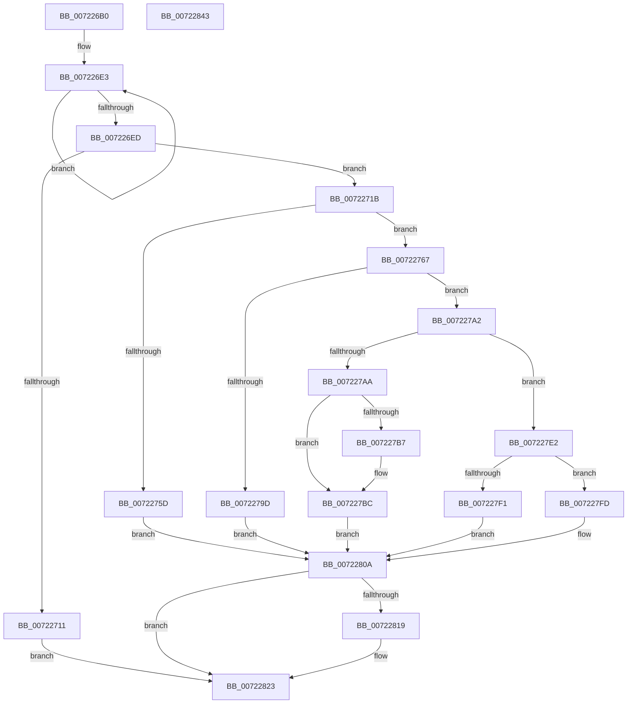

# IopGetEnvironmentVariableTrEE

- RVA: `0x007226B0`–`0x00722844` (길이 `404` bytes)
- VA: `0x00000001407226B0`
- 실행 섹션: `PAGE`
- PDB 이름 있음: `예`; PDB Function 태그: `아니요`
- unwind 정보 RVA: `0x0008C11C`
- 디코드: `115`개 명령, `404/404` bytes 표시
- 미해석 바이트: `0` (있으면 어셈블리에 `.byte`로 보존)

> 이 문서는 커널 이미지의 기계어와 PDB 기호를 분석해 생성했습니다. 4번과 5번은 함수 원형과 자료형을 바이너리 사용 방식에서 추정한 C 해석이며 원본 소스 복구 결과는 아닙니다.

## 1. Dependencies

- 직접 호출 지점: **8**; 고유 호출 대상: **5**
- 직접 호출자로 확인된 함수: **0**
- RIP 상대 이미지 참조: **0**

### Outgoing calls
- `0x00722704` → [ExAllocatePool2](../../poolcode/B8/ExAllocatePool2_function_00B820F0.md) (function, `0x00B820F0`)
- `0x00722725` → [memcpy](../../text/6C/memcpy_function_006C6840.md) (function, `0x006C6840`)
- `0x00722750` → [ExAllocatePool2](../../poolcode/B8/ExAllocatePool2_function_00B820F0.md) (function, `0x00B820F0`)
- `0x00722792` → [IopIssueTrEERequest](../../text/5A/IopIssueTrEERequest_function_005A041C.md) (function, `0x005A041C`)
- `0x007227D6` → [memcpy](../../text/6C/memcpy_function_006C6840.md) (function, `0x006C6840`)
- `0x00722803` → [IopEfiStatusToNTSTATUS](IopEfiStatusToNTSTATUS_function_00721E30.md) (function, `0x00721E30`)
- `0x0072280F` → [ExFreePoolWithTag](../../poolcode/B8/ExFreePoolWithTag_function_00B82870.md) (function, `0x00B82870`)
- `0x0072281E` → [ExFreePoolWithTag](../../poolcode/B8/ExFreePoolWithTag_function_00B82870.md) (function, `0x00B82870`)

### Direct callers
- 이 함수 시작 RVA로 연결되는 직접 call은 확인되지 않았습니다. 간접 호출은 완전히 역산할 수 없습니다.

### Static image references
- 디코드된 RIP-relative 메모리 참조가 없습니다.

## 2. Other-region calls and transfers

- 다른 실행 섹션으로 향하는 call: **7**
  - `0x00722704` → [ExAllocatePool2](../../poolcode/B8/ExAllocatePool2_function_00B820F0.md) (`PAGE` → `POOLCODE`)
  - `0x00722725` → [memcpy](../../text/6C/memcpy_function_006C6840.md) (`PAGE` → `.text`)
  - `0x00722750` → [ExAllocatePool2](../../poolcode/B8/ExAllocatePool2_function_00B820F0.md) (`PAGE` → `POOLCODE`)
  - `0x00722792` → [IopIssueTrEERequest](../../text/5A/IopIssueTrEERequest_function_005A041C.md) (`PAGE` → `.text`)
  - `0x007227D6` → [memcpy](../../text/6C/memcpy_function_006C6840.md) (`PAGE` → `.text`)
  - `0x0072280F` → [ExFreePoolWithTag](../../poolcode/B8/ExFreePoolWithTag_function_00B82870.md) (`PAGE` → `POOLCODE`)
  - `0x0072281E` → [ExFreePoolWithTag](../../poolcode/B8/ExFreePoolWithTag_function_00B82870.md) (`PAGE` → `POOLCODE`)
- 별도 외부 분기/꼬리 이동을 확인하지 못했습니다.

## 3. Assembly (complete function range)

```asm
007226B0  48 8B C4                        mov rax, rsp
007226B3  48 89 58 08                     mov qword ptr [rax + 8], rbx
007226B7  48 89 68 10                     mov qword ptr [rax + 0x10], rbp
007226BB  48 89 70 18                     mov qword ptr [rax + 0x18], rsi
007226BF  57                              push rdi
007226C0  41 54                           push r12
007226C2  41 55                           push r13
007226C4  41 56                           push r14
007226C6  41 57                           push r15
007226C8  48 83 EC 60                     sub rsp, 0x60
007226CC  45 33 ED                        xor r13d, r13d
007226CF  4D 8B F1                        mov r14, r9
007226D2  44 89 68 C8                     mov dword ptr [rax - 0x38], r13d
007226D6  49 8B D8                        mov rbx, r8
007226D9  48 83 C8 FF                     or rax, 0xffffffffffffffff
007226DD  4C 8B FA                        mov r15, rdx
007226E0  4C 8B E1                        mov r12, rcx
007226E3  48 FF C0                        inc rax
007226E6  66 45 39 2C 40                  cmp word ptr [r8 + rax*2], r13w
007226EB  75 F6                           jne 0x1407226e3
007226ED  8D 34 45 02 00 00 00            lea esi, [rax*2 + 2]
007226F4  B9 00 01 00 00                  mov ecx, 0x100
007226F9  8D 7E 10                        lea edi, [rsi + 0x10]
007226FC  41 B8 49 6F 53 79               mov r8d, 0x79536f49
00722702  8B D7                           mov edx, edi
00722704  E8 E7 F9 45 00                  call 0x140b820f0
00722709  48 8B E8                        mov rbp, rax
0072270C  48 85 C0                        test rax, rax
0072270F  75 0A                           jne 0x14072271b
00722711  BF 9A 00 00 C0                  mov edi, 0xc000009a
00722716  E9 08 01 00 00                  jmp 0x140722823
0072271B  44 8B C6                        mov r8d, esi
0072271E  48 8D 48 10                     lea rcx, [rax + 0x10]
00722722  48 8B D3                        mov rdx, rbx
00722725  E8 16 41 FA FF                  call 0x1406c6840
0072272A  41 0F 10 06                     movups xmm0, xmmword ptr [r14]
0072272E  48 8B B4 24 B8 00 00 00         mov rsi, qword ptr [rsp + 0xb8]
00722736  B9 00 01 00 00                  mov ecx, 0x100
0072273B  41 B8 49 6F 53 79               mov r8d, 0x79536f49
00722741  F3 0F 7F 45 00                  movdqu xmmword ptr [rbp], xmm0
00722746  44 8B 36                        mov r14d, dword ptr [rsi]
00722749  41 83 C6 18                     add r14d, 0x18
0072274D  41 8B D6                        mov edx, r14d
00722750  E8 9B F9 45 00                  call 0x140b820f0
00722755  48 8B D8                        mov rbx, rax
00722758  48 85 C0                        test rax, rax
0072275B  75 0A                           jne 0x140722767
0072275D  BF 9A 00 00 C0                  mov edi, 0xc000009a
00722762  E9 A3 00 00 00                  jmp 0x14072280a
00722767  48 8D 44 24 50                  lea rax, [rsp + 0x50]
0072276C  4C 8B CD                        mov r9, rbp
0072276F  48 89 44 24 40                  mov qword ptr [rsp + 0x40], rax
00722774  4D 8B C7                        mov r8, r15
00722777  C7 44 24 38 18 00 00 00         mov dword ptr [rsp + 0x38], 0x18
0072277F  49 8B D4                        mov rdx, r12
00722782  44 89 74 24 30                  mov dword ptr [rsp + 0x30], r14d
00722787  33 C9                           xor ecx, ecx
00722789  48 89 5C 24 28                  mov qword ptr [rsp + 0x28], rbx
0072278E  89 7C 24 20                     mov dword ptr [rsp + 0x20], edi
00722792  E8 85 DC E7 FF                  call 0x1405a041c
00722797  8B F8                           mov edi, eax
00722799  85 C0                           test eax, eax
0072279B  79 05                           jns 0x1407227a2
0072279D  44 89 2E                        mov dword ptr [rsi], r13d
007227A0  EB 68                           jmp 0x14072280a
007227A2  48 8B 03                        mov rax, qword ptr [rbx]
007227A5  48 85 C0                        test rax, rax
007227A8  75 38                           jne 0x1407227e2
007227AA  48 8B 8C 24 C0 00 00 00         mov rcx, qword ptr [rsp + 0xc0]
007227B2  48 85 C9                        test rcx, rcx
007227B5  74 05                           je 0x1407227bc
007227B7  8B 43 08                        mov eax, dword ptr [rbx + 8]
007227BA  89 01                           mov dword ptr [rcx], eax
007227BC  44 8B 06                        mov r8d, dword ptr [rsi]
007227BF  48 8D 53 18                     lea rdx, [rbx + 0x18]
007227C3  48 8B 43 10                     mov rax, qword ptr [rbx + 0x10]
007227C7  48 8B 8C 24 B0 00 00 00         mov rcx, qword ptr [rsp + 0xb0]
007227CF  4C 3B C0                        cmp r8, rax
007227D2  4C 0F 43 C0                     cmovae r8, rax
007227D6  E8 65 40 FA FF                  call 0x1406c6840
007227DB  8B 43 10                        mov eax, dword ptr [rbx + 0x10]
007227DE  89 06                           mov dword ptr [rsi], eax
007227E0  EB 28                           jmp 0x14072280a
007227E2  48 B9 05 00 00 00 00 00 00 80   movabs rcx, 0x8000000000000005
007227EC  48 3B C1                        cmp rax, rcx
007227EF  75 0C                           jne 0x1407227fd
007227F1  8B 43 10                        mov eax, dword ptr [rbx + 0x10]
007227F4  BF 23 00 00 C0                  mov edi, 0xc0000023
007227F9  89 06                           mov dword ptr [rsi], eax
007227FB  EB 0D                           jmp 0x14072280a
007227FD  44 89 2E                        mov dword ptr [rsi], r13d
00722800  48 8B 0B                        mov rcx, qword ptr [rbx]
00722803  E8 28 F6 FF FF                  call 0x140721e30
00722808  8B F8                           mov edi, eax
0072280A  33 D2                           xor edx, edx
0072280C  48 8B CD                        mov rcx, rbp
0072280F  E8 5C 00 46 00                  call 0x140b82870
00722814  48 85 DB                        test rbx, rbx
00722817  74 0A                           je 0x140722823
00722819  33 D2                           xor edx, edx
0072281B  48 8B CB                        mov rcx, rbx
0072281E  E8 4D 00 46 00                  call 0x140b82870
00722823  4C 8D 5C 24 60                  lea r11, [rsp + 0x60]
00722828  8B C7                           mov eax, edi
0072282A  49 8B 5B 30                     mov rbx, qword ptr [r11 + 0x30]
0072282E  49 8B 6B 38                     mov rbp, qword ptr [r11 + 0x38]
00722832  49 8B 73 40                     mov rsi, qword ptr [r11 + 0x40]
00722836  49 8B E3                        mov rsp, r11
00722839  41 5F                           pop r15
0072283B  41 5E                           pop r14
0072283D  41 5D                           pop r13
0072283F  41 5C                           pop r12
00722841  5F                              pop rdi
00722842  C3                              ret
00722843  CC                              int3
```

## 4. C-style interpretation (structured pseudocode)

```c
__int64 __fastcall IopGetEnvironmentVariableTrEE(__int64 a1, __int64 a2, __int64 a3, __int64 a4, __int64 a5, __int64 a6, __int64 a7)
{
    __int64 result;
    __int64 v_r13;
    __int64 v_r14;
    __int64 v_rsp;
    unsigned __int64 v_stack_m28;
    unsigned __int64 v_stack_m38;
    unsigned __int64 v_stack_m48;
    unsigned int v_stack_m50;
    unsigned int v_stack_m58;
    unsigned __int64 v_stack_m60;
    unsigned int v_stack_m68;

    *(unsigned __int64 *)(v_rsp + 8) = v_rbx;
    *(unsigned __int64 *)(v_rsp + 16) = v_rbp;
    *(unsigned __int64 *)(v_rsp + 24) = v_rsi;
    v_rsp = (v_rsp) - (96);
    v_r13 = 0;
    *(unsigned int *)(v_rsp - 56) = 0;
    result = (v_rsp) | (-1);
loc_007226E3:
    result = (result) + 1;
    if ((*(unsigned __int16 *)(a3 + result * 2)) != 0) goto loc_007226E3;
    result = ExAllocatePool2(256, (unsigned int)((unsigned int)(result * 2 + 2 + 16)), (unsigned int)(0x79536F49ULL), a4);
    if (result != 0) goto loc_0072271B;
    goto loc_00722823;
loc_0072271B:
    result = memcpy(result + 16, a3, (unsigned int)((unsigned int)(result * 2 + 2)), a4);
    *(unsigned __int64 *)(result) = v_xmm0;
    v_r14 = (unsigned int)(((unsigned int)(*(unsigned int *)(a6))) + (24));
    result = ExAllocatePool2(256, (unsigned int)((unsigned int)(v_r14)), (unsigned int)(0x79536F49ULL), a4);
    if (result != 0) goto loc_00722767;
    goto loc_0072280A;
loc_00722767:
    v_stack_m48 = v_stack_m38;
    v_stack_m50 = 24;
    v_stack_m58 = (unsigned int)(v_r14);
    a1 = 0;
    v_stack_m60 = result;
    v_stack_m68 = (unsigned int)((unsigned int)(0xC000009AULL));
    result = IopIssueTrEERequest(a1, a1, a2, result);
    if (!sign_flag) goto loc_007227A2;
    *(unsigned int *)(a6) = 0;
    goto loc_0072280A;
loc_007227A2:
    if (*(unsigned __int64 *)(result) != 0) goto loc_007227E2;
    result = *(unsigned __int64 *)(result);
    if (a7 != 0) {
        result = *(unsigned int *)(result + 8);
        *(unsigned int *)(a7) = (unsigned int)(result);
    }
    a3 = (unsigned int)(*(unsigned int *)(a6));
    if (((unsigned int)(*(unsigned int *)(a6))) >= (*(unsigned __int64 *)(result + 16))) { a3 = *(unsigned __int64 *)(result + 16); }
    result = memcpy(a5, result + 24, a3, result);
    *(unsigned int *)(a6) = (unsigned int)((unsigned int)(*(unsigned int *)(result + 16)));
    goto loc_0072280A;
loc_007227E2:
    if (((unsigned int)(*(unsigned int *)(result + 16))) != a5) goto loc_007227FD;
    *(unsigned int *)(a6) = (unsigned int)((unsigned int)(*(unsigned int *)(result + 16)));
    goto loc_0072280A;
loc_007227FD:
    *(unsigned int *)(a6) = 0;
    result = IopEfiStatusToNTSTATUS(*(unsigned __int64 *)(result), result + 24, a3, result);
loc_0072280A:
    a2 = 0;
    result = ExFreePoolWithTag(result, a2, a3, result);
    if (result != 0) {
        a2 = 0;
        a1 = result;
        result = ExFreePoolWithTag(a1, a2, a3, result);
    }
    return (unsigned int)((unsigned int)((unsigned int)((unsigned int)(result))));
}
```

## 5. (Beta) C Style

```c
int64_t IopGetEnvironmentVariableTrEE(int64_t Arg1, int64_t Arg2, void *Arg3, void *Arg4, int64_t Arg5, void *Arg6, int64_t Arg7)
{
    uint8_t *arg3 = (uint8_t *)Arg3;
    uint8_t *arg4 = (uint8_t *)Arg4;
    uint8_t *arg6 = (uint8_t *)Arg6;

    int64_t result;
    int64_t local_r13;
    int64_t local_r14;
    int64_t local_rsp;
    uint64_t v_stack_m28;
    uint64_t v_stack_m38;
    uint64_t v_stack_m48;
    uint32_t v_stack_m50;
    uint32_t v_stack_m58;
    uint64_t v_stack_m60;
    uint32_t v_stack_m68;

    *(uint64_t *)(local_rsp + 0x8) = local_rbx;
    *(uint64_t *)(local_rsp + 0x10) = local_rbp;
    *(uint64_t *)(local_rsp + 0x18) = local_rsi;
    local_rsp = (local_rsp) - (96);
    local_r13 = 0;
    *(uint32_t *)(local_rsp - 0x38) = 0;
    result = (local_rsp) | (-1);
loc_007226E3:
    result = (result) + 1;
    if ((*(uint16_t *)(arg3 + result * 2)) != 0) goto loc_007226E3;
    result = ExAllocatePool2(256, (uint32_t)((uint32_t)(result * 2 + 2 + 16)), (uint32_t)(0x79536F49ULL), Arg4);
    if (result != 0) goto loc_0072271B;
    goto loc_00722823;
loc_0072271B:
    result = memcpy(result + 16, Arg3, (uint32_t)((uint32_t)(result * 2 + 2)), Arg4);
    *(uint64_t *)(result) = v_xmm0;
    local_r14 = (uint32_t)(((uint32_t)(*(uint32_t *)(arg6))) + (24));
    result = ExAllocatePool2(256, (uint32_t)((uint32_t)(local_r14)), (uint32_t)(0x79536F49ULL), Arg4);
    if (result != 0) goto loc_00722767;
    goto loc_0072280A;
loc_00722767:
    v_stack_m48 = v_stack_m38;
    v_stack_m50 = 24;
    v_stack_m58 = (uint32_t)(local_r14);
    Arg1 = 0;
    v_stack_m60 = result;
    v_stack_m68 = (uint32_t)((uint32_t)(0xC000009AULL));
    result = IopIssueTrEERequest(Arg1, Arg1, Arg2, result);
    if (!sign_flag) goto loc_007227A2;
    *(uint32_t *)(arg6) = 0;
    goto loc_0072280A;
loc_007227A2:
    if (*(uint64_t *)(result) != 0) goto loc_007227E2;
    result = *(uint64_t *)(result);
    if (Arg7 != 0) {
        result = *(uint32_t *)(result + 0x8);
        *(uint32_t *)(Arg7) = (uint32_t)(result);
    }
    Arg3 = (uint32_t)(*(uint32_t *)(arg6));
    if (((uint32_t)(*(uint32_t *)(arg6))) >= (*(uint64_t *)(result + 0x10))) { Arg3 = *(uint64_t *)(result + 0x10); }
    result = memcpy(Arg5, result + 24, Arg3, result);
    *(uint32_t *)(arg6) = (uint32_t)((uint32_t)(*(uint32_t *)(result + 0x10)));
    goto loc_0072280A;
loc_007227E2:
    if (((uint32_t)(*(uint32_t *)(result + 0x10))) != Arg5) goto loc_007227FD;
    *(uint32_t *)(arg6) = (uint32_t)((uint32_t)(*(uint32_t *)(result + 0x10)));
    goto loc_0072280A;
loc_007227FD:
    *(uint32_t *)(arg6) = 0;
    result = IopEfiStatusToNTSTATUS(*(uint64_t *)(result), result + 24, Arg3, result);
loc_0072280A:
    Arg2 = 0;
    result = ExFreePoolWithTag(result, Arg2, Arg3, result);
    if (result != 0) {
        Arg2 = 0;
        Arg1 = result;
        result = ExFreePoolWithTag(Arg1, Arg2, Arg3, result);
    }
    return (uint32_t)((uint32_t)((uint32_t)((uint32_t)(result))));
}
```

### 관측된 메모리 오프셋

구조체 형식이 확인되지 않은 접근은 인자 기준의 오프셋으로만 기록했습니다.

| 기준 인자 | 오프셋 표현 | 폭 (bit) | 접근 |
|---|---:|---:|---|
| `Arg3` | `+ 0x0 + rax*2` | `16` | `R` |
| `Arg4` | `+ 0x0` | `128` | `R` |
| `Arg6` | `+ 0x0` | `32` | `R` |
| `Arg6` | `+ 0x0` | `32` | `W` |

## 6. Execution-region graph

[열기: 2D/3D 그래프와 함수 탐색 컨트롤 패널](../../../control-panel.html?section=page&rva=0x007226B0&view=graph)

- 2D 그래프는 위에서 아래로 흐르고, 3D 그래프는 빈 공간을 드래그해 회전합니다. Shift+드래그는 이동, 휠은 확대·축소, 함수 노드 선택은 대상 보고서 이동입니다.

### Static fallback


