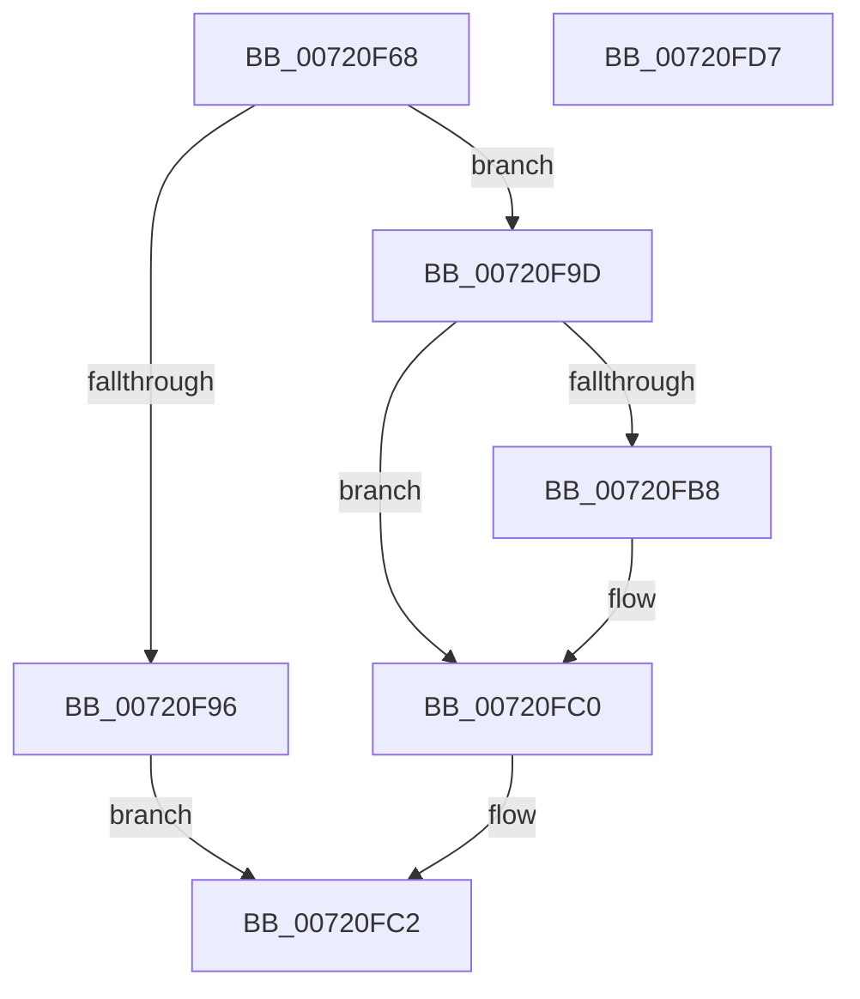

# IopGetNumaNodeInformation

- RVA: `0x00720F68`–`0x00720FD8` (길이 `112` bytes)
- VA: `0x0000000140720F68`
- 실행 섹션: `PAGE`
- PDB 이름 있음: `예`; PDB Function 태그: `아니요`
- unwind 정보 RVA: `0x0006C8E8`
- 디코드: `34`개 명령, `112/112` bytes 표시
- 미해석 바이트: `0` (있으면 어셈블리에 `.byte`로 보존)

> 이 문서는 커널 이미지의 기계어와 PDB 기호를 분석해 생성했습니다. 4번과 5번은 함수 원형과 자료형을 바이너리 사용 방식에서 추정한 C 해석이며 원본 소스 복구 결과는 아닙니다.

## 1. Dependencies

- 직접 호출 지점: **3**; 고유 호출 대상: **3**
- 직접 호출자로 확인된 함수: **1**
- RIP 상대 이미지 참조: **0**

### Outgoing calls
- `0x00720F89` → [IopGetDevicePDO](../../text/27/IopGetDevicePDO_function_002724D8.md) (function, `0x002724D8`)
- `0x00720FA5` → [IoGetDeviceNumaNode](../AA/IoGetDeviceNumaNode_function_00AAA050.md) (function, `0x00AAA050`)
- `0x00720FAF` → [ObfDereferenceObject](../../text/2F/ObfDereferenceObject_function_002F9350.md) (function, `0x002F9350`)

### Direct callers
- [NtQueryInformationFile](../8A/NtQueryInformationFile_function_008AD630.md) at `0x008AE3F9`

### Static image references
- 디코드된 RIP-relative 메모리 참조가 없습니다.

## 2. Other-region calls and transfers

- 다른 실행 섹션으로 향하는 call: **2**
  - `0x00720F89` → [IopGetDevicePDO](../../text/27/IopGetDevicePDO_function_002724D8.md) (`PAGE` → `.text`)
  - `0x00720FAF` → [ObfDereferenceObject](../../text/2F/ObfDereferenceObject_function_002F9350.md) (`PAGE` → `.text`)
- 별도 외부 분기/꼬리 이동을 확인하지 못했습니다.

## 3. Assembly (complete function range)

```asm
00720F68  48 8B C4                        mov rax, rsp
00720F6B  48 89 58 10                     mov qword ptr [rax + 0x10], rbx
00720F6F  48 89 68 18                     mov qword ptr [rax + 0x18], rbp
00720F73  48 89 70 20                     mov qword ptr [rax + 0x20], rsi
00720F77  57                              push rdi
00720F78  48 83 EC 20                     sub rsp, 0x20
00720F7C  48 8B 49 08                     mov rcx, qword ptr [rcx + 8]
00720F80  33 ED                           xor ebp, ebp
00720F82  66 89 68 08                     mov word ptr [rax + 8], bp
00720F86  48 8B F2                        mov rsi, rdx
00720F89  E8 4A 15 B5 FF                  call 0x1402724d8
00720F8E  48 8B F8                        mov rdi, rax
00720F91  48 85 C0                        test rax, rax
00720F94  75 07                           jne 0x140720f9d
00720F96  B8 0E 00 00 C0                  mov eax, 0xc000000e
00720F9B  EB 25                           jmp 0x140720fc2
00720F9D  48 8D 54 24 30                  lea rdx, [rsp + 0x30]
00720FA2  48 8B CF                        mov rcx, rdi
00720FA5  E8 A6 90 38 00                  call 0x140aaa050
00720FAA  48 8B CF                        mov rcx, rdi
00720FAD  8B D8                           mov ebx, eax
00720FAF  E8 9C 83 BD FF                  call 0x1402f9350
00720FB4  85 DB                           test ebx, ebx
00720FB6  78 08                           js 0x140720fc0
00720FB8  0F B7 4C 24 30                  movzx ecx, word ptr [rsp + 0x30]
00720FBD  66 89 0E                        mov word ptr [rsi], cx
00720FC0  8B C3                           mov eax, ebx
00720FC2  48 8B 5C 24 38                  mov rbx, qword ptr [rsp + 0x38]
00720FC7  48 8B 6C 24 40                  mov rbp, qword ptr [rsp + 0x40]
00720FCC  48 8B 74 24 48                  mov rsi, qword ptr [rsp + 0x48]
00720FD1  48 83 C4 20                     add rsp, 0x20
00720FD5  5F                              pop rdi
00720FD6  C3                              ret
00720FD7  CC                              int3
```

## 4. C-style interpretation (structured pseudocode)

```c
__int64 __fastcall IopGetNumaNodeInformation(__int64 a1, __int64 a2)
{
    __int64 result;
    __int64 v_rbp;
    __int64 v_rsp;
    unsigned __int64 v_stack_p10;
    unsigned __int64 v_stack_p18;
    unsigned __int64 v_stack_p20;
    unsigned __int64 v_stack_p8;

    *(unsigned __int64 *)(v_rsp + 16) = v_rbx;
    *(unsigned __int64 *)(v_rsp + 24) = v_rbp;
    *(unsigned __int64 *)(v_rsp + 32) = v_rsi;
    v_rsp = (v_rsp) - (32);
    v_rbp = 0;
    *(unsigned __int16 *)(v_rsp + 8) = 0;
    result = IopGetDevicePDO(*(unsigned __int64 *)(a1 + 8), a2, a3, a4);
    if (result != 0) goto loc_00720F9D;
    goto loc_00720FC2;
loc_00720F9D:
    result = IoGetDeviceNumaNode(result, v_stack_p8, a3, a4);
    result = ObfDereferenceObject(result, v_stack_p8, a3, a4);
    if (!(sign_flag)) {
        a1 = v_stack_p8;
        *(unsigned __int16 *)(a2) = (unsigned __int16)(a1);
    }
loc_00720FC2:
    v_rsp = (v_rsp) + (32);
    return (unsigned int)((unsigned int)((unsigned int)((unsigned int)(result))));
}
```

## 5. (Beta) C Style

```c
int64_t IopGetNumaNodeInformation(void *Arg1, void *Arg2)
{
    uint8_t *arg1 = (uint8_t *)Arg1;
    uint8_t *arg2 = (uint8_t *)Arg2;

    int64_t result;
    int64_t local_rbp;
    int64_t local_rsp;
    uint64_t v_stack_p10;
    uint64_t v_stack_p18;
    uint64_t v_stack_p20;
    uint64_t v_stack_p8;

    *(uint64_t *)(local_rsp + 0x10) = local_rbx;
    *(uint64_t *)(local_rsp + 0x18) = local_rbp;
    *(uint64_t *)(local_rsp + 0x20) = local_rsi;
    local_rsp = (local_rsp) - (32);
    local_rbp = 0;
    *(uint16_t *)(local_rsp + 0x8) = 0;
    result = IopGetDevicePDO(*(uint64_t *)(arg1 + 0x8), Arg2, a3, a4);
    if (result != 0) goto loc_00720F9D;
    goto loc_00720FC2;
loc_00720F9D:
    result = IoGetDeviceNumaNode(result, v_stack_p8, a3, a4);
    result = ObfDereferenceObject(result, v_stack_p8, a3, a4);
    if (!(sign_flag)) {
        Arg1 = v_stack_p8;
        *(uint16_t *)(arg2) = (uint16_t)(Arg1);
    }
loc_00720FC2:
    local_rsp = (local_rsp) + (32);
    return (uint32_t)((uint32_t)((uint32_t)((uint32_t)(result))));
}
```

### 관측된 메모리 오프셋

구조체 형식이 확인되지 않은 접근은 인자 기준의 오프셋으로만 기록했습니다.

| 기준 인자 | 오프셋 표현 | 폭 (bit) | 접근 |
|---|---:|---:|---|
| `Arg1` | `+ 0x8` | `64` | `R` |
| `Arg2` | `+ 0x0` | `16` | `W` |

## 6. Execution-region graph

[열기: 2D/3D 그래프와 함수 탐색 컨트롤 패널](../../../control-panel.html?section=page&rva=0x00720F68&view=graph)

- 2D 그래프는 위에서 아래로 흐르고, 3D 그래프는 빈 공간을 드래그해 회전합니다. Shift+드래그는 이동, 휠은 확대·축소, 함수 노드 선택은 대상 보고서 이동입니다.

### Static fallback


