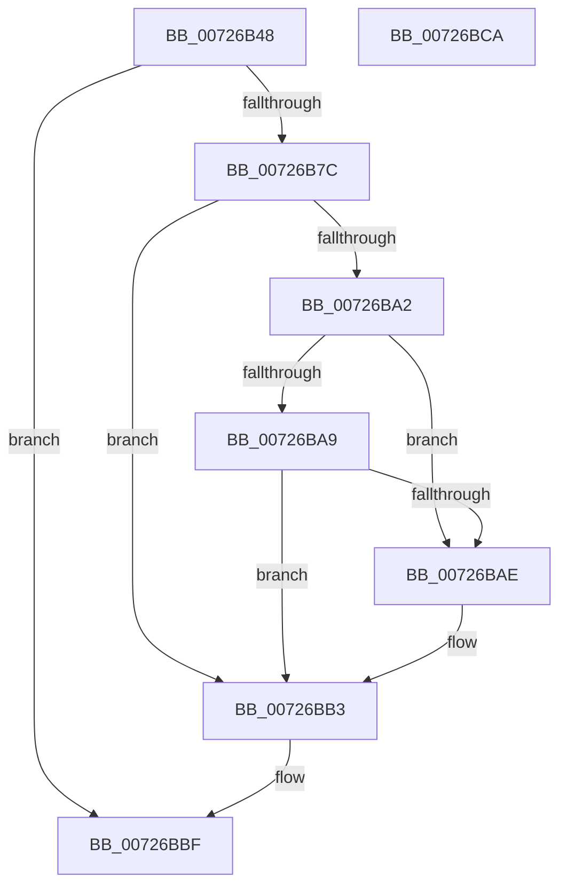

# IopGetOriginalServiceName

- RVA: `0x00726B48`–`0x00726BCB` (길이 `131` bytes)
- VA: `0x0000000140726B48`
- 실행 섹션: `PAGE`
- PDB 이름 있음: `예`; PDB Function 태그: `아니요`
- unwind 정보 RVA: `0x000718C0`
- 디코드: `37`개 명령, `131/131` bytes 표시
- 미해석 바이트: `0` (있으면 어셈블리에 `.byte`로 보존)

> 이 문서는 커널 이미지의 기계어와 PDB 기호를 분석해 생성했습니다. 4번과 5번은 함수 원형과 자료형을 바이너리 사용 방식에서 추정한 C 해석이며 원본 소스 복구 결과는 아닙니다.

## 1. Dependencies

- 직접 호출 지점: **3**; 고유 호출 대상: **3**
- 직접 호출자로 확인된 함수: **2**
- RIP 상대 이미지 참조: **1**

### Outgoing calls
- `0x00726B73` → [PipOpenServiceEnumKeys](../99/PipOpenServiceEnumKeys_function_00998E94.md) (function, `0x00998E94`)
- `0x00726B97` → [PnpCtxRegQueryValue](../99/PnpCtxRegQueryValue_function_009940FC.md) (function, `0x009940FC`)
- `0x00726BB8` → [ZwClose](../../text/6A/ZwClose_function_006AD2B0.md) (function, `0x006AD2B0`)

### Direct callers
- [IoReportDetectedDevice](IoReportDetectedDevice_function_00725CD0.md) at `0x007263E8`
- [IopGetRootDeviceId](IopGetRootDeviceId_function_00726BD4.md) at `0x00726C28`

### Static image references
- `0x00726B8B` → RVA `0x00AFD550` (` ?? ::NNGAKEGL::`string'`; read)

## 2. Other-region calls and transfers

- 다른 실행 섹션으로 향하는 call: **1**
  - `0x00726BB8` → [ZwClose](../../text/6A/ZwClose_function_006AD2B0.md) (`PAGE` → `.text`)
- 별도 외부 분기/꼬리 이동을 확인하지 못했습니다.

## 3. Assembly (complete function range)

```asm
00726B48  48 8B C4                        mov rax, rsp
00726B4B  48 89 58 08                     mov qword ptr [rax + 8], rbx
00726B4F  57                              push rdi
00726B50  48 83 EC 40                     sub rsp, 0x40
00726B54  83 60 20 00                     and dword ptr [rax + 0x20], 0
00726B58  49 8B F8                        mov rdi, r8
00726B5B  48 83 60 E8 00                  and qword ptr [rax - 0x18], 0
00726B60  4C 8D 40 E8                     lea r8, [rax - 0x18]
00726B64  48 8B DA                        mov rbx, rdx
00726B67  C6 40 D8 00                     mov byte ptr [rax - 0x28], 0
00726B6B  BA 19 00 02 00                  mov edx, 0x20019
00726B70  45 33 C9                        xor r9d, r9d
00726B73  E8 1C 23 27 00                  call 0x140998e94
00726B78  85 C0                           test eax, eax
00726B7A  78 43                           js 0x140726bbf
00726B7C  48 8B 54 24 30                  mov rdx, qword ptr [rsp + 0x30]
00726B81  4C 8D 4C 24 68                  lea r9, [rsp + 0x68]
00726B86  48 89 7C 24 28                  mov qword ptr [rsp + 0x28], rdi
00726B8B  4C 8D 05 BE 69 3D 00            lea r8, [rip + 0x3d69be]
00726B92  48 89 5C 24 20                  mov qword ptr [rsp + 0x20], rbx
00726B97  E8 60 D5 26 00                  call 0x1409940fc
00726B9C  8B D8                           mov ebx, eax
00726B9E  85 C0                           test eax, eax
00726BA0  78 11                           js 0x140726bb3
00726BA2  83 7C 24 68 01                  cmp dword ptr [rsp + 0x68], 1
00726BA7  75 05                           jne 0x140726bae
00726BA9  83 3F 02                        cmp dword ptr [rdi], 2
00726BAC  77 05                           ja 0x140726bb3
00726BAE  BB 3E 00 00 C0                  mov ebx, 0xc000003e
00726BB3  48 8B 4C 24 30                  mov rcx, qword ptr [rsp + 0x30]
00726BB8  E8 F3 66 F8 FF                  call 0x1406ad2b0
00726BBD  8B C3                           mov eax, ebx
00726BBF  48 8B 5C 24 50                  mov rbx, qword ptr [rsp + 0x50]
00726BC4  48 83 C4 40                     add rsp, 0x40
00726BC8  5F                              pop rdi
00726BC9  C3                              ret
00726BCA  CC                              int3
```

## 4. C-style interpretation (structured pseudocode)

```c
__int64 __fastcall IopGetOriginalServiceName(__int64 a1, __int64 a2, __int64 a3, int a4)
{
    __int64 result;
    __int64 v_rbx;
    __int64 v_rsp;
    unsigned __int64 v_stack_m18;
    unsigned __int64 v_stack_m20;
    unsigned __int64 v_stack_m28;
    unsigned __int64 v_stack_p20;
    unsigned __int64 v_stack_p8;

    *(unsigned __int64 *)(v_rsp + 8) = v_rbx;
    v_rsp = (v_rsp) - (64);
    *(unsigned __int8 *)(v_rsp - 40) = 0;
    a4 = 0;
    result = PipOpenServiceEnumKeys(a1, (unsigned int)(0x20019ULL), v_rsp - 24, a4);
    if (sign_flag) goto loc_00726BBF;
    v_stack_m20 = a3;
    v_stack_m28 = a2;
    result = PnpCtxRegQueryValue(a1, v_stack_m18, v_rip + 4024766, v_stack_p20);
    if (sign_flag) goto loc_00726BB3;
    if (v_stack_p20 != 1) goto loc_00726BAE;
    v_rbx = (unsigned int)((unsigned int)(result));
    if ((*(unsigned int *)(a3)) <= 2) {
        v_rbx = 0xC000003EULL;
    }
    result = ZwClose(v_stack_m18, v_stack_m18, v_rip + 4024766, v_stack_p20);
loc_00726BBF:
    v_rsp = (v_rsp) + (64);
    return (unsigned int)((unsigned int)(v_rbx));
}
```

## 5. (Beta) C Style

```c
int64_t IopGetOriginalServiceName(int64_t Arg1, int64_t Arg2, void *Arg3, int32_t Arg4)
{
    uint8_t *arg3 = (uint8_t *)Arg3;

    int64_t result;
    int64_t local_rbx;
    int64_t local_rsp;
    uint64_t v_stack_m18;
    uint64_t v_stack_m20;
    uint64_t v_stack_m28;
    uint64_t v_stack_p20;
    uint64_t v_stack_p8;

    *(uint64_t *)(local_rsp + 0x8) = local_rbx;
    local_rsp = (local_rsp) - (64);
    *(uint8_t *)(local_rsp - 0x28) = 0;
    Arg4 = 0;
    result = PipOpenServiceEnumKeys(Arg1, (uint32_t)(0x20019ULL), local_rsp - 24, Arg4);
    if (sign_flag) goto loc_00726BBF;
    v_stack_m20 = Arg3;
    v_stack_m28 = Arg2;
    result = PnpCtxRegQueryValue(Arg1, v_stack_m18, v_rip + 4024766, v_stack_p20);
    if (sign_flag) goto loc_00726BB3;
    if (v_stack_p20 != 1) goto loc_00726BAE;
    local_rbx = (uint32_t)((uint32_t)(result));
    if ((*(uint32_t *)(arg3)) <= 2) {
        local_rbx = 0xC000003EULL;
    }
    result = ZwClose(v_stack_m18, v_stack_m18, v_rip + 4024766, v_stack_p20);
loc_00726BBF:
    local_rsp = (local_rsp) + (64);
    return (uint32_t)((uint32_t)(local_rbx));
}
```

### 관측된 메모리 오프셋

구조체 형식이 확인되지 않은 접근은 인자 기준의 오프셋으로만 기록했습니다.

| 기준 인자 | 오프셋 표현 | 폭 (bit) | 접근 |
|---|---:|---:|---|
| `Arg3` | `+ 0x0` | `32` | `R` |

## 6. Execution-region graph

[열기: 2D/3D 그래프와 함수 탐색 컨트롤 패널](../../../control-panel.html?section=page&rva=0x00726B48&view=graph)

- 2D 그래프는 위에서 아래로 흐르고, 3D 그래프는 빈 공간을 드래그해 회전합니다. Shift+드래그는 이동, 휠은 확대·축소, 함수 노드 선택은 대상 보고서 이동입니다.

### Static fallback


