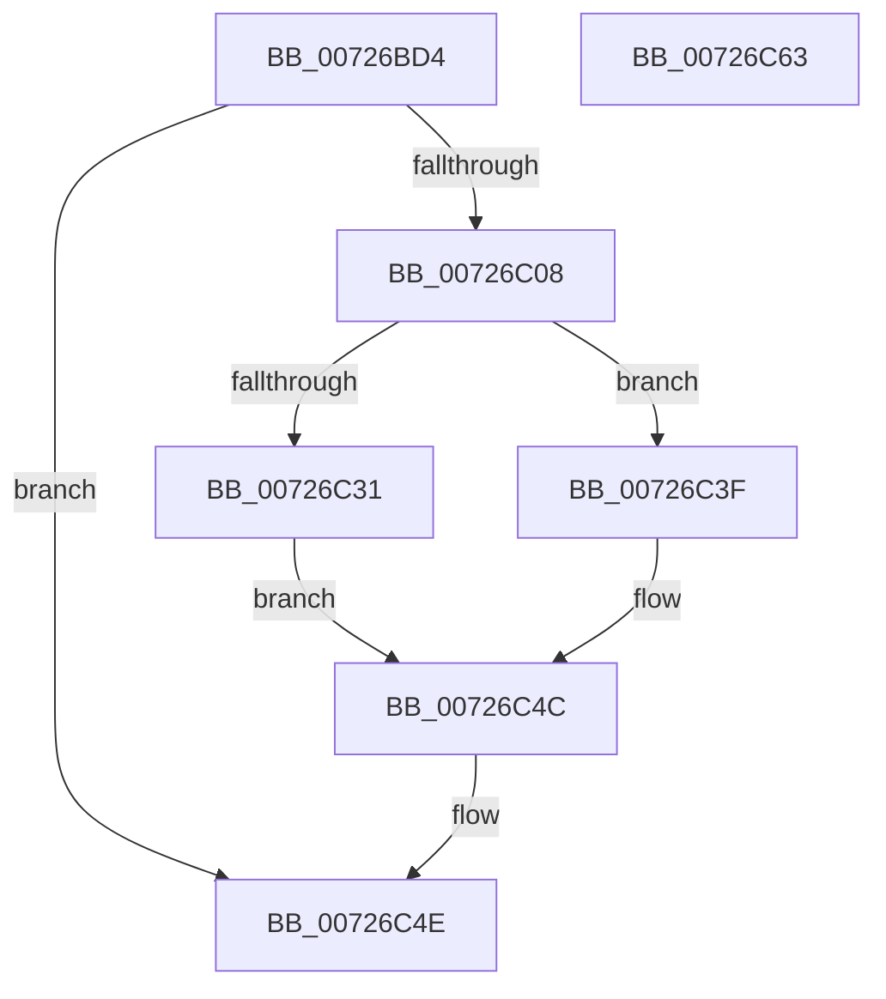

# IopGetRootDeviceId

- RVA: `0x00726BD4`–`0x00726C64` (길이 `144` bytes)
- VA: `0x0000000140726BD4`
- 실행 섹션: `PAGE`
- PDB 이름 있음: `예`; PDB Function 태그: `아니요`
- unwind 정보 RVA: `0x000B6A1C`
- 디코드: `43`개 명령, `144/144` bytes 표시
- 미해석 바이트: `0` (있으면 어셈블리에 `.byte`로 보존)

> 이 문서는 커널 이미지의 기계어와 PDB 기호를 분석해 생성했습니다. 4번과 5번은 함수 원형과 자료형을 바이너리 사용 방식에서 추정한 C 해석이며 원본 소스 복구 결과는 아닙니다.

## 1. Dependencies

- 직접 호출 지점: **3**; 고유 호출 대상: **3**
- 직접 호출자로 확인된 함수: **2**
- RIP 상대 이미지 참조: **1**

### Outgoing calls
- `0x00726BFD` → [RtlAppendUnicodeToString](../../text/40/RtlAppendUnicodeToString_function_0040F990.md) (function, `0x0040F990`)
- `0x00726C28` → [IopGetOriginalServiceName](IopGetOriginalServiceName_function_00726B48.md) (function, `0x00726B48`)
- `0x00726C45` → [RtlAppendUnicodeStringToString](../../text/40/RtlAppendUnicodeStringToString_function_0040FA50.md) (function, `0x0040FA50`)

### Direct callers
- [IoReportDetectedDevice](IoReportDetectedDevice_function_00725CD0.md) at `0x00725E17`
- [IoReportRootDevice](IoReportRootDevice_function_00726780.md) at `0x00726810`

### Static image references
- `0x00726BF6` → RVA `0x00AFD580` (` ?? ::NNGAKEGL::`string'`; read)

## 2. Other-region calls and transfers

- 다른 실행 섹션으로 향하는 call: **2**
  - `0x00726BFD` → [RtlAppendUnicodeToString](../../text/40/RtlAppendUnicodeToString_function_0040F990.md) (`PAGE` → `.text`)
  - `0x00726C45` → [RtlAppendUnicodeStringToString](../../text/40/RtlAppendUnicodeStringToString_function_0040FA50.md) (`PAGE` → `.text`)
- 별도 외부 분기/꼬리 이동을 확인하지 못했습니다.

## 3. Assembly (complete function range)

```asm
00726BD4  48 89 5C 24 08                  mov qword ptr [rsp + 8], rbx
00726BD9  48 89 6C 24 18                  mov qword ptr [rsp + 0x18], rbp
00726BDE  48 89 74 24 20                  mov qword ptr [rsp + 0x20], rsi
00726BE3  57                              push rdi
00726BE4  48 83 EC 20                     sub rsp, 0x20
00726BE8  48 8B DA                        mov rbx, rdx
00726BEB  48 8B F1                        mov rsi, rcx
00726BEE  33 ED                           xor ebp, ebp
00726BF0  48 8B CB                        mov rcx, rbx
00726BF3  66 89 2A                        mov word ptr [rdx], bp
00726BF6  48 8D 15 83 69 3D 00            lea rdx, [rip + 0x3d6983]
00726BFD  E8 8E 8D CE FF                  call 0x14040f990
00726C02  8B F8                           mov edi, eax
00726C04  85 C0                           test eax, eax
00726C06  78 46                           js 0x140726c4e
00726C08  0F B7 0B                        movzx ecx, word ptr [rbx]
00726C0B  4C 8D 44 24 38                  lea r8, [rsp + 0x38]
00726C10  0F B7 43 02                     movzx eax, word ptr [rbx + 2]
00726C14  2B C1                           sub eax, ecx
00726C16  48 D1 E9                        shr rcx, 1
00726C19  89 44 24 38                     mov dword ptr [rsp + 0x38], eax
00726C1D  48 8B 43 08                     mov rax, qword ptr [rbx + 8]
00726C21  48 8D 14 48                     lea rdx, [rax + rcx*2]
00726C25  48 8B CE                        mov rcx, rsi
00726C28  E8 1B FF FF FF                  call 0x140726b48
00726C2D  85 C0                           test eax, eax
00726C2F  78 0E                           js 0x140726c3f
00726C31  0F B7 44 24 38                  movzx eax, word ptr [rsp + 0x38]
00726C36  66 83 E8 02                     sub ax, 2
00726C3A  66 01 03                        add word ptr [rbx], ax
00726C3D  EB 0D                           jmp 0x140726c4c
00726C3F  48 8B D6                        mov rdx, rsi
00726C42  48 8B CB                        mov rcx, rbx
00726C45  E8 06 8E CE FF                  call 0x14040fa50
00726C4A  8B F8                           mov edi, eax
00726C4C  8B C7                           mov eax, edi
00726C4E  48 8B 5C 24 30                  mov rbx, qword ptr [rsp + 0x30]
00726C53  48 8B 6C 24 40                  mov rbp, qword ptr [rsp + 0x40]
00726C58  48 8B 74 24 48                  mov rsi, qword ptr [rsp + 0x48]
00726C5D  48 83 C4 20                     add rsp, 0x20
00726C61  5F                              pop rdi
00726C62  C3                              ret
00726C63  CC                              int3
```

## 4. C-style interpretation (structured pseudocode)

```c
__int64 __fastcall IopGetRootDeviceId(__int64 a1, __int64 a2)
{
    __int64 result;
    __int64 v_rbp;
    __int64 v_rsp;
    unsigned __int64 v_stack_p10;
    unsigned __int64 v_stack_p18;
    unsigned __int64 v_stack_p20;
    unsigned __int64 v_stack_p8;

    v_stack_p8 = v_rbx;
    v_stack_p18 = v_rbp;
    v_stack_p20 = v_rsi;
    v_rsp = (v_rsp) - (32);
    v_rbp = 0;
    *(unsigned __int16 *)(a2) = 0;
    result = RtlAppendUnicodeToString(a2, v_rip + 4024707, a3, a4);
    if (sign_flag) goto loc_00726C4E;
    result = (unsigned int)((*(unsigned __int16 *)(a2 + 2)) - ((unsigned int)(*(unsigned __int16 *)(a2))));
    a1 = (*(unsigned __int16 *)(a2)) >> (1);
    v_stack_p10 = (unsigned int)(result);
    result = IopGetOriginalServiceName(a1, *(unsigned __int64 *)(a2 + 8) + a1 * 2, v_stack_p10, a4);
    if (sign_flag) goto loc_00726C3F;
    result = (unsigned __int16)((v_stack_p10) - (2));
    goto loc_00726C4C;
loc_00726C3F:
    result = RtlAppendUnicodeStringToString(a2, a1, v_stack_p10, a4);
loc_00726C4C:
loc_00726C4E:
    v_rsp = (v_rsp) + (32);
    return (unsigned int)((unsigned int)((unsigned int)((unsigned int)(result))));
}
```

## 5. (Beta) C Style

```c
int64_t IopGetRootDeviceId(int64_t Arg1, void *Arg2)
{
    uint8_t *arg2 = (uint8_t *)Arg2;

    int64_t result;
    int64_t local_rbp;
    int64_t local_rsp;
    uint64_t v_stack_p10;
    uint64_t v_stack_p18;
    uint64_t v_stack_p20;
    uint64_t v_stack_p8;

    v_stack_p8 = local_rbx;
    v_stack_p18 = local_rbp;
    v_stack_p20 = local_rsi;
    local_rsp = (local_rsp) - (32);
    local_rbp = 0;
    *(uint16_t *)(arg2) = 0;
    result = RtlAppendUnicodeToString(Arg2, v_rip + 4024707, a3, a4);
    if (sign_flag) goto loc_00726C4E;
    result = (uint32_t)((*(uint16_t *)(arg2 + 0x2)) - ((uint32_t)(*(uint16_t *)(arg2))));
    Arg1 = (*(uint16_t *)(arg2)) >> (1);
    v_stack_p10 = (uint32_t)(result);
    result = IopGetOriginalServiceName(Arg1, *(uint64_t *)(arg2 + 0x8) + Arg1 * 2, v_stack_p10, a4);
    if (sign_flag) goto loc_00726C3F;
    result = (uint16_t)((v_stack_p10) - (2));
    goto loc_00726C4C;
loc_00726C3F:
    result = RtlAppendUnicodeStringToString(Arg2, Arg1, v_stack_p10, a4);
loc_00726C4C:
loc_00726C4E:
    local_rsp = (local_rsp) + (32);
    return (uint32_t)((uint32_t)((uint32_t)((uint32_t)(result))));
}
```

### 관측된 메모리 오프셋

구조체 형식이 확인되지 않은 접근은 인자 기준의 오프셋으로만 기록했습니다.

| 기준 인자 | 오프셋 표현 | 폭 (bit) | 접근 |
|---|---:|---:|---|
| `Arg2` | `+ 0x0` | `16` | `R` |
| `Arg2` | `+ 0x0` | `16` | `R/W` |
| `Arg2` | `+ 0x0` | `16` | `W` |
| `Arg2` | `+ 0x2` | `16` | `R` |
| `Arg2` | `+ 0x8` | `64` | `R` |

## 6. Execution-region graph

[열기: 2D/3D 그래프와 함수 탐색 컨트롤 패널](../../../control-panel.html?section=page&rva=0x00726BD4&view=graph)

- 2D 그래프는 위에서 아래로 흐르고, 3D 그래프는 빈 공간을 드래그해 회전합니다. Shift+드래그는 이동, 휠은 확대·축소, 함수 노드 선택은 대상 보고서 이동입니다.

### Static fallback


