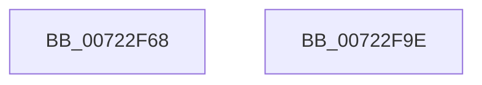

# IopInitializeMdlCache

- RVA: `0x00722F68`–`0x00722F9F` (길이 `55` bytes)
- VA: `0x0000000140722F68`
- 실행 섹션: `PAGE`
- PDB 이름 있음: `예`; PDB Function 태그: `아니요`
- unwind 정보 RVA: `0x000DB714`
- 디코드: `10`개 명령, `55/55` bytes 표시
- 미해석 바이트: `0` (있으면 어셈블리에 `.byte`로 보존)

> 이 문서는 커널 이미지의 기계어와 PDB 기호를 분석해 생성했습니다. 4번과 5번은 함수 원형과 자료형을 바이너리 사용 방식에서 추정한 C 해석이며 원본 소스 복구 결과는 아닙니다.

## 1. Dependencies

- 직접 호출 지점: **0**; 고유 호출 대상: **0**
- 직접 호출자로 확인된 함수: **1**
- RIP 상대 이미지 참조: **7**

### Outgoing calls
- 직접 디코드된 call 명령이 없습니다.

### Direct callers
- [IoInitSystem](../../init/C2/IoInitSystem_function_00C2ABB8.md) at `0x00C2AC25`

### Static image references
- `0x00722F6A` → RVA `0x00F8D000` (`.data`; write)
- `0x00722F74` → RVA `0x00F8D010` (`.data`; read)
- `0x00722F7B` → RVA `0x00E66218` (`.data`; write)
- `0x00722F81` → RVA `0x00F8D008` (`.data`; write)
- `0x00722F88` → RVA `0x00F8D018` (`.data`; write)
- `0x00722F8F` → RVA `0x00F8D010` (`.data`; write)
- `0x00722F96` → RVA `0x00F8D028` (`.data`; write)

## 2. Other-region calls and transfers

- 다른 실행 섹션으로 향하는 call: **0**
- 별도 외부 분기/꼬리 이동을 확인하지 못했습니다.

## 3. Assembly (complete function range)

```asm
00722F68  33 C9                           xor ecx, ecx
00722F6A  C7 05 8C A0 86 00 01 0C 30 00   mov dword ptr [rip + 0x86a08c], 0x300c01
00722F74  48 8D 05 95 A0 86 00            lea rax, [rip + 0x86a095]
00722F7B  88 0D 97 32 74 00               mov byte ptr [rip + 0x743297], cl
00722F81  48 89 0D 80 A0 86 00            mov qword ptr [rip + 0x86a080], rcx
00722F88  48 89 05 89 A0 86 00            mov qword ptr [rip + 0x86a089], rax
00722F8F  48 89 05 7A A0 86 00            mov qword ptr [rip + 0x86a07a], rax
00722F96  48 89 0D 8B A0 86 00            mov qword ptr [rip + 0x86a08b], rcx
00722F9D  C3                              ret
00722F9E  CC                              int3
```

## 4. C-style interpretation (structured pseudocode)

```c
__int64 __fastcall IopInitializeMdlCache(int a1)
{
    a1 = 0;
    *(unsigned int *)(v_rip + 8822924) = 0x300C01ULL;
    *(unsigned __int8 *)(v_rip + 7615127) = 0;
    *(unsigned __int64 *)(v_rip + 8822912) = 0;
    *(unsigned __int64 *)(v_rip + 8822921) = v_rip + 8822933;
    *(unsigned __int64 *)(v_rip + 8822906) = v_rip + 8822933;
    *(unsigned __int64 *)(v_rip + 8822923) = 0;
    return v_rip + 8822933;
}
```

## 5. (Beta) C Style

```c
int64_t IopInitializeMdlCache(int32_t Arg1)
{
    Arg1 = 0;
    *(uint32_t *)(v_rip + 0x86A08C) = 0x300C01ULL;
    *(uint8_t *)(v_rip + 0x743297) = 0;
    *(uint64_t *)(v_rip + 0x86A080) = 0;
    *(uint64_t *)(v_rip + 0x86A089) = v_rip + 8822933;
    *(uint64_t *)(v_rip + 0x86A07A) = v_rip + 8822933;
    *(uint64_t *)(v_rip + 0x86A08B) = 0;
    return v_rip + 8822933;
}
```

## 6. Execution-region graph

[열기: 2D/3D 그래프와 함수 탐색 컨트롤 패널](../../../control-panel.html?section=page&rva=0x00722F68&view=graph)

- 2D 그래프는 위에서 아래로 흐르고, 3D 그래프는 빈 공간을 드래그해 회전합니다. Shift+드래그는 이동, 휠은 확대·축소, 함수 노드 선택은 대상 보고서 이동입니다.

### Static fallback


