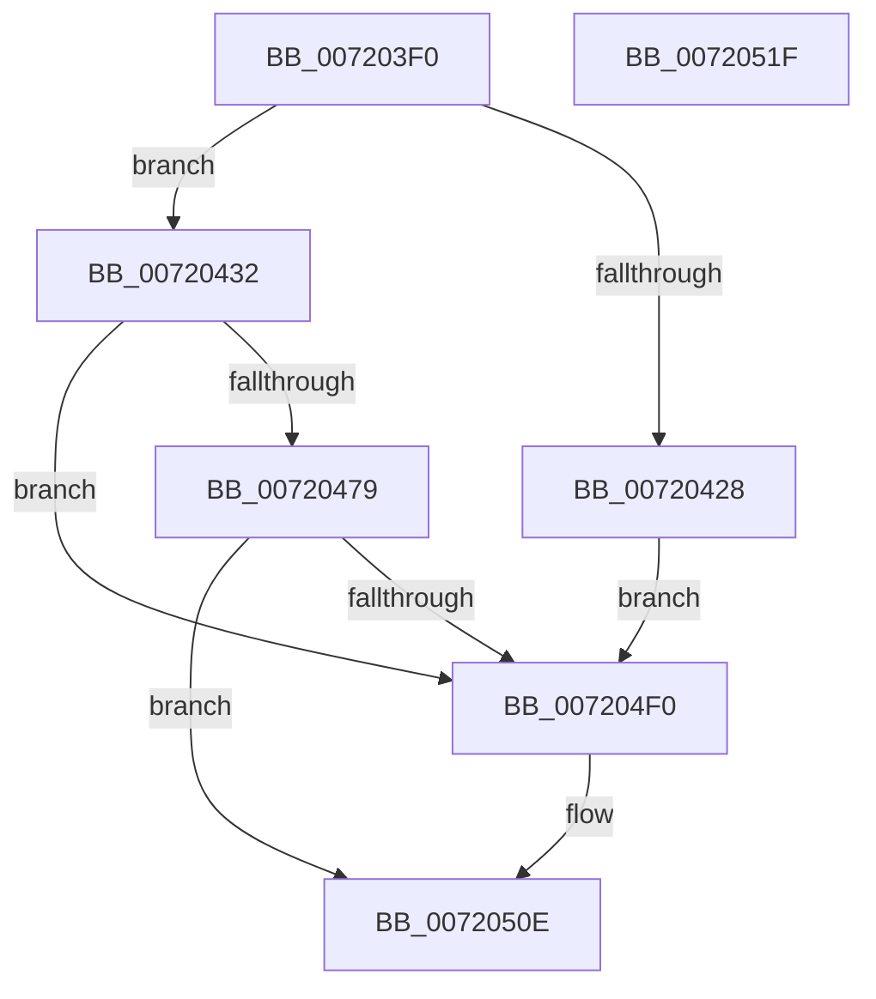

# IopIoRingDispatchWriteGather

- RVA: `0x007203F0`–`0x00720520` (길이 `304` bytes)
- VA: `0x00000001407203F0`
- 실행 섹션: `PAGE`
- PDB 이름 있음: `예`; PDB Function 태그: `아니요`
- unwind 정보 RVA: `0x000C74AC`
- 디코드: `67`개 명령, `304/304` bytes 표시
- 미해석 바이트: `0` (있으면 어셈블리에 `.byte`로 보존)

> 이 문서는 커널 이미지의 기계어와 PDB 기호를 분석해 생성했습니다. 4번과 5번은 함수 원형과 자료형을 바이너리 사용 방식에서 추정한 C 해석이며 원본 소스 복구 결과는 아닙니다.

## 1. Dependencies

- 직접 호출 지점: **3**; 고유 호출 대상: **3**
- 직접 호출자로 확인된 함수: **1**
- RIP 상대 이미지 참조: **0**

### Outgoing calls
- `0x00720470` → [IopIoRingReferenceFileObject](../AD/IopIoRingReferenceFileObject_function_00AD3A8C.md) (function, `0x00AD3A8C`)
- `0x007204E4` → [IopWriteFileGather](../AA/IopWriteFileGather_function_00AAA95C.md) (function, `0x00AAA95C`)
- `0x00720509` → [IopCompleteIoRingEntry](../../text/3E/IopCompleteIoRingEntry_function_003ED2C0.md) (function, `0x003ED2C0`)

### Direct callers
- [IopProcessIoRingEntry](../70/IopProcessIoRingEntry_function_00700A38.md) at `0x00700AEF`

### Static image references
- 디코드된 RIP-relative 메모리 참조가 없습니다.

## 2. Other-region calls and transfers

- 다른 실행 섹션으로 향하는 call: **1**
  - `0x00720509` → [IopCompleteIoRingEntry](../../text/3E/IopCompleteIoRingEntry_function_003ED2C0.md) (`PAGE` → `.text`)
- 별도 외부 분기/꼬리 이동을 확인하지 못했습니다.

## 3. Assembly (complete function range)

```asm
007203F0  48 89 5C 24 08                  mov qword ptr [rsp + 8], rbx
007203F5  57                              push rdi
007203F6  48 81 EC 80 00 00 00            sub rsp, 0x80
007203FD  65 48 8B 04 25 88 01 00 00      mov rax, qword ptr gs:[0x188]
00720406  0F 57 C0                        xorps xmm0, xmm0
00720409  44 8B 42 10                     mov r8d, dword ptr [rdx + 0x10]
0072040D  48 8B DA                        mov rbx, rdx
00720410  48 8B F9                        mov rdi, rcx
00720413  44 8A 88 32 02 00 00            mov r9b, byte ptr [rax + 0x232]
0072041A  0F 11 44 24 70                  movups xmmword ptr [rsp + 0x70], xmm0
0072041F  41 F7 C0 FE FF FF FF            test r8d, 0xfffffffe
00720426  74 0A                           je 0x140720432
00720428  B8 01 00 46 C0                  mov eax, 0xc0460001
0072042D  E9 BE 00 00 00                  jmp 0x1407204f0
00720432  48 8B 52 18                     mov rdx, qword ptr [rdx + 0x18]
00720436  48 8D 84 24 98 00 00 00         lea rax, [rsp + 0x98]
0072043E  48 83 A4 24 A0 00 00 00 00      and qword ptr [rsp + 0xa0], 0
00720447  41 80 E0 01                     and r8b, 1
0072044B  48 83 A4 24 98 00 00 00 00      and qword ptr [rsp + 0x98], 0
00720454  48 89 44 24 38                  mov qword ptr [rsp + 0x38], rax
00720459  48 8D 84 24 A0 00 00 00         lea rax, [rsp + 0xa0]
00720461  48 89 44 24 30                  mov qword ptr [rsp + 0x30], rax
00720466  83 64 24 28 00                  and dword ptr [rsp + 0x28], 0
0072046B  C6 44 24 20 00                  mov byte ptr [rsp + 0x20], 0
00720470  E8 17 36 3B 00                  call 0x140ad3a8c
00720475  85 C0                           test eax, eax
00720477  78 77                           js 0x1407204f0
00720479  C6 43 17 00                     mov byte ptr [rbx + 0x17], 0
0072047D  48 8D 4B 3C                     lea rcx, [rbx + 0x3c]
00720481  8B 43 14                        mov eax, dword ptr [rbx + 0x14]
00720484  48 8D 53 30                     lea rdx, [rbx + 0x30]
00720488  0F BA E8 1F                     bts eax, 0x1f
0072048C  45 33 C9                        xor r9d, r9d
0072048F  89 44 24 68                     mov dword ptr [rsp + 0x68], eax
00720493  45 33 C0                        xor r8d, r8d
00720496  48 8B 43 08                     mov rax, qword ptr [rbx + 8]
0072049A  48 89 44 24 60                  mov qword ptr [rsp + 0x60], rax
0072049F  8B 84 24 9C 00 00 00            mov eax, dword ptr [rsp + 0x9c]
007204A6  48 89 7C 24 58                  mov qword ptr [rsp + 0x58], rdi
007204AB  89 44 24 50                     mov dword ptr [rsp + 0x50], eax
007204AF  8B 43 38                        mov eax, dword ptr [rbx + 0x38]
007204B2  48 89 4C 24 48                  mov qword ptr [rsp + 0x48], rcx
007204B7  48 8B 8C 24 A0 00 00 00         mov rcx, qword ptr [rsp + 0xa0]
007204BF  48 89 54 24 40                  mov qword ptr [rsp + 0x40], rdx
007204C4  33 D2                           xor edx, edx
007204C6  89 44 24 38                     mov dword ptr [rsp + 0x38], eax
007204CA  48 8B 43 28                     mov rax, qword ptr [rbx + 0x28]
007204CE  48 89 44 24 30                  mov qword ptr [rsp + 0x30], rax
007204D3  8B 43 20                        mov eax, dword ptr [rbx + 0x20]
007204D6  89 44 24 28                     mov dword ptr [rsp + 0x28], eax
007204DA  48 8D 44 24 70                  lea rax, [rsp + 0x70]
007204DF  48 89 44 24 20                  mov qword ptr [rsp + 0x20], rax
007204E4  E8 73 A4 38 00                  call 0x140aaa95c
007204E9  3D 03 01 00 00                  cmp eax, 0x103
007204EE  74 1E                           je 0x14072050e
007204F0  48 83 64 24 78 00               and qword ptr [rsp + 0x78], 0
007204F6  4C 8D 44 24 70                  lea r8, [rsp + 0x70]
007204FB  48 8B 53 08                     mov rdx, qword ptr [rbx + 8]
007204FF  45 33 C9                        xor r9d, r9d
00720502  48 8B CF                        mov rcx, rdi
00720505  89 44 24 70                     mov dword ptr [rsp + 0x70], eax
00720509  E8 B2 CD CC FF                  call 0x1403ed2c0
0072050E  48 8B 9C 24 90 00 00 00         mov rbx, qword ptr [rsp + 0x90]
00720516  48 81 C4 80 00 00 00            add rsp, 0x80
0072051D  5F                              pop rdi
0072051E  C3                              ret
0072051F  CC                              int3
```

## 4. C-style interpretation (structured pseudocode)

```c
__int64 __fastcall IopIoRingDispatchWriteGather(__int64 a1, __int64 a2)
{
    __int64 result;
    __int64 v_rsp;
    unsigned __int64 v_stack_m10;
    unsigned __int64 v_stack_m18;
    unsigned int v_stack_m20;
    unsigned __int64 v_stack_m28;
    unsigned __int64 v_stack_m30;
    unsigned int v_stack_m38;
    unsigned __int64 v_stack_m40;
    unsigned __int64 v_stack_m48;
    unsigned __int64 v_stack_m50;
    unsigned __int64 v_stack_m58;
    unsigned int v_stack_m60;
    unsigned __int8 v_stack_m68;
    unsigned __int64 v_stack_p10;
    unsigned int v_stack_p14;
    unsigned __int64 v_stack_p18;
    unsigned __int64 v_stack_p8;

    v_stack_p8 = v_rbx;
    v_rsp = (v_rsp) - (128);
    v_stack_m18 = v_xmm0;
    if ((((unsigned int)((unsigned int)(*(unsigned int *)(a2 + 16)))) & (0xFFFFFFFEULL)) == 0) goto loc_00720432;
    goto loc_007204F0;
loc_00720432:
    a3 = (unsigned __int8)(((unsigned int)(*(unsigned int *)(a2 + 16))) & (1));
    v_stack_m50 = v_stack_p10;
    v_stack_m58 = v_stack_p18;
    v_stack_m68 = 0;
    result = IopIoRingReferenceFileObject(a1, *(unsigned __int64 *)(a2 + 24), a3, *(unsigned __int8 *)(*(unsigned __int64 *)(gs_base + (0 + 392)) + 562));
    if (sign_flag) goto loc_007204F0;
    *(unsigned __int8 *)(a2 + 23) = 0;
    a4 = 0;
    v_stack_m20 = (unsigned int)((unsigned int)(*(unsigned int *)(a2 + 20)));
    a3 = 0;
    v_stack_m28 = *(unsigned __int64 *)(a2 + 8);
    v_stack_m30 = a1;
    v_stack_m38 = (unsigned int)((unsigned int)(v_stack_p14));
    v_stack_m40 = a2 + 60;
    v_stack_m48 = a2 + 48;
    a2 = 0;
    v_stack_m50 = (unsigned int)((unsigned int)(*(unsigned int *)(a2 + 56)));
    v_stack_m58 = *(unsigned __int64 *)(a2 + 40);
    v_stack_m60 = (unsigned int)((unsigned int)(*(unsigned int *)(a2 + 32)));
    v_stack_m68 = v_stack_m18;
    result = IopWriteFileGather(v_stack_p18, a2, a3, a4);
    if (((unsigned int)(result)) != 259) {
        a3 = v_stack_m18;
        a2 = *(unsigned __int64 *)(a2 + 8);
        a4 = 0;
        a1 = a1;
        v_stack_m18 = (unsigned int)(result);
        result = IopCompleteIoRingEntry(a1, a2, a3, a4);
    }
    v_rsp = (v_rsp) + (128);
    return result;
}
```

## 5. (Beta) C Style

```c
int64_t IopIoRingDispatchWriteGather(int64_t Arg1, void *Arg2)
{
    uint8_t *arg2 = (uint8_t *)Arg2;

    int64_t result;
    int64_t local_rsp;
    uint64_t v_stack_m10;
    uint64_t v_stack_m18;
    uint32_t v_stack_m20;
    uint64_t v_stack_m28;
    uint64_t v_stack_m30;
    uint32_t v_stack_m38;
    uint64_t v_stack_m40;
    uint64_t v_stack_m48;
    uint64_t v_stack_m50;
    uint64_t v_stack_m58;
    uint32_t v_stack_m60;
    uint8_t v_stack_m68;
    uint64_t v_stack_p10;
    uint32_t v_stack_p14;
    uint64_t v_stack_p18;
    uint64_t v_stack_p8;

    v_stack_p8 = local_rbx;
    local_rsp = (local_rsp) - (128);
    v_stack_m18 = v_xmm0;
    if ((((uint32_t)((uint32_t)(*(uint32_t *)(arg2 + 0x10)))) & (0xFFFFFFFEULL)) == 0) goto loc_00720432;
    goto loc_007204F0;
loc_00720432:
    a3 = (uint8_t)(((uint32_t)(*(uint32_t *)(arg2 + 0x10))) & (1));
    v_stack_m50 = v_stack_p10;
    v_stack_m58 = v_stack_p18;
    v_stack_m68 = 0;
    result = IopIoRingReferenceFileObject(Arg1, *(uint64_t *)(arg2 + 0x18), a3, *(uint8_t *)(*(uint64_t *)(gs_base + (0 + 0x188)) + 0x232));
    if (sign_flag) goto loc_007204F0;
    *(uint8_t *)(arg2 + 0x17) = 0;
    a4 = 0;
    v_stack_m20 = (uint32_t)((uint32_t)(*(uint32_t *)(arg2 + 0x14)));
    a3 = 0;
    v_stack_m28 = *(uint64_t *)(arg2 + 0x8);
    v_stack_m30 = Arg1;
    v_stack_m38 = (uint32_t)((uint32_t)(v_stack_p14));
    v_stack_m40 = Arg2 + 60;
    v_stack_m48 = Arg2 + 48;
    Arg2 = 0;
    v_stack_m50 = (uint32_t)((uint32_t)(*(uint32_t *)(arg2 + 0x38)));
    v_stack_m58 = *(uint64_t *)(arg2 + 0x28);
    v_stack_m60 = (uint32_t)((uint32_t)(*(uint32_t *)(arg2 + 0x20)));
    v_stack_m68 = v_stack_m18;
    result = IopWriteFileGather(v_stack_p18, Arg2, a3, a4);
    if (((uint32_t)(result)) != 259) {
        a3 = v_stack_m18;
        Arg2 = *(uint64_t *)(arg2 + 0x8);
        a4 = 0;
        Arg1 = Arg1;
        v_stack_m18 = (uint32_t)(result);
        result = IopCompleteIoRingEntry(Arg1, Arg2, a3, a4);
    }
    local_rsp = (local_rsp) + (128);
    return result;
}
```

### 관측된 메모리 오프셋

구조체 형식이 확인되지 않은 접근은 인자 기준의 오프셋으로만 기록했습니다.

| 기준 인자 | 오프셋 표현 | 폭 (bit) | 접근 |
|---|---:|---:|---|
| `Arg2` | `+ 0x8` | `64` | `R` |
| `Arg2` | `+ 0x10` | `32` | `R` |
| `Arg2` | `+ 0x14` | `32` | `R` |
| `Arg2` | `+ 0x17` | `8` | `W` |
| `Arg2` | `+ 0x18` | `64` | `R` |
| `Arg2` | `+ 0x20` | `32` | `R` |
| `Arg2` | `+ 0x28` | `64` | `R` |
| `Arg2` | `+ 0x30` | `64` | `R` |
| `Arg2` | `+ 0x38` | `32` | `R` |
| `Arg2` | `+ 0x3C` | `64` | `R` |

## 6. Execution-region graph

[열기: 2D/3D 그래프와 함수 탐색 컨트롤 패널](../../../control-panel.html?section=page&rva=0x007203F0&view=graph)

- 2D 그래프는 위에서 아래로 흐르고, 3D 그래프는 빈 공간을 드래그해 회전합니다. Shift+드래그는 이동, 휠은 확대·축소, 함수 노드 선택은 대상 보고서 이동입니다.

### Static fallback


