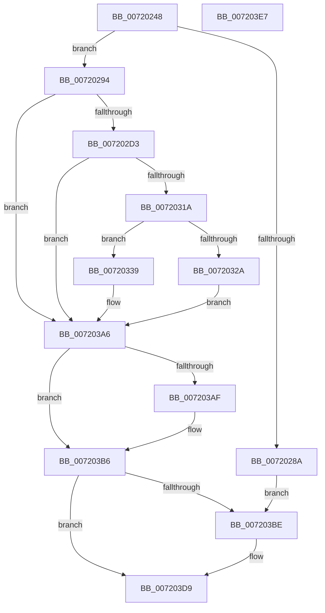

# IopIoRingDispatchWrite

- RVA: `0x00720248`–`0x007203E8` (길이 `416` bytes)
- VA: `0x0000000140720248`
- 실행 섹션: `PAGE`
- PDB 이름 있음: `예`; PDB Function 태그: `아니요`
- unwind 정보 RVA: `0x000C7234`
- 디코드: `109`개 명령, `416/416` bytes 표시
- 미해석 바이트: `0` (있으면 어셈블리에 `.byte`로 보존)

> 이 문서는 커널 이미지의 기계어와 PDB 기호를 분석해 생성했습니다. 4번과 5번은 함수 원형과 자료형을 바이너리 사용 방식에서 추정한 C 해석이며 원본 소스 복구 결과는 아닙니다.

## 1. Dependencies

- 직접 호출 지점: **7**; 고유 호출 대상: **7**
- 직접 호출자로 확인된 함수: **1**
- RIP 상대 이미지 참조: **0**

### Outgoing calls
- `0x007202C4` → [IopIoRingGetBuffer](../AB/IopIoRingGetBuffer_function_00AB0B88.md) (function, `0x00AB0B88`)
- `0x0072030B` → [IopIoRingReferenceFileObject](../AD/IopIoRingReferenceFileObject_function_00AD3A8C.md) (function, `0x00AD3A8C`)
- `0x00720321` → [IopFileObjectRevoked](../../text/41/IopFileObjectRevoked_function_004159D0.md) (function, `0x004159D0`)
- `0x0072032D` → [ObfDereferenceObject](../../text/2F/ObfDereferenceObject_function_002F9350.md) (function, `0x002F9350`)
- `0x0072039F` → [IopWriteFile](../8E/IopWriteFile_function_008E9790.md) (function, `0x008E9790`)
- `0x007203B1` → [IopMcReleaseMdl](../../text/5A/IopMcReleaseMdl_function_005A3CE8.md) (function, `0x005A3CE8`)
- `0x007203D4` → [IopCompleteIoRingEntry](../../text/3E/IopCompleteIoRingEntry_function_003ED2C0.md) (function, `0x003ED2C0`)

### Direct callers
- [IopProcessIoRingEntry](../70/IopProcessIoRingEntry_function_00700A38.md) at `0x00700B0D`

### Static image references
- 디코드된 RIP-relative 메모리 참조가 없습니다.

## 2. Other-region calls and transfers

- 다른 실행 섹션으로 향하는 call: **4**
  - `0x00720321` → [IopFileObjectRevoked](../../text/41/IopFileObjectRevoked_function_004159D0.md) (`PAGE` → `.text`)
  - `0x0072032D` → [ObfDereferenceObject](../../text/2F/ObfDereferenceObject_function_002F9350.md) (`PAGE` → `.text`)
  - `0x007203B1` → [IopMcReleaseMdl](../../text/5A/IopMcReleaseMdl_function_005A3CE8.md) (`PAGE` → `.text`)
  - `0x007203D4` → [IopCompleteIoRingEntry](../../text/3E/IopCompleteIoRingEntry_function_003ED2C0.md) (`PAGE` → `.text`)
- 별도 외부 분기/꼬리 이동을 확인하지 못했습니다.

## 3. Assembly (complete function range)

```asm
00720248  40 55                           push rbp
0072024A  53                              push rbx
0072024B  56                              push rsi
0072024C  57                              push rdi
0072024D  41 56                           push r14
0072024F  48 8D 6C 24 C9                  lea rbp, [rsp - 0x37]
00720254  48 81 EC 90 00 00 00            sub rsp, 0x90
0072025B  65 48 8B 04 25 88 01 00 00      mov rax, qword ptr gs:[0x188]
00720264  0F 57 C0                        xorps xmm0, xmm0
00720267  44 8B 42 10                     mov r8d, dword ptr [rdx + 0x10]
0072026B  48 8B FA                        mov rdi, rdx
0072026E  48 8B F1                        mov rsi, rcx
00720271  44 8A B0 32 02 00 00            mov r14b, byte ptr [rax + 0x232]
00720278  48 83 65 6F 00                  and qword ptr [rbp + 0x6f], 0
0072027D  0F 11 45 1F                     movups xmmword ptr [rbp + 0x1f], xmm0
00720281  41 F7 C0 FC FF FF FF            test r8d, 0xfffffffc
00720288  74 0A                           je 0x140720294
0072028A  BB 01 00 46 C0                  mov ebx, 0xc0460001
0072028F  E9 2A 01 00 00                  jmp 0x1407203be
00720294  44 8B 4A 30                     mov r9d, dword ptr [rdx + 0x30]
00720298  48 8D 45 6F                     lea rax, [rbp + 0x6f]
0072029C  48 8B 52 20                     mov rdx, qword ptr [rdx + 0x20]
007202A0  48 83 65 17 00                  and qword ptr [rbp + 0x17], 0
007202A5  48 89 44 24 38                  mov qword ptr [rsp + 0x38], rax
007202AA  48 8D 45 17                     lea rax, [rbp + 0x17]
007202AE  48 89 44 24 30                  mov qword ptr [rsp + 0x30], rax
007202B3  41 D1 E8                        shr r8d, 1
007202B6  C6 44 24 28 00                  mov byte ptr [rsp + 0x28], 0
007202BB  41 80 E0 01                     and r8b, 1
007202BF  44 88 74 24 20                  mov byte ptr [rsp + 0x20], r14b
007202C4  E8 BF 08 39 00                  call 0x140ab0b88
007202C9  8B D8                           mov ebx, eax
007202CB  85 C0                           test eax, eax
007202CD  0F 88 D3 00 00 00               js 0x1407203a6
007202D3  44 8A 47 10                     mov r8b, byte ptr [rdi + 0x10]
007202D7  48 8D 45 7F                     lea rax, [rbp + 0x7f]
007202DB  48 8B 57 18                     mov rdx, qword ptr [rdi + 0x18]
007202DF  41 80 E0 01                     and r8b, 1
007202E3  48 83 65 77 00                  and qword ptr [rbp + 0x77], 0
007202E8  45 8A CE                        mov r9b, r14b
007202EB  48 83 65 7F 00                  and qword ptr [rbp + 0x7f], 0
007202F0  48 8B CE                        mov rcx, rsi
007202F3  48 89 44 24 38                  mov qword ptr [rsp + 0x38], rax
007202F8  48 8D 45 77                     lea rax, [rbp + 0x77]
007202FC  48 89 44 24 30                  mov qword ptr [rsp + 0x30], rax
00720301  83 64 24 28 00                  and dword ptr [rsp + 0x28], 0
00720306  C6 44 24 20 01                  mov byte ptr [rsp + 0x20], 1
0072030B  E8 7C 37 3B 00                  call 0x140ad3a8c
00720310  8B D8                           mov ebx, eax
00720312  85 C0                           test eax, eax
00720314  0F 88 8C 00 00 00               js 0x1407203a6
0072031A  48 8B 5D 77                     mov rbx, qword ptr [rbp + 0x77]
0072031E  48 8B CB                        mov rcx, rbx
00720321  E8 AA 56 CF FF                  call 0x1404159d0
00720326  84 C0                           test al, al
00720328  74 0F                           je 0x140720339
0072032A  48 8B CB                        mov rcx, rbx
0072032D  E8 1E 90 BD FF                  call 0x1402f9350
00720332  BB 10 09 00 C0                  mov ebx, 0xc0000910
00720337  EB 6D                           jmp 0x1407203a6
00720339  C6 47 17 00                     mov byte ptr [rdi + 0x17], 0
0072033D  4C 8D 45 6F                     lea r8, [rbp + 0x6f]
00720341  8B 47 14                        mov eax, dword ptr [rdi + 0x14]
00720344  48 8D 4F 34                     lea rcx, [rdi + 0x34]
00720348  4C 89 44 24 68                  mov qword ptr [rsp + 0x68], r8
0072034D  48 8D 57 28                     lea rdx, [rdi + 0x28]
00720351  0F BA E8 1F                     bts eax, 0x1f
00720355  45 33 C9                        xor r9d, r9d
00720358  89 44 24 60                     mov dword ptr [rsp + 0x60], eax
0072035C  45 33 C0                        xor r8d, r8d
0072035F  48 8B 47 08                     mov rax, qword ptr [rdi + 8]
00720363  48 89 44 24 58                  mov qword ptr [rsp + 0x58], rax
00720368  8B 85 83 00 00 00               mov eax, dword ptr [rbp + 0x83]
0072036E  48 89 74 24 50                  mov qword ptr [rsp + 0x50], rsi
00720373  89 44 24 48                     mov dword ptr [rsp + 0x48], eax
00720377  8B 47 30                        mov eax, dword ptr [rdi + 0x30]
0072037A  48 89 4C 24 40                  mov qword ptr [rsp + 0x40], rcx
0072037F  48 8B CB                        mov rcx, rbx
00720382  48 89 54 24 38                  mov qword ptr [rsp + 0x38], rdx
00720387  33 D2                           xor edx, edx
00720389  89 44 24 30                     mov dword ptr [rsp + 0x30], eax
0072038D  48 8B 45 17                     mov rax, qword ptr [rbp + 0x17]
00720391  48 89 44 24 28                  mov qword ptr [rsp + 0x28], rax
00720396  48 8D 45 1F                     lea rax, [rbp + 0x1f]
0072039A  48 89 44 24 20                  mov qword ptr [rsp + 0x20], rax
0072039F  E8 EC 93 1C 00                  call 0x1408e9790
007203A4  8B D8                           mov ebx, eax
007203A6  48 8B 4D 6F                     mov rcx, qword ptr [rbp + 0x6f]
007203AA  48 85 C9                        test rcx, rcx
007203AD  74 07                           je 0x1407203b6
007203AF  33 D2                           xor edx, edx
007203B1  E8 32 39 E8 FF                  call 0x1405a3ce8
007203B6  81 FB 03 01 00 00               cmp ebx, 0x103
007203BC  74 1B                           je 0x1407203d9
007203BE  48 83 65 27 00                  and qword ptr [rbp + 0x27], 0
007203C3  4C 8D 45 1F                     lea r8, [rbp + 0x1f]
007203C7  48 8B 57 08                     mov rdx, qword ptr [rdi + 8]
007203CB  45 33 C9                        xor r9d, r9d
007203CE  48 8B CE                        mov rcx, rsi
007203D1  89 5D 1F                        mov dword ptr [rbp + 0x1f], ebx
007203D4  E8 E7 CE CC FF                  call 0x1403ed2c0
007203D9  48 81 C4 90 00 00 00            add rsp, 0x90
007203E0  41 5E                           pop r14
007203E2  5F                              pop rdi
007203E3  5E                              pop rsi
007203E4  5B                              pop rbx
007203E5  5D                              pop rbp
007203E6  C3                              ret
007203E7  CC                              int3
```

## 4. C-style interpretation (structured pseudocode)

```c
__int64 __fastcall IopIoRingDispatchWrite(__int64 a1, __int64 a2)
{
    __int64 result;
    __int64 v_rsp;
    unsigned __int64 v_stack_m38;
    unsigned __int64 v_stack_m40;
    unsigned __int64 v_stack_m48;
    unsigned __int64 v_stack_m50;
    unsigned int v_stack_m58;
    unsigned __int64 v_stack_m5F;
    unsigned __int64 v_stack_m60;
    unsigned __int64 v_stack_m68;
    unsigned int v_stack_m70;
    unsigned __int64 v_stack_m78;
    unsigned __int64 v_stack_m80;
    unsigned __int64 v_stack_m88;
    unsigned __int8 v_stack_m90;
    unsigned __int8 v_stack_m98;
    unsigned __int64 v_stack_p10;
    unsigned __int64 v_stack_p18;
    unsigned __int64 v_stack_p20;
    unsigned int v_stack_p24;

    v_rsp = (v_rsp) - (144);
    v_stack_m40 = v_xmm0;
    if ((((unsigned int)((unsigned int)(*(unsigned int *)(a2 + 16)))) & (0xFFFFFFFCULL)) == 0) goto loc_00720294;
    goto loc_007203BE;
loc_00720294:
    v_stack_m80 = v_stack_p10;
    v_stack_m88 = v_stack_m48;
    a3 = (unsigned int)(((unsigned int)(*(unsigned int *)(a2 + 16))) >> (1));
    v_stack_m90 = 0;
    a3 = (unsigned __int8)((a3) & (1));
    v_stack_m98 = (unsigned __int8)(*(unsigned __int8 *)(*(unsigned __int64 *)(gs_base + (0 + 392)) + 562));
    result = IopIoRingGetBuffer(a1, *(unsigned __int64 *)(a2 + 32), a3, (unsigned int)(*(unsigned int *)(a2 + 48)));
    if (sign_flag) goto loc_007203A6;
    a3 = (unsigned __int8)((*(unsigned __int8 *)(a2 + 16)) & (1));
    v_stack_m80 = v_stack_p20;
    v_stack_m88 = v_stack_p18;
    v_stack_m98 = 1;
    result = IopIoRingReferenceFileObject(a1, *(unsigned __int64 *)(a2 + 24), a3, (unsigned __int8)(*(unsigned __int8 *)(*(unsigned __int64 *)(gs_base + (0 + 392)) + 562)));
    if (sign_flag) goto loc_007203A6;
    result = IopFileObjectRevoked(v_stack_p18, *(unsigned __int64 *)(a2 + 24), a3, (unsigned __int8)(*(unsigned __int8 *)(*(unsigned __int64 *)(gs_base + (0 + 392)) + 562)));
    if ((unsigned __int8)(result) == 0) goto loc_00720339;
    result = ObfDereferenceObject(v_stack_p18, *(unsigned __int64 *)(a2 + 24), a3, (unsigned __int8)(*(unsigned __int8 *)(*(unsigned __int64 *)(gs_base + (0 + 392)) + 562)));
    goto loc_007203A6;
loc_00720339:
    *(unsigned __int8 *)(a2 + 23) = 0;
    v_stack_m50 = v_stack_p10;
    a4 = 0;
    v_stack_m58 = (unsigned int)((unsigned int)(*(unsigned int *)(a2 + 20)));
    a3 = 0;
    v_stack_m60 = *(unsigned __int64 *)(a2 + 8);
    v_stack_m68 = a1;
    v_stack_m70 = (unsigned int)((unsigned int)(v_stack_p24));
    v_stack_m78 = a2 + 52;
    v_stack_m80 = a2 + 40;
    a2 = 0;
    v_stack_m88 = (unsigned int)((unsigned int)(*(unsigned int *)(a2 + 48)));
    v_stack_m90 = v_stack_m48;
    v_stack_m98 = v_stack_m40;
    result = IopWriteFile((unsigned int)(0xC0000910ULL), a2, a3, a4);
loc_007203A6:
    if (v_stack_p10 != 0) {
        a2 = 0;
        result = IopMcReleaseMdl(v_stack_p10, a2, a3, a4);
    }
    if (((unsigned int)((unsigned int)((unsigned int)(result)))) != 259) {
        a3 = v_stack_m40;
        a2 = *(unsigned __int64 *)(a2 + 8);
        a4 = 0;
        a1 = a1;
        v_stack_m40 = (unsigned int)((unsigned int)((unsigned int)(result)));
        result = IopCompleteIoRingEntry(a1, a2, a3, a4);
    }
    v_rsp = (v_rsp) + (144);
    return result;
}
```

## 5. (Beta) C Style

```c
int64_t IopIoRingDispatchWrite(int64_t Arg1, void *Arg2)
{
    uint8_t *arg2 = (uint8_t *)Arg2;

    int64_t result;
    int64_t local_rsp;
    uint64_t v_stack_m38;
    uint64_t v_stack_m40;
    uint64_t v_stack_m48;
    uint64_t v_stack_m50;
    uint32_t v_stack_m58;
    uint64_t v_stack_m5F;
    uint64_t v_stack_m60;
    uint64_t v_stack_m68;
    uint32_t v_stack_m70;
    uint64_t v_stack_m78;
    uint64_t v_stack_m80;
    uint64_t v_stack_m88;
    uint8_t v_stack_m90;
    uint8_t v_stack_m98;
    uint64_t v_stack_p10;
    uint64_t v_stack_p18;
    uint64_t v_stack_p20;
    uint32_t v_stack_p24;

    local_rsp = (local_rsp) - (144);
    v_stack_m40 = v_xmm0;
    if ((((uint32_t)((uint32_t)(*(uint32_t *)(arg2 + 0x10)))) & (0xFFFFFFFCULL)) == 0) goto loc_00720294;
    goto loc_007203BE;
loc_00720294:
    v_stack_m80 = v_stack_p10;
    v_stack_m88 = v_stack_m48;
    a3 = (uint32_t)(((uint32_t)(*(uint32_t *)(arg2 + 0x10))) >> (1));
    v_stack_m90 = 0;
    a3 = (uint8_t)((a3) & (1));
    v_stack_m98 = (uint8_t)(*(uint8_t *)(*(uint64_t *)(gs_base + (0 + 0x188)) + 0x232));
    result = IopIoRingGetBuffer(Arg1, *(uint64_t *)(arg2 + 0x20), a3, (uint32_t)(*(uint32_t *)(arg2 + 0x30)));
    if (sign_flag) goto loc_007203A6;
    a3 = (uint8_t)((*(uint8_t *)(arg2 + 0x10)) & (1));
    v_stack_m80 = v_stack_p20;
    v_stack_m88 = v_stack_p18;
    v_stack_m98 = 1;
    result = IopIoRingReferenceFileObject(Arg1, *(uint64_t *)(arg2 + 0x18), a3, (uint8_t)(*(uint8_t *)(*(uint64_t *)(gs_base + (0 + 0x188)) + 0x232)));
    if (sign_flag) goto loc_007203A6;
    result = IopFileObjectRevoked(v_stack_p18, *(uint64_t *)(arg2 + 0x18), a3, (uint8_t)(*(uint8_t *)(*(uint64_t *)(gs_base + (0 + 0x188)) + 0x232)));
    if ((uint8_t)(result) == 0) goto loc_00720339;
    result = ObfDereferenceObject(v_stack_p18, *(uint64_t *)(arg2 + 0x18), a3, (uint8_t)(*(uint8_t *)(*(uint64_t *)(gs_base + (0 + 0x188)) + 0x232)));
    goto loc_007203A6;
loc_00720339:
    *(uint8_t *)(arg2 + 0x17) = 0;
    v_stack_m50 = v_stack_p10;
    a4 = 0;
    v_stack_m58 = (uint32_t)((uint32_t)(*(uint32_t *)(arg2 + 0x14)));
    a3 = 0;
    v_stack_m60 = *(uint64_t *)(arg2 + 0x8);
    v_stack_m68 = Arg1;
    v_stack_m70 = (uint32_t)((uint32_t)(v_stack_p24));
    v_stack_m78 = Arg2 + 52;
    v_stack_m80 = Arg2 + 40;
    Arg2 = 0;
    v_stack_m88 = (uint32_t)((uint32_t)(*(uint32_t *)(arg2 + 0x30)));
    v_stack_m90 = v_stack_m48;
    v_stack_m98 = v_stack_m40;
    result = IopWriteFile((uint32_t)(0xC0000910ULL), Arg2, a3, a4);
loc_007203A6:
    if (v_stack_p10 != 0) {
        Arg2 = 0;
        result = IopMcReleaseMdl(v_stack_p10, Arg2, a3, a4);
    }
    if (((uint32_t)((uint32_t)((uint32_t)(result)))) != 259) {
        a3 = v_stack_m40;
        Arg2 = *(uint64_t *)(arg2 + 0x8);
        a4 = 0;
        Arg1 = Arg1;
        v_stack_m40 = (uint32_t)((uint32_t)((uint32_t)(result)));
        result = IopCompleteIoRingEntry(Arg1, Arg2, a3, a4);
    }
    local_rsp = (local_rsp) + (144);
    return result;
}
```

### 관측된 메모리 오프셋

구조체 형식이 확인되지 않은 접근은 인자 기준의 오프셋으로만 기록했습니다.

| 기준 인자 | 오프셋 표현 | 폭 (bit) | 접근 |
|---|---:|---:|---|
| `Arg2` | `+ 0x8` | `64` | `R` |
| `Arg2` | `+ 0x10` | `8` | `R` |
| `Arg2` | `+ 0x10` | `32` | `R` |
| `Arg2` | `+ 0x14` | `32` | `R` |
| `Arg2` | `+ 0x17` | `8` | `W` |
| `Arg2` | `+ 0x18` | `64` | `R` |
| `Arg2` | `+ 0x20` | `64` | `R` |
| `Arg2` | `+ 0x28` | `64` | `R` |
| `Arg2` | `+ 0x30` | `32` | `R` |
| `Arg2` | `+ 0x34` | `64` | `R` |

## 6. Execution-region graph

[열기: 2D/3D 그래프와 함수 탐색 컨트롤 패널](../../../control-panel.html?section=page&rva=0x00720248&view=graph)

- 2D 그래프는 위에서 아래로 흐르고, 3D 그래프는 빈 공간을 드래그해 회전합니다. Shift+드래그는 이동, 휠은 확대·축소, 함수 노드 선택은 대상 보고서 이동입니다.

### Static fallback


