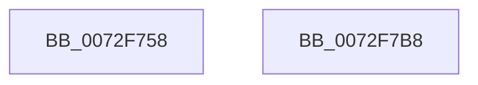

# IopIrqInitialize

- RVA: `0x0072F758`–`0x0072F7B9` (길이 `97` bytes)
- VA: `0x000000014072F758`
- 실행 섹션: `PAGE`
- PDB 이름 있음: `예`; PDB Function 태그: `아니요`
- unwind 정보 RVA: `0x0005D2F4`
- 디코드: `17`개 명령, `97/97` bytes 표시
- 미해석 바이트: `0` (있으면 어셈블리에 `.byte`로 보존)

> 이 문서는 커널 이미지의 기계어와 PDB 기호를 분석해 생성했습니다. 4번과 5번은 함수 원형과 자료형을 바이너리 사용 방식에서 추정한 C 해석이며 원본 소스 복구 결과는 아닙니다.

## 1. Dependencies

- 직접 호출 지점: **1**; 고유 호출 대상: **1**
- 직접 호출자로 확인된 함수: **1**
- RIP 상대 이미지 참조: **10**

### Outgoing calls
- `0x0072F7AE` → [ArbInitializeArbiterInstance](../70/ArbInitializeArbiterInstance_function_0070ECB4.md) (function, `0x0070ECB4`)

### Direct callers
- [IopInitializePlugPlayServices](../../init/C2/IopInitializePlugPlayServices_function_00C2F298.md) at `0x00C2F5E6`

### Static image references
- `0x0072F762` → RVA `0x0072F710` (`IopDmaUnpackRequirement`; read)
- `0x0072F769` → RVA `0x00F8BC38` (`.data`; write)
- `0x0072F770` → RVA `0x00AFE230` (` ?? ::NNGAKEGL::`string'`; read)
- `0x0072F777` → RVA `0x0072F7C0` (`IopIrqPackResource`; read)
- `0x0072F784` → RVA `0x00F8BC40` (`.data`; write)
- `0x0072F78B` → RVA `0x00F8BBC0` (`.data`; read)
- `0x0072F792` → RVA `0x0072F810` (`IopIrqUnpackResource`; read)
- `0x0072F799` → RVA `0x00F8BC48` (`.data`; write)
- `0x0072F7A0` → RVA `0x0072F800` (`IopIrqScoreRequirement`; read)
- `0x0072F7A7` → RVA `0x00F8BC50` (`.data`; write)

## 2. Other-region calls and transfers

- 다른 실행 섹션으로 향하는 call: **0**
- 별도 외부 분기/꼬리 이동을 확인하지 못했습니다.

## 3. Assembly (complete function range)

```asm
0072F758  48 83 EC 38                     sub rsp, 0x38
0072F75C  48 83 64 24 28 00               and qword ptr [rsp + 0x28], 0
0072F762  48 8D 05 A7 FF FF FF            lea rax, [rip - 0x59]
0072F769  48 89 05 C8 C4 85 00            mov qword ptr [rip + 0x85c4c8], rax
0072F770  4C 8D 0D B9 EA 3C 00            lea r9, [rip + 0x3ceab9]
0072F777  48 8D 05 42 00 00 00            lea rax, [rip + 0x42]
0072F77E  41 B8 02 00 00 00               mov r8d, 2
0072F784  48 89 05 B5 C4 85 00            mov qword ptr [rip + 0x85c4b5], rax
0072F78B  48 8D 0D 2E C4 85 00            lea rcx, [rip + 0x85c42e]
0072F792  48 8D 05 77 00 00 00            lea rax, [rip + 0x77]
0072F799  48 89 05 A8 C4 85 00            mov qword ptr [rip + 0x85c4a8], rax
0072F7A0  48 8D 05 59 00 00 00            lea rax, [rip + 0x59]
0072F7A7  48 89 05 A2 C4 85 00            mov qword ptr [rip + 0x85c4a2], rax
0072F7AE  E8 01 F5 FD FF                  call 0x14070ecb4
0072F7B3  48 83 C4 38                     add rsp, 0x38
0072F7B7  C3                              ret
0072F7B8  CC                              int3
```

## 4. C-style interpretation (structured pseudocode)

```c
__int64 __fastcall IopIrqInitialize(void)
{
    __int64 result;
    __int64 v_rsp;
    unsigned __int64 v_stack_m10;

    v_rsp = (v_rsp) - (56);
    *(unsigned __int64 *)(v_rip + 8766664) = v_rip - 89;
    *(unsigned __int64 *)(v_rip + 8766645) = v_rip + 66;
    *(unsigned __int64 *)(v_rip + 8766632) = v_rip + 119;
    *(unsigned __int64 *)(v_rip + 8766626) = v_rip + 89;
    result = ArbInitializeArbiterInstance(v_rip + 8766510, a2, 2, v_rip + 3992249);
    v_rsp = (v_rsp) + (56);
    return result;
}
```

## 5. (Beta) C Style

```c
void IopIrqInitialize(void)
{
    int64_t result;
    int64_t local_rsp;
    uint64_t v_stack_m10;

    local_rsp = (local_rsp) - (56);
    *(uint64_t *)(v_rip + 0x85C4C8) = v_rip - 89;
    *(uint64_t *)(v_rip + 0x85C4B5) = v_rip + 66;
    *(uint64_t *)(v_rip + 0x85C4A8) = v_rip + 119;
    *(uint64_t *)(v_rip + 0x85C4A2) = v_rip + 89;
    result = ArbInitializeArbiterInstance(v_rip + 8766510, a2, 2, v_rip + 3992249);
    local_rsp = (local_rsp) + (56);
    return result;
}
```

## 6. Execution-region graph

[열기: 2D/3D 그래프와 함수 탐색 컨트롤 패널](../../../control-panel.html?section=page&rva=0x0072F758&view=graph)

- 2D 그래프는 위에서 아래로 흐르고, 3D 그래프는 빈 공간을 드래그해 회전합니다. Shift+드래그는 이동, 휠은 확대·축소, 함수 노드 선택은 대상 보고서 이동입니다.

### Static fallback


