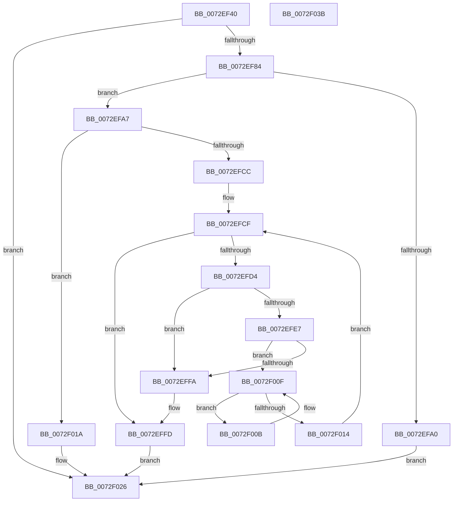

# IopIsPciRootBus

- RVA: `0x0072EF40`–`0x0072F03C` (길이 `252` bytes)
- VA: `0x000000014072EF40`
- 실행 섹션: `PAGE`
- PDB 이름 있음: `예`; PDB Function 태그: `아니요`
- unwind 정보 RVA: `0x000A7960`
- 디코드: `73`개 명령, `252/252` bytes 표시
- 미해석 바이트: `0` (있으면 어셈블리에 `.byte`로 보존)

> 이 문서는 커널 이미지의 기계어와 PDB 기호를 분석해 생성했습니다. 4번과 5번은 함수 원형과 자료형을 바이너리 사용 방식에서 추정한 C 해석이며 원본 소스 복구 결과는 아닙니다.

## 1. Dependencies

- 직접 호출 지점: **7**; 고유 호출 대상: **4**
- 직접 호출자로 확인된 함수: **1**
- RIP 상대 이미지 참조: **2**

### Outgoing calls
- `0x0072EF74` → [IoGetDeviceProperty](../8F/IoGetDeviceProperty_function_008FA720.md) (function, `0x008FA720`)
- `0x0072EF93` → [ExAllocatePool2](../../poolcode/B8/ExAllocatePool2_function_00B820F0.md) (function, `0x00B820F0`)
- `0x0072EFC1` → [IoGetDeviceProperty](../8F/IoGetDeviceProperty_function_008FA720.md) (function, `0x008FA720`)
- `0x0072EFDE` → [wcsicmp](../../text/50/wcsicmp_function_00500080.md) (function, `0x00500080`)
- `0x0072EFF1` → [wcsicmp](../../text/50/wcsicmp_function_00500080.md) (function, `0x00500080`)
- `0x0072F002` → [ExFreePoolWithTag](../../poolcode/B8/ExFreePoolWithTag_function_00B82870.md) (function, `0x00B82870`)
- `0x0072F01F` → [ExFreePoolWithTag](../../poolcode/B8/ExFreePoolWithTag_function_00B82870.md) (function, `0x00B82870`)

### Direct callers
- [IopMemQueryConflict](IopMemQueryConflict_function_0072F160.md) at `0x0072F18F`

### Static image references
- `0x0072EFD4` → RVA `0x00AFE1D0` (` ?? ::NNGAKEGL::`string'`; read)
- `0x0072EFE7` → RVA `0x00AFE1F0` (` ?? ::NNGAKEGL::`string'`; read)

## 2. Other-region calls and transfers

- 다른 실행 섹션으로 향하는 call: **5**
  - `0x0072EF93` → [ExAllocatePool2](../../poolcode/B8/ExAllocatePool2_function_00B820F0.md) (`PAGE` → `POOLCODE`)
  - `0x0072EFDE` → [wcsicmp](../../text/50/wcsicmp_function_00500080.md) (`PAGE` → `.text`)
  - `0x0072EFF1` → [wcsicmp](../../text/50/wcsicmp_function_00500080.md) (`PAGE` → `.text`)
  - `0x0072F002` → [ExFreePoolWithTag](../../poolcode/B8/ExFreePoolWithTag_function_00B82870.md) (`PAGE` → `POOLCODE`)
  - `0x0072F01F` → [ExFreePoolWithTag](../../poolcode/B8/ExFreePoolWithTag_function_00B82870.md) (`PAGE` → `POOLCODE`)
- 별도 외부 분기/꼬리 이동을 확인하지 못했습니다.

## 3. Assembly (complete function range)

```asm
0072EF40  48 8B C4                        mov rax, rsp
0072EF43  48 89 58 08                     mov qword ptr [rax + 8], rbx
0072EF47  48 89 68 18                     mov qword ptr [rax + 0x18], rbp
0072EF4B  48 89 70 20                     mov qword ptr [rax + 0x20], rsi
0072EF4F  57                              push rdi
0072EF50  48 83 EC 30                     sub rsp, 0x30
0072EF54  33 ED                           xor ebp, ebp
0072EF56  48 8B F2                        mov rsi, rdx
0072EF59  89 68 10                        mov dword ptr [rax + 0x10], ebp
0072EF5C  48 8D 40 10                     lea rax, [rax + 0x10]
0072EF60  40 88 2A                        mov byte ptr [rdx], bpl
0072EF63  45 33 C9                        xor r9d, r9d
0072EF66  45 33 C0                        xor r8d, r8d
0072EF69  48 89 44 24 20                  mov qword ptr [rsp + 0x20], rax
0072EF6E  8D 55 01                        lea edx, [rbp + 1]
0072EF71  48 8B D9                        mov rbx, rcx
0072EF74  E8 A7 B7 1C 00                  call 0x1408fa720
0072EF79  3D 23 00 00 C0                  cmp eax, 0xc0000023
0072EF7E  0F 85 A2 00 00 00               jne 0x14072f026
0072EF84  8B 54 24 48                     mov edx, dword ptr [rsp + 0x48]
0072EF88  B9 00 01 00 00                  mov ecx, 0x100
0072EF8D  41 B8 50 70 20 20               mov r8d, 0x20207050
0072EF93  E8 58 31 45 00                  call 0x140b820f0
0072EF98  48 8B F8                        mov rdi, rax
0072EF9B  48 85 C0                        test rax, rax
0072EF9E  75 07                           jne 0x14072efa7
0072EFA0  B8 9A 00 00 C0                  mov eax, 0xc000009a
0072EFA5  EB 7F                           jmp 0x14072f026
0072EFA7  44 8B 44 24 48                  mov r8d, dword ptr [rsp + 0x48]
0072EFAC  48 8D 44 24 48                  lea rax, [rsp + 0x48]
0072EFB1  4C 8B CF                        mov r9, rdi
0072EFB4  48 89 44 24 20                  mov qword ptr [rsp + 0x20], rax
0072EFB9  BA 01 00 00 00                  mov edx, 1
0072EFBE  48 8B CB                        mov rcx, rbx
0072EFC1  E8 5A B7 1C 00                  call 0x1408fa720
0072EFC6  8B D8                           mov ebx, eax
0072EFC8  85 C0                           test eax, eax
0072EFCA  78 4E                           js 0x14072f01a
0072EFCC  48 8B DF                        mov rbx, rdi
0072EFCF  66 39 2B                        cmp word ptr [rbx], bp
0072EFD2  74 29                           je 0x14072effd
0072EFD4  48 8D 15 F5 F1 3C 00            lea rdx, [rip + 0x3cf1f5]
0072EFDB  48 8B CB                        mov rcx, rbx
0072EFDE  E8 9D 10 DD FF                  call 0x140500080
0072EFE3  85 C0                           test eax, eax
0072EFE5  74 13                           je 0x14072effa
0072EFE7  48 8D 15 02 F2 3C 00            lea rdx, [rip + 0x3cf202]
0072EFEE  48 8B CB                        mov rcx, rbx
0072EFF1  E8 8A 10 DD FF                  call 0x140500080
0072EFF6  85 C0                           test eax, eax
0072EFF8  75 15                           jne 0x14072f00f
0072EFFA  C6 06 01                        mov byte ptr [rsi], 1
0072EFFD  33 D2                           xor edx, edx
0072EFFF  48 8B CF                        mov rcx, rdi
0072F002  E8 69 38 45 00                  call 0x140b82870
0072F007  33 C0                           xor eax, eax
0072F009  EB 1B                           jmp 0x14072f026
0072F00B  48 83 C3 02                     add rbx, 2
0072F00F  66 39 2B                        cmp word ptr [rbx], bp
0072F012  75 F7                           jne 0x14072f00b
0072F014  48 83 C3 02                     add rbx, 2
0072F018  EB B5                           jmp 0x14072efcf
0072F01A  33 D2                           xor edx, edx
0072F01C  48 8B CF                        mov rcx, rdi
0072F01F  E8 4C 38 45 00                  call 0x140b82870
0072F024  8B C3                           mov eax, ebx
0072F026  48 8B 5C 24 40                  mov rbx, qword ptr [rsp + 0x40]
0072F02B  48 8B 6C 24 50                  mov rbp, qword ptr [rsp + 0x50]
0072F030  48 8B 74 24 58                  mov rsi, qword ptr [rsp + 0x58]
0072F035  48 83 C4 30                     add rsp, 0x30
0072F039  5F                              pop rdi
0072F03A  C3                              ret
0072F03B  CC                              int3
```

## 4. C-style interpretation (structured pseudocode)

```c
__int64 __fastcall IopIsPciRootBus(__int64 a1, __int64 a2, int a3, int a4)
{
    __int64 result;
    __int64 v_rbp;
    __int64 v_rbx;
    __int64 v_rsp;
    unsigned __int64 v_stack_m18;
    unsigned int v_stack_p10;
    unsigned __int64 v_stack_p18;
    unsigned __int64 v_stack_p20;
    unsigned __int64 v_stack_p8;

    *(unsigned __int64 *)(v_rsp + 8) = v_rbx;
    *(unsigned __int64 *)(v_rsp + 24) = v_rbp;
    *(unsigned __int64 *)(v_rsp + 32) = v_rsi;
    v_rsp = (v_rsp) - (48);
    v_rbp = 0;
    *(unsigned int *)(v_rsp + 16) = 0;
    *(unsigned __int8 *)(a2) = 0;
    a4 = 0;
    a3 = 0;
    v_stack_m18 = v_rsp + 16;
    result = IoGetDeviceProperty(a1, v_rbp + 1, a3, a4);
    if (((unsigned int)(result)) != 0xC0000023ULL) goto loc_0072F026;
    result = ExAllocatePool2(256, (unsigned int)(v_stack_p10), (unsigned int)(0x20207050ULL), a4);
    if (result != 0) goto loc_0072EFA7;
    goto loc_0072F026;
loc_0072EFA7:
    v_stack_m18 = v_stack_p10;
    result = IoGetDeviceProperty(a1, 1, (unsigned int)(v_stack_p10), result);
    if (sign_flag) goto loc_0072F01A;
loc_0072EFCF:
    if ((*(unsigned __int16 *)(result)) == 0) goto loc_0072EFFD;
    result = wcsicmp(result, v_rip + 3994101, (unsigned int)(v_stack_p10), result);
    if ((unsigned int)(result) == 0) goto loc_0072EFFA;
    result = wcsicmp(result, v_rip + 3994114, (unsigned int)(v_stack_p10), result);
    if ((unsigned int)(result) != 0) goto loc_0072F00F;
loc_0072EFFA:
    *(unsigned __int8 *)(a2) = 1;
loc_0072EFFD:
    a2 = 0;
    result = ExFreePoolWithTag(result, a2, (unsigned int)(v_stack_p10), result);
    result = 0;
    goto loc_0072F026;
loc_0072F00B:
    v_rbx = (result) + (2);
loc_0072F00F:
    if ((*(unsigned __int16 *)(v_rbx)) != 0) goto loc_0072F00B;
    v_rbx = (v_rbx) + (2);
    goto loc_0072EFCF;
loc_0072F01A:
    a2 = 0;
    result = ExFreePoolWithTag(0, a2, (unsigned int)(v_stack_p10), result);
loc_0072F026:
    v_rsp = (v_rsp) + (48);
    return (unsigned int)((unsigned int)(v_rbx));
}
```

## 5. (Beta) C Style

```c
int64_t IopIsPciRootBus(int64_t Arg1, void *Arg2, int32_t Arg3, int32_t Arg4)
{
    uint8_t *arg2 = (uint8_t *)Arg2;

    int64_t result;
    int64_t local_rbp;
    int64_t local_rbx;
    int64_t local_rsp;
    uint64_t v_stack_m18;
    uint32_t v_stack_p10;
    uint64_t v_stack_p18;
    uint64_t v_stack_p20;
    uint64_t v_stack_p8;

    *(uint64_t *)(local_rsp + 0x8) = local_rbx;
    *(uint64_t *)(local_rsp + 0x18) = local_rbp;
    *(uint64_t *)(local_rsp + 0x20) = local_rsi;
    local_rsp = (local_rsp) - (48);
    local_rbp = 0;
    *(uint32_t *)(local_rsp + 0x10) = 0;
    *(uint8_t *)(arg2) = 0;
    Arg4 = 0;
    Arg3 = 0;
    v_stack_m18 = local_rsp + 16;
    result = IoGetDeviceProperty(Arg1, local_rbp + 1, Arg3, Arg4);
    if (((uint32_t)(result)) != 0xC0000023ULL) goto loc_0072F026;
    result = ExAllocatePool2(256, (uint32_t)(v_stack_p10), (uint32_t)(0x20207050ULL), Arg4);
    if (result != 0) goto loc_0072EFA7;
    goto loc_0072F026;
loc_0072EFA7:
    v_stack_m18 = v_stack_p10;
    result = IoGetDeviceProperty(Arg1, 1, (uint32_t)(v_stack_p10), result);
    if (sign_flag) goto loc_0072F01A;
loc_0072EFCF:
    if ((*(uint16_t *)(result)) == 0) goto loc_0072EFFD;
    result = wcsicmp(result, v_rip + 3994101, (uint32_t)(v_stack_p10), result);
    if ((uint32_t)(result) == 0) goto loc_0072EFFA;
    result = wcsicmp(result, v_rip + 3994114, (uint32_t)(v_stack_p10), result);
    if ((uint32_t)(result) != 0) goto loc_0072F00F;
loc_0072EFFA:
    *(uint8_t *)(arg2) = 1;
loc_0072EFFD:
    Arg2 = 0;
    result = ExFreePoolWithTag(result, Arg2, (uint32_t)(v_stack_p10), result);
    result = 0;
    goto loc_0072F026;
loc_0072F00B:
    local_rbx = (result) + (2);
loc_0072F00F:
    if ((*(uint16_t *)(local_rbx)) != 0) goto loc_0072F00B;
    local_rbx = (local_rbx) + (2);
    goto loc_0072EFCF;
loc_0072F01A:
    Arg2 = 0;
    result = ExFreePoolWithTag(0, Arg2, (uint32_t)(v_stack_p10), result);
loc_0072F026:
    local_rsp = (local_rsp) + (48);
    return (uint32_t)((uint32_t)(local_rbx));
}
```

### 관측된 메모리 오프셋

구조체 형식이 확인되지 않은 접근은 인자 기준의 오프셋으로만 기록했습니다.

| 기준 인자 | 오프셋 표현 | 폭 (bit) | 접근 |
|---|---:|---:|---|
| `Arg2` | `+ 0x0` | `8` | `W` |

## 6. Execution-region graph

[열기: 2D/3D 그래프와 함수 탐색 컨트롤 패널](../../../control-panel.html?section=page&rva=0x0072EF40&view=graph)

- 2D 그래프는 위에서 아래로 흐르고, 3D 그래프는 빈 공간을 드래그해 회전합니다. Shift+드래그는 이동, 휠은 확대·축소, 함수 노드 선택은 대상 보고서 이동입니다.

### Static fallback


