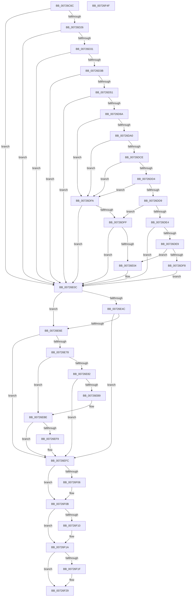

# IopIsReportedAlready

- RVA: `0x00726C6C`–`0x00726F50` (길이 `740` bytes)
- VA: `0x0000000140726C6C`
- 실행 섹션: `PAGE`
- PDB 이름 있음: `예`; PDB Function 태그: `아니요`
- unwind 정보 RVA: `0x000C82E4`
- 디코드: `187`개 명령, `740/740` bytes 표시
- 미해석 바이트: `0` (있으면 어셈블리에 `.byte`로 보존)

> 이 문서는 커널 이미지의 기계어와 PDB 기호를 분석해 생성했습니다. 4번과 5번은 함수 원형과 자료형을 바이너리 사용 방식에서 추정한 C 해석이며 원본 소스 복구 결과는 아닙니다.

## 1. Dependencies

- 직접 호출 지점: **15**; 고유 호출 대상: **10**
- 직접 호출자로 확인된 함수: **1**
- RIP 상대 이미지 참조: **4**

### Outgoing calls
- `0x00726D19` → [CmGetDeviceRegProp](../8E/CmGetDeviceRegProp_function_008ED870.md) (function, `0x008ED870`)
- `0x00726D44` → [RtlInitUnicodeStringEx](../../text/46/RtlInitUnicodeStringEx_function_00463960.md) (function, `0x00463960`)
- `0x00726D5D` → [RtlEqualUnicodeString](../93/RtlEqualUnicodeString_function_00932A20.md) (function, `0x00932A20`)
- `0x00726D97` → [_CmOpenDeviceRegKey](../8E/_CmOpenDeviceRegKey_function_008EE540.md) (function, `0x008EE540`)
- `0x00726DB4` → [IopGetRegistryValue](../99/IopGetRegistryValue_function_009990EC.md) (function, `0x009990EC`)
- `0x00726DC0` → [ZwClose](../../text/6A/ZwClose_function_006AD2B0.md) (function, `0x006AD2B0`)
- `0x00726DEF` → [PnpIsDuplicateDevice](PnpIsDuplicateDevice_function_00726F58.md) (function, `0x00726F58`)
- `0x00726E3C` → [_CmOpenDeviceRegKey](../8E/_CmOpenDeviceRegKey_function_008EE540.md) (function, `0x008EE540`)
- `0x00726E5C` → [IopGetRegistryValue](../99/IopGetRegistryValue_function_009990EC.md) (function, `0x009990EC`)
- `0x00726EB0` → [_CmOpenDeviceRegKey](../8E/_CmOpenDeviceRegKey_function_008EE540.md) (function, `0x008EE540`)
- `0x00726EF0` → [ZwSetValueKey](../../text/6A/ZwSetValueKey_function_006ADCD0.md) (function, `0x006ADCD0`)
- `0x00726F06` → [ZwClose](../../text/6A/ZwClose_function_006AD2B0.md) (function, `0x006AD2B0`)
- `0x00726F15` → [ExFreePoolWithTag](../../poolcode/B8/ExFreePoolWithTag_function_00B82870.md) (function, `0x00B82870`)
- `0x00726F24` → [ExFreePoolWithTag](../../poolcode/B8/ExFreePoolWithTag_function_00B82870.md) (function, `0x00B82870`)
- `0x00726F36` → [_security_check_cookie](../../text/6A/_security_check_cookie_function_006AC640.md) (function, `0x006AC640`)

### Direct callers
- [IoReportDetectedDevice](IoReportDetectedDevice_function_00725CD0.md) at `0x00725FC5`

### Static image references
- `0x00726C88` → RVA `0x00E0A740` (`.data`; read)
- `0x00726CF6` → RVA `0x00E66398` (`.data`; read)
- `0x00726DAD` → RVA `0x00AFD500` (` ?? ::NNGAKEGL::`string'`; read)
- `0x00726E41` → RVA `0x00AFD4E0` (` ?? ::NNGAKEGL::`string'`; read)

## 2. Other-region calls and transfers

- 다른 실행 섹션으로 향하는 call: **7**
  - `0x00726D44` → [RtlInitUnicodeStringEx](../../text/46/RtlInitUnicodeStringEx_function_00463960.md) (`PAGE` → `.text`)
  - `0x00726DC0` → [ZwClose](../../text/6A/ZwClose_function_006AD2B0.md) (`PAGE` → `.text`)
  - `0x00726EF0` → [ZwSetValueKey](../../text/6A/ZwSetValueKey_function_006ADCD0.md) (`PAGE` → `.text`)
  - `0x00726F06` → [ZwClose](../../text/6A/ZwClose_function_006AD2B0.md) (`PAGE` → `.text`)
  - `0x00726F15` → [ExFreePoolWithTag](../../poolcode/B8/ExFreePoolWithTag_function_00B82870.md) (`PAGE` → `POOLCODE`)
  - `0x00726F24` → [ExFreePoolWithTag](../../poolcode/B8/ExFreePoolWithTag_function_00B82870.md) (`PAGE` → `POOLCODE`)
  - `0x00726F36` → [_security_check_cookie](../../text/6A/_security_check_cookie_function_006AC640.md) (`PAGE` → `.text`)
- 별도 외부 분기/꼬리 이동을 확인하지 못했습니다.

## 3. Assembly (complete function range)

```asm
00726C6C  40 55                           push rbp
00726C6E  53                              push rbx
00726C6F  56                              push rsi
00726C70  57                              push rdi
00726C71  41 54                           push r12
00726C73  41 55                           push r13
00726C75  41 56                           push r14
00726C77  41 57                           push r15
00726C79  48 8D AC 24 58 FE FF FF         lea rbp, [rsp - 0x1a8]
00726C81  48 81 EC A8 02 00 00            sub rsp, 0x2a8
00726C88  48 8B 05 B1 3A 6E 00            mov rax, qword ptr [rip + 0x6e3ab1]
00726C8F  48 33 C4                        xor rax, rsp
00726C92  48 89 85 90 01 00 00            mov qword ptr [rbp + 0x190], rax
00726C99  4C 8B A5 10 02 00 00            mov r12, qword ptr [rbp + 0x210]
00726CA0  33 C0                           xor eax, eax
00726CA2  89 44 24 38                     mov dword ptr [rsp + 0x38], eax
00726CA6  8B F8                           mov edi, eax
00726CA8  44 8B F0                        mov r14d, eax
00726CAB  48 89 44 24 68                  mov qword ptr [rsp + 0x68], rax
00726CB0  8B D8                           mov ebx, eax
00726CB2  48 89 44 24 60                  mov qword ptr [rsp + 0x60], rax
00726CB7  41 89 04 24                     mov dword ptr [r12], eax
00726CBB  40 8A F0                        mov sil, al
00726CBE  48 89 44 24 58                  mov qword ptr [rsp + 0x58], rax
00726CC3  4D 8B F9                        mov r15, r9
00726CC6  48 89 44 24 40                  mov qword ptr [rsp + 0x40], rax
00726CCB  44 8D 4F 05                     lea r9d, [rdi + 5]
00726CCF  89 44 24 50                     mov dword ptr [rsp + 0x50], eax
00726CD3  4C 8B E9                        mov r13, rcx
00726CD6  89 44 24 48                     mov dword ptr [rsp + 0x48], eax
00726CDA  0F 57 C0                        xorps xmm0, xmm0
00726CDD  48 8D 44 24 4C                  lea rax, [rsp + 0x4c]
00726CE2  4C 89 45 80                     mov qword ptr [rbp - 0x80], r8
00726CE6  48 89 44 24 30                  mov qword ptr [rsp + 0x30], rax
00726CEB  4C 8B C2                        mov r8, rdx
00726CEE  48 8B 51 08                     mov rdx, qword ptr [rcx + 8]
00726CF2  48 8D 45 90                     lea rax, [rbp - 0x70]
00726CF6  48 8B 0D 9B F6 73 00            mov rcx, qword ptr [rip + 0x73f69b]
00726CFD  48 89 44 24 28                  mov qword ptr [rsp + 0x28], rax
00726D02  48 8D 44 24 48                  lea rax, [rsp + 0x48]
00726D07  48 89 44 24 20                  mov qword ptr [rsp + 0x20], rax
00726D0C  0F 11 44 24 70                  movups xmmword ptr [rsp + 0x70], xmm0
00726D11  C7 44 24 4C 00 02 00 00         mov dword ptr [rsp + 0x4c], 0x200
00726D19  E8 52 6B 1C 00                  call 0x1408ed870
00726D1E  85 C0                           test eax, eax
00726D20  0F 88 E6 00 00 00               js 0x140726e0c
00726D26  83 7C 24 48 01                  cmp dword ptr [rsp + 0x48], 1
00726D2B  0F 85 DB 00 00 00               jne 0x140726e0c
00726D31  39 5C 24 4C                     cmp dword ptr [rsp + 0x4c], ebx
00726D35  0F 84 D1 00 00 00               je 0x140726e0c
00726D3B  48 8D 55 90                     lea rdx, [rbp - 0x70]
00726D3F  48 8D 4C 24 70                  lea rcx, [rsp + 0x70]
00726D44  E8 17 CC D3 FF                  call 0x140463960
00726D49  85 C0                           test eax, eax
00726D4B  0F 88 BB 00 00 00               js 0x140726e0c
00726D51  48 8B 4D 80                     mov rcx, qword ptr [rbp - 0x80]
00726D55  48 8D 54 24 70                  lea rdx, [rsp + 0x70]
00726D5A  41 B0 01                        mov r8b, 1
00726D5D  E8 BE BC 20 00                  call 0x140932a20
00726D62  84 C0                           test al, al
00726D64  0F 84 A2 00 00 00               je 0x140726e0c
00726D6A  48 21 5C 24 38                  and qword ptr [rsp + 0x38], rbx
00726D6F  48 8D 44 24 58                  lea rax, [rsp + 0x58]
00726D74  49 8B 55 08                     mov rdx, qword ptr [r13 + 8]
00726D78  44 8D 47 14                     lea r8d, [rdi + 0x14]
00726D7C  48 8B 0D 15 F6 73 00            mov rcx, qword ptr [rip + 0x73f615]
00726D83  45 33 C9                        xor r9d, r9d
00726D86  48 89 44 24 30                  mov qword ptr [rsp + 0x30], rax
00726D8B  88 5C 24 28                     mov byte ptr [rsp + 0x28], bl
00726D8F  C7 44 24 20 19 00 02 00         mov dword ptr [rsp + 0x20], 0x20019
00726D97  E8 A4 77 1C 00                  call 0x1408ee540
00726D9C  85 C0                           test eax, eax
00726D9E  78 5A                           js 0x140726dfa
00726DA0  48 8B 4C 24 58                  mov rcx, qword ptr [rsp + 0x58]
00726DA5  4C 8D 4C 24 60                  lea r9, [rsp + 0x60]
00726DAA  45 33 C0                        xor r8d, r8d
00726DAD  48 8D 15 4C 67 3D 00            lea rdx, [rip + 0x3d674c]
00726DB4  E8 33 23 27 00                  call 0x1409990ec
00726DB9  48 8B 4C 24 58                  mov rcx, qword ptr [rsp + 0x58]
00726DBE  8B D8                           mov ebx, eax
00726DC0  E8 EB 64 F8 FF                  call 0x1406ad2b0
00726DC5  85 DB                           test ebx, ebx
00726DC7  48 8B 5C 24 60                  mov rbx, qword ptr [rsp + 0x60]
00726DCC  78 2C                           js 0x140726dfa
00726DCE  83 7B 04 08                     cmp dword ptr [rbx + 4], 8
00726DD2  75 26                           jne 0x140726dfa
00726DD4  39 7B 0C                        cmp dword ptr [rbx + 0xc], edi
00726DD7  74 21                           je 0x140726dfa
00726DD9  8B 7B 08                        mov edi, dword ptr [rbx + 8]
00726DDC  48 03 FB                        add rdi, rbx
00726DDF  4D 85 FF                        test r15, r15
00726DE2  74 1B                           je 0x140726dff
00726DE4  48 85 FF                        test rdi, rdi
00726DE7  74 23                           je 0x140726e0c
00726DE9  48 8B D7                        mov rdx, rdi
00726DEC  49 8B CF                        mov rcx, r15
00726DEF  E8 64 01 00 00                  call 0x140726f58
00726DF4  85 C0                           test eax, eax
00726DF6  75 0C                           jne 0x140726e04
00726DF8  EB 12                           jmp 0x140726e0c
00726DFA  4D 85 FF                        test r15, r15
00726DFD  75 0D                           jne 0x140726e0c
00726DFF  48 85 FF                        test rdi, rdi
00726E02  75 08                           jne 0x140726e0c
00726E04  41 C7 04 24 01 00 00 00         mov dword ptr [r12], 1
00726E0C  49 8B 55 08                     mov rdx, qword ptr [r13 + 8]
00726E10  48 8D 44 24 40                  lea rax, [rsp + 0x40]
00726E15  48 8B 0D 7C F5 73 00            mov rcx, qword ptr [rip + 0x73f57c]
00726E1C  33 FF                           xor edi, edi
00726E1E  48 89 7C 24 38                  mov qword ptr [rsp + 0x38], rdi
00726E23  45 33 C9                        xor r9d, r9d
00726E26  48 89 44 24 30                  mov qword ptr [rsp + 0x30], rax
00726E2B  40 88 7C 24 28                  mov byte ptr [rsp + 0x28], dil
00726E30  44 8D 47 13                     lea r8d, [rdi + 0x13]
00726E34  C7 44 24 20 3F 00 0F 00         mov dword ptr [rsp + 0x20], 0xf003f
00726E3C  E8 FF 76 1C 00                  call 0x1408ee540
00726E41  4C 8D 3D 98 66 3D 00            lea r15, [rip + 0x3d6698]
00726E48  85 C0                           test eax, eax
00726E4A  78 22                           js 0x140726e6e
00726E4C  48 8B 4C 24 40                  mov rcx, qword ptr [rsp + 0x40]
00726E51  4C 8D 4C 24 68                  lea r9, [rsp + 0x68]
00726E56  45 33 C0                        xor r8d, r8d
00726E59  49 8B D7                        mov rdx, r15
00726E5C  E8 8B 22 27 00                  call 0x1409990ec
00726E61  4C 8B 74 24 68                  mov r14, qword ptr [rsp + 0x68]
00726E66  85 C0                           test eax, eax
00726E68  0F 89 8E 00 00 00               jns 0x140726efc
00726E6E  41 39 3C 24                     cmp dword ptr [r12], edi
00726E72  0F 84 84 00 00 00               je 0x140726efc
00726E78  48 8B 4C 24 40                  mov rcx, qword ptr [rsp + 0x40]
00726E7D  48 85 C9                        test rcx, rcx
00726E80  75 3C                           jne 0x140726ebe
00726E82  49 8B 55 08                     mov rdx, qword ptr [r13 + 8]
00726E86  48 8D 44 24 40                  lea rax, [rsp + 0x40]
00726E8B  48 89 7C 24 38                  mov qword ptr [rsp + 0x38], rdi
00726E90  44 8D 41 13                     lea r8d, [rcx + 0x13]
00726E94  48 8B 0D FD F4 73 00            mov rcx, qword ptr [rip + 0x73f4fd]
00726E9B  45 33 C9                        xor r9d, r9d
00726E9E  48 89 44 24 30                  mov qword ptr [rsp + 0x30], rax
00726EA3  C6 44 24 28 01                  mov byte ptr [rsp + 0x28], 1
00726EA8  C7 44 24 20 3F 00 0F 00         mov dword ptr [rsp + 0x20], 0xf003f
00726EB0  E8 8B 76 1C 00                  call 0x1408ee540
00726EB5  85 C0                           test eax, eax
00726EB7  78 43                           js 0x140726efc
00726EB9  48 8B 4C 24 40                  mov rcx, qword ptr [rsp + 0x40]
00726EBE  41 B9 04 00 00 00               mov r9d, 4
00726EC4  C7 44 24 70 1C 00 1E 00         mov dword ptr [rsp + 0x70], 0x1e001c
00726ECC  48 8D 44 24 50                  lea rax, [rsp + 0x50]
00726ED1  44 89 4C 24 28                  mov dword ptr [rsp + 0x28], r9d
00726ED6  45 33 C0                        xor r8d, r8d
00726ED9  48 89 44 24 20                  mov qword ptr [rsp + 0x20], rax
00726EDE  48 8D 54 24 70                  lea rdx, [rsp + 0x70]
00726EE3  4C 89 7C 24 78                  mov qword ptr [rsp + 0x78], r15
00726EE8  C7 44 24 50 01 00 00 00         mov dword ptr [rsp + 0x50], 1
00726EF0  E8 DB 6D F8 FF                  call 0x1406adcd0
00726EF5  85 C0                           test eax, eax
00726EF7  78 03                           js 0x140726efc
00726EF9  40 B6 01                        mov sil, 1
00726EFC  48 8B 4C 24 40                  mov rcx, qword ptr [rsp + 0x40]
00726F01  48 85 C9                        test rcx, rcx
00726F04  74 05                           je 0x140726f0b
00726F06  E8 A5 63 F8 FF                  call 0x1406ad2b0
00726F0B  4D 85 F6                        test r14, r14
00726F0E  74 0A                           je 0x140726f1a
00726F10  33 D2                           xor edx, edx
00726F12  49 8B CE                        mov rcx, r14
00726F15  E8 56 B9 45 00                  call 0x140b82870
00726F1A  48 85 DB                        test rbx, rbx
00726F1D  74 0A                           je 0x140726f29
00726F1F  33 D2                           xor edx, edx
00726F21  48 8B CB                        mov rcx, rbx
00726F24  E8 47 B9 45 00                  call 0x140b82870
00726F29  40 8A C6                        mov al, sil
00726F2C  48 8B 8D 90 01 00 00            mov rcx, qword ptr [rbp + 0x190]
00726F33  48 33 CC                        xor rcx, rsp
00726F36  E8 05 57 F8 FF                  call 0x1406ac640
00726F3B  48 81 C4 A8 02 00 00            add rsp, 0x2a8
00726F42  41 5F                           pop r15
00726F44  41 5E                           pop r14
00726F46  41 5D                           pop r13
00726F48  41 5C                           pop r12
00726F4A  5F                              pop rdi
00726F4B  5E                              pop rsi
00726F4C  5B                              pop rbx
00726F4D  5D                              pop rbp
00726F4E  C3                              ret
00726F4F  CC                              int3
```

## 4. C-style interpretation (structured pseudocode)

```c
__int64 __fastcall IopIsReportedAlready(__int64 a1, __int64 a2, __int64 a3, __int64 a4, __int64 a5)
{
    __int64 result;
    __int64 v_rdi;
    __int64 v_rsi;
    __int64 v_rsp;
    unsigned __int64 v_stack_m1E8;
    unsigned __int64 v_stack_m258;
    unsigned __int64 v_stack_m268;
    unsigned __int64 v_stack_m270;
    unsigned __int64 v_stack_m278;
    unsigned __int64 v_stack_m280;
    unsigned __int64 v_stack_m288;
    unsigned __int64 v_stack_m290;
    unsigned int v_stack_m298;
    unsigned __int64 v_stack_m29C;
    unsigned int v_stack_m2A0;
    unsigned __int64 v_stack_m2A8;
    unsigned int v_stack_m2B0;
    unsigned __int64 v_stack_m2B8;
    unsigned __int64 v_stack_m2C0;
    unsigned __int64 v_stack_m2C8;
    unsigned __int64 v_stack_m58;

    v_rsp = (v_rsp) - (680);
    result = (*(unsigned __int64 *)(v_rip + 7223985)) ^ (v_rsp);
    v_stack_m58 = result;
    result = 0;
    v_stack_m2B0 = 0;
    v_stack_m280 = 0;
    v_stack_m288 = 0;
    *(unsigned int *)(a5) = 0;
    v_stack_m290 = 0;
    v_stack_m2A8 = 0;
    v_stack_m298 = 0;
    v_stack_m2A0 = 0;
    v_stack_m268 = a3;
    v_stack_m2B8 = v_stack_m29C;
    v_stack_m2C0 = v_stack_m258;
    v_stack_m2C8 = v_stack_m2A0;
    v_stack_m278 = v_xmm0;
    v_stack_m29C = 512;
    result = CmGetDeviceRegProp(*(unsigned __int64 *)(v_rip + 7599771), *(unsigned __int64 *)(a1 + 8), a2, 0 + 5);
    if (sign_flag) goto loc_00726E0C;
    if (v_stack_m2A0 != 1) goto loc_00726E0C;
    if (v_stack_m29C == 0) goto loc_00726E0C;
    result = RtlInitUnicodeStringEx(v_stack_m278, v_stack_m258, a2, 0 + 5);
    if (sign_flag) goto loc_00726E0C;
    result = RtlEqualUnicodeString(v_stack_m268, v_stack_m278, 1, 0 + 5);
    if ((unsigned __int8)(result) == 0) goto loc_00726E0C;
    a4 = 0;
    v_stack_m2B8 = v_stack_m290;
    v_stack_m2C0 = 0;
    v_stack_m2C8 = 0x20019ULL;
    result = _CmOpenDeviceRegKey(*(unsigned __int64 *)(v_rip + 7599637), *(unsigned __int64 *)(a1 + 8), 0 + 20, a4);
    if (sign_flag) goto loc_00726DFA;
    a3 = 0;
    result = IopGetRegistryValue(v_stack_m290, v_rip + 4024140, a3, v_stack_m288);
    result = ZwClose(v_stack_m290, v_rip + 4024140, a3, v_stack_m288);
    if (sign_flag) goto loc_00726DFA;
    if ((*(unsigned int *)(v_stack_m288 + 4)) != 8) goto loc_00726DFA;
    if ((*(unsigned int *)(v_stack_m288 + 12)) == 0) goto loc_00726DFA;
    v_rdi = ((unsigned int)(*(unsigned int *)(v_stack_m288 + 8))) + (v_stack_m288);
    if (0 == 0) goto loc_00726DFF;
    if (v_rdi == 0) goto loc_00726E0C;
    result = PnpIsDuplicateDevice(0, v_rdi, a3, v_stack_m288);
    if ((unsigned int)(result) != 0) goto loc_00726E04;
    goto loc_00726E0C;
loc_00726DFA:
    if (0 != 0) goto loc_00726E0C;
loc_00726DFF:
    if (v_rdi == 0) {
        *(unsigned int *)(a5) = 1;
    }
    v_rdi = 0;
    v_stack_m2B0 = 0;
    a4 = 0;
    v_stack_m2B8 = v_stack_m2A8;
    v_stack_m2C0 = 0;
    v_stack_m2C8 = 0xF003FULL;
    result = _CmOpenDeviceRegKey(*(unsigned __int64 *)(v_rip + 7599484), *(unsigned __int64 *)(a1 + 8), v_rdi + 19, a4);
    if (sign_flag) goto loc_00726E6E;
    a3 = 0;
    result = IopGetRegistryValue(v_stack_m2A8, v_rip + 4023960, a3, v_stack_m280);
    if (!sign_flag) goto loc_00726EFC;
loc_00726E6E:
    if ((*(unsigned int *)(a5)) == 0) goto loc_00726EFC;
    if (v_stack_m2A8 != 0) goto loc_00726EBE;
    v_stack_m2B0 = 0;
    a4 = 0;
    v_stack_m2B8 = v_stack_m2A8;
    v_stack_m2C0 = 1;
    v_stack_m2C8 = 0xF003FULL;
    result = _CmOpenDeviceRegKey(*(unsigned __int64 *)(v_rip + 7599357), *(unsigned __int64 *)(a1 + 8), v_stack_m2A8 + 19, a4);
    if (sign_flag) goto loc_00726EFC;
loc_00726EBE:
    v_stack_m278 = 0x1E001CULL;
    v_stack_m2C0 = 4;
    a3 = 0;
    v_stack_m2C8 = v_stack_m298;
    v_stack_m270 = v_rip + 4023960;
    v_stack_m298 = 1;
    result = ZwSetValueKey(v_stack_m2A8, v_stack_m278, a3, 4);
    v_rsi = 0;
    if (!(sign_flag)) {
        v_rsi = 1;
    }
    if (v_stack_m2A8 != 0) {
        result = ZwClose(v_stack_m2A8, v_stack_m278, a3, 4);
    }
    if (v_stack_m280 != 0) {
        a2 = 0;
        a1 = v_stack_m280;
        result = ExFreePoolWithTag(a1, a2, a3, 4);
    }
    if (v_stack_m288 != 0) {
        a2 = 0;
        a1 = v_stack_m288;
        result = ExFreePoolWithTag(a1, a2, a3, 4);
    }
    a1 = (v_stack_m58) ^ (v_rsp);
    result = _security_check_cookie(a1, a2, a3, 4);
    v_rsp = (v_rsp) + (680);
    return result;
}
```

## 5. (Beta) C Style

```c
int64_t IopIsReportedAlready(void *Arg1, int64_t Arg2, int64_t Arg3, int64_t Arg4, void *Arg5)
{
    uint8_t *arg1 = (uint8_t *)Arg1;
    uint8_t *arg5 = (uint8_t *)Arg5;

    int64_t result;
    int64_t local_rdi;
    int64_t local_rsi;
    int64_t local_rsp;
    uint64_t v_stack_m1E8;
    uint64_t v_stack_m258;
    uint64_t v_stack_m268;
    uint64_t v_stack_m270;
    uint64_t v_stack_m278;
    uint64_t v_stack_m280;
    uint64_t v_stack_m288;
    uint64_t v_stack_m290;
    uint32_t v_stack_m298;
    uint64_t v_stack_m29C;
    uint32_t v_stack_m2A0;
    uint64_t v_stack_m2A8;
    uint32_t v_stack_m2B0;
    uint64_t v_stack_m2B8;
    uint64_t v_stack_m2C0;
    uint64_t v_stack_m2C8;
    uint64_t v_stack_m58;

    local_rsp = (local_rsp) - (680);
    result = (*(uint64_t *)(v_rip + 0x6E3AB1)) ^ (local_rsp);
    v_stack_m58 = result;
    result = 0;
    v_stack_m2B0 = 0;
    v_stack_m280 = 0;
    v_stack_m288 = 0;
    *(uint32_t *)(arg5) = 0;
    v_stack_m290 = 0;
    v_stack_m2A8 = 0;
    v_stack_m298 = 0;
    v_stack_m2A0 = 0;
    v_stack_m268 = Arg3;
    v_stack_m2B8 = v_stack_m29C;
    v_stack_m2C0 = v_stack_m258;
    v_stack_m2C8 = v_stack_m2A0;
    v_stack_m278 = v_xmm0;
    v_stack_m29C = 512;
    result = CmGetDeviceRegProp(*(uint64_t *)(v_rip + 0x73F69B), *(uint64_t *)(arg1 + 0x8), Arg2, 0 + 5);
    if (sign_flag) goto loc_00726E0C;
    if (v_stack_m2A0 != 1) goto loc_00726E0C;
    if (v_stack_m29C == 0) goto loc_00726E0C;
    result = RtlInitUnicodeStringEx(v_stack_m278, v_stack_m258, Arg2, 0 + 5);
    if (sign_flag) goto loc_00726E0C;
    result = RtlEqualUnicodeString(v_stack_m268, v_stack_m278, 1, 0 + 5);
    if ((uint8_t)(result) == 0) goto loc_00726E0C;
    Arg4 = 0;
    v_stack_m2B8 = v_stack_m290;
    v_stack_m2C0 = 0;
    v_stack_m2C8 = 0x20019ULL;
    result = _CmOpenDeviceRegKey(*(uint64_t *)(v_rip + 0x73F615), *(uint64_t *)(arg1 + 0x8), 0 + 20, Arg4);
    if (sign_flag) goto loc_00726DFA;
    Arg3 = 0;
    result = IopGetRegistryValue(v_stack_m290, v_rip + 4024140, Arg3, v_stack_m288);
    result = ZwClose(v_stack_m290, v_rip + 4024140, Arg3, v_stack_m288);
    if (sign_flag) goto loc_00726DFA;
    if ((*(uint32_t *)(v_stack_m288 + 0x4)) != 8) goto loc_00726DFA;
    if ((*(uint32_t *)(v_stack_m288 + 0xC)) == 0) goto loc_00726DFA;
    local_rdi = ((uint32_t)(*(uint32_t *)(v_stack_m288 + 0x8))) + (v_stack_m288);
    if (0 == 0) goto loc_00726DFF;
    if (local_rdi == 0) goto loc_00726E0C;
    result = PnpIsDuplicateDevice(0, local_rdi, Arg3, v_stack_m288);
    if ((uint32_t)(result) != 0) goto loc_00726E04;
    goto loc_00726E0C;
loc_00726DFA:
    if (0 != 0) goto loc_00726E0C;
loc_00726DFF:
    if (local_rdi == 0) {
        *(uint32_t *)(arg5) = 1;
    }
    local_rdi = 0;
    v_stack_m2B0 = 0;
    Arg4 = 0;
    v_stack_m2B8 = v_stack_m2A8;
    v_stack_m2C0 = 0;
    v_stack_m2C8 = 0xF003FULL;
    result = _CmOpenDeviceRegKey(*(uint64_t *)(v_rip + 0x73F57C), *(uint64_t *)(arg1 + 0x8), local_rdi + 19, Arg4);
    if (sign_flag) goto loc_00726E6E;
    Arg3 = 0;
    result = IopGetRegistryValue(v_stack_m2A8, v_rip + 4023960, Arg3, v_stack_m280);
    if (!sign_flag) goto loc_00726EFC;
loc_00726E6E:
    if ((*(uint32_t *)(arg5)) == 0) goto loc_00726EFC;
    if (v_stack_m2A8 != 0) goto loc_00726EBE;
    v_stack_m2B0 = 0;
    Arg4 = 0;
    v_stack_m2B8 = v_stack_m2A8;
    v_stack_m2C0 = 1;
    v_stack_m2C8 = 0xF003FULL;
    result = _CmOpenDeviceRegKey(*(uint64_t *)(v_rip + 0x73F4FD), *(uint64_t *)(arg1 + 0x8), v_stack_m2A8 + 19, Arg4);
    if (sign_flag) goto loc_00726EFC;
loc_00726EBE:
    v_stack_m278 = 0x1E001CULL;
    v_stack_m2C0 = 4;
    Arg3 = 0;
    v_stack_m2C8 = v_stack_m298;
    v_stack_m270 = v_rip + 4023960;
    v_stack_m298 = 1;
    result = ZwSetValueKey(v_stack_m2A8, v_stack_m278, Arg3, 4);
    local_rsi = 0;
    if (!(sign_flag)) {
        local_rsi = 1;
    }
    if (v_stack_m2A8 != 0) {
        result = ZwClose(v_stack_m2A8, v_stack_m278, Arg3, 4);
    }
    if (v_stack_m280 != 0) {
        Arg2 = 0;
        Arg1 = v_stack_m280;
        result = ExFreePoolWithTag(Arg1, Arg2, Arg3, 4);
    }
    if (v_stack_m288 != 0) {
        Arg2 = 0;
        Arg1 = v_stack_m288;
        result = ExFreePoolWithTag(Arg1, Arg2, Arg3, 4);
    }
    Arg1 = (v_stack_m58) ^ (local_rsp);
    result = _security_check_cookie(Arg1, Arg2, Arg3, 4);
    local_rsp = (local_rsp) + (680);
    return result;
}
```

### 관측된 메모리 오프셋

구조체 형식이 확인되지 않은 접근은 인자 기준의 오프셋으로만 기록했습니다.

| 기준 인자 | 오프셋 표현 | 폭 (bit) | 접근 |
|---|---:|---:|---|
| `Arg1` | `+ 0x8` | `64` | `R` |
| `Arg5` | `+ 0x0` | `32` | `R` |
| `Arg5` | `+ 0x0` | `32` | `W` |

## 6. Execution-region graph

[열기: 2D/3D 그래프와 함수 탐색 컨트롤 패널](../../../control-panel.html?section=page&rva=0x00726C6C&view=graph)

- 2D 그래프는 위에서 아래로 흐르고, 3D 그래프는 빈 공간을 드래그해 회전합니다. Shift+드래그는 이동, 휠은 확대·축소, 함수 노드 선택은 대상 보고서 이동입니다.

### Static fallback


