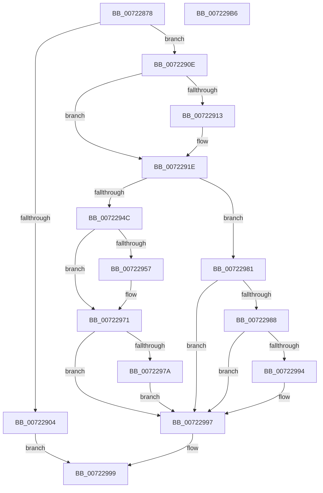

# IopIssueSystemEnvironmentRequest

- RVA: `0x00722878`–`0x007229B7` (길이 `319` bytes)
- VA: `0x0000000140722878`
- 실행 섹션: `PAGE`
- PDB 이름 있음: `예`; PDB Function 태그: `아니요`
- unwind 정보 RVA: `0x0006EE68`
- 디코드: `89`개 명령, `319/319` bytes 표시
- 미해석 바이트: `0` (있으면 어셈블리에 `.byte`로 보존)

> 이 문서는 커널 이미지의 기계어와 PDB 기호를 분석해 생성했습니다. 4번과 5번은 함수 원형과 자료형을 바이너리 사용 방식에서 추정한 C 해석이며 원본 소스 복구 결과는 아닙니다.

## 1. Dependencies

- 직접 호출 지점: **4**; 고유 호출 대상: **4**
- 직접 호출자로 확인된 함수: **5**
- RIP 상대 이미지 참조: **2**

### Outgoing calls
- `0x007228BF` → [KeInitializeEvent](../../text/40/KeInitializeEvent_function_0040DD10.md) (function, `0x0040DD10`)
- `0x007228F7` → [IoBuildDeviceIoControlRequest](../../text/20/IoBuildDeviceIoControlRequest_function_00204FD0.md) (function, `0x00204FD0`)
- `0x00722941` → [KeExpandKernelStackAndCalloutEx](../../text/2F/KeExpandKernelStackAndCalloutEx_function_002F85B0.md) (function, `0x002F85B0`)
- `0x00722969` → [KeWaitForSingleObject](../../text/20/KeWaitForSingleObject_function_0020E6B0.md) (function, `0x0020E6B0`)

### Direct callers
- [IopIssueTrEERequest](../../text/5A/IopIssueTrEERequest_function_005A041C.md) at `0x005A04AE`
- [IopEnumerateEnvironmentVariablesSysEnv](IopEnumerateEnvironmentVariablesSysEnv_function_00722010.md) at `0x0072207E`
- [IopGetEnvironmentVariableSysEnv](IopGetEnvironmentVariableSysEnv_function_00722540.md) at `0x0072261E`
- [IopQueryEnvironmentVariableInfoSysEnv](IopQueryEnvironmentVariableInfoSysEnv_function_007229F0.md) at `0x00722A62`
- [IopSetEnvironmentVariableSysEnv](IopSetEnvironmentVariableSysEnv_function_00722BC0.md) at `0x00722C99`

### Static image references
- `0x0072291E` → RVA `0x00FC51D8` (`ALMOSTRO`; read)
- `0x00722936` → RVA `0x00722850` (`IopIssueSystemEnvironmentCallout`; read)

## 2. Other-region calls and transfers

- 다른 실행 섹션으로 향하는 call: **4**
  - `0x007228BF` → [KeInitializeEvent](../../text/40/KeInitializeEvent_function_0040DD10.md) (`PAGE` → `.text`)
  - `0x007228F7` → [IoBuildDeviceIoControlRequest](../../text/20/IoBuildDeviceIoControlRequest_function_00204FD0.md) (`PAGE` → `.text`)
  - `0x00722941` → [KeExpandKernelStackAndCalloutEx](../../text/2F/KeExpandKernelStackAndCalloutEx_function_002F85B0.md) (`PAGE` → `.text`)
  - `0x00722969` → [KeWaitForSingleObject](../../text/20/KeWaitForSingleObject_function_0020E6B0.md) (`PAGE` → `.text`)
- 별도 외부 분기/꼬리 이동을 확인하지 못했습니다.

## 3. Assembly (complete function range)

```asm
00722878  48 8B C4                        mov rax, rsp
0072287B  48 89 58 08                     mov qword ptr [rax + 8], rbx
0072287F  48 89 70 10                     mov qword ptr [rax + 0x10], rsi
00722883  48 89 78 18                     mov qword ptr [rax + 0x18], rdi
00722887  4C 89 70 20                     mov qword ptr [rax + 0x20], r14
0072288B  55                              push rbp
0072288C  48 8D 68 C9                     lea rbp, [rax - 0x37]
00722890  48 81 EC 90 00 00 00            sub rsp, 0x90
00722897  0F 57 C0                        xorps xmm0, xmm0
0072289A  33 C0                           xor eax, eax
0072289C  48 21 45 0F                     and qword ptr [rbp + 0xf], rax
007228A0  49 8B F0                        mov rsi, r8
007228A3  8A DA                           mov bl, dl
007228A5  48 89 45 27                     mov qword ptr [rbp + 0x27], rax
007228A9  8B F9                           mov edi, ecx
007228AB  45 33 C0                        xor r8d, r8d
007228AE  33 D2                           xor edx, edx
007228B0  48 8D 4D 17                     lea rcx, [rbp + 0x17]
007228B4  0F 11 45 17                     movups xmmword ptr [rbp + 0x17], xmm0
007228B8  4D 8B F1                        mov r14, r9
007228BB  0F 11 45 EF                     movups xmmword ptr [rbp - 0x11], xmm0
007228BF  E8 4C B4 CE FF                  call 0x14040dd10
007228C4  44 8B 4D 67                     mov r9d, dword ptr [rbp + 0x67]
007228C8  48 8D 45 EF                     lea rax, [rbp - 0x11]
007228CC  4C 8B 45 5F                     mov r8, qword ptr [rbp + 0x5f]
007228D0  49 8B D6                        mov rdx, r14
007228D3  48 89 44 24 40                  mov qword ptr [rsp + 0x40], rax
007228D8  8B CF                           mov ecx, edi
007228DA  48 8D 45 17                     lea rax, [rbp + 0x17]
007228DE  48 89 44 24 38                  mov qword ptr [rsp + 0x38], rax
007228E3  8B 45 77                        mov eax, dword ptr [rbp + 0x77]
007228E6  88 5C 24 30                     mov byte ptr [rsp + 0x30], bl
007228EA  89 44 24 28                     mov dword ptr [rsp + 0x28], eax
007228EE  48 8B 45 6F                     mov rax, qword ptr [rbp + 0x6f]
007228F2  48 89 44 24 20                  mov qword ptr [rsp + 0x20], rax
007228F7  E8 D4 26 AE FF                  call 0x140204fd0
007228FC  48 8B C8                        mov rcx, rax
007228FF  48 85 C0                        test rax, rax
00722902  75 0A                           jne 0x14072290e
00722904  B8 9A 00 00 C0                  mov eax, 0xc000009a
00722909  E9 8B 00 00 00                  jmp 0x140722999
0072290E  48 85 F6                        test rsi, rsi
00722911  74 0B                           je 0x14072291e
00722913  48 8B 80 B8 00 00 00            mov rax, qword ptr [rax + 0xb8]
0072291A  48 89 70 E8                     mov qword ptr [rax - 0x18], rsi
0072291E  44 8B 05 B3 28 8A 00            mov r8d, dword ptr [rip + 0x8a28b3]
00722925  48 8D 55 FF                     lea rdx, [rbp - 1]
00722929  48 83 64 24 20 00               and qword ptr [rsp + 0x20], 0
0072292F  41 B1 01                        mov r9b, 1
00722932  48 89 4D 07                     mov qword ptr [rbp + 7], rcx
00722936  48 8D 0D 13 FF FF FF            lea rcx, [rip - 0xed]
0072293D  4C 89 75 FF                     mov qword ptr [rbp - 1], r14
00722941  E8 6A 5C BD FF                  call 0x1402f85b0
00722946  8B C8                           mov ecx, eax
00722948  85 C0                           test eax, eax
0072294A  78 35                           js 0x140722981
0072294C  8B 4D 0F                        mov ecx, dword ptr [rbp + 0xf]
0072294F  81 F9 03 01 00 00               cmp ecx, 0x103
00722955  75 1A                           jne 0x140722971
00722957  48 83 64 24 20 00               and qword ptr [rsp + 0x20], 0
0072295D  48 8D 4D 17                     lea rcx, [rbp + 0x17]
00722961  45 33 C9                        xor r9d, r9d
00722964  45 33 C0                        xor r8d, r8d
00722967  33 D2                           xor edx, edx
00722969  E8 42 BD AE FF                  call 0x14020e6b0
0072296E  8B 4D EF                        mov ecx, dword ptr [rbp - 0x11]
00722971  48 8B 55 7F                     mov rdx, qword ptr [rbp + 0x7f]
00722975  48 85 D2                        test rdx, rdx
00722978  74 1D                           je 0x140722997
0072297A  8B 45 F7                        mov eax, dword ptr [rbp - 9]
0072297D  89 02                           mov dword ptr [rdx], eax
0072297F  EB 16                           jmp 0x140722997
00722981  3D 23 00 00 C0                  cmp eax, 0xc0000023
00722986  75 0F                           jne 0x140722997
00722988  8D 48 F4                        lea ecx, [rax - 0xc]
0072298B  48 8B 45 7F                     mov rax, qword ptr [rbp + 0x7f]
0072298F  48 85 C0                        test rax, rax
00722992  74 03                           je 0x140722997
00722994  83 20 00                        and dword ptr [rax], 0
00722997  8B C1                           mov eax, ecx
00722999  4C 8D 9C 24 90 00 00 00         lea r11, [rsp + 0x90]
007229A1  49 8B 5B 10                     mov rbx, qword ptr [r11 + 0x10]
007229A5  49 8B 73 18                     mov rsi, qword ptr [r11 + 0x18]
007229A9  49 8B 7B 20                     mov rdi, qword ptr [r11 + 0x20]
007229AD  4D 8B 73 28                     mov r14, qword ptr [r11 + 0x28]
007229B1  49 8B E3                        mov rsp, r11
007229B4  5D                              pop rbp
007229B5  C3                              ret
007229B6  CC                              int3
```

## 4. C-style interpretation (structured pseudocode)

```c
__int64 __fastcall IopIssueSystemEnvironmentRequest(int a1, int a2, __int64 a3, __int64 a4)
{
    __int64 result;
    __int64 v_rsp;
    unsigned __int64 v_stack_m58;
    unsigned __int64 v_stack_m60;
    unsigned __int8 v_stack_m68;
    unsigned int v_stack_m70;
    unsigned __int64 v_stack_m78;
    unsigned __int64 v_stack_m8;

    *(unsigned __int64 *)(v_rsp + 8) = v_rbx;
    *(unsigned __int64 *)(v_rsp + 16) = v_rsi;
    *(unsigned __int64 *)(v_rsp + 24) = v_rdi;
    *(unsigned __int64 *)(v_rsp + 32) = v_r14;
    v_rsp = (v_rsp) - (144);
    result = 0;
    *(unsigned __int64 *)(v_rsp - 55 + 39) = 0;
    a3 = 0;
    a2 = 0;
    *(unsigned __int64 *)(v_rsp - 55 + 23) = v_xmm0;
    *(unsigned __int64 *)(v_rsp - 55 - 17) = v_xmm0;
    result = KeInitializeEvent(v_rsp - 55 + 23, a2, a3, a4);
    v_stack_m58 = v_rsp - 55 - 17;
    v_stack_m60 = v_rsp - 55 + 23;
    v_stack_m68 = (unsigned __int8)((unsigned __int8)(a2));
    v_stack_m70 = (unsigned int)((unsigned int)(*(unsigned int *)(v_rsp - 55 + 119)));
    v_stack_m78 = *(unsigned __int64 *)(v_rsp - 55 + 111);
    result = IoBuildDeviceIoControlRequest((unsigned int)((unsigned int)((unsigned int)(a1))), a4, *(unsigned __int64 *)(v_rsp - 55 + 95), (unsigned int)(*(unsigned int *)(v_rsp - 55 + 103)));
    if (result != 0) goto loc_0072290E;
    goto loc_00722999;
loc_0072290E:
    result = (unsigned int)(0xC000009AULL);
    if (0 != 0) {
        result = *(unsigned __int64 *)((unsigned int)(0xC000009AULL) + 184);
        *(unsigned __int64 *)(result - 24) = 0;
    }
    *(unsigned __int64 *)(v_rsp - 55 + 7) = result;
    *(unsigned __int64 *)(v_rsp - 55 - 1) = a4;
    result = KeExpandKernelStackAndCalloutEx(v_rip - 237, v_rsp - 55 - 1, (unsigned int)(*(unsigned int *)(v_rip + 9054387)), 1);
    if (sign_flag) goto loc_00722981;
    if (((unsigned int)((unsigned int)(*(unsigned int *)(v_rsp - 55 + 15)))) == 259) {
        a1 = v_rsp - 55 + 23;
        a4 = 0;
        a3 = 0;
        a2 = 0;
        result = KeWaitForSingleObject(a1, a2, a3, a4);
        a1 = *(unsigned int *)(v_rsp - 55 - 17);
    }
    if (*(unsigned __int64 *)(v_rsp - 55 + 127) == 0) goto loc_00722997;
    *(unsigned int *)(*(unsigned __int64 *)(v_rsp - 55 + 127)) = (unsigned int)((unsigned int)(*(unsigned int *)(v_rsp - 55 - 9)));
    goto loc_00722997;
loc_00722981:
    if (((unsigned int)((unsigned int)(*(unsigned int *)(v_rsp - 55 - 9)))) != 0xC0000023ULL) goto loc_00722997;
    if (*(unsigned __int64 *)(v_rsp - 55 + 127) != 0) {
    }
loc_00722999:
    return (unsigned int)((unsigned int)((unsigned int)(*(unsigned int *)(v_rsp - 55 - 9)) - 12));
}
```

## 5. (Beta) C Style

```c
int64_t IopIssueSystemEnvironmentRequest(int32_t Arg1, int32_t Arg2, int64_t Arg3, int64_t Arg4)
{
    int64_t result;
    int64_t local_rsp;
    uint64_t v_stack_m58;
    uint64_t v_stack_m60;
    uint8_t v_stack_m68;
    uint32_t v_stack_m70;
    uint64_t v_stack_m78;
    uint64_t v_stack_m8;

    *(uint64_t *)(local_rsp + 0x8) = local_rbx;
    *(uint64_t *)(local_rsp + 0x10) = local_rsi;
    *(uint64_t *)(local_rsp + 0x18) = local_rdi;
    *(uint64_t *)(local_rsp + 0x20) = local_r14;
    local_rsp = (local_rsp) - (144);
    result = 0;
    *(uint64_t *)(local_rsp - 0x37 + 0x27) = 0;
    Arg3 = 0;
    Arg2 = 0;
    *(uint64_t *)(local_rsp - 0x37 + 0x17) = v_xmm0;
    *(uint64_t *)(local_rsp - 0x37 - 0x11) = v_xmm0;
    result = KeInitializeEvent(local_rsp - 55 + 23, Arg2, Arg3, Arg4);
    v_stack_m58 = local_rsp - 55 - 17;
    v_stack_m60 = local_rsp - 55 + 23;
    v_stack_m68 = (uint8_t)((uint8_t)(Arg2));
    v_stack_m70 = (uint32_t)((uint32_t)(*(uint32_t *)(local_rsp - 0x37 + 0x77)));
    v_stack_m78 = *(uint64_t *)(local_rsp - 0x37 + 0x6F);
    result = IoBuildDeviceIoControlRequest((uint32_t)((uint32_t)((uint32_t)(Arg1))), Arg4, *(uint64_t *)(local_rsp - 0x37 + 0x5F), (uint32_t)(*(uint32_t *)(local_rsp - 0x37 + 0x67)));
    if (result != 0) goto loc_0072290E;
    goto loc_00722999;
loc_0072290E:
    result = (uint32_t)(0xC000009AULL);
    if (0 != 0) {
        result = *(uint64_t *)((uint32_t)(0xC000009AULL) + 0xB8);
        *(uint64_t *)(result - 0x18) = 0;
    }
    *(uint64_t *)(local_rsp - 0x37 + 0x7) = result;
    *(uint64_t *)(local_rsp - 0x37 - 0x1) = Arg4;
    result = KeExpandKernelStackAndCalloutEx(v_rip - 237, local_rsp - 55 - 1, (uint32_t)(*(uint32_t *)(v_rip + 0x8A28B3)), 1);
    if (sign_flag) goto loc_00722981;
    if (((uint32_t)((uint32_t)(*(uint32_t *)(local_rsp - 0x37 + 0xF)))) == 259) {
        Arg1 = local_rsp - 55 + 23;
        Arg4 = 0;
        Arg3 = 0;
        Arg2 = 0;
        result = KeWaitForSingleObject(Arg1, Arg2, Arg3, Arg4);
        Arg1 = *(uint32_t *)(local_rsp - 0x37 - 0x11);
    }
    if (*(uint64_t *)(local_rsp - 0x37 + 0x7F) == 0) goto loc_00722997;
    *(uint32_t *)(*(uint64_t *)(local_rsp - 0x37 + 0x7F)) = (uint32_t)((uint32_t)(*(uint32_t *)(local_rsp - 0x37 - 0x9)));
    goto loc_00722997;
loc_00722981:
    if (((uint32_t)((uint32_t)(*(uint32_t *)(local_rsp - 0x37 - 0x9)))) != 0xC0000023ULL) goto loc_00722997;
    if (*(uint64_t *)(local_rsp - 0x37 + 0x7F) != 0) {
    }
loc_00722999:
    return (uint32_t)((uint32_t)((uint32_t)(*(uint32_t *)(local_rsp - 0x37 - 0x9)) - 12));
}
```

## 6. Execution-region graph

[열기: 2D/3D 그래프와 함수 탐색 컨트롤 패널](../../../control-panel.html?section=page&rva=0x00722878&view=graph)

- 2D 그래프는 위에서 아래로 흐르고, 3D 그래프는 빈 공간을 드래그해 회전합니다. Shift+드래그는 이동, 휠은 확대·축소, 함수 노드 선택은 대상 보고서 이동입니다.

### Static fallback


