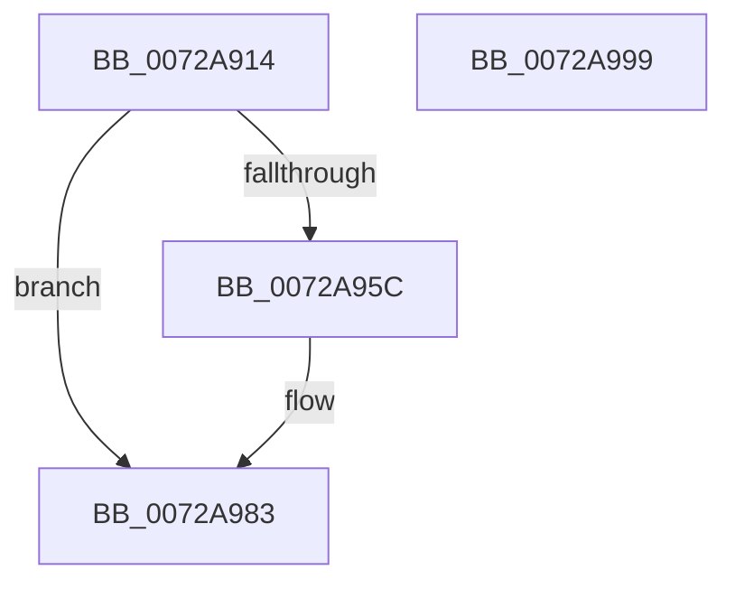

# IopLogDeviceResetComplete

- RVA: `0x0072A914`–`0x0072A99A` (길이 `134` bytes)
- VA: `0x000000014072A914`
- 실행 섹션: `PAGE`
- PDB 이름 있음: `예`; PDB Function 태그: `아니요`
- unwind 정보 RVA: `0x000BE9D0`
- 디코드: `35`개 명령, `134/134` bytes 표시
- 미해석 바이트: `0` (있으면 어셈블리에 `.byte`로 보존)

> 이 문서는 커널 이미지의 기계어와 PDB 기호를 분석해 생성했습니다. 4번과 5번은 함수 원형과 자료형을 바이너리 사용 방식에서 추정한 C 해석이며 원본 소스 복구 결과는 아닙니다.

## 1. Dependencies

- 직접 호출 지점: **2**; 고유 호출 대상: **2**
- 직접 호출자로 확인된 함수: **2**
- RIP 상대 이미지 참조: **2**

### Outgoing calls
- `0x0072A94E` → [PnpTraceDeviceRemovalForResetComplete](../73/PnpTraceDeviceRemovalForResetComplete_function_0073C804.md) (function, `0x0073C804`)
- `0x0072A97E` → [McTemplateK0hzr0qqhzr4_EtwWriteTransfer](../../text/5A/McTemplateK0hzr0qqhzr4_EtwWriteTransfer_function_005A5C08.md) (function, `0x005A5C08`)

### Direct callers
- [PiProcessDeviceResetAction](../../text/5A/PiProcessDeviceResetAction_function_005A5CD8.md) at `0x005A5D7C`
- [PnpFinalizeDeviceRemovalForReset](PnpFinalizeDeviceRemovalForReset_function_0072AD04.md) at `0x0072AD56`

### Static image references
- `0x0072A93D` → RVA `0x00AFCAD0` (` ?? ::NNGAKEGL::`string'`; read)
- `0x0072A953` → RVA `0x00EF012C` (`.data`; read)

## 2. Other-region calls and transfers

- 다른 실행 섹션으로 향하는 call: **1**
  - `0x0072A97E` → [McTemplateK0hzr0qqhzr4_EtwWriteTransfer](../../text/5A/McTemplateK0hzr0qqhzr4_EtwWriteTransfer_function_005A5C08.md) (`PAGE` → `.text`)
- 별도 외부 분기/꼬리 이동을 확인하지 못했습니다.

## 3. Assembly (complete function range)

```asm
0072A914  4C 8B DC                        mov r11, rsp
0072A917  49 89 5B 08                     mov qword ptr [r11 + 8], rbx
0072A91B  49 89 6B 10                     mov qword ptr [r11 + 0x10], rbp
0072A91F  49 89 73 18                     mov qword ptr [r11 + 0x18], rsi
0072A923  57                              push rdi
0072A924  48 83 EC 60                     sub rsp, 0x60
0072A928  48 8D 41 28                     lea rax, [rcx + 0x28]
0072A92C  49 C7 43 E8 00 00 02 00         mov qword ptr [r11 - 0x18], 0x20000
0072A934  49 8D 7B E8                     lea rdi, [r11 - 0x18]
0072A938  33 DB                           xor ebx, ebx
0072A93A  48 85 C0                        test rax, rax
0072A93D  48 8D 2D 8C 21 3D 00            lea rbp, [rip + 0x3d218c]
0072A944  8B F2                           mov esi, edx
0072A946  49 89 6B F0                     mov qword ptr [r11 - 0x10], rbp
0072A94A  48 0F 45 F8                     cmovne rdi, rax
0072A94E  E8 B1 1E 01 00                  call 0x14073c804
0072A953  F6 05 D2 57 7C 00 08            test byte ptr [rip + 0x7c57d2], 8
0072A95A  74 27                           je 0x14072a983
0072A95C  44 0F B7 0F                     movzx r9d, word ptr [rdi]
0072A960  48 8B 47 08                     mov rax, qword ptr [rdi + 8]
0072A964  48 89 6C 24 40                  mov qword ptr [rsp + 0x40], rbp
0072A969  66 D1 EB                        shr bx, 1
0072A96C  66 89 5C 24 38                  mov word ptr [rsp + 0x38], bx
0072A971  89 74 24 28                     mov dword ptr [rsp + 0x28], esi
0072A975  66 41 D1 E9                     shr r9w, 1
0072A979  48 89 44 24 20                  mov qword ptr [rsp + 0x20], rax
0072A97E  E8 85 B2 E7 FF                  call 0x1405a5c08
0072A983  4C 8D 5C 24 60                  lea r11, [rsp + 0x60]
0072A988  49 8B 5B 10                     mov rbx, qword ptr [r11 + 0x10]
0072A98C  49 8B 6B 18                     mov rbp, qword ptr [r11 + 0x18]
0072A990  49 8B 73 20                     mov rsi, qword ptr [r11 + 0x20]
0072A994  49 8B E3                        mov rsp, r11
0072A997  5F                              pop rdi
0072A998  C3                              ret
0072A999  CC                              int3
```

## 4. C-style interpretation (structured pseudocode)

```c
__int64 __fastcall IopLogDeviceResetComplete(__int64 a1, int a2)
{
    __int64 result;
    __int64 v_rbx;
    __int64 v_rdi;
    __int64 v_rsp;
    unsigned __int64 v_stack_m28;
    unsigned __int16 v_stack_m30;
    unsigned int v_stack_m40;
    unsigned __int64 v_stack_m48;
    unsigned __int64 v_stack_m8;

    *(unsigned __int64 *)(v_rsp + 8) = v_rbx;
    *(unsigned __int64 *)(v_rsp + 16) = v_rbp;
    *(unsigned __int64 *)(v_rsp + 24) = v_rsi;
    v_rsp = (v_rsp) - (96);
    *(unsigned __int64 *)(v_rsp - 24) = 0x20000ULL;
    v_rbx = 0;
    *(unsigned __int64 *)(v_rsp - 16) = v_rip + 4006284;
    v_rdi = v_rsp - 24;
    if (a1 + 40 != 0) { v_rdi = a1 + 40; }
    result = PnpTraceDeviceRemovalForResetComplete(a1, a2, a3, a4);
    if (((*(unsigned __int8 *)(v_rip + 8148946)) & (8)) != 0) {
        a4 = *(unsigned __int16 *)(v_rdi);
        result = *(unsigned __int64 *)(v_rdi + 8);
        v_stack_m28 = v_rip + 4006284;
        v_rbx = (unsigned __int16)((v_rbx) >> (1));
        v_stack_m30 = (unsigned __int16)(v_rbx);
        v_stack_m40 = (unsigned int)((unsigned int)(a2));
        a4 = (unsigned __int16)((a4) >> (1));
        v_stack_m48 = result;
        result = McTemplateK0hzr0qqhzr4_EtwWriteTransfer(a1, a2, a3, a4);
    }
    return result;
}
```

## 5. (Beta) C Style

```c
int64_t IopLogDeviceResetComplete(void *Arg1, int32_t Arg2)
{
    uint8_t *arg1 = (uint8_t *)Arg1;

    int64_t result;
    int64_t local_rbx;
    int64_t local_rdi;
    int64_t local_rsp;
    uint64_t v_stack_m28;
    uint16_t v_stack_m30;
    uint32_t v_stack_m40;
    uint64_t v_stack_m48;
    uint64_t v_stack_m8;

    *(uint64_t *)(local_rsp + 0x8) = local_rbx;
    *(uint64_t *)(local_rsp + 0x10) = local_rbp;
    *(uint64_t *)(local_rsp + 0x18) = local_rsi;
    local_rsp = (local_rsp) - (96);
    *(uint64_t *)(local_rsp - 0x18) = 0x20000ULL;
    local_rbx = 0;
    *(uint64_t *)(local_rsp - 0x10) = v_rip + 4006284;
    local_rdi = local_rsp - 24;
    if (Arg1 + 40 != 0) { local_rdi = Arg1 + 40; }
    result = PnpTraceDeviceRemovalForResetComplete(Arg1, Arg2, a3, a4);
    if (((*(uint8_t *)(v_rip + 0x7C57D2)) & (8)) != 0) {
        a4 = *(uint16_t *)(local_rdi);
        result = *(uint64_t *)(local_rdi + 0x8);
        v_stack_m28 = v_rip + 4006284;
        local_rbx = (uint16_t)((local_rbx) >> (1));
        v_stack_m30 = (uint16_t)(local_rbx);
        v_stack_m40 = (uint32_t)((uint32_t)(Arg2));
        a4 = (uint16_t)((a4) >> (1));
        v_stack_m48 = result;
        result = McTemplateK0hzr0qqhzr4_EtwWriteTransfer(Arg1, Arg2, a3, a4);
    }
    return result;
}
```

### 관측된 메모리 오프셋

구조체 형식이 확인되지 않은 접근은 인자 기준의 오프셋으로만 기록했습니다.

| 기준 인자 | 오프셋 표현 | 폭 (bit) | 접근 |
|---|---:|---:|---|
| `Arg1` | `+ 0x28` | `64` | `R` |

## 6. Execution-region graph

[열기: 2D/3D 그래프와 함수 탐색 컨트롤 패널](../../../control-panel.html?section=page&rva=0x0072A914&view=graph)

- 2D 그래프는 위에서 아래로 흐르고, 3D 그래프는 빈 공간을 드래그해 회전합니다. Shift+드래그는 이동, 휠은 확대·축소, 함수 노드 선택은 대상 보고서 이동입니다.

### Static fallback


