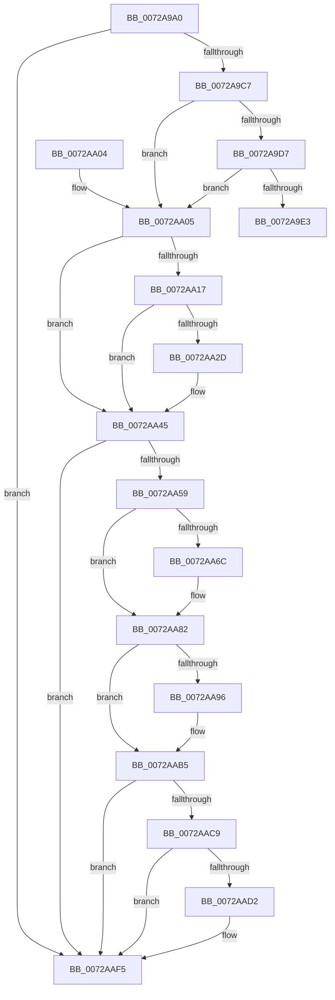

# IopMarkDeviceToBeReset

- RVA: `0x0072A9A0`–`0x0072AB0E` (길이 `366` bytes)
- VA: `0x000000014072A9A0`
- 실행 섹션: `PAGE`
- PDB 이름 있음: `예`; PDB Function 태그: `아니요`
- unwind 정보 RVA: `0x000C84E8`
- 디코드: `93`개 명령, `366/366` bytes 표시
- 미해석 바이트: `0` (있으면 어셈블리에 `.byte`로 보존)

> 이 문서는 커널 이미지의 기계어와 PDB 기호를 분석해 생성했습니다. 4번과 5번은 함수 원형과 자료형을 바이너리 사용 방식에서 추정한 C 해석이며 원본 소스 복구 결과는 아닙니다.

## 1. Dependencies

- 직접 호출 지점: **13**; 고유 호출 대상: **3**
- 직접 호출자로 확인된 함수: **3**
- RIP 상대 이미지 참조: **0**

### Outgoing calls
- `0x0072A9EA` → [IopQueryDeviceState](../8F/IopQueryDeviceState_function_008FB2F0.md) (function, `0x008FB2F0`)
- `0x0072AA09` → [IoAddTriageDumpDataBlock](../../text/42/IoAddTriageDumpDataBlock_function_00428374.md) (function, `0x00428374`)
- `0x0072AA1B` → [IoAddTriageDumpDataBlock](../../text/42/IoAddTriageDumpDataBlock_function_00428374.md) (function, `0x00428374`)
- `0x0072AA2F` → [IoAddTriageDumpDataBlock](../../text/42/IoAddTriageDumpDataBlock_function_00428374.md) (function, `0x00428374`)
- `0x0072AA40` → [IoAddTriageDumpDataBlock](../../text/42/IoAddTriageDumpDataBlock_function_00428374.md) (function, `0x00428374`)
- `0x0072AA62` → [IoAddTriageDumpDataBlock](../../text/42/IoAddTriageDumpDataBlock_function_00428374.md) (function, `0x00428374`)
- `0x0072AA71` → [IoAddTriageDumpDataBlock](../../text/42/IoAddTriageDumpDataBlock_function_00428374.md) (function, `0x00428374`)
- `0x0072AA7D` → [IoAddTriageDumpDataBlock](../../text/42/IoAddTriageDumpDataBlock_function_00428374.md) (function, `0x00428374`)
- `0x0072AA98` → [IoAddTriageDumpDataBlock](../../text/42/IoAddTriageDumpDataBlock_function_00428374.md) (function, `0x00428374`)
- `0x0072AAB0` → [IoAddTriageDumpDataBlock](../../text/42/IoAddTriageDumpDataBlock_function_00428374.md) (function, `0x00428374`)
- `0x0072AAD4` → [IoAddTriageDumpDataBlock](../../text/42/IoAddTriageDumpDataBlock_function_00428374.md) (function, `0x00428374`)
- `0x0072AAF0` → [IoAddTriageDumpDataBlock](../../text/42/IoAddTriageDumpDataBlock_function_00428374.md) (function, `0x00428374`)
- `0x0072AB08` → [KeBugCheckEx](../../text/4F/KeBugCheckEx_function_004FD660.md) (function, `0x004FD660`)

### Direct callers
- [IopQueueDeviceResetEvent](IopQueueDeviceResetEvent_function_0072AB14.md) at `0x0072ABEA`
- [PnpFinalizeDeviceRemovalForReset](PnpFinalizeDeviceRemovalForReset_function_0072AD04.md) at `0x0072AD2D`
- [PnpRebalance](../73/PnpRebalance_function_0073F508.md) at `0x0073F7D6`

### Static image references
- 디코드된 RIP-relative 메모리 참조가 없습니다.

## 2. Other-region calls and transfers

- 다른 실행 섹션으로 향하는 call: **12**
  - `0x0072AA09` → [IoAddTriageDumpDataBlock](../../text/42/IoAddTriageDumpDataBlock_function_00428374.md) (`PAGE` → `.text`)
  - `0x0072AA1B` → [IoAddTriageDumpDataBlock](../../text/42/IoAddTriageDumpDataBlock_function_00428374.md) (`PAGE` → `.text`)
  - `0x0072AA2F` → [IoAddTriageDumpDataBlock](../../text/42/IoAddTriageDumpDataBlock_function_00428374.md) (`PAGE` → `.text`)
  - `0x0072AA40` → [IoAddTriageDumpDataBlock](../../text/42/IoAddTriageDumpDataBlock_function_00428374.md) (`PAGE` → `.text`)
  - `0x0072AA62` → [IoAddTriageDumpDataBlock](../../text/42/IoAddTriageDumpDataBlock_function_00428374.md) (`PAGE` → `.text`)
  - `0x0072AA71` → [IoAddTriageDumpDataBlock](../../text/42/IoAddTriageDumpDataBlock_function_00428374.md) (`PAGE` → `.text`)
  - `0x0072AA7D` → [IoAddTriageDumpDataBlock](../../text/42/IoAddTriageDumpDataBlock_function_00428374.md) (`PAGE` → `.text`)
  - `0x0072AA98` → [IoAddTriageDumpDataBlock](../../text/42/IoAddTriageDumpDataBlock_function_00428374.md) (`PAGE` → `.text`)
  - `0x0072AAB0` → [IoAddTriageDumpDataBlock](../../text/42/IoAddTriageDumpDataBlock_function_00428374.md) (`PAGE` → `.text`)
  - `0x0072AAD4` → [IoAddTriageDumpDataBlock](../../text/42/IoAddTriageDumpDataBlock_function_00428374.md) (`PAGE` → `.text`)
  - `0x0072AAF0` → [IoAddTriageDumpDataBlock](../../text/42/IoAddTriageDumpDataBlock_function_00428374.md) (`PAGE` → `.text`)
  - `0x0072AB08` → [KeBugCheckEx](../../text/4F/KeBugCheckEx_function_004FD660.md) (`PAGE` → `.text`)
- 별도 외부 분기/꼬리 이동을 확인하지 못했습니다.

## 3. Assembly (complete function range)

```asm
0072A9A0  48 89 5C 24 08                  mov qword ptr [rsp + 8], rbx
0072A9A5  48 89 6C 24 10                  mov qword ptr [rsp + 0x10], rbp
0072A9AA  48 89 74 24 18                  mov qword ptr [rsp + 0x18], rsi
0072A9AF  57                              push rdi
0072A9B0  48 83 EC 30                     sub rsp, 0x30
0072A9B4  33 F6                           xor esi, esi
0072A9B6  48 8B D9                        mov rbx, rcx
0072A9B9  BD 02 00 00 00                  mov ebp, 2
0072A9BE  48 85 C9                        test rcx, rcx
0072A9C1  0F 84 2E 01 00 00               je 0x14072aaf5
0072A9C7  48 8B 81 38 01 00 00            mov rax, qword ptr [rcx + 0x138]
0072A9CE  48 8B 40 28                     mov rax, qword ptr [rax + 0x28]
0072A9D2  48 85 C0                        test rax, rax
0072A9D5  74 2E                           je 0x14072aa05
0072A9D7  F7 80 8C 01 00 00 00 00 02 00   test dword ptr [rax + 0x18c], 0x20000
0072A9E1  75 22                           jne 0x14072aa05
0072A9E3  0F BA 69 30 1A                  bts dword ptr [rcx + 0x30], 0x1a
0072A9E8  33 D2                           xor edx, edx
0072A9EA  E8 01 09 1D 00                  call 0x1408fb2f0
0072A9EF  48 8B 5C 24 40                  mov rbx, qword ptr [rsp + 0x40]
0072A9F4  48 8B 6C 24 48                  mov rbp, qword ptr [rsp + 0x48]
0072A9F9  48 8B 74 24 50                  mov rsi, qword ptr [rsp + 0x50]
0072A9FE  48 83 C4 30                     add rsp, 0x30
0072AA02  5F                              pop rdi
0072AA03  C3                              ret
0072AA04  CC                              int3
0072AA05  0F B7 51 02                     movzx edx, word ptr [rcx + 2]
0072AA09  E8 66 D9 CF FF                  call 0x140428374
0072AA0E  48 8B 4B 08                     mov rcx, qword ptr [rbx + 8]
0072AA12  48 85 C9                        test rcx, rcx
0072AA15  74 2E                           je 0x14072aa45
0072AA17  0F BF 51 02                     movsx edx, word ptr [rcx + 2]
0072AA1B  E8 54 D9 CF FF                  call 0x140428374
0072AA20  48 8B 4B 08                     mov rcx, qword ptr [rbx + 8]
0072AA24  48 83 C1 38                     add rcx, 0x38
0072AA28  66 39 31                        cmp word ptr [rcx], si
0072AA2B  74 18                           je 0x14072aa45
0072AA2D  8B D5                           mov edx, ebp
0072AA2F  E8 40 D9 CF FF                  call 0x140428374
0072AA34  48 8B 4B 08                     mov rcx, qword ptr [rbx + 8]
0072AA38  0F B7 51 38                     movzx edx, word ptr [rcx + 0x38]
0072AA3C  48 8B 49 40                     mov rcx, qword ptr [rcx + 0x40]
0072AA40  E8 2F D9 CF FF                  call 0x140428374
0072AA45  48 8B 83 38 01 00 00            mov rax, qword ptr [rbx + 0x138]
0072AA4C  48 8B 48 28                     mov rcx, qword ptr [rax + 0x28]
0072AA50  48 85 C9                        test rcx, rcx
0072AA53  0F 84 9C 00 00 00               je 0x14072aaf5
0072AA59  BA 88 03 00 00                  mov edx, 0x388
0072AA5E  48 8D 79 28                     lea rdi, [rcx + 0x28]
0072AA62  E8 0D D9 CF FF                  call 0x140428374
0072AA67  66 39 37                        cmp word ptr [rdi], si
0072AA6A  74 16                           je 0x14072aa82
0072AA6C  8B D5                           mov edx, ebp
0072AA6E  48 8B CF                        mov rcx, rdi
0072AA71  E8 FE D8 CF FF                  call 0x140428374
0072AA76  0F B7 17                        movzx edx, word ptr [rdi]
0072AA79  48 8B 4F 08                     mov rcx, qword ptr [rdi + 8]
0072AA7D  E8 F2 D8 CF FF                  call 0x140428374
0072AA82  48 8B 83 38 01 00 00            mov rax, qword ptr [rbx + 0x138]
0072AA89  48 8B 48 28                     mov rcx, qword ptr [rax + 0x28]
0072AA8D  48 83 C1 38                     add rcx, 0x38
0072AA91  66 39 31                        cmp word ptr [rcx], si
0072AA94  74 1F                           je 0x14072aab5
0072AA96  8B D5                           mov edx, ebp
0072AA98  E8 D7 D8 CF FF                  call 0x140428374
0072AA9D  48 8B 83 38 01 00 00            mov rax, qword ptr [rbx + 0x138]
0072AAA4  48 8B 48 28                     mov rcx, qword ptr [rax + 0x28]
0072AAA8  0F B7 51 38                     movzx edx, word ptr [rcx + 0x38]
0072AAAC  48 8B 49 40                     mov rcx, qword ptr [rcx + 0x40]
0072AAB0  E8 BF D8 CF FF                  call 0x140428374
0072AAB5  48 8B 83 38 01 00 00            mov rax, qword ptr [rbx + 0x138]
0072AABC  48 8B 48 28                     mov rcx, qword ptr [rax + 0x28]
0072AAC0  48 8B 41 10                     mov rax, qword ptr [rcx + 0x10]
0072AAC4  48 85 C0                        test rax, rax
0072AAC7  74 2C                           je 0x14072aaf5
0072AAC9  48 8D 48 38                     lea rcx, [rax + 0x38]
0072AACD  66 39 31                        cmp word ptr [rcx], si
0072AAD0  74 23                           je 0x14072aaf5
0072AAD2  8B D5                           mov edx, ebp
0072AAD4  E8 9B D8 CF FF                  call 0x140428374
0072AAD9  48 8B 83 38 01 00 00            mov rax, qword ptr [rbx + 0x138]
0072AAE0  48 8B 48 28                     mov rcx, qword ptr [rax + 0x28]
0072AAE4  48 8B 49 10                     mov rcx, qword ptr [rcx + 0x10]
0072AAE8  0F B7 51 38                     movzx edx, word ptr [rcx + 0x38]
0072AAEC  48 8B 49 40                     mov rcx, qword ptr [rcx + 0x40]
0072AAF0  E8 7F D8 CF FF                  call 0x140428374
0072AAF5  45 33 C9                        xor r9d, r9d
0072AAF8  48 89 74 24 20                  mov qword ptr [rsp + 0x20], rsi
0072AAFD  4C 8B C3                        mov r8, rbx
0072AB00  48 8B D5                        mov rdx, rbp
0072AB03  B9 CA 00 00 00                  mov ecx, 0xca
0072AB08  E8 53 2B DD FF                  call 0x1404fd660
0072AB0D  CC                              int3
```

## 4. C-style interpretation (structured pseudocode)

```c
__int64 __fastcall IopMarkDeviceToBeReset(__int64 a1, int a2, __int64 a3, int a4)
{
    __int64 result;
    __int64 v_rsi;
    __int64 v_rsp;
    unsigned __int64 v_stack_p10;
    unsigned __int64 v_stack_p18;
    unsigned __int64 v_stack_p20;
    unsigned __int64 v_stack_p8;

    v_stack_p8 = v_rbx;
    v_stack_p10 = v_rbp;
    v_stack_p18 = v_rsi;
    v_rsp = (v_rsp) - (48);
    v_rsi = 0;
    if (a1 == 0) goto loc_0072AAF5;
    if (*(unsigned __int64 *)(*(unsigned __int64 *)(a1 + 312) + 40) == 0) goto loc_0072AA05;
    if (((*(unsigned int *)(*(unsigned __int64 *)(*(unsigned __int64 *)(a1 + 312) + 40) + 396)) & (0x20000ULL)) != 0) goto loc_0072AA05;
    a2 = 0;
    result = IopQueryDeviceState(a1, a2, a3, a4);
    v_rsp = (v_rsp) + (48);
    return result;
loc_0072AA05:
    result = IoAddTriageDumpDataBlock(a1, *(unsigned __int16 *)(a1 + 2), a3, a4);
    if (*(unsigned __int64 *)(v_stack_p8 + 8) == 0) goto loc_0072AA45;
    result = IoAddTriageDumpDataBlock(*(unsigned __int64 *)(v_stack_p8 + 8), (__int16)(*(unsigned __int16 *)(*(unsigned __int64 *)(v_stack_p8 + 8) + 2)), a3, a4);
    a1 = (*(unsigned __int64 *)(v_stack_p8 + 8)) + (56);
    if ((*(unsigned __int16 *)(a1)) != ((unsigned __int16)(v_stack_p18))) {
        a2 = (unsigned int)(v_stack_p10);
        result = IoAddTriageDumpDataBlock(a1, a2, a3, a4);
        a1 = *(unsigned __int64 *)(v_stack_p8 + 8);
        a2 = *(unsigned __int16 *)(a1 + 56);
        a1 = *(unsigned __int64 *)(a1 + 64);
        result = IoAddTriageDumpDataBlock(a1, a2, a3, a4);
    }
    if (*(unsigned __int64 *)(*(unsigned __int64 *)(v_stack_p8 + 312) + 40) == 0) goto loc_0072AAF5;
    result = IoAddTriageDumpDataBlock(*(unsigned __int64 *)(*(unsigned __int64 *)(v_stack_p8 + 312) + 40), 904, a3, a4);
    if ((*(unsigned __int16 *)(*(unsigned __int64 *)(*(unsigned __int64 *)(v_stack_p8 + 312) + 40) + 40)) != ((unsigned __int16)(v_stack_p18))) {
        a2 = (unsigned int)(v_stack_p10);
        a1 = *(unsigned __int64 *)(*(unsigned __int64 *)(v_stack_p8 + 312) + 40) + 40;
        result = IoAddTriageDumpDataBlock(a1, a2, a3, a4);
        a2 = *(unsigned __int16 *)(*(unsigned __int64 *)(*(unsigned __int64 *)(v_stack_p8 + 312) + 40) + 40);
        a1 = *(unsigned __int64 *)(*(unsigned __int64 *)(*(unsigned __int64 *)(v_stack_p8 + 312) + 40) + 40 + 8);
        result = IoAddTriageDumpDataBlock(a1, a2, a3, a4);
    }
    a1 = (*(unsigned __int64 *)(*(unsigned __int64 *)(v_stack_p8 + 312) + 40)) + (56);
    result = *(unsigned __int64 *)(v_stack_p8 + 312);
    if ((*(unsigned __int16 *)(a1)) != ((unsigned __int16)(v_stack_p18))) {
        a2 = (unsigned int)(v_stack_p10);
        result = IoAddTriageDumpDataBlock(a1, a2, a3, a4);
        result = *(unsigned __int64 *)(v_stack_p8 + 312);
        a1 = *(unsigned __int64 *)(result + 40);
        a2 = *(unsigned __int16 *)(a1 + 56);
        a1 = *(unsigned __int64 *)(a1 + 64);
        result = IoAddTriageDumpDataBlock(a1, a2, a3, a4);
    }
    if (*(unsigned __int64 *)(*(unsigned __int64 *)(*(unsigned __int64 *)(v_stack_p8 + 312) + 40) + 16) == 0) goto loc_0072AAF5;
    result = *(unsigned __int64 *)(*(unsigned __int64 *)(*(unsigned __int64 *)(v_stack_p8 + 312) + 40) + 16);
    if ((*(unsigned __int16 *)(*(unsigned __int64 *)(*(unsigned __int64 *)(*(unsigned __int64 *)(v_stack_p8 + 312) + 40) + 16) + 56)) != ((unsigned __int16)(v_stack_p18))) {
        a2 = (unsigned int)(v_stack_p10);
        result = IoAddTriageDumpDataBlock(*(unsigned __int64 *)(*(unsigned __int64 *)(*(unsigned __int64 *)(v_stack_p8 + 312) + 40) + 16) + 56, a2, a3, a4);
        result = *(unsigned __int64 *)(v_stack_p8 + 312);
        a1 = *(unsigned __int64 *)(result + 40);
        a1 = *(unsigned __int64 *)(a1 + 16);
        a2 = *(unsigned __int16 *)(a1 + 56);
        a1 = *(unsigned __int64 *)(a1 + 64);
        result = IoAddTriageDumpDataBlock(a1, a2, a3, a4);
    }
    a4 = 0;
    v_stack_p20 = v_stack_p18;
    result = KeBugCheckEx(202, v_stack_p10, v_stack_p8, a4);
    return result;
}
```

## 5. (Beta) C Style

```c
int64_t IopMarkDeviceToBeReset(void *Arg1, int32_t Arg2, int64_t Arg3, int32_t Arg4)
{
    uint8_t *arg1 = (uint8_t *)Arg1;

    int64_t result;
    int64_t local_rsi;
    int64_t local_rsp;
    uint64_t v_stack_p10;
    uint64_t v_stack_p18;
    uint64_t v_stack_p20;
    uint64_t v_stack_p8;

    v_stack_p8 = local_rbx;
    v_stack_p10 = local_rbp;
    v_stack_p18 = local_rsi;
    local_rsp = (local_rsp) - (48);
    local_rsi = 0;
    if (Arg1 == NULL) goto loc_0072AAF5;
    if (*(uint64_t *)(*(uint64_t *)(arg1 + 0x138) + 0x28) == 0) goto loc_0072AA05;
    if (((*(uint32_t *)(*(uint64_t *)(*(uint64_t *)(arg1 + 0x138) + 0x28) + 0x18C)) & (0x20000ULL)) != 0) goto loc_0072AA05;
    Arg2 = 0;
    result = IopQueryDeviceState(Arg1, Arg2, Arg3, Arg4);
    local_rsp = (local_rsp) + (48);
    return result;
loc_0072AA05:
    result = IoAddTriageDumpDataBlock(Arg1, *(uint16_t *)(arg1 + 0x2), Arg3, Arg4);
    if (*(uint64_t *)(v_stack_p8 + 0x8) == 0) goto loc_0072AA45;
    result = IoAddTriageDumpDataBlock(*(uint64_t *)(v_stack_p8 + 0x8), (int16_t)(*(uint16_t *)(*(uint64_t *)(v_stack_p8 + 0x8) + 0x2)), Arg3, Arg4);
    Arg1 = (*(uint64_t *)(v_stack_p8 + 0x8)) + (56);
    if ((*(uint16_t *)(arg1)) != ((uint16_t)(v_stack_p18))) {
        Arg2 = (uint32_t)(v_stack_p10);
        result = IoAddTriageDumpDataBlock(Arg1, Arg2, Arg3, Arg4);
        Arg1 = *(uint64_t *)(v_stack_p8 + 0x8);
        Arg2 = *(uint16_t *)(arg1 + 0x38);
        Arg1 = *(uint64_t *)(arg1 + 0x40);
        result = IoAddTriageDumpDataBlock(Arg1, Arg2, Arg3, Arg4);
    }
    if (*(uint64_t *)(*(uint64_t *)(v_stack_p8 + 0x138) + 0x28) == 0) goto loc_0072AAF5;
    result = IoAddTriageDumpDataBlock(*(uint64_t *)(*(uint64_t *)(v_stack_p8 + 0x138) + 0x28), 904, Arg3, Arg4);
    if ((*(uint16_t *)(*(uint64_t *)(*(uint64_t *)(v_stack_p8 + 0x138) + 0x28) + 0x28)) != ((uint16_t)(v_stack_p18))) {
        Arg2 = (uint32_t)(v_stack_p10);
        Arg1 = *(uint64_t *)(*(uint64_t *)(v_stack_p8 + 0x138) + 0x28) + 40;
        result = IoAddTriageDumpDataBlock(Arg1, Arg2, Arg3, Arg4);
        Arg2 = *(uint16_t *)(*(uint64_t *)(*(uint64_t *)(v_stack_p8 + 0x138) + 0x28) + 0x28);
        Arg1 = *(uint64_t *)(*(uint64_t *)(*(uint64_t *)(v_stack_p8 + 0x138) + 0x28) + 0x28 + 0x8);
        result = IoAddTriageDumpDataBlock(Arg1, Arg2, Arg3, Arg4);
    }
    Arg1 = (*(uint64_t *)(*(uint64_t *)(v_stack_p8 + 0x138) + 0x28)) + (56);
    result = *(uint64_t *)(v_stack_p8 + 0x138);
    if ((*(uint16_t *)(arg1)) != ((uint16_t)(v_stack_p18))) {
        Arg2 = (uint32_t)(v_stack_p10);
        result = IoAddTriageDumpDataBlock(Arg1, Arg2, Arg3, Arg4);
        result = *(uint64_t *)(v_stack_p8 + 0x138);
        Arg1 = *(uint64_t *)(result + 0x28);
        Arg2 = *(uint16_t *)(arg1 + 0x38);
        Arg1 = *(uint64_t *)(arg1 + 0x40);
        result = IoAddTriageDumpDataBlock(Arg1, Arg2, Arg3, Arg4);
    }
    if (*(uint64_t *)(*(uint64_t *)(*(uint64_t *)(v_stack_p8 + 0x138) + 0x28) + 0x10) == 0) goto loc_0072AAF5;
    result = *(uint64_t *)(*(uint64_t *)(*(uint64_t *)(v_stack_p8 + 0x138) + 0x28) + 0x10);
    if ((*(uint16_t *)(*(uint64_t *)(*(uint64_t *)(*(uint64_t *)(v_stack_p8 + 0x138) + 0x28) + 0x10) + 0x38)) != ((uint16_t)(v_stack_p18))) {
        Arg2 = (uint32_t)(v_stack_p10);
        result = IoAddTriageDumpDataBlock(*(uint64_t *)(*(uint64_t *)(*(uint64_t *)(v_stack_p8 + 0x138) + 0x28) + 0x10) + 56, Arg2, Arg3, Arg4);
        result = *(uint64_t *)(v_stack_p8 + 0x138);
        Arg1 = *(uint64_t *)(result + 0x28);
        Arg1 = *(uint64_t *)(arg1 + 0x10);
        Arg2 = *(uint16_t *)(arg1 + 0x38);
        Arg1 = *(uint64_t *)(arg1 + 0x40);
        result = IoAddTriageDumpDataBlock(Arg1, Arg2, Arg3, Arg4);
    }
    Arg4 = 0;
    v_stack_p20 = v_stack_p18;
    result = KeBugCheckEx(202, v_stack_p10, v_stack_p8, Arg4);
    return result;
}
```

### 관측된 메모리 오프셋

구조체 형식이 확인되지 않은 접근은 인자 기준의 오프셋으로만 기록했습니다.

| 기준 인자 | 오프셋 표현 | 폭 (bit) | 접근 |
|---|---:|---:|---|
| `Arg1` | `+ 0x8` | `64` | `R` |
| `Arg1` | `+ 0x138` | `64` | `R` |

## 6. Execution-region graph

[열기: 2D/3D 그래프와 함수 탐색 컨트롤 패널](../../../control-panel.html?section=page&rva=0x0072A9A0&view=graph)

- 2D 그래프는 위에서 아래로 흐르고, 3D 그래프는 빈 공간을 드래그해 회전합니다. Shift+드래그는 이동, 휠은 확대·축소, 함수 노드 선택은 대상 보고서 이동입니다.

### Static fallback


