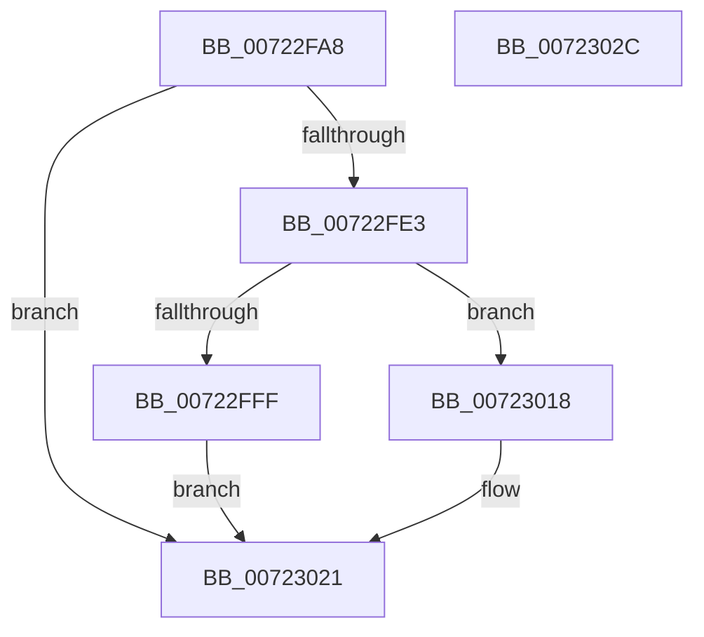

# IopMcCreateBufferEntryMdl

- RVA: `0x00722FA8`–`0x0072302D` (길이 `133` bytes)
- VA: `0x0000000140722FA8`
- 실행 섹션: `PAGE`
- PDB 이름 있음: `예`; PDB Function 태그: `아니요`
- unwind 정보 RVA: `0x000BDD0C`
- 디코드: `36`개 명령, `133/133` bytes 표시
- 미해석 바이트: `0` (있으면 어셈블리에 `.byte`로 보존)

> 이 문서는 커널 이미지의 기계어와 PDB 기호를 분석해 생성했습니다. 4번과 5번은 함수 원형과 자료형을 바이너리 사용 방식에서 추정한 C 해석이며 원본 소스 복구 결과는 아닙니다.

## 1. Dependencies

- 직접 호출 지점: **4**; 고유 호출 대상: **4**
- 직접 호출자로 확인된 함수: **1**
- RIP 상대 이미지 참조: **1**

### Outgoing calls
- `0x00722FDA` → [IopAllocateAndLockMdl](../71/IopAllocateAndLockMdl_function_0071AC6C.md) (function, `0x0071AC6C`)
- `0x00722FEB` → [IopMcAddMdlPagesToTable](../../text/4C/IopMcAddMdlPagesToTable_function_004C82F8.md) (function, `0x004C82F8`)
- `0x00723007` → [IopMcRemoveMdlPagesFromTable](../../text/5A/IopMcRemoveMdlPagesFromTable_function_005A3D94.md) (function, `0x005A3D94`)
- `0x00723011` → [IopUnlockAndFreeMdl](../../text/29/IopUnlockAndFreeMdl_function_0029F200.md) (function, `0x0029F200`)

### Direct callers
- [sub_00B4A8D2](../B4/Unknown_function_00B4A8D2.md) at `0x00B4A8E2`

### Static image references
- `0x00722FB4` → RVA `0x00F8D020` (`.data`; read)

## 2. Other-region calls and transfers

- 다른 실행 섹션으로 향하는 call: **3**
  - `0x00722FEB` → [IopMcAddMdlPagesToTable](../../text/4C/IopMcAddMdlPagesToTable_function_004C82F8.md) (`PAGE` → `.text`)
  - `0x00723007` → [IopMcRemoveMdlPagesFromTable](../../text/5A/IopMcRemoveMdlPagesFromTable_function_005A3D94.md) (`PAGE` → `.text`)
  - `0x00723011` → [IopUnlockAndFreeMdl](../../text/29/IopUnlockAndFreeMdl_function_0029F200.md) (`PAGE` → `.text`)
- 별도 외부 분기/꼬리 이동을 확인하지 못했습니다.

## 3. Assembly (complete function range)

```asm
00722FA8  4C 8B DC                        mov r11, rsp
00722FAB  49 89 5B 10                     mov qword ptr [r11 + 0x10], rbx
00722FAF  57                              push rdi
00722FB0  48 83 EC 30                     sub rsp, 0x30
00722FB4  8B 3D 66 A0 86 00               mov edi, dword ptr [rip + 0x86a066]
00722FBA  49 8D 43 08                     lea rax, [r11 + 8]
00722FBE  44 8A 41 2C                     mov r8b, byte ptr [rcx + 0x2c]
00722FC2  48 8B D9                        mov rbx, rcx
00722FC5  8B 51 28                        mov edx, dword ptr [rcx + 0x28]
00722FC8  49 83 63 F0 00                  and qword ptr [r11 - 0x10], 0
00722FCD  48 8B 49 20                     mov rcx, qword ptr [rcx + 0x20]
00722FD1  49 83 63 08 00                  and qword ptr [r11 + 8], 0
00722FD6  49 89 43 E8                     mov qword ptr [r11 - 0x18], rax
00722FDA  E8 8D 7C FF FF                  call 0x14071ac6c
00722FDF  85 C0                           test eax, eax
00722FE1  78 3E                           js 0x140723021
00722FE3  48 8B 54 24 40                  mov rdx, qword ptr [rsp + 0x40]
00722FE8  48 8B CB                        mov rcx, rbx
00722FEB  E8 08 53 DA FF                  call 0x1404c82f8
00722FF0  F0 83 0C 24 00                  lock or dword ptr [rsp], 0
00722FF5  8B 05 25 A0 86 00               mov eax, dword ptr [rip + 0x86a025]
00722FFB  3B F8                           cmp edi, eax
00722FFD  74 19                           je 0x140723018
00722FFF  48 8B 54 24 40                  mov rdx, qword ptr [rsp + 0x40]
00723004  48 8B CB                        mov rcx, rbx
00723007  E8 88 0D E8 FF                  call 0x1405a3d94
0072300C  48 8B 4C 24 40                  mov rcx, qword ptr [rsp + 0x40]
00723011  E8 EA C1 B7 FF                  call 0x14029f200
00723016  EB 09                           jmp 0x140723021
00723018  48 8B 44 24 40                  mov rax, qword ptr [rsp + 0x40]
0072301D  48 89 43 38                     mov qword ptr [rbx + 0x38], rax
00723021  48 8B 5C 24 48                  mov rbx, qword ptr [rsp + 0x48]
00723026  48 83 C4 30                     add rsp, 0x30
0072302A  5F                              pop rdi
0072302B  C3                              ret
0072302C  CC                              int3
```

## 4. C-style interpretation (structured pseudocode)

```c
__int64 __fastcall IopMcCreateBufferEntryMdl(__int64 a1)
{
    __int64 result;
    __int64 v_rsp;
    unsigned int v_stack_m38;
    unsigned __int64 v_stack_p10;
    unsigned __int64 v_stack_p8;

    *(unsigned __int64 *)(v_rsp + 16) = v_rbx;
    v_rsp = (v_rsp) - (48);
    *(unsigned __int64 *)(v_rsp - 24) = v_rsp + 8;
    result = IopAllocateAndLockMdl(*(unsigned __int64 *)(a1 + 32), (unsigned int)(*(unsigned int *)(a1 + 40)), *(unsigned __int8 *)(a1 + 44), a4);
    if (sign_flag) goto loc_00723021;
    result = IopMcAddMdlPagesToTable(a1, v_stack_p8, *(unsigned __int8 *)(a1 + 44), a4);
    if (((unsigned int)((unsigned int)(*(unsigned int *)(v_rip + 8822886)))) == ((unsigned int)((unsigned int)(*(unsigned int *)(v_rip + 8822821))))) goto loc_00723018;
    result = IopMcRemoveMdlPagesFromTable(a1, v_stack_p8, *(unsigned __int8 *)(a1 + 44), a4);
    result = IopUnlockAndFreeMdl(v_stack_p8, v_stack_p8, *(unsigned __int8 *)(a1 + 44), a4);
    goto loc_00723021;
loc_00723018:
    *(unsigned __int64 *)(a1 + 56) = v_stack_p8;
loc_00723021:
    v_rsp = (v_rsp) + (48);
    return v_stack_p8;
}
```

## 5. (Beta) C Style

```c
int64_t IopMcCreateBufferEntryMdl(void *Arg1)
{
    uint8_t *arg1 = (uint8_t *)Arg1;

    int64_t result;
    int64_t local_rsp;
    uint32_t v_stack_m38;
    uint64_t v_stack_p10;
    uint64_t v_stack_p8;

    *(uint64_t *)(local_rsp + 0x10) = local_rbx;
    local_rsp = (local_rsp) - (48);
    *(uint64_t *)(local_rsp - 0x18) = local_rsp + 8;
    result = IopAllocateAndLockMdl(*(uint64_t *)(arg1 + 0x20), (uint32_t)(*(uint32_t *)(arg1 + 0x28)), *(uint8_t *)(arg1 + 0x2C), a4);
    if (sign_flag) goto loc_00723021;
    result = IopMcAddMdlPagesToTable(Arg1, v_stack_p8, *(uint8_t *)(arg1 + 0x2C), a4);
    if (((uint32_t)((uint32_t)(*(uint32_t *)(v_rip + 0x86A066)))) == ((uint32_t)((uint32_t)(*(uint32_t *)(v_rip + 0x86A025))))) goto loc_00723018;
    result = IopMcRemoveMdlPagesFromTable(Arg1, v_stack_p8, *(uint8_t *)(arg1 + 0x2C), a4);
    result = IopUnlockAndFreeMdl(v_stack_p8, v_stack_p8, *(uint8_t *)(arg1 + 0x2C), a4);
    goto loc_00723021;
loc_00723018:
    *(uint64_t *)(arg1 + 0x38) = v_stack_p8;
loc_00723021:
    local_rsp = (local_rsp) + (48);
    return v_stack_p8;
}
```

### 관측된 메모리 오프셋

구조체 형식이 확인되지 않은 접근은 인자 기준의 오프셋으로만 기록했습니다.

| 기준 인자 | 오프셋 표현 | 폭 (bit) | 접근 |
|---|---:|---:|---|
| `Arg1` | `+ 0x20` | `64` | `R` |
| `Arg1` | `+ 0x28` | `32` | `R` |
| `Arg1` | `+ 0x2C` | `8` | `R` |
| `Arg1` | `+ 0x38` | `64` | `W` |

## 6. Execution-region graph

[열기: 2D/3D 그래프와 함수 탐색 컨트롤 패널](../../../control-panel.html?section=page&rva=0x00722FA8&view=graph)

- 2D 그래프는 위에서 아래로 흐르고, 3D 그래프는 빈 공간을 드래그해 회전합니다. Shift+드래그는 이동, 휠은 확대·축소, 함수 노드 선택은 대상 보고서 이동입니다.

### Static fallback


