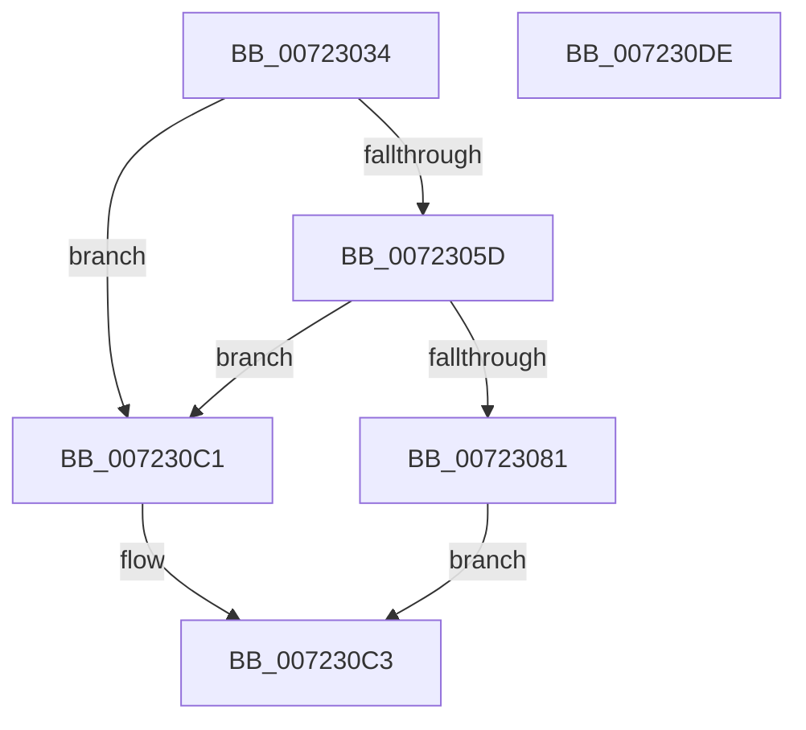

# IopMcCreatePartialMdl

- RVA: `0x00723034`–`0x007230DF` (길이 `171` bytes)
- VA: `0x0000000140723034`
- 실행 섹션: `PAGE`
- PDB 이름 있음: `예`; PDB Function 태그: `아니요`
- unwind 정보 RVA: `0x0005D7BC`
- 디코드: `46`개 명령, `171/171` bytes 표시
- 미해석 바이트: `0` (있으면 어셈블리에 `.byte`로 보존)

> 이 문서는 커널 이미지의 기계어와 PDB 기호를 분석해 생성했습니다. 4번과 5번은 함수 원형과 자료형을 바이너리 사용 방식에서 추정한 C 해석이며 원본 소스 복구 결과는 아닙니다.

## 1. Dependencies

- 직접 호출 지점: **2**; 고유 호출 대상: **2**
- 직접 호출자로 확인된 함수: **1**
- RIP 상대 이미지 참조: **0**

### Outgoing calls
- `0x00723074` → [IopAllocateMdl](../../text/3F/IopAllocateMdl_function_003FF0B0.md) (function, `0x003FF0B0`)
- `0x0072308E` → [IoBuildPartialMdl](../../text/26/IoBuildPartialMdl_function_00267BE0.md) (function, `0x00267BE0`)

### Direct callers
- [sub_00B4A8D2](../B4/Unknown_function_00B4A8D2.md) at `0x00B4A8F0`

### Static image references
- 디코드된 RIP-relative 메모리 참조가 없습니다.

## 2. Other-region calls and transfers

- 다른 실행 섹션으로 향하는 call: **2**
  - `0x00723074` → [IopAllocateMdl](../../text/3F/IopAllocateMdl_function_003FF0B0.md) (`PAGE` → `.text`)
  - `0x0072308E` → [IoBuildPartialMdl](../../text/26/IoBuildPartialMdl_function_00267BE0.md) (`PAGE` → `.text`)
- 별도 외부 분기/꼬리 이동을 확인하지 못했습니다.

## 3. Assembly (complete function range)

```asm
00723034  48 8B C4                        mov rax, rsp
00723037  48 89 58 08                     mov qword ptr [rax + 8], rbx
0072303B  48 89 68 10                     mov qword ptr [rax + 0x10], rbp
0072303F  48 89 70 18                     mov qword ptr [rax + 0x18], rsi
00723043  48 89 78 20                     mov qword ptr [rax + 0x20], rdi
00723047  41 56                           push r14
00723049  48 83 EC 30                     sub rsp, 0x30
0072304D  48 83 79 38 00                  cmp qword ptr [rcx + 0x38], 0
00723052  41 8B F0                        mov esi, r8d
00723055  48 8B EA                        mov rbp, rdx
00723058  48 8B F9                        mov rdi, rcx
0072305B  74 64                           je 0x1407230c1
0072305D  41 BE 10 00 00 00               mov r14d, 0x10
00723063  45 33 C0                        xor r8d, r8d
00723066  44 89 70 F0                     mov dword ptr [rax - 0x10], r14d
0072306A  8B D6                           mov edx, esi
0072306C  48 83 60 E8 00                  and qword ptr [rax - 0x18], 0
00723071  48 8B CD                        mov rcx, rbp
00723074  E8 37 C0 CD FF                  call 0x1403ff0b0
00723079  48 8B D8                        mov rbx, rax
0072307C  48 85 C0                        test rax, rax
0072307F  74 40                           je 0x1407230c1
00723081  48 8B 4F 38                     mov rcx, qword ptr [rdi + 0x38]
00723085  44 8B CE                        mov r9d, esi
00723088  4C 8B C5                        mov r8, rbp
0072308B  48 8B D0                        mov rdx, rax
0072308E  E8 4D 4B B4 FF                  call 0x140267be0
00723093  8B 53 2C                        mov edx, dword ptr [rbx + 0x2c]
00723096  48 8B C3                        mov rax, rbx
00723099  44 8B 43 28                     mov r8d, dword ptr [rbx + 0x28]
0072309D  81 E2 FF 0F 00 00               and edx, 0xfff
007230A3  49 81 C0 FF 0F 00 00            add r8, 0xfff
007230AA  4C 03 C2                        add r8, rdx
007230AD  49 C1 E8 0C                     shr r8, 0xc
007230B1  42 C7 44 C3 30 03 0C 10 00      mov dword ptr [rbx + r8*8 + 0x30], 0x100c03
007230BA  4A 89 7C C3 38                  mov qword ptr [rbx + r8*8 + 0x38], rdi
007230BF  EB 02                           jmp 0x1407230c3
007230C1  33 C0                           xor eax, eax
007230C3  48 8B 5C 24 40                  mov rbx, qword ptr [rsp + 0x40]
007230C8  48 8B 6C 24 48                  mov rbp, qword ptr [rsp + 0x48]
007230CD  48 8B 74 24 50                  mov rsi, qword ptr [rsp + 0x50]
007230D2  48 8B 7C 24 58                  mov rdi, qword ptr [rsp + 0x58]
007230D7  48 83 C4 30                     add rsp, 0x30
007230DB  41 5E                           pop r14
007230DD  C3                              ret
007230DE  CC                              int3
```

## 4. C-style interpretation (structured pseudocode)

```c
__int64 __fastcall IopMcCreatePartialMdl(__int64 a1, __int64 a2, int a3)
{
    __int64 result;
    __int64 v_rsp;
    unsigned __int64 v_stack_p10;
    unsigned __int64 v_stack_p18;
    unsigned __int64 v_stack_p20;
    unsigned __int64 v_stack_p8;

    *(unsigned __int64 *)(v_rsp + 8) = v_rbx;
    *(unsigned __int64 *)(v_rsp + 16) = v_rbp;
    *(unsigned __int64 *)(v_rsp + 24) = v_rsi;
    *(unsigned __int64 *)(v_rsp + 32) = v_rdi;
    v_rsp = (v_rsp) - (48);
    if ((*(unsigned __int64 *)(a1 + 56)) == 0) goto loc_007230C1;
    a3 = 0;
    *(unsigned int *)(v_rsp - 16) = 16;
    result = IopAllocateMdl(a2, (unsigned int)((unsigned int)((unsigned int)(a3))), a3, a4);
    if (result == 0) goto loc_007230C1;
    result = IoBuildPartialMdl(*(unsigned __int64 *)(a1 + 56), result, a2, (unsigned int)((unsigned int)((unsigned int)(a3))));
    a2 = (unsigned int)(((unsigned int)(*(unsigned int *)(result + 44))) & (0xFFFULL));
    a3 = ((unsigned int)(*(unsigned int *)(result + 40))) + (0xFFFULL);
    a3 = (a3) + (a2);
    a3 = (a3) >> (12);
    *(unsigned int *)(result + a3 * 8 + 48) = 0x100C03ULL;
    *(unsigned __int64 *)(result + a3 * 8 + 56) = a1;
    goto loc_007230C3;
loc_007230C1:
    result = 0;
loc_007230C3:
    v_rsp = (v_rsp) + (48);
    return result;
}
```

## 5. (Beta) C Style

```c
int64_t IopMcCreatePartialMdl(void *Arg1, int64_t Arg2, int32_t Arg3)
{
    uint8_t *arg1 = (uint8_t *)Arg1;

    int64_t result;
    int64_t local_rsp;
    uint64_t v_stack_p10;
    uint64_t v_stack_p18;
    uint64_t v_stack_p20;
    uint64_t v_stack_p8;

    *(uint64_t *)(local_rsp + 0x8) = local_rbx;
    *(uint64_t *)(local_rsp + 0x10) = local_rbp;
    *(uint64_t *)(local_rsp + 0x18) = local_rsi;
    *(uint64_t *)(local_rsp + 0x20) = local_rdi;
    local_rsp = (local_rsp) - (48);
    if ((*(uint64_t *)(arg1 + 0x38)) == 0) goto loc_007230C1;
    Arg3 = 0;
    *(uint32_t *)(local_rsp - 0x10) = 16;
    result = IopAllocateMdl(Arg2, (uint32_t)((uint32_t)((uint32_t)(Arg3))), Arg3, a4);
    if (result == 0) goto loc_007230C1;
    result = IoBuildPartialMdl(*(uint64_t *)(arg1 + 0x38), result, Arg2, (uint32_t)((uint32_t)((uint32_t)(Arg3))));
    Arg2 = (uint32_t)(((uint32_t)(*(uint32_t *)(result + 0x2C))) & (0xFFFULL));
    Arg3 = ((uint32_t)(*(uint32_t *)(result + 0x28))) + (0xFFFULL);
    Arg3 = (Arg3) + (Arg2);
    Arg3 = (Arg3) >> (12);
    *(uint32_t *)(result + Arg3 * 8 + 0x30) = 0x100C03ULL;
    *(void **)(result + Arg3 * 8 + 0x38) = Arg1;
    goto loc_007230C3;
loc_007230C1:
    result = 0;
loc_007230C3:
    local_rsp = (local_rsp) + (48);
    return result;
}
```

### 관측된 메모리 오프셋

구조체 형식이 확인되지 않은 접근은 인자 기준의 오프셋으로만 기록했습니다.

| 기준 인자 | 오프셋 표현 | 폭 (bit) | 접근 |
|---|---:|---:|---|
| `Arg1` | `+ 0x38` | `64` | `R` |

## 6. Execution-region graph

[열기: 2D/3D 그래프와 함수 탐색 컨트롤 패널](../../../control-panel.html?section=page&rva=0x00723034&view=graph)

- 2D 그래프는 위에서 아래로 흐르고, 3D 그래프는 빈 공간을 드래그해 회전합니다. Shift+드래그는 이동, 휠은 확대·축소, 함수 노드 선택은 대상 보고서 이동입니다.

### Static fallback


