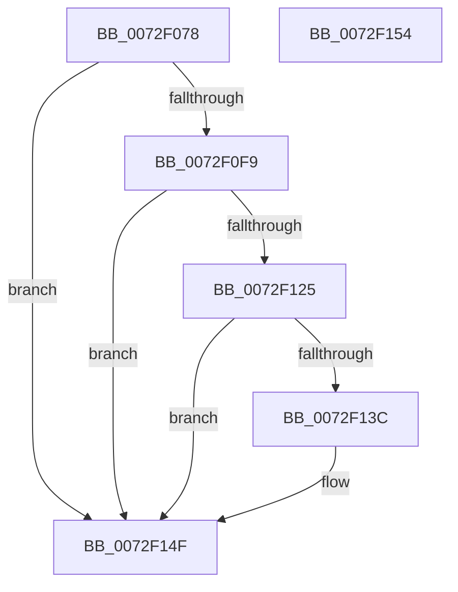

# IopMemInitialize

- RVA: `0x0072F078`–`0x0072F155` (길이 `221` bytes)
- VA: `0x000000014072F078`
- 실행 섹션: `PAGE`
- PDB 이름 있음: `예`; PDB Function 태그: `아니요`
- unwind 정보 RVA: `0x00063458`
- 디코드: `42`개 명령, `221/221` bytes 표시
- 미해석 바이트: `0` (있으면 어셈블리에 `.byte`로 보존)

> 이 문서는 커널 이미지의 기계어와 PDB 기호를 분석해 생성했습니다. 4번과 5번은 함수 원형과 자료형을 바이너리 사용 방식에서 추정한 C 해석이며 원본 소스 복구 결과는 아닙니다.

## 1. Dependencies

- 직접 호출 지점: **4**; 고유 호출 대상: **4**
- 직접 호출자로 확인된 함수: **1**
- RIP 상대 이미지 참조: **16**

### Outgoing calls
- `0x0072F0F0` → [ArbInitializeArbiterInstance](../70/ArbInitializeArbiterInstance_function_0070ECB4.md) (function, `0x0070ECB4`)
- `0x0072F11C` → [RtlAddRange](../A8/RtlAddRange_function_00A8E860.md) (function, `0x00A8E860`)
- `0x0072F133` → [ArbAddInaccessibleAllocationRange](../70/ArbAddInaccessibleAllocationRange_function_0070DEB0.md) (function, `0x0070DEB0`)
- `0x0072F14A` → [ArbAddMmConfigRangeAsBootReserved](../70/ArbAddMmConfigRangeAsBootReserved_function_0070E0C8.md) (function, `0x0070E0C8`)

### Direct callers
- [IopInitializePlugPlayServices](../../init/C2/IopInitializePlugPlayServices_function_00C2F298.md) at `0x00C2F5C8`

### Static image references
- `0x0072F07C` → RVA `0x0072EEA0` (`IopGenericUnpackRequirement`; read)
- `0x0072F089` → RVA `0x00F8BEF8` (`.data`; write)
- `0x0072F090` → RVA `0x00AFE1B0` (` ?? ::NNGAKEGL::`string'`; read)
- `0x0072F097` → RVA `0x0072ED40` (`IopGenericPackResource`; read)
- `0x0072F09E` → RVA `0x00F8BF00` (`.data`; write)
- `0x0072F0A5` → RVA `0x00F8BE80` (`.data`; read)
- `0x0072F0AC` → RVA `0x0072EF20` (`IopGenericUnpackResource`; read)
- `0x0072F0B3` → RVA `0x00F8BF08` (`.data`; write)
- `0x0072F0BA` → RVA `0x0072ED70` (`IopGenericScoreRequirement`; read)
- `0x0072F0C1` → RVA `0x00F8BF10` (`.data`; write)
- `0x0072F0C8` → RVA `0x0072F050` (`IopMemFindSuitableRange`; read)
- `0x0072F0CF` → RVA `0x00F8BF78` (`.data`; write)
- `0x0072F0D6` → RVA `0x0072F160` (`IopMemQueryConflict`; read)
- `0x0072F0DD` → RVA `0x00F8BF48` (`.data`; write)
- `0x0072F0E4` → RVA `0x0072EE00` (`IopGenericTranslateOrdering`; read)
- `0x0072F10A` → RVA `0x00F8BEA8` (`.data`; read)

## 2. Other-region calls and transfers

- 다른 실행 섹션으로 향하는 call: **0**
- 별도 외부 분기/꼬리 이동을 확인하지 못했습니다.

## 3. Assembly (complete function range)

```asm
0072F078  48 83 EC 48                     sub rsp, 0x48
0072F07C  48 8D 05 1D FE FF FF            lea rax, [rip - 0x1e3]
0072F083  41 B8 03 00 00 00               mov r8d, 3
0072F089  48 89 05 68 CE 85 00            mov qword ptr [rip + 0x85ce68], rax
0072F090  4C 8D 0D 19 F1 3C 00            lea r9, [rip + 0x3cf119]
0072F097  48 8D 05 A2 FC FF FF            lea rax, [rip - 0x35e]
0072F09E  48 89 05 5B CE 85 00            mov qword ptr [rip + 0x85ce5b], rax
0072F0A5  48 8D 0D D4 CD 85 00            lea rcx, [rip + 0x85cdd4]
0072F0AC  48 8D 05 6D FE FF FF            lea rax, [rip - 0x193]
0072F0B3  48 89 05 4E CE 85 00            mov qword ptr [rip + 0x85ce4e], rax
0072F0BA  48 8D 05 AF FC FF FF            lea rax, [rip - 0x351]
0072F0C1  48 89 05 48 CE 85 00            mov qword ptr [rip + 0x85ce48], rax
0072F0C8  48 8D 05 81 FF FF FF            lea rax, [rip - 0x7f]
0072F0CF  48 89 05 A2 CE 85 00            mov qword ptr [rip + 0x85cea2], rax
0072F0D6  48 8D 05 83 00 00 00            lea rax, [rip + 0x83]
0072F0DD  48 89 05 64 CE 85 00            mov qword ptr [rip + 0x85ce64], rax
0072F0E4  48 8D 05 15 FD FF FF            lea rax, [rip - 0x2eb]
0072F0EB  48 89 44 24 28                  mov qword ptr [rsp + 0x28], rax
0072F0F0  E8 BF FB FD FF                  call 0x14070ecb4
0072F0F5  85 C0                           test eax, eax
0072F0F7  78 56                           js 0x14072f14f
0072F0F9  48 83 64 24 30 00               and qword ptr [rsp + 0x30], 0
0072F0FF  45 33 C9                        xor r9d, r9d
0072F102  48 83 64 24 28 00               and qword ptr [rsp + 0x28], 0
0072F108  33 D2                           xor edx, edx
0072F10A  48 8B 0D 97 CD 85 00            mov rcx, qword ptr [rip + 0x85cd97]
0072F111  41 B8 FF 0F 00 00               mov r8d, 0xfff
0072F117  83 64 24 20 00                  and dword ptr [rsp + 0x20], 0
0072F11C  E8 3F F7 35 00                  call 0x140a8e860
0072F121  85 C0                           test eax, eax
0072F123  78 2A                           js 0x14072f14f
0072F125  48 8B 15 7C CD 85 00            mov rdx, qword ptr [rip + 0x85cd7c]
0072F12C  48 8D 0D 4D CD 85 00            lea rcx, [rip + 0x85cd4d]
0072F133  E8 78 ED FD FF                  call 0x14070deb0
0072F138  85 C0                           test eax, eax
0072F13A  78 13                           js 0x14072f14f
0072F13C  48 8B 15 65 CD 85 00            mov rdx, qword ptr [rip + 0x85cd65]
0072F143  48 8D 0D 36 CD 85 00            lea rcx, [rip + 0x85cd36]
0072F14A  E8 79 EF FD FF                  call 0x14070e0c8
0072F14F  48 83 C4 48                     add rsp, 0x48
0072F153  C3                              ret
0072F154  CC                              int3
```

## 4. C-style interpretation (structured pseudocode)

```c
__int64 __fastcall IopMemInitialize(__int64 a1, int a2)
{
    __int64 result;
    __int64 v_rsp;
    unsigned __int64 v_stack_m18;
    unsigned __int64 v_stack_m20;
    unsigned int v_stack_m28;

    v_rsp = (v_rsp) - (72);
    *(unsigned __int64 *)(v_rip + 8769128) = v_rip - 483;
    *(unsigned __int64 *)(v_rip + 8769115) = v_rip - 862;
    *(unsigned __int64 *)(v_rip + 8769102) = v_rip - 403;
    *(unsigned __int64 *)(v_rip + 8769096) = v_rip - 849;
    *(unsigned __int64 *)(v_rip + 8769186) = v_rip - 127;
    *(unsigned __int64 *)(v_rip + 8769124) = v_rip + 131;
    v_stack_m20 = v_rip - 747;
    result = ArbInitializeArbiterInstance(v_rip + 8768980, a2, 3, v_rip + 3993881);
    if (sign_flag) goto loc_0072F14F;
    a4 = 0;
    a2 = 0;
    result = RtlAddRange(*(unsigned __int64 *)(v_rip + 8768919), a2, (unsigned int)(0xFFFULL), a4);
    if (sign_flag) goto loc_0072F14F;
    result = ArbAddInaccessibleAllocationRange(v_rip + 8768845, *(unsigned __int64 *)(v_rip + 8768892), (unsigned int)(0xFFFULL), a4);
    if (!(sign_flag)) {
        a2 = *(unsigned __int64 *)(v_rip + 8768869);
        a1 = v_rip + 8768822;
        result = ArbAddMmConfigRangeAsBootReserved(a1, a2, (unsigned int)(0xFFFULL), a4);
    }
    v_rsp = (v_rsp) + (72);
    return result;
}
```

## 5. (Beta) C Style

```c
int64_t IopMemInitialize(int64_t Arg1, int32_t Arg2)
{
    int64_t result;
    int64_t local_rsp;
    uint64_t v_stack_m18;
    uint64_t v_stack_m20;
    uint32_t v_stack_m28;

    local_rsp = (local_rsp) - (72);
    *(uint64_t *)(v_rip + 0x85CE68) = v_rip - 483;
    *(uint64_t *)(v_rip + 0x85CE5B) = v_rip - 862;
    *(uint64_t *)(v_rip + 0x85CE4E) = v_rip - 403;
    *(uint64_t *)(v_rip + 0x85CE48) = v_rip - 849;
    *(uint64_t *)(v_rip + 0x85CEA2) = v_rip - 127;
    *(uint64_t *)(v_rip + 0x85CE64) = v_rip + 131;
    v_stack_m20 = v_rip - 747;
    result = ArbInitializeArbiterInstance(v_rip + 8768980, Arg2, 3, v_rip + 3993881);
    if (sign_flag) goto loc_0072F14F;
    a4 = 0;
    Arg2 = 0;
    result = RtlAddRange(*(uint64_t *)(v_rip + 0x85CD97), Arg2, (uint32_t)(0xFFFULL), a4);
    if (sign_flag) goto loc_0072F14F;
    result = ArbAddInaccessibleAllocationRange(v_rip + 8768845, *(uint64_t *)(v_rip + 0x85CD7C), (uint32_t)(0xFFFULL), a4);
    if (!(sign_flag)) {
        Arg2 = *(uint64_t *)(v_rip + 0x85CD65);
        Arg1 = v_rip + 8768822;
        result = ArbAddMmConfigRangeAsBootReserved(Arg1, Arg2, (uint32_t)(0xFFFULL), a4);
    }
    local_rsp = (local_rsp) + (72);
    return result;
}
```

## 6. Execution-region graph

[열기: 2D/3D 그래프와 함수 탐색 컨트롤 패널](../../../control-panel.html?section=page&rva=0x0072F078&view=graph)

- 2D 그래프는 위에서 아래로 흐르고, 3D 그래프는 빈 공간을 드래그해 회전합니다. Shift+드래그는 이동, 휠은 확대·축소, 함수 노드 선택은 대상 보고서 이동입니다.

### Static fallback


