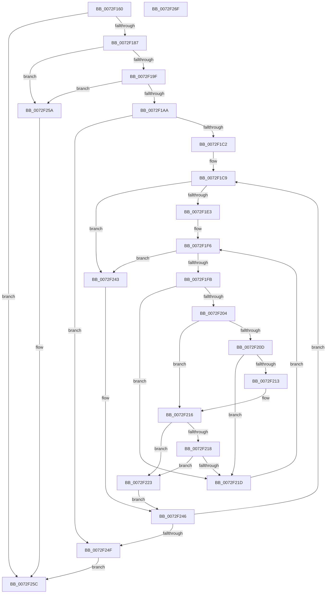

# IopMemQueryConflict

- RVA: `0x0072F160`–`0x0072F270` (길이 `272` bytes)
- VA: `0x000000014072F160`
- 실행 섹션: `PAGE`
- PDB 이름 있음: `예`; PDB Function 태그: `아니요`
- unwind 정보 RVA: `0x000BD140`
- 디코드: `78`개 명령, `272/272` bytes 표시
- 미해석 바이트: `0` (있으면 어셈블리에 `.byte`로 보존)

> 이 문서는 커널 이미지의 기계어와 PDB 기호를 분석해 생성했습니다. 4번과 5번은 함수 원형과 자료형을 바이너리 사용 방식에서 추정한 C 해석이며 원본 소스 복구 결과는 아닙니다.

## 1. Dependencies

- 직접 호출 지점: **2**; 고유 호출 대상: **2**
- 직접 호출자로 확인된 함수: **0**
- RIP 상대 이미지 참조: **1**

### Outgoing calls
- `0x0072F17A` → [ArbQueryConflict](../70/ArbQueryConflict_function_0070F410.md) (function, `0x0070F410`)
- `0x0072F18F` → [IopIsPciRootBus](IopIsPciRootBus_function_0072EF40.md) (function, `0x0072EF40`)

### Direct callers
- 이 함수 시작 RVA로 연결되는 직접 call은 확인되지 않았습니다. 간접 호출은 완전히 역산할 수 없습니다.

### Static image references
- `0x0072F1C2` → RVA `0x00E65AD8` (`.data`; read)

## 2. Other-region calls and transfers

- 다른 실행 섹션으로 향하는 call: **0**
- 별도 외부 분기/꼬리 이동을 확인하지 못했습니다.

## 3. Assembly (complete function range)

```asm
0072F160  48 89 5C 24 08                  mov qword ptr [rsp + 8], rbx
0072F165  48 89 6C 24 10                  mov qword ptr [rsp + 0x10], rbp
0072F16A  56                              push rsi
0072F16B  57                              push rdi
0072F16C  41 56                           push r14
0072F16E  48 83 EC 20                     sub rsp, 0x20
0072F172  48 8B DA                        mov rbx, rdx
0072F175  C6 44 24 50 00                  mov byte ptr [rsp + 0x50], 0
0072F17A  E8 91 02 FE FF                  call 0x14070f410
0072F17F  85 C0                           test eax, eax
0072F181  0F 88 D5 00 00 00               js 0x14072f25c
0072F187  48 8B 0B                        mov rcx, qword ptr [rbx]
0072F18A  48 8D 54 24 50                  lea rdx, [rsp + 0x50]
0072F18F  E8 AC FD FF FF                  call 0x14072ef40
0072F194  44 8B D8                        mov r11d, eax
0072F197  85 C0                           test eax, eax
0072F199  0F 88 BB 00 00 00               js 0x14072f25a
0072F19F  80 7C 24 50 00                  cmp byte ptr [rsp + 0x50], 0
0072F1A4  0F 84 B0 00 00 00               je 0x14072f25a
0072F1AA  48 8B 4B 10                     mov rcx, qword ptr [rbx + 0x10]
0072F1AE  45 33 C0                        xor r8d, r8d
0072F1B1  8B 11                           mov edx, dword ptr [rcx]
0072F1B3  48 8B 4B 18                     mov rcx, qword ptr [rbx + 0x18]
0072F1B7  4C 8B 11                        mov r10, qword ptr [rcx]
0072F1BA  85 D2                           test edx, edx
0072F1BC  0F 84 8D 00 00 00               je 0x14072f24f
0072F1C2  4C 8B 35 0F 69 73 00            mov r14, qword ptr [rip + 0x73690f]
0072F1C9  4C 8B 0D 08 69 73 00            mov r9, qword ptr [rip + 0x736908]
0072F1D0  4B 8D 34 40                     lea rsi, [r8 + r8*2]
0072F1D4  49 8B 7C F2 08                  mov rdi, qword ptr [r10 + rsi*8 + 8]
0072F1D9  49 8B 6C F2 10                  mov rbp, qword ptr [r10 + rsi*8 + 0x10]
0072F1DE  4D 85 C9                        test r9, r9
0072F1E1  74 60                           je 0x14072f243
0072F1E3  41 8B 46 04                     mov eax, dword ptr [r14 + 4]
0072F1E7  49 8D 49 08                     lea rcx, [r9 + 8]
0072F1EB  48 C1 E0 05                     shl rax, 5
0072F1EF  49 83 C1 08                     add r9, 8
0072F1F3  4C 03 C8                        add r9, rax
0072F1F6  49 3B C9                        cmp rcx, r9
0072F1F9  73 48                           jae 0x14072f243
0072F1FB  8A 41 01                        mov al, byte ptr [rcx + 1]
0072F1FE  2C 03                           sub al, 3
0072F200  A8 FB                           test al, 0xfb
0072F202  75 19                           jne 0x14072f21d
0072F204  48 8B 41 10                     mov rax, qword ptr [rcx + 0x10]
0072F208  48 3B F8                        cmp rdi, rax
0072F20B  76 09                           jbe 0x14072f216
0072F20D  48 39 79 18                     cmp qword ptr [rcx + 0x18], rdi
0072F211  72 0A                           jb 0x14072f21d
0072F213  48 3B F8                        cmp rdi, rax
0072F216  73 0B                           jae 0x14072f223
0072F218  48 3B E8                        cmp rbp, rax
0072F21B  73 06                           jae 0x14072f223
0072F21D  48 83 C1 20                     add rcx, 0x20
0072F221  EB D3                           jmp 0x14072f1f6
0072F223  FF CA                           dec edx
0072F225  48 8D 0C 52                     lea rcx, [rdx + rdx*2]
0072F229  41 0F 10 04 CA                  movups xmm0, xmmword ptr [r10 + rcx*8]
0072F22E  41 0F 11 04 F2                  movups xmmword ptr [r10 + rsi*8], xmm0
0072F233  F2 41 0F 10 4C CA 10            movsd xmm1, qword ptr [r10 + rcx*8 + 0x10]
0072F23A  F2 41 0F 11 4C F2 10            movsd qword ptr [r10 + rsi*8 + 0x10], xmm1
0072F241  EB 03                           jmp 0x14072f246
0072F243  41 FF C0                        inc r8d
0072F246  44 3B C2                        cmp r8d, edx
0072F249  0F 82 7A FF FF FF               jb 0x14072f1c9
0072F24F  48 8B 43 10                     mov rax, qword ptr [rbx + 0x10]
0072F253  89 10                           mov dword ptr [rax], edx
0072F255  41 8B C3                        mov eax, r11d
0072F258  EB 02                           jmp 0x14072f25c
0072F25A  33 C0                           xor eax, eax
0072F25C  48 8B 5C 24 40                  mov rbx, qword ptr [rsp + 0x40]
0072F261  48 8B 6C 24 48                  mov rbp, qword ptr [rsp + 0x48]
0072F266  48 83 C4 20                     add rsp, 0x20
0072F26A  41 5E                           pop r14
0072F26C  5F                              pop rdi
0072F26D  5E                              pop rsi
0072F26E  C3                              ret
0072F26F  CC                              int3
```

## 4. C-style interpretation (structured pseudocode)

```c
__int64 __fastcall IopMemQueryConflict(__int64 a1, __int64 a2, int a3)
{
    __int64 result;
    __int64 v_rsp;
    unsigned __int64 v_stack_p10;
    unsigned __int8 v_stack_p18;
    unsigned __int64 v_stack_p8;

    v_stack_p8 = v_rbx;
    v_stack_p10 = v_rbp;
    v_rsp = (v_rsp) - (32);
    v_stack_p18 = 0;
    result = ArbQueryConflict(a1, a2, a3, a4);
    if (sign_flag) goto loc_0072F25C;
    result = IopIsPciRootBus(*(unsigned __int64 *)(a2), v_stack_p18, a3, a4);
    if (sign_flag) goto loc_0072F25A;
    if (v_stack_p18 == 0) goto loc_0072F25A;
    a3 = 0;
    if ((unsigned int)((unsigned int)(*(unsigned int *)(*(unsigned __int64 *)(a2 + 16)))) == 0) goto loc_0072F24F;
loc_0072F1C9:
    if (*(unsigned __int64 *)(v_rip + 7563528) == 0) goto loc_0072F243;
    result = ((unsigned int)(*(unsigned int *)(*(unsigned __int64 *)(v_rip + 7563535) + 4))) << (5);
    a4 = (*(unsigned __int64 *)(v_rip + 7563528)) + (8);
    a4 = (a4) + (result);
loc_0072F1F6:
    if ((*(unsigned __int64 *)(v_rip + 7563528) + 8) >= a4) goto loc_0072F243;
    result = (unsigned __int8)((*(unsigned __int8 *)(*(unsigned __int64 *)(v_rip + 7563528) + 8 + 1)) - (3));
    if ((((unsigned __int8)(result)) & (251)) != 0) goto loc_0072F21D;
    if ((*(unsigned __int64 *)(*(unsigned __int64 *)(*(unsigned __int64 *)(a2 + 24)) + a3 + a3 * 2 * 8 + 8)) <= (*(unsigned __int64 *)(*(unsigned __int64 *)(v_rip + 7563528) + 8 + 16))) goto loc_0072F216;
    if ((*(unsigned __int64 *)(*(unsigned __int64 *)(v_rip + 7563528) + 8 + 24)) < (*(unsigned __int64 *)(*(unsigned __int64 *)(*(unsigned __int64 *)(a2 + 24)) + a3 + a3 * 2 * 8 + 8))) goto loc_0072F21D;
loc_0072F216:
    if ((*(unsigned __int64 *)(*(unsigned __int64 *)(*(unsigned __int64 *)(a2 + 24)) + a3 + a3 * 2 * 8 + 8)) >= (*(unsigned __int64 *)(*(unsigned __int64 *)(v_rip + 7563528) + 8 + 16))) goto loc_0072F223;
    if ((*(unsigned __int64 *)(*(unsigned __int64 *)(*(unsigned __int64 *)(a2 + 24)) + a3 + a3 * 2 * 8 + 16)) >= (*(unsigned __int64 *)(*(unsigned __int64 *)(v_rip + 7563528) + 8 + 16))) goto loc_0072F223;
loc_0072F21D:
    a1 = (*(unsigned __int64 *)(v_rip + 7563528) + 8) + (32);
    goto loc_0072F1F6;
loc_0072F223:
    a2 = (unsigned int)(((unsigned int)(*(unsigned int *)(*(unsigned __int64 *)(a2 + 16)))) - 1);
    *(unsigned __int64 *)(*(unsigned __int64 *)(*(unsigned __int64 *)(a2 + 24)) + a3 + a3 * 2 * 8) = v_xmm0;
    *(unsigned __int64 *)(*(unsigned __int64 *)(*(unsigned __int64 *)(a2 + 24)) + a3 + a3 * 2 * 8 + 16) = v_xmm1;
    goto loc_0072F246;
loc_0072F243:
    a3 = (unsigned int)((a3) + 1);
loc_0072F246:
    if (a3 < ((unsigned int)(a2))) goto loc_0072F1C9;
loc_0072F24F:
    *(unsigned int *)(*(unsigned __int64 *)(a2 + 16)) = (unsigned int)(a2);
    goto loc_0072F25C;
loc_0072F25A:
    result = 0;
loc_0072F25C:
    v_rsp = (v_rsp) + (32);
    return result;
}
```

## 5. (Beta) C Style

```c
int64_t IopMemQueryConflict(int64_t Arg1, void *Arg2, int32_t Arg3)
{
    uint8_t *arg2 = (uint8_t *)Arg2;

    int64_t result;
    int64_t local_rsp;
    uint64_t v_stack_p10;
    uint8_t v_stack_p18;
    uint64_t v_stack_p8;

    v_stack_p8 = local_rbx;
    v_stack_p10 = local_rbp;
    local_rsp = (local_rsp) - (32);
    v_stack_p18 = 0;
    result = ArbQueryConflict(Arg1, Arg2, Arg3, a4);
    if (sign_flag) goto loc_0072F25C;
    result = IopIsPciRootBus(*(uint64_t *)(arg2), v_stack_p18, Arg3, a4);
    if (sign_flag) goto loc_0072F25A;
    if (v_stack_p18 == 0) goto loc_0072F25A;
    Arg3 = 0;
    if ((uint32_t)((uint32_t)(*(uint32_t *)(*(uint64_t *)(arg2 + 0x10)))) == 0) goto loc_0072F24F;
loc_0072F1C9:
    if (*(uint64_t *)(v_rip + 0x736908) == 0) goto loc_0072F243;
    result = ((uint32_t)(*(uint32_t *)(*(uint64_t *)(v_rip + 0x73690F) + 0x4))) << (5);
    a4 = (*(uint64_t *)(v_rip + 0x736908)) + (8);
    a4 = (a4) + (result);
loc_0072F1F6:
    if ((*(uint64_t *)(v_rip + 0x736908) + 8) >= a4) goto loc_0072F243;
    result = (uint8_t)((*(uint8_t *)(*(uint64_t *)(v_rip + 0x736908) + 0x8 + 0x1)) - (3));
    if ((((uint8_t)(result)) & (251)) != 0) goto loc_0072F21D;
    if ((*(uint64_t *)(*(uint64_t *)(*(uint64_t *)(arg2 + 0x18)) + Arg3 + Arg3 * 2 * 8 + 0x8)) <= (*(uint64_t *)(*(uint64_t *)(v_rip + 0x736908) + 0x8 + 0x10))) goto loc_0072F216;
    if ((*(uint64_t *)(*(uint64_t *)(v_rip + 0x736908) + 0x8 + 0x18)) < (*(uint64_t *)(*(uint64_t *)(*(uint64_t *)(arg2 + 0x18)) + Arg3 + Arg3 * 2 * 8 + 0x8))) goto loc_0072F21D;
loc_0072F216:
    if ((*(uint64_t *)(*(uint64_t *)(*(uint64_t *)(arg2 + 0x18)) + Arg3 + Arg3 * 2 * 8 + 0x8)) >= (*(uint64_t *)(*(uint64_t *)(v_rip + 0x736908) + 0x8 + 0x10))) goto loc_0072F223;
    if ((*(uint64_t *)(*(uint64_t *)(*(uint64_t *)(arg2 + 0x18)) + Arg3 + Arg3 * 2 * 8 + 0x10)) >= (*(uint64_t *)(*(uint64_t *)(v_rip + 0x736908) + 0x8 + 0x10))) goto loc_0072F223;
loc_0072F21D:
    Arg1 = (*(uint64_t *)(v_rip + 0x736908) + 8) + (32);
    goto loc_0072F1F6;
loc_0072F223:
    Arg2 = (uint32_t)(((uint32_t)(*(uint32_t *)(*(uint64_t *)(arg2 + 0x10)))) - 1);
    *(uint64_t *)(*(uint64_t *)(*(uint64_t *)(arg2 + 0x18)) + Arg3 + Arg3 * 2 * 8) = v_xmm0;
    *(uint64_t *)(*(uint64_t *)(*(uint64_t *)(arg2 + 0x18)) + Arg3 + Arg3 * 2 * 8 + 0x10) = v_xmm1;
    goto loc_0072F246;
loc_0072F243:
    Arg3 = (uint32_t)((Arg3) + 1);
loc_0072F246:
    if (Arg3 < ((uint32_t)(Arg2))) goto loc_0072F1C9;
loc_0072F24F:
    *(uint32_t *)(*(uint64_t *)(arg2 + 0x10)) = (uint32_t)(Arg2);
    goto loc_0072F25C;
loc_0072F25A:
    result = 0;
loc_0072F25C:
    local_rsp = (local_rsp) + (32);
    return result;
}
```

### 관측된 메모리 오프셋

구조체 형식이 확인되지 않은 접근은 인자 기준의 오프셋으로만 기록했습니다.

| 기준 인자 | 오프셋 표현 | 폭 (bit) | 접근 |
|---|---:|---:|---|
| `Arg2` | `+ 0x0` | `64` | `R` |
| `Arg2` | `+ 0x10` | `64` | `R` |
| `Arg2` | `+ 0x18` | `64` | `R` |

## 6. Execution-region graph

[열기: 2D/3D 그래프와 함수 탐색 컨트롤 패널](../../../control-panel.html?section=page&rva=0x0072F160&view=graph)

- 2D 그래프는 위에서 아래로 흐르고, 3D 그래프는 빈 공간을 드래그해 회전합니다. Shift+드래그는 이동, 휠은 확대·축소, 함수 노드 선택은 대상 보고서 이동입니다.

### Static fallback


