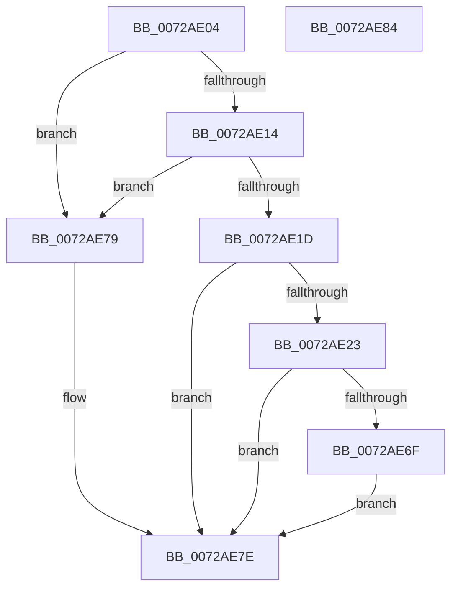

# IopParentToRawTranslation

- RVA: `0x0072AE04`–`0x0072AE85` (길이 `129` bytes)
- VA: `0x000000014072AE04`
- 실행 섹션: `PAGE`
- PDB 이름 있음: `예`; PDB Function 태그: `아니요`
- unwind 정보 RVA: `0x000697A4`
- 디코드: `36`개 명령, `129/129` bytes 표시
- 미해석 바이트: `0` (있으면 어셈블리에 `.byte`로 보존)

> 이 문서는 커널 이미지의 기계어와 PDB 기호를 분석해 생성했습니다. 4번과 5번은 함수 원형과 자료형을 바이너리 사용 방식에서 추정한 C 해석이며 원본 소스 복구 결과는 아닙니다.

## 1. Dependencies

- 직접 호출 지점: **2**; 고유 호출 대상: **2**
- 직접 호출자로 확인된 함수: **2**
- RIP 상대 이미지 참조: **0**

### Outgoing calls
- `0x0072AE66` → [guard_dispatch_icall](../../text/6B/guard_dispatch_icall_function_006BAAD0.md) (function, `0x006BAAD0`)
- `0x0072AE72` → [IopParentToRawTranslation](IopParentToRawTranslation_function_0072AE04.md) (function, `0x0072AE04`)

### Direct callers
- [IopParentToRawTranslation](IopParentToRawTranslation_function_0072AE04.md) at `0x0072AE72`
- [PnpBuildCmResourceList](../AA/PnpBuildCmResourceList_function_00AAB034.md) at `0x00AAB1A9`

### Static image references
- 디코드된 RIP-relative 메모리 참조가 없습니다.

## 2. Other-region calls and transfers

- 다른 실행 섹션으로 향하는 call: **1**
  - `0x0072AE66` → [guard_dispatch_icall](../../text/6B/guard_dispatch_icall_function_006BAAD0.md) (`PAGE` → `.text`)
- 별도 외부 분기/꼬리 이동을 확인하지 못했습니다.

## 3. Assembly (complete function range)

```asm
0072AE04  40 53                           push rbx
0072AE06  48 83 EC 40                     sub rsp, 0x40
0072AE0A  33 C0                           xor eax, eax
0072AE0C  48 8B D1                        mov rdx, rcx
0072AE0F  39 41 38                        cmp dword ptr [rcx + 0x38], eax
0072AE12  74 65                           je 0x14072ae79
0072AE14  80 B9 88 00 00 00 08            cmp byte ptr [rcx + 0x88], 8
0072AE1B  74 5C                           je 0x14072ae79
0072AE1D  48 39 41 10                     cmp qword ptr [rcx + 0x10], rax
0072AE21  75 5B                           jne 0x14072ae7e
0072AE23  48 8B 59 20                     mov rbx, qword ptr [rcx + 0x20]
0072AE27  41 B8 01 00 00 00               mov r8d, 1
0072AE2D  48 8B 81 20 01 00 00            mov rax, qword ptr [rcx + 0x120]
0072AE34  48 8B 52 70                     mov rdx, qword ptr [rdx + 0x70]
0072AE38  44 8B 4B 38                     mov r9d, dword ptr [rbx + 0x38]
0072AE3C  48 8B 48 18                     mov rcx, qword ptr [rax + 0x18]
0072AE40  48 8B 43 70                     mov rax, qword ptr [rbx + 0x70]
0072AE44  48 89 44 24 30                  mov qword ptr [rsp + 0x30], rax
0072AE49  48 8B 43 48                     mov rax, qword ptr [rbx + 0x48]
0072AE4D  4C 8B 51 20                     mov r10, qword ptr [rcx + 0x20]
0072AE51  48 8B 49 08                     mov rcx, qword ptr [rcx + 8]
0072AE55  48 89 44 24 28                  mov qword ptr [rsp + 0x28], rax
0072AE5A  48 8B 43 40                     mov rax, qword ptr [rbx + 0x40]
0072AE5E  48 89 44 24 20                  mov qword ptr [rsp + 0x20], rax
0072AE63  49 8B C2                        mov rax, r10
0072AE66  E8 65 FC F8 FF                  call 0x1406baad0
0072AE6B  85 C0                           test eax, eax
0072AE6D  78 0F                           js 0x14072ae7e
0072AE6F  48 8B CB                        mov rcx, rbx
0072AE72  E8 8D FF FF FF                  call 0x14072ae04
0072AE77  EB 05                           jmp 0x14072ae7e
0072AE79  B8 0D 00 00 C0                  mov eax, 0xc000000d
0072AE7E  48 83 C4 40                     add rsp, 0x40
0072AE82  5B                              pop rbx
0072AE83  C3                              ret
0072AE84  CC                              int3
```

## 4. C-style interpretation (structured pseudocode)

```c
__int64 __fastcall IopParentToRawTranslation(__int64 a1)
{
    __int64 result;
    __int64 v_rsp;
    unsigned __int64 v_stack_m18;
    unsigned __int64 v_stack_m20;
    unsigned __int64 v_stack_m28;

    v_rsp = (v_rsp) - (64);
    result = 0;
    if ((*(unsigned int *)(a1 + 56)) == 0) goto loc_0072AE79;
    if ((*(unsigned __int8 *)(a1 + 136)) == 8) goto loc_0072AE79;
    if ((*(unsigned __int64 *)(a1 + 16)) != 0) goto loc_0072AE7E;
    v_stack_m18 = *(unsigned __int64 *)(*(unsigned __int64 *)(a1 + 32) + 112);
    v_stack_m20 = *(unsigned __int64 *)(*(unsigned __int64 *)(a1 + 32) + 72);
    v_stack_m28 = *(unsigned __int64 *)(*(unsigned __int64 *)(a1 + 32) + 64);
    result = guard_dispatch_icall(*(unsigned __int64 *)(*(unsigned __int64 *)(*(unsigned __int64 *)(a1 + 288) + 24) + 8), *(unsigned __int64 *)(a1 + 112), 1, (unsigned int)(*(unsigned int *)(*(unsigned __int64 *)(a1 + 32) + 56)));
    if (sign_flag) goto loc_0072AE7E;
    result = IopParentToRawTranslation(*(unsigned __int64 *)(a1 + 32), *(unsigned __int64 *)(a1 + 112), 1, (unsigned int)(*(unsigned int *)(*(unsigned __int64 *)(a1 + 32) + 56)));
    goto loc_0072AE7E;
loc_0072AE79:
loc_0072AE7E:
    v_rsp = (v_rsp) + (64);
    return (unsigned int)(0xC000000DULL);
}
```

## 5. (Beta) C Style

```c
int64_t IopParentToRawTranslation(void *Arg1)
{
    uint8_t *arg1 = (uint8_t *)Arg1;

    int64_t result;
    int64_t local_rsp;
    uint64_t v_stack_m18;
    uint64_t v_stack_m20;
    uint64_t v_stack_m28;

    local_rsp = (local_rsp) - (64);
    result = 0;
    if ((*(uint32_t *)(arg1 + 0x38)) == 0) goto loc_0072AE79;
    if ((*(uint8_t *)(arg1 + 0x88)) == 8) goto loc_0072AE79;
    if ((*(uint64_t *)(arg1 + 0x10)) != 0) goto loc_0072AE7E;
    v_stack_m18 = *(uint64_t *)(*(uint64_t *)(arg1 + 0x20) + 0x70);
    v_stack_m20 = *(uint64_t *)(*(uint64_t *)(arg1 + 0x20) + 0x48);
    v_stack_m28 = *(uint64_t *)(*(uint64_t *)(arg1 + 0x20) + 0x40);
    result = guard_dispatch_icall(*(uint64_t *)(*(uint64_t *)(*(uint64_t *)(arg1 + 0x120) + 0x18) + 0x8), *(uint64_t *)(arg1 + 0x70), 1, (uint32_t)(*(uint32_t *)(*(uint64_t *)(arg1 + 0x20) + 0x38)));
    if (sign_flag) goto loc_0072AE7E;
    result = IopParentToRawTranslation(*(uint64_t *)(arg1 + 0x20), *(uint64_t *)(arg1 + 0x70), 1, (uint32_t)(*(uint32_t *)(*(uint64_t *)(arg1 + 0x20) + 0x38)));
    goto loc_0072AE7E;
loc_0072AE79:
loc_0072AE7E:
    local_rsp = (local_rsp) + (64);
    return (uint32_t)(0xC000000DULL);
}
```

### 관측된 메모리 오프셋

구조체 형식이 확인되지 않은 접근은 인자 기준의 오프셋으로만 기록했습니다.

| 기준 인자 | 오프셋 표현 | 폭 (bit) | 접근 |
|---|---:|---:|---|
| `Arg1` | `+ 0x10` | `64` | `R` |
| `Arg1` | `+ 0x20` | `64` | `R` |
| `Arg1` | `+ 0x38` | `32` | `R` |
| `Arg1` | `+ 0x70` | `64` | `R` |
| `Arg1` | `+ 0x88` | `8` | `R` |
| `Arg1` | `+ 0x120` | `64` | `R` |

## 6. Execution-region graph

[열기: 2D/3D 그래프와 함수 탐색 컨트롤 패널](../../../control-panel.html?section=page&rva=0x0072AE04&view=graph)

- 2D 그래프는 위에서 아래로 흐르고, 3D 그래프는 빈 공간을 드래그해 회전합니다. Shift+드래그는 이동, 휠은 확대·축소, 함수 노드 선택은 대상 보고서 이동입니다.

### Static fallback


