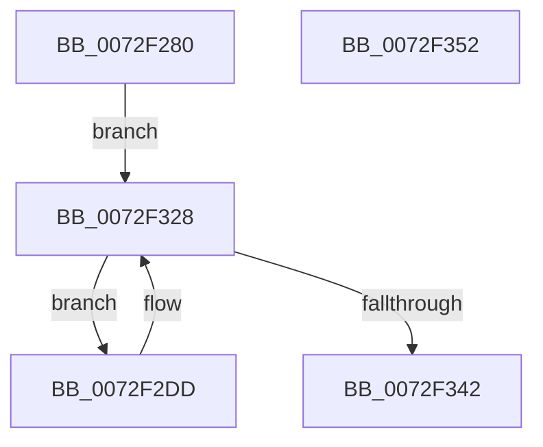

# IopPortAddAllocation

- RVA: `0x0072F280`–`0x0072F353` (길이 `211` bytes)
- VA: `0x000000014072F280`
- 실행 섹션: `PAGE`
- PDB 이름 있음: `예`; PDB Function 태그: `아니요`
- unwind 정보 RVA: `0x000937EC`
- 디코드: `54`개 명령, `211/211` bytes 표시
- 미해석 바이트: `0` (있으면 어셈블리에 `.byte`로 보존)

> 이 문서는 커널 이미지의 기계어와 PDB 기호를 분석해 생성했습니다. 4번과 5번은 함수 원형과 자료형을 바이너리 사용 방식에서 추정한 C 해석이며 원본 소스 복구 결과는 아닙니다.

## 1. Dependencies

- 직접 호출 지점: **3**; 고유 호출 대상: **2**
- 직접 호출자로 확인된 함수: **0**
- RIP 상대 이미지 참조: **0**

### Outgoing calls
- `0x0072F2CE` → [RtlAddRange](../A8/RtlAddRange_function_00A8E860.md) (function, `0x00A8E860`)
- `0x0072F320` → [RtlAddRange](../A8/RtlAddRange_function_00A8E860.md) (function, `0x00A8E860`)
- `0x0072F339` → [IopPortGetNextAlias](IopPortGetNextAlias_function_0072F4CC.md) (function, `0x0072F4CC`)

### Direct callers
- 이 함수 시작 RVA로 연결되는 직접 call은 확인되지 않았습니다. 간접 호출은 완전히 역산할 수 없습니다.

### Static image references
- 디코드된 RIP-relative 메모리 참조가 없습니다.

## 2. Other-region calls and transfers

- 다른 실행 섹션으로 향하는 call: **0**
- 별도 외부 분기/꼬리 이동을 확인하지 못했습니다.

## 3. Assembly (complete function range)

```asm
0072F280  4C 8B DC                        mov r11, rsp
0072F283  49 89 5B 10                     mov qword ptr [r11 + 0x10], rbx
0072F287  49 89 73 18                     mov qword ptr [r11 + 0x18], rsi
0072F28B  57                              push rdi
0072F28C  48 83 EC 40                     sub rsp, 0x40
0072F290  48 8B 42 28                     mov rax, qword ptr [rdx + 0x28]
0072F294  48 8B FA                        mov rdi, rdx
0072F297  4C 8B 4A 20                     mov r9, qword ptr [rdx + 0x20]
0072F29B  48 8B F1                        mov rsi, rcx
0072F29E  48 8B 49 30                     mov rcx, qword ptr [rcx + 0x30]
0072F2A2  44 8B 40 24                     mov r8d, dword ptr [rax + 0x24]
0072F2A6  49 8B 41 20                     mov rax, qword ptr [r9 + 0x20]
0072F2AA  41 83 E0 01                     and r8d, 1
0072F2AE  44 8A 4A 42                     mov r9b, byte ptr [rdx + 0x42]
0072F2B2  49 89 43 E8                     mov qword ptr [r11 - 0x18], rax
0072F2B6  49 83 63 E0 00                  and qword ptr [r11 - 0x20], 0
0072F2BB  46 8D 04 45 01 00 00 00         lea r8d, [r8*2 + 1]
0072F2C3  45 89 43 D8                     mov dword ptr [r11 - 0x28], r8d
0072F2C7  4C 8B 42 08                     mov r8, qword ptr [rdx + 8]
0072F2CB  48 8B 12                        mov rdx, qword ptr [rdx]
0072F2CE  E8 8D F5 35 00                  call 0x140a8e860
0072F2D3  48 8B 17                        mov rdx, qword ptr [rdi]
0072F2D6  48 89 54 24 50                  mov qword ptr [rsp + 0x50], rdx
0072F2DB  EB 4B                           jmp 0x14072f328
0072F2DD  41 8B 43 24                     mov eax, dword ptr [r11 + 0x24]
0072F2E1  48 8B 4F 20                     mov rcx, qword ptr [rdi + 0x20]
0072F2E5  83 E0 01                        and eax, 1
0072F2E8  48 8B 5C 24 50                  mov rbx, qword ptr [rsp + 0x50]
0072F2ED  44 8A 4F 42                     mov r9b, byte ptr [rdi + 0x42]
0072F2F1  48 8B D3                        mov rdx, rbx
0072F2F4  41 80 C9 10                     or r9b, 0x10
0072F2F8  44 8D 14 45 01 00 00 00         lea r10d, [rax*2 + 1]
0072F300  48 8B 41 20                     mov rax, qword ptr [rcx + 0x20]
0072F304  48 8B 4E 30                     mov rcx, qword ptr [rsi + 0x30]
0072F308  4C 8D 43 FF                     lea r8, [rbx - 1]
0072F30C  4D 03 43 10                     add r8, qword ptr [r11 + 0x10]
0072F310  48 89 44 24 30                  mov qword ptr [rsp + 0x30], rax
0072F315  48 83 64 24 28 00               and qword ptr [rsp + 0x28], 0
0072F31B  44 89 54 24 20                  mov dword ptr [rsp + 0x20], r10d
0072F320  E8 3B F5 35 00                  call 0x140a8e860
0072F325  48 8B D3                        mov rdx, rbx
0072F328  4C 8B 5F 28                     mov r11, qword ptr [rdi + 0x28]
0072F32C  4C 8D 44 24 50                  lea r8, [rsp + 0x50]
0072F331  49 8B 43 28                     mov rax, qword ptr [r11 + 0x28]
0072F335  0F B7 48 04                     movzx ecx, word ptr [rax + 4]
0072F339  E8 8E 01 00 00                  call 0x14072f4cc
0072F33E  84 C0                           test al, al
0072F340  75 9B                           jne 0x14072f2dd
0072F342  48 8B 5C 24 58                  mov rbx, qword ptr [rsp + 0x58]
0072F347  48 8B 74 24 60                  mov rsi, qword ptr [rsp + 0x60]
0072F34C  48 83 C4 40                     add rsp, 0x40
0072F350  5F                              pop rdi
0072F351  C3                              ret
0072F352  CC                              int3
```

## 4. C-style interpretation (structured pseudocode)

```c
__int64 __fastcall IopPortAddAllocation(__int64 a1, __int64 a2)
{
    __int64 result;
    __int64 v_rsp;
    unsigned __int64 v_stack_m18;
    unsigned __int64 v_stack_m20;
    unsigned int v_stack_m28;
    unsigned __int64 v_stack_p10;
    unsigned __int64 v_stack_p18;
    unsigned __int64 v_stack_p8;

    *(unsigned __int64 *)(v_rsp + 16) = v_rbx;
    *(unsigned __int64 *)(v_rsp + 24) = v_rsi;
    v_rsp = (v_rsp) - (64);
    a3 = (unsigned int)(((unsigned int)(*(unsigned int *)(*(unsigned __int64 *)(a2 + 40) + 36))) & (1));
    *(unsigned __int64 *)(v_rsp - 24) = *(unsigned __int64 *)(*(unsigned __int64 *)(a2 + 32) + 32);
    *(unsigned int *)(v_rsp - 40) = (unsigned int)(a3 * 2 + 1);
    result = RtlAddRange(*(unsigned __int64 *)(a1 + 48), *(unsigned __int64 *)(a2), *(unsigned __int64 *)(a2 + 8), *(unsigned __int8 *)(a2 + 66));
    v_stack_p8 = *(unsigned __int64 *)(a2);
    goto loc_0072F328;
loc_0072F2DD:
    result = (unsigned int)(((unsigned int)(*(unsigned int *)(v_rsp + 36))) & (1));
    a4 = (unsigned __int8)((*(unsigned __int8 *)(a2 + 66)) | (16));
    a3 = (v_stack_p8 - 1) + (*(unsigned __int64 *)(v_rsp + 16));
    v_stack_m18 = *(unsigned __int64 *)(*(unsigned __int64 *)(a2 + 32) + 32);
    v_stack_m28 = (unsigned int)(result * 2 + 1);
    result = RtlAddRange(*(unsigned __int64 *)(a1 + 48), v_stack_p8, a3, a4);
loc_0072F328:
    result = IopPortGetNextAlias(*(unsigned __int16 *)(*(unsigned __int64 *)(*(unsigned __int64 *)(a2 + 40) + 40) + 4), v_stack_p8, v_stack_p8, a4);
    if ((unsigned __int8)(result) != 0) goto loc_0072F2DD;
    v_rsp = (v_rsp) + (64);
    return result;
}
```

## 5. (Beta) C Style

```c
int64_t IopPortAddAllocation(void *Arg1, void *Arg2)
{
    uint8_t *arg1 = (uint8_t *)Arg1;
    uint8_t *arg2 = (uint8_t *)Arg2;

    int64_t result;
    int64_t local_rsp;
    uint64_t v_stack_m18;
    uint64_t v_stack_m20;
    uint32_t v_stack_m28;
    uint64_t v_stack_p10;
    uint64_t v_stack_p18;
    uint64_t v_stack_p8;

    *(uint64_t *)(local_rsp + 0x10) = local_rbx;
    *(uint64_t *)(local_rsp + 0x18) = local_rsi;
    local_rsp = (local_rsp) - (64);
    a3 = (uint32_t)(((uint32_t)(*(uint32_t *)(*(uint64_t *)(arg2 + 0x28) + 0x24))) & (1));
    *(uint64_t *)(local_rsp - 0x18) = *(uint64_t *)(*(uint64_t *)(arg2 + 0x20) + 0x20);
    *(uint32_t *)(local_rsp - 0x28) = (uint32_t)(a3 * 2 + 1);
    result = RtlAddRange(*(uint64_t *)(arg1 + 0x30), *(uint64_t *)(arg2), *(uint64_t *)(arg2 + 0x8), *(uint8_t *)(arg2 + 0x42));
    v_stack_p8 = *(uint64_t *)(arg2);
    goto loc_0072F328;
loc_0072F2DD:
    result = (uint32_t)(((uint32_t)(*(uint32_t *)(local_rsp + 0x24))) & (1));
    a4 = (uint8_t)((*(uint8_t *)(arg2 + 0x42)) | (16));
    a3 = (v_stack_p8 - 1) + (*(uint64_t *)(local_rsp + 0x10));
    v_stack_m18 = *(uint64_t *)(*(uint64_t *)(arg2 + 0x20) + 0x20);
    v_stack_m28 = (uint32_t)(result * 2 + 1);
    result = RtlAddRange(*(uint64_t *)(arg1 + 0x30), v_stack_p8, a3, a4);
loc_0072F328:
    result = IopPortGetNextAlias(*(uint16_t *)(*(uint64_t *)(*(uint64_t *)(arg2 + 0x28) + 0x28) + 0x4), v_stack_p8, v_stack_p8, a4);
    if ((uint8_t)(result) != 0) goto loc_0072F2DD;
    local_rsp = (local_rsp) + (64);
    return result;
}
```

### 관측된 메모리 오프셋

구조체 형식이 확인되지 않은 접근은 인자 기준의 오프셋으로만 기록했습니다.

| 기준 인자 | 오프셋 표현 | 폭 (bit) | 접근 |
|---|---:|---:|---|
| `Arg1` | `+ 0x30` | `64` | `R` |
| `Arg2` | `+ 0x0` | `64` | `R` |
| `Arg2` | `+ 0x8` | `64` | `R` |
| `Arg2` | `+ 0x20` | `64` | `R` |
| `Arg2` | `+ 0x28` | `64` | `R` |
| `Arg2` | `+ 0x42` | `8` | `R` |

## 6. Execution-region graph

[열기: 2D/3D 그래프와 함수 탐색 컨트롤 패널](../../../control-panel.html?section=page&rva=0x0072F280&view=graph)

- 2D 그래프는 위에서 아래로 흐르고, 3D 그래프는 빈 공간을 드래그해 회전합니다. Shift+드래그는 이동, 휠은 확대·축소, 함수 노드 선택은 대상 보고서 이동입니다.

### Static fallback


