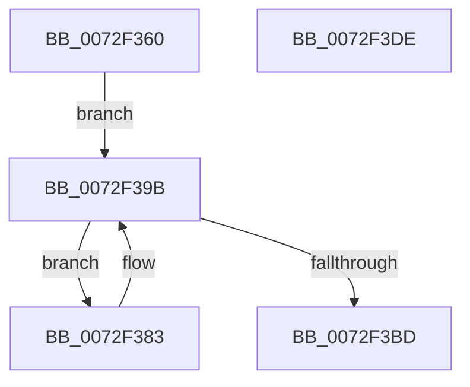

# IopPortBacktrackAllocation

- RVA: `0x0072F360`–`0x0072F3DF` (길이 `127` bytes)
- VA: `0x000000014072F360`
- 실행 섹션: `PAGE`
- PDB 이름 있음: `예`; PDB Function 태그: `아니요`
- unwind 정보 RVA: `0x0006C8E8`
- 디코드: `36`개 명령, `127/127` bytes 표시
- 미해석 바이트: `0` (있으면 어셈블리에 `.byte`로 보존)

> 이 문서는 커널 이미지의 기계어와 PDB 기호를 분석해 생성했습니다. 4번과 5번은 함수 원형과 자료형을 바이너리 사용 방식에서 추정한 C 해석이며 원본 소스 복구 결과는 아닙니다.

## 1. Dependencies

- 직접 호출 지점: **3**; 고유 호출 대상: **2**
- 직접 호출자로 확인된 함수: **0**
- RIP 상대 이미지 참조: **0**

### Outgoing calls
- `0x0072F393` → [RtlDeleteRange](../78/RtlDeleteRange_function_0078A920.md) (function, `0x0078A920`)
- `0x0072F3A8` → [IopPortGetNextAlias](IopPortGetNextAlias_function_0072F4CC.md) (function, `0x0072F4CC`)
- `0x0072F3C4` → [RtlDeleteRange](../78/RtlDeleteRange_function_0078A920.md) (function, `0x0078A920`)

### Direct callers
- 이 함수 시작 RVA로 연결되는 직접 call은 확인되지 않았습니다. 간접 호출은 완전히 역산할 수 없습니다.

### Static image references
- 디코드된 RIP-relative 메모리 참조가 없습니다.

## 2. Other-region calls and transfers

- 다른 실행 섹션으로 향하는 call: **0**
- 별도 외부 분기/꼬리 이동을 확인하지 못했습니다.

## 3. Assembly (complete function range)

```asm
0072F360  48 8B C4                        mov rax, rsp
0072F363  48 89 58 10                     mov qword ptr [rax + 0x10], rbx
0072F367  48 89 68 18                     mov qword ptr [rax + 0x18], rbp
0072F36B  48 89 70 20                     mov qword ptr [rax + 0x20], rsi
0072F36F  57                              push rdi
0072F370  48 83 EC 20                     sub rsp, 0x20
0072F374  48 8B FA                        mov rdi, rdx
0072F377  48 8B E9                        mov rbp, rcx
0072F37A  48 8B 12                        mov rdx, qword ptr [rdx]
0072F37D  48 89 50 08                     mov qword ptr [rax + 8], rdx
0072F381  EB 18                           jmp 0x14072f39b
0072F383  48 8B 5C 24 30                  mov rbx, qword ptr [rsp + 0x30]
0072F388  48 8B D3                        mov rdx, rbx
0072F38B  4C 8D 43 FF                     lea r8, [rbx - 1]
0072F38F  4D 03 42 10                     add r8, qword ptr [r10 + 0x10]
0072F393  E8 88 B5 05 00                  call 0x14078a920
0072F398  48 8B D3                        mov rdx, rbx
0072F39B  4C 8B 57 28                     mov r10, qword ptr [rdi + 0x28]
0072F39F  4C 8D 44 24 30                  lea r8, [rsp + 0x30]
0072F3A4  41 8B 4A 24                     mov ecx, dword ptr [r10 + 0x24]
0072F3A8  E8 1F 01 00 00                  call 0x14072f4cc
0072F3AD  4C 8B 4F 20                     mov r9, qword ptr [rdi + 0x20]
0072F3B1  48 8B 4D 30                     mov rcx, qword ptr [rbp + 0x30]
0072F3B5  4D 8B 49 20                     mov r9, qword ptr [r9 + 0x20]
0072F3B9  84 C0                           test al, al
0072F3BB  75 C6                           jne 0x14072f383
0072F3BD  4C 8B 47 08                     mov r8, qword ptr [rdi + 8]
0072F3C1  48 8B 17                        mov rdx, qword ptr [rdi]
0072F3C4  E8 57 B5 05 00                  call 0x14078a920
0072F3C9  48 8B 5C 24 38                  mov rbx, qword ptr [rsp + 0x38]
0072F3CE  48 8B 6C 24 40                  mov rbp, qword ptr [rsp + 0x40]
0072F3D3  48 8B 74 24 48                  mov rsi, qword ptr [rsp + 0x48]
0072F3D8  48 83 C4 20                     add rsp, 0x20
0072F3DC  5F                              pop rdi
0072F3DD  C3                              ret
0072F3DE  CC                              int3
```

## 4. C-style interpretation (structured pseudocode)

```c
__int64 __fastcall IopPortBacktrackAllocation(__int64 a1, __int64 a2)
{
    __int64 result;
    __int64 v_rsp;
    unsigned __int64 v_stack_p10;
    unsigned __int64 v_stack_p18;
    unsigned __int64 v_stack_p20;
    unsigned __int64 v_stack_p8;

    *(unsigned __int64 *)(v_rsp + 16) = v_rbx;
    *(unsigned __int64 *)(v_rsp + 24) = v_rbp;
    *(unsigned __int64 *)(v_rsp + 32) = v_rsi;
    v_rsp = (v_rsp) - (32);
    *(unsigned __int64 *)(v_rsp + 8) = *(unsigned __int64 *)(a2);
    goto loc_0072F39B;
loc_0072F383:
    a3 = (v_stack_p8 - 1) + (*(unsigned __int64 *)(v_r10 + 16));
    result = RtlDeleteRange(a1, v_stack_p8, a3, a4);
loc_0072F39B:
    result = IopPortGetNextAlias((unsigned int)(*(unsigned int *)(*(unsigned __int64 *)(a2 + 40) + 36)), v_stack_p8, v_stack_p8, a4);
    if ((unsigned __int8)(result) != 0) goto loc_0072F383;
    result = RtlDeleteRange(*(unsigned __int64 *)(a1 + 48), *(unsigned __int64 *)(a2), *(unsigned __int64 *)(a2 + 8), *(unsigned __int64 *)(*(unsigned __int64 *)(a2 + 32) + 32));
    v_rsp = (v_rsp) + (32);
    return result;
}
```

## 5. (Beta) C Style

```c
int64_t IopPortBacktrackAllocation(void *Arg1, void *Arg2)
{
    uint8_t *arg1 = (uint8_t *)Arg1;
    uint8_t *arg2 = (uint8_t *)Arg2;

    int64_t result;
    int64_t local_rsp;
    uint64_t v_stack_p10;
    uint64_t v_stack_p18;
    uint64_t v_stack_p20;
    uint64_t v_stack_p8;

    *(uint64_t *)(local_rsp + 0x10) = local_rbx;
    *(uint64_t *)(local_rsp + 0x18) = local_rbp;
    *(uint64_t *)(local_rsp + 0x20) = local_rsi;
    local_rsp = (local_rsp) - (32);
    *(uint64_t *)(local_rsp + 0x8) = *(uint64_t *)(arg2);
    goto loc_0072F39B;
loc_0072F383:
    a3 = (v_stack_p8 - 1) + (*(uint64_t *)(local_r10 + 0x10));
    result = RtlDeleteRange(Arg1, v_stack_p8, a3, a4);
loc_0072F39B:
    result = IopPortGetNextAlias((uint32_t)(*(uint32_t *)(*(uint64_t *)(arg2 + 0x28) + 0x24)), v_stack_p8, v_stack_p8, a4);
    if ((uint8_t)(result) != 0) goto loc_0072F383;
    result = RtlDeleteRange(*(uint64_t *)(arg1 + 0x30), *(uint64_t *)(arg2), *(uint64_t *)(arg2 + 0x8), *(uint64_t *)(*(uint64_t *)(arg2 + 0x20) + 0x20));
    local_rsp = (local_rsp) + (32);
    return result;
}
```

### 관측된 메모리 오프셋

구조체 형식이 확인되지 않은 접근은 인자 기준의 오프셋으로만 기록했습니다.

| 기준 인자 | 오프셋 표현 | 폭 (bit) | 접근 |
|---|---:|---:|---|
| `Arg1` | `+ 0x30` | `64` | `R` |
| `Arg2` | `+ 0x0` | `64` | `R` |
| `Arg2` | `+ 0x8` | `64` | `R` |
| `Arg2` | `+ 0x20` | `64` | `R` |
| `Arg2` | `+ 0x28` | `64` | `R` |

## 6. Execution-region graph

[열기: 2D/3D 그래프와 함수 탐색 컨트롤 패널](../../../control-panel.html?section=page&rva=0x0072F360&view=graph)

- 2D 그래프는 위에서 아래로 흐르고, 3D 그래프는 빈 공간을 드래그해 회전합니다. Shift+드래그는 이동, 휠은 확대·축소, 함수 노드 선택은 대상 보고서 이동입니다.

### Static fallback


