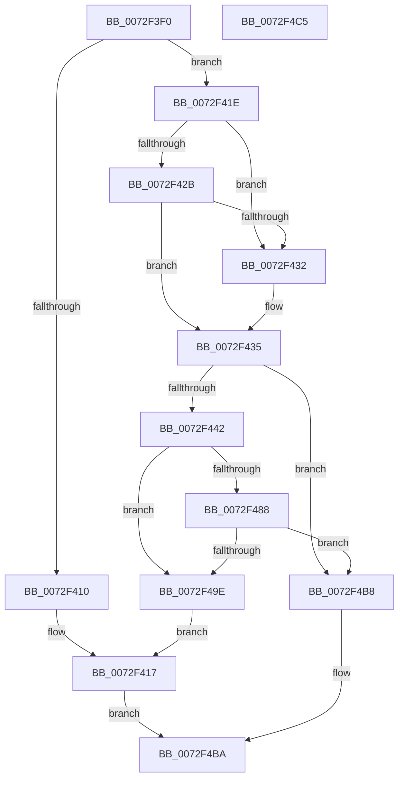

# IopPortFindSuitableRange

- RVA: `0x0072F3F0`–`0x0072F4C6` (길이 `214` bytes)
- VA: `0x000000014072F3F0`
- 실행 섹션: `PAGE`
- PDB 이름 있음: `예`; PDB Function 태그: `아니요`
- unwind 정보 RVA: `0x0008A2AC`
- 디코드: `60`개 명령, `214/214` bytes 표시
- 미해석 바이트: `0` (있으면 어셈블리에 `.byte`로 보존)

> 이 문서는 커널 이미지의 기계어와 PDB 기호를 분석해 생성했습니다. 4번과 5번은 함수 원형과 자료형을 바이너리 사용 방식에서 추정한 C 해석이며 원본 소스 복구 결과는 아닙니다.

## 1. Dependencies

- 직접 호출 지점: **2**; 고유 호출 대상: **2**
- 직접 호출자로 확인된 함수: **0**
- RIP 상대 이미지 참조: **0**

### Outgoing calls
- `0x0072F47F` → [RtlFindRange](../A3/RtlFindRange_function_00A35720.md) (function, `0x00A35720`)
- `0x0072F495` → [guard_dispatch_icall](../../text/6B/guard_dispatch_icall_function_006BAAD0.md) (function, `0x006BAAD0`)

### Direct callers
- 이 함수 시작 RVA로 연결되는 직접 call은 확인되지 않았습니다. 간접 호출은 완전히 역산할 수 없습니다.

### Static image references
- 디코드된 RIP-relative 메모리 참조가 없습니다.

## 2. Other-region calls and transfers

- 다른 실행 섹션으로 향하는 call: **1**
  - `0x0072F495` → [guard_dispatch_icall](../../text/6B/guard_dispatch_icall_function_006BAAD0.md) (`PAGE` → `.text`)
- 별도 외부 분기/꼬리 이동을 확인하지 못했습니다.

## 3. Assembly (complete function range)

```asm
0072F3F0  48 89 5C 24 08                  mov qword ptr [rsp + 8], rbx
0072F3F5  57                              push rdi
0072F3F6  48 83 EC 50                     sub rsp, 0x50
0072F3FA  4C 8B 52 28                     mov r10, qword ptr [rdx + 0x28]
0072F3FE  45 32 C9                        xor r9b, r9b
0072F401  48 8B DA                        mov rbx, rdx
0072F404  48 8B F9                        mov rdi, rcx
0072F407  4D 8B 5A 10                     mov r11, qword ptr [r10 + 0x10]
0072F40B  4D 85 DB                        test r11, r11
0072F40E  75 0E                           jne 0x14072f41e
0072F410  48 8B 02                        mov rax, qword ptr [rdx]
0072F413  48 89 42 08                     mov qword ptr [rdx + 8], rax
0072F417  B0 01                           mov al, 1
0072F419  E9 9C 00 00 00                  jmp 0x14072f4ba
0072F41E  48 8B 4A 20                     mov rcx, qword ptr [rdx + 0x20]
0072F422  F7 41 28 FD FF FF FF            test dword ptr [rcx + 0x28], 0xfffffffd
0072F429  74 07                           je 0x14072f432
0072F42B  8B 41 2C                        mov eax, dword ptr [rcx + 0x2c]
0072F42E  A8 01                           test al, 1
0072F430  74 03                           je 0x14072f435
0072F432  41 B1 01                        mov r9b, 1
0072F435  48 8B 52 10                     mov rdx, qword ptr [rdx + 0x10]
0072F439  4C 8B 43 18                     mov r8, qword ptr [rbx + 0x18]
0072F43D  49 3B D0                        cmp rdx, r8
0072F440  77 76                           ja 0x14072f4b8
0072F442  48 8B 87 50 01 00 00            mov rax, qword ptr [rdi + 0x150]
0072F449  41 8B 4A 24                     mov ecx, dword ptr [r10 + 0x24]
0072F44D  48 89 5C 24 48                  mov qword ptr [rsp + 0x48], rbx
0072F452  83 E1 01                        and ecx, 1
0072F455  48 89 44 24 40                  mov qword ptr [rsp + 0x40], rax
0072F45A  48 8B 87 48 01 00 00            mov rax, qword ptr [rdi + 0x148]
0072F461  48 89 44 24 38                  mov qword ptr [rsp + 0x38], rax
0072F466  49 8B 42 18                     mov rax, qword ptr [r10 + 0x18]
0072F46A  44 88 4C 24 30                  mov byte ptr [rsp + 0x30], r9b
0072F46F  4D 8B CB                        mov r9, r11
0072F472  89 4C 24 28                     mov dword ptr [rsp + 0x28], ecx
0072F476  48 8B 4F 30                     mov rcx, qword ptr [rdi + 0x30]
0072F47A  48 89 44 24 20                  mov qword ptr [rsp + 0x20], rax
0072F47F  E8 9C 62 30 00                  call 0x140a35720
0072F484  85 C0                           test eax, eax
0072F486  79 16                           jns 0x14072f49e
0072F488  48 8B 87 10 01 00 00            mov rax, qword ptr [rdi + 0x110]
0072F48F  48 8B D3                        mov rdx, rbx
0072F492  48 8B CF                        mov rcx, rdi
0072F495  E8 36 B6 F8 FF                  call 0x1406baad0
0072F49A  84 C0                           test al, al
0072F49C  74 1A                           je 0x14072f4b8
0072F49E  48 8B 43 28                     mov rax, qword ptr [rbx + 0x28]
0072F4A2  48 8B 48 10                     mov rcx, qword ptr [rax + 0x10]
0072F4A6  48 8B 03                        mov rax, qword ptr [rbx]
0072F4A9  48 FF C8                        dec rax
0072F4AC  48 03 C8                        add rcx, rax
0072F4AF  48 89 4B 08                     mov qword ptr [rbx + 8], rcx
0072F4B3  E9 5F FF FF FF                  jmp 0x14072f417
0072F4B8  32 C0                           xor al, al
0072F4BA  48 8B 5C 24 60                  mov rbx, qword ptr [rsp + 0x60]
0072F4BF  48 83 C4 50                     add rsp, 0x50
0072F4C3  5F                              pop rdi
0072F4C4  C3                              ret
0072F4C5  CC                              int3
```

## 4. C-style interpretation (structured pseudocode)

```c
__int64 __fastcall IopPortFindSuitableRange(__int64 a1, __int64 a2, __int64 a3, unsigned __int8 a4)
{
    __int64 result;
    __int64 v_rsp;
    unsigned __int64 v_stack_m10;
    unsigned __int64 v_stack_m18;
    unsigned __int64 v_stack_m20;
    unsigned __int8 v_stack_m28;
    unsigned int v_stack_m30;
    unsigned __int64 v_stack_m38;
    unsigned __int64 v_stack_p8;

    v_stack_p8 = v_rbx;
    v_rsp = (v_rsp) - (80);
    a4 = 0;
    if (*(unsigned __int64 *)(*(unsigned __int64 *)(a2 + 40) + 16) != 0) goto loc_0072F41E;
    *(unsigned __int64 *)(a2 + 8) = *(unsigned __int64 *)(a2);
loc_0072F417:
    goto loc_0072F4BA;
loc_0072F41E:
    if (((*(unsigned int *)(*(unsigned __int64 *)(a2 + 32) + 40)) & (0xFFFFFFFDULL)) == 0) goto loc_0072F432;
    if ((((unsigned __int8)((unsigned int)(*(unsigned int *)(*(unsigned __int64 *)(a2 + 32) + 44)))) & (1)) != 0) {
        a4 = 1;
    }
    if ((*(unsigned __int64 *)(a2 + 16)) > (*(unsigned __int64 *)(a2 + 24))) goto loc_0072F4B8;
    v_stack_m10 = a2;
    a1 = (unsigned int)(((unsigned int)(*(unsigned int *)(*(unsigned __int64 *)(a2 + 40) + 36))) & (1));
    v_stack_m18 = *(unsigned __int64 *)(a1 + 336);
    v_stack_m20 = *(unsigned __int64 *)(a1 + 328);
    v_stack_m28 = a4;
    v_stack_m30 = (unsigned int)(a1);
    v_stack_m38 = *(unsigned __int64 *)(*(unsigned __int64 *)(a2 + 40) + 24);
    result = RtlFindRange(*(unsigned __int64 *)(a1 + 48), *(unsigned __int64 *)(a2 + 16), *(unsigned __int64 *)(a2 + 24), *(unsigned __int64 *)(*(unsigned __int64 *)(a2 + 40) + 16));
    if (!sign_flag) goto loc_0072F49E;
    result = guard_dispatch_icall(a1, a2, *(unsigned __int64 *)(a2 + 24), *(unsigned __int64 *)(*(unsigned __int64 *)(a2 + 40) + 16));
    if ((unsigned __int8)(result) == 0) goto loc_0072F4B8;
loc_0072F49E:
    result = (*(unsigned __int64 *)(a2)) - 1;
    a1 = (*(unsigned __int64 *)(*(unsigned __int64 *)(a2 + 40) + 16)) + (result);
    *(unsigned __int64 *)(a2 + 8) = a1;
    goto loc_0072F417;
loc_0072F4B8:
    result = 0;
loc_0072F4BA:
    v_rsp = (v_rsp) + (80);
    return result;
}
```

## 5. (Beta) C Style

```c
int64_t IopPortFindSuitableRange(void *Arg1, void *Arg2, int64_t Arg3, uint8_t Arg4)
{
    uint8_t *arg1 = (uint8_t *)Arg1;
    uint8_t *arg2 = (uint8_t *)Arg2;

    int64_t result;
    int64_t local_rsp;
    uint64_t v_stack_m10;
    uint64_t v_stack_m18;
    uint64_t v_stack_m20;
    uint8_t v_stack_m28;
    uint32_t v_stack_m30;
    uint64_t v_stack_m38;
    uint64_t v_stack_p8;

    v_stack_p8 = local_rbx;
    local_rsp = (local_rsp) - (80);
    Arg4 = 0;
    if (*(uint64_t *)(*(uint64_t *)(arg2 + 0x28) + 0x10) != 0) goto loc_0072F41E;
    *(uint64_t *)(arg2 + 0x8) = *(uint64_t *)(arg2);
loc_0072F417:
    goto loc_0072F4BA;
loc_0072F41E:
    if (((*(uint32_t *)(*(uint64_t *)(arg2 + 0x20) + 0x28)) & (0xFFFFFFFDULL)) == 0) goto loc_0072F432;
    if ((((uint8_t)((uint32_t)(*(uint32_t *)(*(uint64_t *)(arg2 + 0x20) + 0x2C)))) & (1)) != 0) {
        Arg4 = 1;
    }
    if ((*(uint64_t *)(arg2 + 0x10)) > (*(uint64_t *)(arg2 + 0x18))) goto loc_0072F4B8;
    v_stack_m10 = Arg2;
    Arg1 = (uint32_t)(((uint32_t)(*(uint32_t *)(*(uint64_t *)(arg2 + 0x28) + 0x24))) & (1));
    v_stack_m18 = *(uint64_t *)(arg1 + 0x150);
    v_stack_m20 = *(uint64_t *)(arg1 + 0x148);
    v_stack_m28 = Arg4;
    v_stack_m30 = (uint32_t)(Arg1);
    v_stack_m38 = *(uint64_t *)(*(uint64_t *)(arg2 + 0x28) + 0x18);
    result = RtlFindRange(*(uint64_t *)(arg1 + 0x30), *(uint64_t *)(arg2 + 0x10), *(uint64_t *)(arg2 + 0x18), *(uint64_t *)(*(uint64_t *)(arg2 + 0x28) + 0x10));
    if (!sign_flag) goto loc_0072F49E;
    result = guard_dispatch_icall(Arg1, Arg2, *(uint64_t *)(arg2 + 0x18), *(uint64_t *)(*(uint64_t *)(arg2 + 0x28) + 0x10));
    if ((uint8_t)(result) == 0) goto loc_0072F4B8;
loc_0072F49E:
    result = (*(uint64_t *)(arg2)) - 1;
    Arg1 = (*(uint64_t *)(*(uint64_t *)(arg2 + 0x28) + 0x10)) + (result);
    *(void **)(arg2 + 0x8) = Arg1;
    goto loc_0072F417;
loc_0072F4B8:
    result = 0;
loc_0072F4BA:
    local_rsp = (local_rsp) + (80);
    return result;
}
```

### 관측된 메모리 오프셋

구조체 형식이 확인되지 않은 접근은 인자 기준의 오프셋으로만 기록했습니다.

| 기준 인자 | 오프셋 표현 | 폭 (bit) | 접근 |
|---|---:|---:|---|
| `Arg1` | `+ 0x30` | `64` | `R` |
| `Arg1` | `+ 0x110` | `64` | `R` |
| `Arg1` | `+ 0x148` | `64` | `R` |
| `Arg1` | `+ 0x150` | `64` | `R` |
| `Arg2` | `+ 0x0` | `64` | `R` |
| `Arg2` | `+ 0x8` | `64` | `W` |
| `Arg2` | `+ 0x10` | `64` | `R` |
| `Arg2` | `+ 0x18` | `64` | `R` |
| `Arg2` | `+ 0x20` | `64` | `R` |
| `Arg2` | `+ 0x28` | `64` | `R` |

## 6. Execution-region graph

[열기: 2D/3D 그래프와 함수 탐색 컨트롤 패널](../../../control-panel.html?section=page&rva=0x0072F3F0&view=graph)

- 2D 그래프는 위에서 아래로 흐르고, 3D 그래프는 빈 공간을 드래그해 회전합니다. Shift+드래그는 이동, 휠은 확대·축소, 함수 노드 선택은 대상 보고서 이동입니다.

### Static fallback


