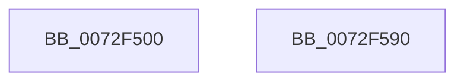

# IopPortInitialize

- RVA: `0x0072F500`–`0x0072F591` (길이 `145` bytes)
- VA: `0x000000014072F500`
- 실행 섹션: `PAGE`
- PDB 이름 있음: `예`; PDB Function 태그: `아니요`
- unwind 정보 RVA: `0x0005D2F4`
- 디코드: `24`개 명령, `145/145` bytes 표시
- 미해석 바이트: `0` (있으면 어셈블리에 `.byte`로 보존)

> 이 문서는 커널 이미지의 기계어와 PDB 기호를 분석해 생성했습니다. 4번과 5번은 함수 원형과 자료형을 바이너리 사용 방식에서 추정한 C 해석이며 원본 소스 복구 결과는 아닙니다.

## 1. Dependencies

- 직접 호출 지점: **1**; 고유 호출 대상: **1**
- 직접 호출자로 확인된 함수: **1**
- RIP 상대 이미지 참조: **17**

### Outgoing calls
- `0x0072F586` → [ArbInitializeArbiterInstance](../70/ArbInitializeArbiterInstance_function_0070ECB4.md) (function, `0x0070ECB4`)

### Direct callers
- [IopInitializePlugPlayServices](../../init/C2/IopInitializePlugPlayServices_function_00C2F298.md) at `0x00C2F5B9`

### Static image references
- `0x0072F504` → RVA `0x0072F3F0` (`IopPortFindSuitableRange`; read)
- `0x0072F511` → RVA `0x00F8C0D8` (`.data`; write)
- `0x0072F518` → RVA `0x00AFE190` (` ?? ::NNGAKEGL::`string'`; read)
- `0x0072F51F` → RVA `0x0072F280` (`IopPortAddAllocation`; read)
- `0x0072F526` → RVA `0x00F8C0E0` (`.data`; write)
- `0x0072F52D` → RVA `0x00F8BFE0` (`.data`; read)
- `0x0072F534` → RVA `0x0072F360` (`IopPortBacktrackAllocation`; read)
- `0x0072F53B` → RVA `0x00F8C0E8` (`.data`; write)
- `0x0072F542` → RVA `0x0072EEA0` (`IopGenericUnpackRequirement`; read)
- `0x0072F549` → RVA `0x00F8C058` (`.data`; write)
- `0x0072F550` → RVA `0x0072ED40` (`IopGenericPackResource`; read)
- `0x0072F557` → RVA `0x00F8C060` (`.data`; write)
- `0x0072F55E` → RVA `0x0072EF20` (`IopGenericUnpackResource`; read)
- `0x0072F565` → RVA `0x00F8C068` (`.data`; write)
- `0x0072F56C` → RVA `0x0072ED70` (`IopGenericScoreRequirement`; read)
- `0x0072F573` → RVA `0x00F8C070` (`.data`; write)
- `0x0072F57A` → RVA `0x0072EE00` (`IopGenericTranslateOrdering`; read)

## 2. Other-region calls and transfers

- 다른 실행 섹션으로 향하는 call: **0**
- 별도 외부 분기/꼬리 이동을 확인하지 못했습니다.

## 3. Assembly (complete function range)

```asm
0072F500  48 83 EC 38                     sub rsp, 0x38
0072F504  48 8D 05 E5 FE FF FF            lea rax, [rip - 0x11b]
0072F50B  41 B8 01 00 00 00               mov r8d, 1
0072F511  48 89 05 C0 CB 85 00            mov qword ptr [rip + 0x85cbc0], rax
0072F518  4C 8D 0D 71 EC 3C 00            lea r9, [rip + 0x3cec71]
0072F51F  48 8D 05 5A FD FF FF            lea rax, [rip - 0x2a6]
0072F526  48 89 05 B3 CB 85 00            mov qword ptr [rip + 0x85cbb3], rax
0072F52D  48 8D 0D AC CA 85 00            lea rcx, [rip + 0x85caac]
0072F534  48 8D 05 25 FE FF FF            lea rax, [rip - 0x1db]
0072F53B  48 89 05 A6 CB 85 00            mov qword ptr [rip + 0x85cba6], rax
0072F542  48 8D 05 57 F9 FF FF            lea rax, [rip - 0x6a9]
0072F549  48 89 05 08 CB 85 00            mov qword ptr [rip + 0x85cb08], rax
0072F550  48 8D 05 E9 F7 FF FF            lea rax, [rip - 0x817]
0072F557  48 89 05 02 CB 85 00            mov qword ptr [rip + 0x85cb02], rax
0072F55E  48 8D 05 BB F9 FF FF            lea rax, [rip - 0x645]
0072F565  48 89 05 FC CA 85 00            mov qword ptr [rip + 0x85cafc], rax
0072F56C  48 8D 05 FD F7 FF FF            lea rax, [rip - 0x803]
0072F573  48 89 05 F6 CA 85 00            mov qword ptr [rip + 0x85caf6], rax
0072F57A  48 8D 05 7F F8 FF FF            lea rax, [rip - 0x781]
0072F581  48 89 44 24 28                  mov qword ptr [rsp + 0x28], rax
0072F586  E8 29 F7 FD FF                  call 0x14070ecb4
0072F58B  48 83 C4 38                     add rsp, 0x38
0072F58F  C3                              ret
0072F590  CC                              int3
```

## 4. C-style interpretation (structured pseudocode)

```c
__int64 __fastcall IopPortInitialize(void)
{
    __int64 result;
    __int64 v_rsp;
    unsigned __int64 v_stack_m10;

    v_rsp = (v_rsp) - (56);
    *(unsigned __int64 *)(v_rip + 8768448) = v_rip - 283;
    *(unsigned __int64 *)(v_rip + 8768435) = v_rip - 678;
    *(unsigned __int64 *)(v_rip + 8768422) = v_rip - 475;
    *(unsigned __int64 *)(v_rip + 8768264) = v_rip - 1705;
    *(unsigned __int64 *)(v_rip + 8768258) = v_rip - 2071;
    *(unsigned __int64 *)(v_rip + 8768252) = v_rip - 1605;
    *(unsigned __int64 *)(v_rip + 8768246) = v_rip - 2051;
    v_stack_m10 = v_rip - 1921;
    result = ArbInitializeArbiterInstance(v_rip + 8768172, a2, 1, v_rip + 3992689);
    v_rsp = (v_rsp) + (56);
    return result;
}
```

## 5. (Beta) C Style

```c
void IopPortInitialize(void)
{
    int64_t result;
    int64_t local_rsp;
    uint64_t v_stack_m10;

    local_rsp = (local_rsp) - (56);
    *(uint64_t *)(v_rip + 0x85CBC0) = v_rip - 283;
    *(uint64_t *)(v_rip + 0x85CBB3) = v_rip - 678;
    *(uint64_t *)(v_rip + 0x85CBA6) = v_rip - 475;
    *(uint64_t *)(v_rip + 0x85CB08) = v_rip - 1705;
    *(uint64_t *)(v_rip + 0x85CB02) = v_rip - 2071;
    *(uint64_t *)(v_rip + 0x85CAFC) = v_rip - 1605;
    *(uint64_t *)(v_rip + 0x85CAF6) = v_rip - 2051;
    v_stack_m10 = v_rip - 1921;
    result = ArbInitializeArbiterInstance(v_rip + 8768172, a2, 1, v_rip + 3992689);
    local_rsp = (local_rsp) + (56);
    return result;
}
```

## 6. Execution-region graph

[열기: 2D/3D 그래프와 함수 탐색 컨트롤 패널](../../../control-panel.html?section=page&rva=0x0072F500&view=graph)

- 2D 그래프는 위에서 아래로 흐르고, 3D 그래프는 빈 공간을 드래그해 회전합니다. Shift+드래그는 이동, 휠은 확대·축소, 함수 노드 선택은 대상 보고서 이동입니다.

### Static fallback


