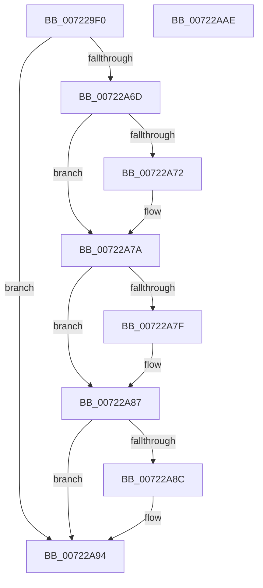

# IopQueryEnvironmentVariableInfoSysEnv

- RVA: `0x007229F0`–`0x00722AAF` (길이 `191` bytes)
- VA: `0x00000001407229F0`
- 실행 섹션: `PAGE`
- PDB 이름 있음: `예`; PDB Function 태그: `아니요`
- unwind 정보 RVA: `0x000C7CE8`
- 디코드: `53`개 명령, `191/191` bytes 표시
- 미해석 바이트: `0` (있으면 어셈블리에 `.byte`로 보존)

> 이 문서는 커널 이미지의 기계어와 PDB 기호를 분석해 생성했습니다. 4번과 5번은 함수 원형과 자료형을 바이너리 사용 방식에서 추정한 C 해석이며 원본 소스 복구 결과는 아닙니다.

## 1. Dependencies

- 직접 호출 지점: **2**; 고유 호출 대상: **2**
- 직접 호출자로 확인된 함수: **0**
- RIP 상대 이미지 참조: **1**

### Outgoing calls
- `0x00722A62` → [IopIssueSystemEnvironmentRequest](IopIssueSystemEnvironmentRequest_function_00722878.md) (function, `0x00722878`)
- `0x00722A9E` → [_security_check_cookie](../../text/6A/_security_check_cookie_function_006AC640.md) (function, `0x006AC640`)

### Direct callers
- 이 함수 시작 RVA로 연결되는 직접 call은 확인되지 않았습니다. 간접 호출은 완전히 역산할 수 없습니다.

### Static image references
- `0x007229FD` → RVA `0x00E0A740` (`.data`; read)

## 2. Other-region calls and transfers

- 다른 실행 섹션으로 향하는 call: **1**
  - `0x00722A9E` → [_security_check_cookie](../../text/6A/_security_check_cookie_function_006AC640.md) (`PAGE` → `.text`)
- 별도 외부 분기/꼬리 이동을 확인하지 못했습니다.

## 3. Assembly (complete function range)

```asm
007229F0  4C 8B DC                        mov r11, rsp
007229F3  53                              push rbx
007229F4  56                              push rsi
007229F5  57                              push rdi
007229F6  48 81 EC 80 00 00 00            sub rsp, 0x80
007229FD  48 8B 05 3C 7D 6E 00            mov rax, qword ptr [rip + 0x6e7d3c]
00722A04  48 33 C4                        xor rax, rsp
00722A07  48 89 44 24 70                  mov qword ptr [rsp + 0x70], rax
00722A0C  48 8B BC 24 C0 00 00 00         mov rdi, qword ptr [rsp + 0xc0]
00722A14  33 C0                           xor eax, eax
00722A16  49 21 43 A8                     and qword ptr [r11 - 0x58], rax
00722A1A  0F 57 C0                        xorps xmm0, xmm0
00722A1D  48 8B 9C 24 C8 00 00 00         mov rbx, qword ptr [rsp + 0xc8]
00722A25  49 8B F1                        mov rsi, r9
00722A28  45 89 43 B8                     mov dword ptr [r11 - 0x48], r8d
00722A2C  4C 8B CA                        mov r9, rdx
00722A2F  C7 44 24 38 18 00 00 00         mov dword ptr [rsp + 0x38], 0x18
00722A37  4C 8B C1                        mov r8, rcx
00722A3A  0F 11 44 24 58                  movups xmmword ptr [rsp + 0x58], xmm0
00722A3F  49 89 43 D0                     mov qword ptr [r11 - 0x30], rax
00722A43  B2 01                           mov dl, 1
00722A45  49 8D 43 C0                     lea rax, [r11 - 0x40]
00722A49  B9 10 00 52 00                  mov ecx, 0x520010
00722A4E  49 89 43 98                     mov qword ptr [r11 - 0x68], rax
00722A52  49 8D 43 B8                     lea rax, [r11 - 0x48]
00722A56  C7 44 24 28 04 00 00 00         mov dword ptr [rsp + 0x28], 4
00722A5E  49 89 43 88                     mov qword ptr [r11 - 0x78], rax
00722A62  E8 11 FE FF FF                  call 0x140722878
00722A67  8B D0                           mov edx, eax
00722A69  85 C0                           test eax, eax
00722A6B  78 27                           js 0x140722a94
00722A6D  48 85 F6                        test rsi, rsi
00722A70  74 08                           je 0x140722a7a
00722A72  48 8B 4C 24 58                  mov rcx, qword ptr [rsp + 0x58]
00722A77  48 89 0E                        mov qword ptr [rsi], rcx
00722A7A  48 85 FF                        test rdi, rdi
00722A7D  74 08                           je 0x140722a87
00722A7F  48 8B 4C 24 60                  mov rcx, qword ptr [rsp + 0x60]
00722A84  48 89 0F                        mov qword ptr [rdi], rcx
00722A87  48 85 DB                        test rbx, rbx
00722A8A  74 08                           je 0x140722a94
00722A8C  48 8B 44 24 68                  mov rax, qword ptr [rsp + 0x68]
00722A91  48 89 03                        mov qword ptr [rbx], rax
00722A94  8B C2                           mov eax, edx
00722A96  48 8B 4C 24 70                  mov rcx, qword ptr [rsp + 0x70]
00722A9B  48 33 CC                        xor rcx, rsp
00722A9E  E8 9D 9B F8 FF                  call 0x1406ac640
00722AA3  48 81 C4 80 00 00 00            add rsp, 0x80
00722AAA  5F                              pop rdi
00722AAB  5E                              pop rsi
00722AAC  5B                              pop rbx
00722AAD  C3                              ret
00722AAE  CC                              int3
```

## 4. C-style interpretation (structured pseudocode)

```c
__int64 __fastcall IopQueryEnvironmentVariableInfoSysEnv(__int64 a1, __int64 a2, int a3, __int64 a4, __int64 a5, __int64 a6)
{
    __int64 result;
    __int64 v_rsp;
    unsigned __int64 v_stack_m28;
    unsigned __int64 v_stack_m30;
    unsigned __int64 v_stack_m38;
    unsigned __int64 v_stack_m40;
    unsigned int v_stack_m60;
    unsigned int v_stack_m70;

    v_rsp = (v_rsp) - (128);
    result = (*(unsigned __int64 *)(v_rip + 7241020)) ^ (v_rsp);
    v_stack_m28 = result;
    result = 0;
    *(unsigned int *)(v_rsp - 72) = a3;
    v_stack_m60 = 24;
    v_stack_m40 = v_xmm0;
    *(unsigned __int64 *)(v_rsp - 48) = 0;
    *(unsigned __int64 *)(v_rsp - 104) = v_rsp - 64;
    v_stack_m70 = 4;
    *(unsigned __int64 *)(v_rsp - 120) = v_rsp - 72;
    result = IopIssueSystemEnvironmentRequest((unsigned int)(0x520010ULL), 1, a1, a2);
    if (sign_flag) goto loc_00722A94;
    if (a4 != 0) {
        a1 = v_stack_m40;
        *(unsigned __int64 *)(a4) = a1;
    }
    if (a5 != 0) {
        a1 = v_stack_m38;
        *(unsigned __int64 *)(a5) = a1;
    }
    if (a6 != 0) {
        result = v_stack_m30;
        *(unsigned __int64 *)(a6) = result;
    }
    a1 = (v_stack_m28) ^ (v_rsp);
    result = _security_check_cookie(a1, (unsigned int)((unsigned int)(result)), a1, a2);
    v_rsp = (v_rsp) + (128);
    return result;
}
```

## 5. (Beta) C Style

```c
int64_t IopQueryEnvironmentVariableInfoSysEnv(int64_t Arg1, int64_t Arg2, int32_t Arg3, int64_t Arg4, int64_t Arg5, int64_t Arg6)
{
    int64_t result;
    int64_t local_rsp;
    uint64_t v_stack_m28;
    uint64_t v_stack_m30;
    uint64_t v_stack_m38;
    uint64_t v_stack_m40;
    uint32_t v_stack_m60;
    uint32_t v_stack_m70;

    local_rsp = (local_rsp) - (128);
    result = (*(uint64_t *)(v_rip + 0x6E7D3C)) ^ (local_rsp);
    v_stack_m28 = result;
    result = 0;
    *(uint32_t *)(local_rsp - 0x48) = Arg3;
    v_stack_m60 = 24;
    v_stack_m40 = v_xmm0;
    *(uint64_t *)(local_rsp - 0x30) = 0;
    *(uint64_t *)(local_rsp - 0x68) = local_rsp - 64;
    v_stack_m70 = 4;
    *(uint64_t *)(local_rsp - 0x78) = local_rsp - 72;
    result = IopIssueSystemEnvironmentRequest((uint32_t)(0x520010ULL), 1, Arg1, Arg2);
    if (sign_flag) goto loc_00722A94;
    if (Arg4 != 0) {
        Arg1 = v_stack_m40;
        *(uint64_t *)(Arg4) = Arg1;
    }
    if (Arg5 != 0) {
        Arg1 = v_stack_m38;
        *(uint64_t *)(Arg5) = Arg1;
    }
    if (Arg6 != 0) {
        result = v_stack_m30;
        *(uint64_t *)(Arg6) = result;
    }
    Arg1 = (v_stack_m28) ^ (local_rsp);
    result = _security_check_cookie(Arg1, (uint32_t)((uint32_t)(result)), Arg1, Arg2);
    local_rsp = (local_rsp) + (128);
    return result;
}
```

## 6. Execution-region graph

[열기: 2D/3D 그래프와 함수 탐색 컨트롤 패널](../../../control-panel.html?section=page&rva=0x007229F0&view=graph)

- 2D 그래프는 위에서 아래로 흐르고, 3D 그래프는 빈 공간을 드래그해 회전합니다. Shift+드래그는 이동, 휠은 확대·축소, 함수 노드 선택은 대상 보고서 이동입니다.

### Static fallback


