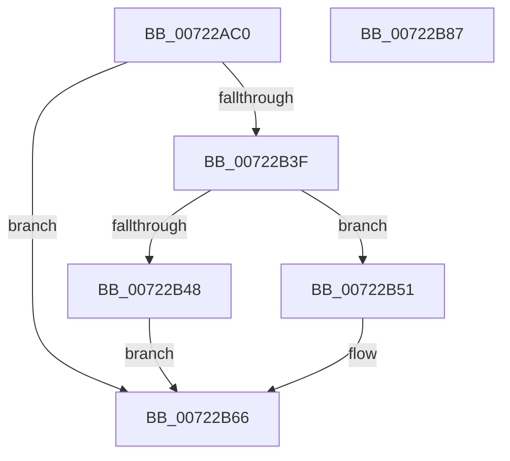

# IopQueryEnvironmentVariableInfoTrEE

- RVA: `0x00722AC0`–`0x00722B88` (길이 `200` bytes)
- VA: `0x0000000140722AC0`
- 실행 섹션: `PAGE`
- PDB 이름 있음: `예`; PDB Function 태그: `아니요`
- unwind 정보 RVA: `0x000C7C94`
- 디코드: `56`개 명령, `200/200` bytes 표시
- 미해석 바이트: `0` (있으면 어셈블리에 `.byte`로 보존)

> 이 문서는 커널 이미지의 기계어와 PDB 기호를 분석해 생성했습니다. 4번과 5번은 함수 원형과 자료형을 바이너리 사용 방식에서 추정한 C 해석이며 원본 소스 복구 결과는 아닙니다.

## 1. Dependencies

- 직접 호출 지점: **3**; 고유 호출 대상: **3**
- 직접 호출자로 확인된 함수: **0**
- RIP 상대 이미지 참조: **1**

### Outgoing calls
- `0x00722B34` → [IopIssueTrEERequest](../../text/5A/IopIssueTrEERequest_function_005A041C.md) (function, `0x005A041C`)
- `0x00722B48` → [IopEfiStatusToNTSTATUS](IopEfiStatusToNTSTATUS_function_00721E30.md) (function, `0x00721E30`)
- `0x00722B6F` → [_security_check_cookie](../../text/6A/_security_check_cookie_function_006AC640.md) (function, `0x006AC640`)

### Direct callers
- 이 함수 시작 RVA로 연결되는 직접 call은 확인되지 않았습니다. 간접 호출은 완전히 역산할 수 없습니다.

### Static image references
- `0x00722AD2` → RVA `0x00E0A740` (`.data`; read)

## 2. Other-region calls and transfers

- 다른 실행 섹션으로 향하는 call: **2**
  - `0x00722B34` → [IopIssueTrEERequest](../../text/5A/IopIssueTrEERequest_function_005A041C.md) (`PAGE` → `.text`)
  - `0x00722B6F` → [_security_check_cookie](../../text/6A/_security_check_cookie_function_006AC640.md) (`PAGE` → `.text`)
- 별도 외부 분기/꼬리 이동을 확인하지 못했습니다.

## 3. Assembly (complete function range)

```asm
00722AC0  48 89 5C 24 08                  mov qword ptr [rsp + 8], rbx
00722AC5  55                              push rbp
00722AC6  56                              push rsi
00722AC7  57                              push rdi
00722AC8  48 8B EC                        mov rbp, rsp
00722ACB  48 81 EC 80 00 00 00            sub rsp, 0x80
00722AD2  48 8B 05 67 7C 6E 00            mov rax, qword ptr [rip + 0x6e7c67]
00722AD9  48 33 C4                        xor rax, rsp
00722ADC  48 89 45 F8                     mov qword ptr [rbp - 8], rax
00722AE0  48 8B 7D 40                     mov rdi, qword ptr [rbp + 0x40]
00722AE4  48 8D 45 D0                     lea rax, [rbp - 0x30]
00722AE8  48 8B 75 48                     mov rsi, qword ptr [rbp + 0x48]
00722AEC  0F 57 C0                        xorps xmm0, xmm0
00722AEF  83 65 D0 00                     and dword ptr [rbp - 0x30], 0
00722AF3  49 8B D9                        mov rbx, r9
00722AF6  48 89 44 24 40                  mov qword ptr [rsp + 0x40], rax
00722AFB  4C 8D 4D D4                     lea r9, [rbp - 0x2c]
00722AFF  B8 20 00 00 00                  mov eax, 0x20
00722B04  44 89 45 D4                     mov dword ptr [rbp - 0x2c], r8d
00722B08  89 44 24 38                     mov dword ptr [rsp + 0x38], eax
00722B0C  4C 8B C2                        mov r8, rdx
00722B0F  89 44 24 30                     mov dword ptr [rsp + 0x30], eax
00722B13  48 8B D1                        mov rdx, rcx
00722B16  48 8D 45 D8                     lea rax, [rbp - 0x28]
00722B1A  B9 03 00 00 00                  mov ecx, 3
00722B1F  48 89 44 24 28                  mov qword ptr [rsp + 0x28], rax
00722B24  C7 44 24 20 04 00 00 00         mov dword ptr [rsp + 0x20], 4
00722B2C  0F 11 45 D8                     movups xmmword ptr [rbp - 0x28], xmm0
00722B30  0F 11 45 E8                     movups xmmword ptr [rbp - 0x18], xmm0
00722B34  E8 E3 D8 E7 FF                  call 0x1405a041c
00722B39  8B D0                           mov edx, eax
00722B3B  85 C0                           test eax, eax
00722B3D  78 27                           js 0x140722b66
00722B3F  48 8B 4D D8                     mov rcx, qword ptr [rbp - 0x28]
00722B43  48 85 C9                        test rcx, rcx
00722B46  74 09                           je 0x140722b51
00722B48  E8 E3 F2 FF FF                  call 0x140721e30
00722B4D  8B D0                           mov edx, eax
00722B4F  EB 15                           jmp 0x140722b66
00722B51  48 8B 45 E0                     mov rax, qword ptr [rbp - 0x20]
00722B55  48 89 03                        mov qword ptr [rbx], rax
00722B58  48 8B 45 E8                     mov rax, qword ptr [rbp - 0x18]
00722B5C  48 89 07                        mov qword ptr [rdi], rax
00722B5F  48 8B 45 F0                     mov rax, qword ptr [rbp - 0x10]
00722B63  48 89 06                        mov qword ptr [rsi], rax
00722B66  8B C2                           mov eax, edx
00722B68  48 8B 4D F8                     mov rcx, qword ptr [rbp - 8]
00722B6C  48 33 CC                        xor rcx, rsp
00722B6F  E8 CC 9A F8 FF                  call 0x1406ac640
00722B74  48 8B 9C 24 A0 00 00 00         mov rbx, qword ptr [rsp + 0xa0]
00722B7C  48 81 C4 80 00 00 00            add rsp, 0x80
00722B83  5F                              pop rdi
00722B84  5E                              pop rsi
00722B85  5D                              pop rbp
00722B86  C3                              ret
00722B87  CC                              int3
```

## 4. C-style interpretation (structured pseudocode)

```c
__int64 __fastcall IopQueryEnvironmentVariableInfoTrEE(__int64 a1, __int64 a2, int a3, __int64 a4, __int64 a5, __int64 a6)
{
    __int64 result;
    __int64 v_rsp;
    unsigned __int64 v_stack_m20;
    unsigned __int64 v_stack_m28;
    unsigned __int64 v_stack_m30;
    unsigned __int64 v_stack_m38;
    unsigned __int64 v_stack_m40;
    unsigned __int64 v_stack_m44;
    unsigned __int64 v_stack_m48;
    unsigned __int64 v_stack_m58;
    unsigned int v_stack_m60;
    unsigned int v_stack_m68;
    unsigned __int64 v_stack_m70;
    unsigned int v_stack_m78;
    unsigned __int64 v_stack_p8;

    v_stack_p8 = v_rbx;
    v_rsp = (v_rsp) - (128);
    result = (*(unsigned __int64 *)(v_rip + 7240807)) ^ (v_rsp);
    v_stack_m20 = result;
    v_stack_m58 = v_stack_m48;
    v_stack_m44 = a3;
    v_stack_m60 = 32;
    v_stack_m68 = 32;
    v_stack_m70 = v_stack_m40;
    v_stack_m78 = 4;
    v_stack_m40 = v_xmm0;
    v_stack_m30 = v_xmm0;
    result = IopIssueTrEERequest(3, a1, a2, v_stack_m44);
    if (sign_flag) goto loc_00722B66;
    if (v_stack_m40 == 0) goto loc_00722B51;
    result = IopEfiStatusToNTSTATUS(v_stack_m40, (unsigned int)((unsigned int)(result)), a2, v_stack_m44);
    goto loc_00722B66;
loc_00722B51:
    *(unsigned __int64 *)(a4) = v_stack_m38;
    *(unsigned __int64 *)(a5) = v_stack_m30;
    *(unsigned __int64 *)(a6) = v_stack_m28;
loc_00722B66:
    a1 = (v_stack_m20) ^ (v_rsp);
    result = _security_check_cookie(a1, (unsigned int)((unsigned int)(result)), a2, v_stack_m44);
    v_rsp = (v_rsp) + (128);
    return result;
}
```

## 5. (Beta) C Style

```c
int64_t IopQueryEnvironmentVariableInfoTrEE(int64_t Arg1, int64_t Arg2, int32_t Arg3, void *Arg4, void *Arg5, void *Arg6)
{
    uint8_t *arg4 = (uint8_t *)Arg4;
    uint8_t *arg5 = (uint8_t *)Arg5;
    uint8_t *arg6 = (uint8_t *)Arg6;

    int64_t result;
    int64_t local_rsp;
    uint64_t v_stack_m20;
    uint64_t v_stack_m28;
    uint64_t v_stack_m30;
    uint64_t v_stack_m38;
    uint64_t v_stack_m40;
    uint64_t v_stack_m44;
    uint64_t v_stack_m48;
    uint64_t v_stack_m58;
    uint32_t v_stack_m60;
    uint32_t v_stack_m68;
    uint64_t v_stack_m70;
    uint32_t v_stack_m78;
    uint64_t v_stack_p8;

    v_stack_p8 = local_rbx;
    local_rsp = (local_rsp) - (128);
    result = (*(uint64_t *)(v_rip + 0x6E7C67)) ^ (local_rsp);
    v_stack_m20 = result;
    v_stack_m58 = v_stack_m48;
    v_stack_m44 = Arg3;
    v_stack_m60 = 32;
    v_stack_m68 = 32;
    v_stack_m70 = v_stack_m40;
    v_stack_m78 = 4;
    v_stack_m40 = v_xmm0;
    v_stack_m30 = v_xmm0;
    result = IopIssueTrEERequest(3, Arg1, Arg2, v_stack_m44);
    if (sign_flag) goto loc_00722B66;
    if (v_stack_m40 == 0) goto loc_00722B51;
    result = IopEfiStatusToNTSTATUS(v_stack_m40, (uint32_t)((uint32_t)(result)), Arg2, v_stack_m44);
    goto loc_00722B66;
loc_00722B51:
    *(uint64_t *)(arg4) = v_stack_m38;
    *(uint64_t *)(arg5) = v_stack_m30;
    *(uint64_t *)(arg6) = v_stack_m28;
loc_00722B66:
    Arg1 = (v_stack_m20) ^ (local_rsp);
    result = _security_check_cookie(Arg1, (uint32_t)((uint32_t)(result)), Arg2, v_stack_m44);
    local_rsp = (local_rsp) + (128);
    return result;
}
```

### 관측된 메모리 오프셋

구조체 형식이 확인되지 않은 접근은 인자 기준의 오프셋으로만 기록했습니다.

| 기준 인자 | 오프셋 표현 | 폭 (bit) | 접근 |
|---|---:|---:|---|
| `Arg4` | `+ 0x0` | `64` | `W` |
| `Arg5` | `+ 0x0` | `64` | `W` |
| `Arg6` | `+ 0x0` | `64` | `W` |

## 6. Execution-region graph

[열기: 2D/3D 그래프와 함수 탐색 컨트롤 패널](../../../control-panel.html?section=page&rva=0x00722AC0&view=graph)

- 2D 그래프는 위에서 아래로 흐르고, 3D 그래프는 빈 공간을 드래그해 회전합니다. Shift+드래그는 이동, 휠은 확대·축소, 함수 노드 선택은 대상 보고서 이동입니다.

### Static fallback


