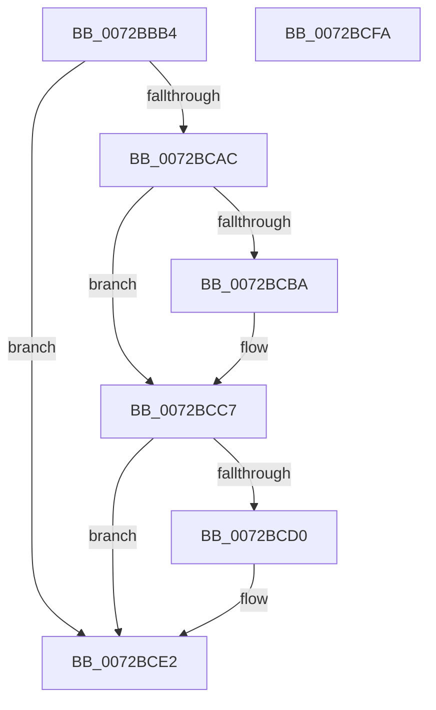

# IopQueryPassiveInterruptRegistryOptions

- RVA: `0x0072BBB4`–`0x0072BCFB` (길이 `327` bytes)
- VA: `0x000000014072BBB4`
- 실행 섹션: `PAGE`
- PDB 이름 있음: `예`; PDB Function 태그: `아니요`
- unwind 정보 RVA: `0x000C861C`
- 디코드: `78`개 명령, `327/327` bytes 표시
- 미해석 바이트: `0` (있으면 어셈블리에 `.byte`로 보존)

> 이 문서는 커널 이미지의 기계어와 PDB 기호를 분석해 생성했습니다. 4번과 5번은 함수 원형과 자료형을 바이너리 사용 방식에서 추정한 C 해석이며 원본 소스 복구 결과는 아닙니다.

## 1. Dependencies

- 직접 호출 지점: **3**; 고유 호출 대상: **3**
- 직접 호출자로 확인된 함수: **1**
- RIP 상대 이미지 참조: **10**

### Outgoing calls
- `0x0072BBDD` → [memset](../../text/6C/memset_function_006C6C40.md) (function, `0x006C6C40`)
- `0x0072BCA0` → [RtlpQueryRegistryValues](../8C/RtlpQueryRegistryValues_function_008C9050.md) (function, `0x008C9050`)
- `0x0072BCEC` → [_security_check_cookie](../../text/6A/_security_check_cookie_function_006AC640.md) (function, `0x006AC640`)

### Direct callers
- [IoInitSystemPreDrivers](../../init/C2/IoInitSystemPreDrivers_function_00C2AC3C.md) at `0x00C2B9C6`

### Static image references
- `0x0072BBC2` → RVA `0x00E0A740` (`.data`; read)
- `0x0072BBE2` → RVA `0x00E662E0` (`.data`; read)
- `0x0072BC0C` → RVA `0x00E0AA01` (`.data`; read)
- `0x0072BC17` → RVA `0x00E0AA00` (`.data`; read)
- `0x0072BC22` → RVA `0x00AFD970` (` ?? ::NNGAKEGL::`string'`; read)
- `0x0072BC42` → RVA `0x00AFD9B0` (` ?? ::NNGAKEGL::`string'`; read)
- `0x0072BC5F` → RVA `0x00AFDA00` (` ?? ::NNGAKEGL::`string'`; read)
- `0x0072BC89` → RVA `0x00AFDA40` (` ?? ::NNGAKEGL::`string'`; read)
- `0x0072BCC1` → RVA `0x00E0AA01` (`.data`; write)
- `0x0072BCDC` → RVA `0x00E0AA00` (`.data`; write)

## 2. Other-region calls and transfers

- 다른 실행 섹션으로 향하는 call: **2**
  - `0x0072BBDD` → [memset](../../text/6C/memset_function_006C6C40.md) (`PAGE` → `.text`)
  - `0x0072BCEC` → [_security_check_cookie](../../text/6A/_security_check_cookie_function_006AC640.md) (`PAGE` → `.text`)
- 별도 외부 분기/꼬리 이동을 확인하지 못했습니다.

## 3. Assembly (complete function range)

```asm
0072BBB4  40 55                           push rbp
0072BBB6  48 8D 6C 24 D0                  lea rbp, [rsp - 0x30]
0072BBBB  48 81 EC 30 01 00 00            sub rsp, 0x130
0072BBC2  48 8B 05 77 EB 6D 00            mov rax, qword ptr [rip + 0x6deb77]
0072BBC9  48 33 C4                        xor rax, rsp
0072BBCC  48 89 45 20                     mov qword ptr [rbp + 0x20], rax
0072BBD0  33 D2                           xor edx, edx
0072BBD2  48 8D 4C 24 40                  lea rcx, [rsp + 0x40]
0072BBD7  41 B8 E0 00 00 00               mov r8d, 0xe0
0072BBDD  E8 5E B0 F9 FF                  call 0x1406c6c40
0072BBE2  0F B6 05 F7 A6 73 00            movzx eax, byte ptr [rip + 0x73a6f7]
0072BBE9  4C 8D 44 24 40                  lea r8, [rsp + 0x40]
0072BBEE  83 64 24 70 00                  and dword ptr [rsp + 0x70], 0
0072BBF3  B9 04 00 00 04                  mov ecx, 0x4000004
0072BBF8  83 65 A8 00                     and dword ptr [rbp - 0x58], 0
0072BBFC  BA 20 01 00 00                  mov edx, 0x120
0072BC01  83 65 E0 00                     and dword ptr [rbp - 0x20], 0
0072BC05  45 33 C9                        xor r9d, r9d
0072BC08  89 44 24 38                     mov dword ptr [rsp + 0x38], eax
0072BC0C  0F B6 05 EE ED 6D 00            movzx eax, byte ptr [rip + 0x6dedee]
0072BC13  89 44 24 30                     mov dword ptr [rsp + 0x30], eax
0072BC17  0F B6 05 E2 ED 6D 00            movzx eax, byte ptr [rip + 0x6dede2]
0072BC1E  89 44 24 34                     mov dword ptr [rsp + 0x34], eax
0072BC22  48 8D 05 47 1D 3D 00            lea rax, [rip + 0x3d1d47]
0072BC29  48 89 44 24 50                  mov qword ptr [rsp + 0x50], rax
0072BC2E  48 8D 44 24 30                  lea rax, [rsp + 0x30]
0072BC33  48 89 44 24 58                  mov qword ptr [rsp + 0x58], rax
0072BC38  48 8D 44 24 30                  lea rax, [rsp + 0x30]
0072BC3D  48 89 44 24 68                  mov qword ptr [rsp + 0x68], rax
0072BC42  48 8D 05 67 1D 3D 00            lea rax, [rip + 0x3d1d67]
0072BC49  48 89 45 88                     mov qword ptr [rbp - 0x78], rax
0072BC4D  48 8D 44 24 34                  lea rax, [rsp + 0x34]
0072BC52  48 89 45 90                     mov qword ptr [rbp - 0x70], rax
0072BC56  48 8D 44 24 34                  lea rax, [rsp + 0x34]
0072BC5B  48 89 45 A0                     mov qword ptr [rbp - 0x60], rax
0072BC5F  48 8D 05 9A 1D 3D 00            lea rax, [rip + 0x3d1d9a]
0072BC66  48 89 45 C0                     mov qword ptr [rbp - 0x40], rax
0072BC6A  48 8D 44 24 38                  lea rax, [rsp + 0x38]
0072BC6F  48 89 45 C8                     mov qword ptr [rbp - 0x38], rax
0072BC73  48 8D 44 24 38                  lea rax, [rsp + 0x38]
0072BC78  89 54 24 48                     mov dword ptr [rsp + 0x48], edx
0072BC7C  89 4C 24 60                     mov dword ptr [rsp + 0x60], ecx
0072BC80  89 55 80                        mov dword ptr [rbp - 0x80], edx
0072BC83  89 4D 98                        mov dword ptr [rbp - 0x68], ecx
0072BC86  89 55 B8                        mov dword ptr [rbp - 0x48], edx
0072BC89  48 8D 15 B0 1D 3D 00            lea rdx, [rip + 0x3d1db0]
0072BC90  89 4D D0                        mov dword ptr [rbp - 0x30], ecx
0072BC93  41 8D 49 02                     lea ecx, [r9 + 2]
0072BC97  48 89 45 D8                     mov qword ptr [rbp - 0x28], rax
0072BC9B  C6 44 24 28 01                  mov byte ptr [rsp + 0x28], 1
0072BCA0  E8 AB D3 19 00                  call 0x1408c9050
0072BCA5  44 8B C0                        mov r8d, eax
0072BCA8  85 C0                           test eax, eax
0072BCAA  78 36                           js 0x14072bce2
0072BCAC  0F B6 54 24 30                  movzx edx, byte ptr [rsp + 0x30]
0072BCB1  B8 10 00 00 00                  mov eax, 0x10
0072BCB6  84 D2                           test dl, dl
0072BCB8  74 0D                           je 0x14072bcc7
0072BCBA  3A D0                           cmp dl, al
0072BCBC  8B CA                           mov ecx, edx
0072BCBE  0F 47 C8                        cmova ecx, eax
0072BCC1  88 0D 3A ED 6D 00               mov byte ptr [rip + 0x6ded3a], cl
0072BCC7  0F B6 4C 24 34                  movzx ecx, byte ptr [rsp + 0x34]
0072BCCC  3A C8                           cmp cl, al
0072BCCE  76 12                           jbe 0x14072bce2
0072BCD0  BA 15 00 00 00                  mov edx, 0x15
0072BCD5  8B C1                           mov eax, ecx
0072BCD7  3A CA                           cmp cl, dl
0072BCD9  0F 47 C2                        cmova eax, edx
0072BCDC  88 05 1E ED 6D 00               mov byte ptr [rip + 0x6ded1e], al
0072BCE2  41 8B C0                        mov eax, r8d
0072BCE5  48 8B 4D 20                     mov rcx, qword ptr [rbp + 0x20]
0072BCE9  48 33 CC                        xor rcx, rsp
0072BCEC  E8 4F 09 F8 FF                  call 0x1406ac640
0072BCF1  48 81 C4 30 01 00 00            add rsp, 0x130
0072BCF8  5D                              pop rbp
0072BCF9  C3                              ret
0072BCFA  CC                              int3
```

## 4. C-style interpretation (structured pseudocode)

```c
__int64 __fastcall IopQueryPassiveInterruptRegistryOptions(__int64 a1, int a2, __int64 a3, int a4)
{
    __int64 result;
    __int64 v_rsp;
    unsigned int v_stack_m100;
    unsigned int v_stack_m104;
    unsigned int v_stack_m108;
    unsigned __int8 v_stack_m110;
    unsigned __int64 v_stack_m18;
    unsigned __int64 v_stack_m38;
    unsigned int v_stack_m58;
    unsigned __int64 v_stack_m60;
    unsigned int v_stack_m68;
    unsigned __int64 v_stack_m70;
    unsigned __int64 v_stack_m78;
    unsigned int v_stack_m80;
    unsigned int v_stack_m90;
    unsigned __int64 v_stack_m98;
    unsigned int v_stack_mA0;
    unsigned __int64 v_stack_mA8;
    unsigned __int64 v_stack_mB0;
    unsigned int v_stack_mB8;
    unsigned int v_stack_mC8;
    unsigned __int64 v_stack_mD0;
    unsigned int v_stack_mD8;
    unsigned __int64 v_stack_mE0;
    unsigned __int64 v_stack_mE8;
    unsigned int v_stack_mF0;
    unsigned __int64 v_stack_mF8;

    v_rsp = (v_rsp) - (304);
    result = (*(unsigned __int64 *)(v_rip + 7203703)) ^ (v_rsp);
    v_stack_m18 = result;
    a2 = 0;
    result = memset(v_stack_mF8, a2, 224, a4);
    a4 = 0;
    v_stack_m100 = (unsigned int)(*(unsigned __int8 *)(v_rip + 7579383));
    v_stack_m108 = (unsigned int)(*(unsigned __int8 *)(v_rip + 7204334));
    v_stack_m104 = (unsigned int)(*(unsigned __int8 *)(v_rip + 7204322));
    v_stack_mE8 = v_rip + 4005191;
    v_stack_mE0 = v_stack_m108;
    v_stack_mD0 = v_stack_m108;
    v_stack_mB0 = v_rip + 4005223;
    v_stack_mA8 = v_stack_m104;
    v_stack_m98 = v_stack_m104;
    v_stack_m78 = v_rip + 4005274;
    v_stack_m70 = v_stack_m100;
    v_stack_mF0 = 288;
    v_stack_mD8 = (unsigned int)((unsigned int)(0x4000004ULL));
    v_stack_mB8 = 288;
    v_stack_mA0 = (unsigned int)((unsigned int)(0x4000004ULL));
    v_stack_m80 = 288;
    v_stack_m68 = (unsigned int)((unsigned int)(0x4000004ULL));
    v_stack_m60 = v_stack_m100;
    v_stack_m110 = 1;
    result = RtlpQueryRegistryValues(a4 + 2, v_rip + 4005296, v_stack_mF8, a4);
    if (sign_flag) goto loc_0072BCE2;
    if ((unsigned __int8)(v_stack_m108) != 0) {
        a1 = (unsigned int)(v_stack_m108);
        if (((unsigned __int8)(v_stack_m108)) > 16) { a1 = 16; }
        *(unsigned __int8 *)(v_rip + 7204154) = (unsigned __int8)(a1);
    }
    result = 16;
    if (((unsigned __int8)(v_stack_m104)) >= = 16) {
        a2 = 21;
        result = (unsigned int)(v_stack_m104);
        if (((unsigned __int8)(v_stack_m104)) > ((unsigned __int8)(a2))) { result = a2; }
        *(unsigned __int8 *)(v_rip + 7204126) = (unsigned __int8)(result);
    }
    a1 = (v_stack_m18) ^ (v_rsp);
    result = _security_check_cookie(a1, a2, (unsigned int)((unsigned int)(result)), a4);
    v_rsp = (v_rsp) + (304);
    return result;
}
```

## 5. (Beta) C Style

```c
int64_t IopQueryPassiveInterruptRegistryOptions(int64_t Arg1, int32_t Arg2, int64_t Arg3, int32_t Arg4)
{
    int64_t result;
    int64_t local_rsp;
    uint32_t v_stack_m100;
    uint32_t v_stack_m104;
    uint32_t v_stack_m108;
    uint8_t v_stack_m110;
    uint64_t v_stack_m18;
    uint64_t v_stack_m38;
    uint32_t v_stack_m58;
    uint64_t v_stack_m60;
    uint32_t v_stack_m68;
    uint64_t v_stack_m70;
    uint64_t v_stack_m78;
    uint32_t v_stack_m80;
    uint32_t v_stack_m90;
    uint64_t v_stack_m98;
    uint32_t v_stack_mA0;
    uint64_t v_stack_mA8;
    uint64_t v_stack_mB0;
    uint32_t v_stack_mB8;
    uint32_t v_stack_mC8;
    uint64_t v_stack_mD0;
    uint32_t v_stack_mD8;
    uint64_t v_stack_mE0;
    uint64_t v_stack_mE8;
    uint32_t v_stack_mF0;
    uint64_t v_stack_mF8;

    local_rsp = (local_rsp) - (304);
    result = (*(uint64_t *)(v_rip + 0x6DEB77)) ^ (local_rsp);
    v_stack_m18 = result;
    Arg2 = 0;
    result = memset(v_stack_mF8, Arg2, 224, Arg4);
    Arg4 = 0;
    v_stack_m100 = (uint32_t)(*(uint8_t *)(v_rip + 0x73A6F7));
    v_stack_m108 = (uint32_t)(*(uint8_t *)(v_rip + 0x6DEDEE));
    v_stack_m104 = (uint32_t)(*(uint8_t *)(v_rip + 0x6DEDE2));
    v_stack_mE8 = v_rip + 4005191;
    v_stack_mE0 = v_stack_m108;
    v_stack_mD0 = v_stack_m108;
    v_stack_mB0 = v_rip + 4005223;
    v_stack_mA8 = v_stack_m104;
    v_stack_m98 = v_stack_m104;
    v_stack_m78 = v_rip + 4005274;
    v_stack_m70 = v_stack_m100;
    v_stack_mF0 = 288;
    v_stack_mD8 = (uint32_t)((uint32_t)(0x4000004ULL));
    v_stack_mB8 = 288;
    v_stack_mA0 = (uint32_t)((uint32_t)(0x4000004ULL));
    v_stack_m80 = 288;
    v_stack_m68 = (uint32_t)((uint32_t)(0x4000004ULL));
    v_stack_m60 = v_stack_m100;
    v_stack_m110 = 1;
    result = RtlpQueryRegistryValues(Arg4 + 2, v_rip + 4005296, v_stack_mF8, Arg4);
    if (sign_flag) goto loc_0072BCE2;
    if ((uint8_t)(v_stack_m108) != 0) {
        Arg1 = (uint32_t)(v_stack_m108);
        if (((uint8_t)(v_stack_m108)) > 16) { Arg1 = 16; }
        *(uint8_t *)(v_rip + 0x6DED3A) = (uint8_t)(Arg1);
    }
    result = 16;
    if (((uint8_t)(v_stack_m104)) >= = 16) {
        Arg2 = 21;
        result = (uint32_t)(v_stack_m104);
        if (((uint8_t)(v_stack_m104)) > ((uint8_t)(Arg2))) { result = Arg2; }
        *(uint8_t *)(v_rip + 0x6DED1E) = (uint8_t)(result);
    }
    Arg1 = (v_stack_m18) ^ (local_rsp);
    result = _security_check_cookie(Arg1, Arg2, (uint32_t)((uint32_t)(result)), Arg4);
    local_rsp = (local_rsp) + (304);
    return result;
}
```

## 6. Execution-region graph

[열기: 2D/3D 그래프와 함수 탐색 컨트롤 패널](../../../control-panel.html?section=page&rva=0x0072BBB4&view=graph)

- 2D 그래프는 위에서 아래로 흐르고, 3D 그래프는 빈 공간을 드래그해 회전합니다. Shift+드래그는 이동, 휠은 확대·축소, 함수 노드 선택은 대상 보고서 이동입니다.

### Static fallback


