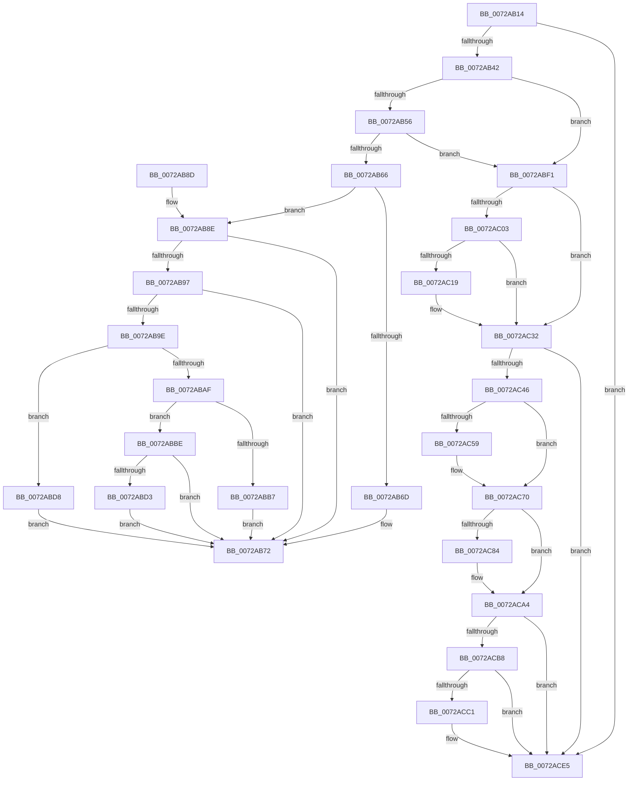

# IopQueueDeviceResetEvent

- RVA: `0x0072AB14`–`0x0072ACFE` (길이 `490` bytes)
- VA: `0x000000014072AB14`
- 실행 섹션: `PAGE`
- PDB 이름 있음: `예`; PDB Function 태그: `아니요`
- unwind 정보 RVA: `0x000C8500`
- 디코드: `128`개 명령, `490/490` bytes 표시
- 미해석 바이트: `0` (있으면 어셈블리에 `.byte`로 보존)

> 이 문서는 커널 이미지의 기계어와 PDB 기호를 분석해 생성했습니다. 4번과 5번은 함수 원형과 자료형을 바이너리 사용 방식에서 추정한 C 해석이며 원본 소스 복구 결과는 아닙니다.

## 1. Dependencies

- 직접 호출 지점: **16**; 고유 호출 대상: **6**
- 직접 호출자로 확인된 함수: **1**
- RIP 상대 이미지 참조: **0**

### Outgoing calls
- `0x0072AB8E` → [PipSetDevNodeStateFlags](PipSetDevNodeStateFlags_function_0072DB98.md) (function, `0x0072DB98`)
- `0x0072ABCA` → [PnpRequestDeviceRemoval](../8F/PnpRequestDeviceRemoval_function_008FC294.md) (function, `0x008FC294`)
- `0x0072ABE2` → [PipSetDevNodeProblem](../8F/PipSetDevNodeProblem_function_008FDE0C.md) (function, `0x008FDE0C`)
- `0x0072ABEA` → [IopMarkDeviceToBeReset](IopMarkDeviceToBeReset_function_0072A9A0.md) (function, `0x0072A9A0`)
- `0x0072ABF5` → [IoAddTriageDumpDataBlock](../../text/42/IoAddTriageDumpDataBlock_function_00428374.md) (function, `0x00428374`)
- `0x0072AC07` → [IoAddTriageDumpDataBlock](../../text/42/IoAddTriageDumpDataBlock_function_00428374.md) (function, `0x00428374`)
- `0x0072AC1C` → [IoAddTriageDumpDataBlock](../../text/42/IoAddTriageDumpDataBlock_function_00428374.md) (function, `0x00428374`)
- `0x0072AC2D` → [IoAddTriageDumpDataBlock](../../text/42/IoAddTriageDumpDataBlock_function_00428374.md) (function, `0x00428374`)
- `0x0072AC4F` → [IoAddTriageDumpDataBlock](../../text/42/IoAddTriageDumpDataBlock_function_00428374.md) (function, `0x00428374`)
- `0x0072AC5F` → [IoAddTriageDumpDataBlock](../../text/42/IoAddTriageDumpDataBlock_function_00428374.md) (function, `0x00428374`)
- `0x0072AC6B` → [IoAddTriageDumpDataBlock](../../text/42/IoAddTriageDumpDataBlock_function_00428374.md) (function, `0x00428374`)
- `0x0072AC87` → [IoAddTriageDumpDataBlock](../../text/42/IoAddTriageDumpDataBlock_function_00428374.md) (function, `0x00428374`)
- `0x0072AC9F` → [IoAddTriageDumpDataBlock](../../text/42/IoAddTriageDumpDataBlock_function_00428374.md) (function, `0x00428374`)
- `0x0072ACC4` → [IoAddTriageDumpDataBlock](../../text/42/IoAddTriageDumpDataBlock_function_00428374.md) (function, `0x00428374`)
- `0x0072ACE0` → [IoAddTriageDumpDataBlock](../../text/42/IoAddTriageDumpDataBlock_function_00428374.md) (function, `0x00428374`)
- `0x0072ACF8` → [KeBugCheckEx](../../text/4F/KeBugCheckEx_function_004FD660.md) (function, `0x004FD660`)

### Direct callers
- [PiProcessDeviceResetAction](../../text/5A/PiProcessDeviceResetAction_function_005A5CD8.md) at `0x005A5D54`

### Static image references
- 디코드된 RIP-relative 메모리 참조가 없습니다.

## 2. Other-region calls and transfers

- 다른 실행 섹션으로 향하는 call: **12**
  - `0x0072ABF5` → [IoAddTriageDumpDataBlock](../../text/42/IoAddTriageDumpDataBlock_function_00428374.md) (`PAGE` → `.text`)
  - `0x0072AC07` → [IoAddTriageDumpDataBlock](../../text/42/IoAddTriageDumpDataBlock_function_00428374.md) (`PAGE` → `.text`)
  - `0x0072AC1C` → [IoAddTriageDumpDataBlock](../../text/42/IoAddTriageDumpDataBlock_function_00428374.md) (`PAGE` → `.text`)
  - `0x0072AC2D` → [IoAddTriageDumpDataBlock](../../text/42/IoAddTriageDumpDataBlock_function_00428374.md) (`PAGE` → `.text`)
  - `0x0072AC4F` → [IoAddTriageDumpDataBlock](../../text/42/IoAddTriageDumpDataBlock_function_00428374.md) (`PAGE` → `.text`)
  - `0x0072AC5F` → [IoAddTriageDumpDataBlock](../../text/42/IoAddTriageDumpDataBlock_function_00428374.md) (`PAGE` → `.text`)
  - `0x0072AC6B` → [IoAddTriageDumpDataBlock](../../text/42/IoAddTriageDumpDataBlock_function_00428374.md) (`PAGE` → `.text`)
  - `0x0072AC87` → [IoAddTriageDumpDataBlock](../../text/42/IoAddTriageDumpDataBlock_function_00428374.md) (`PAGE` → `.text`)
  - `0x0072AC9F` → [IoAddTriageDumpDataBlock](../../text/42/IoAddTriageDumpDataBlock_function_00428374.md) (`PAGE` → `.text`)
  - `0x0072ACC4` → [IoAddTriageDumpDataBlock](../../text/42/IoAddTriageDumpDataBlock_function_00428374.md) (`PAGE` → `.text`)
  - `0x0072ACE0` → [IoAddTriageDumpDataBlock](../../text/42/IoAddTriageDumpDataBlock_function_00428374.md) (`PAGE` → `.text`)
  - `0x0072ACF8` → [KeBugCheckEx](../../text/4F/KeBugCheckEx_function_004FD660.md) (`PAGE` → `.text`)
- 별도 외부 분기/꼬리 이동을 확인하지 못했습니다.

## 3. Assembly (complete function range)

```asm
0072AB14  48 8B C4                        mov rax, rsp
0072AB17  48 89 58 08                     mov qword ptr [rax + 8], rbx
0072AB1B  48 89 68 10                     mov qword ptr [rax + 0x10], rbp
0072AB1F  48 89 70 18                     mov qword ptr [rax + 0x18], rsi
0072AB23  48 89 78 20                     mov qword ptr [rax + 0x20], rdi
0072AB27  41 56                           push r14
0072AB29  48 83 EC 30                     sub rsp, 0x30
0072AB2D  33 ED                           xor ebp, ebp
0072AB2F  48 8B F2                        mov rsi, rdx
0072AB32  48 8B D9                        mov rbx, rcx
0072AB35  44 8D 75 02                     lea r14d, [rbp + 2]
0072AB39  48 85 C9                        test rcx, rcx
0072AB3C  0F 84 A3 01 00 00               je 0x14072ace5
0072AB42  48 8B 81 38 01 00 00            mov rax, qword ptr [rcx + 0x138]
0072AB49  48 8B 78 28                     mov rdi, qword ptr [rax + 0x28]
0072AB4D  48 85 FF                        test rdi, rdi
0072AB50  0F 84 9B 00 00 00               je 0x14072abf1
0072AB56  8B 87 8C 01 00 00               mov eax, dword ptr [rdi + 0x18c]
0072AB5C  0F BA E0 11                     bt eax, 0x11
0072AB60  0F 82 8B 00 00 00               jb 0x14072abf1
0072AB66  40 88 2A                        mov byte ptr [rdx], bpl
0072AB69  A8 10                           test al, 0x10
0072AB6B  75 21                           jne 0x14072ab8e
0072AB6D  B8 B6 02 00 C0                  mov eax, 0xc00002b6
0072AB72  48 8B 5C 24 40                  mov rbx, qword ptr [rsp + 0x40]
0072AB77  48 8B 6C 24 48                  mov rbp, qword ptr [rsp + 0x48]
0072AB7C  48 8B 74 24 50                  mov rsi, qword ptr [rsp + 0x50]
0072AB81  48 8B 7C 24 58                  mov rdi, qword ptr [rsp + 0x58]
0072AB86  48 83 C4 30                     add rsp, 0x30
0072AB8A  41 5E                           pop r14
0072AB8C  C3                              ret
0072AB8D  CC                              int3
0072AB8E  E8 05 30 00 00                  call 0x14072db98
0072AB93  85 C0                           test eax, eax
0072AB95  78 DB                           js 0x14072ab72
0072AB97  3D FF 00 00 00                  cmp eax, 0xff
0072AB9C  74 D4                           je 0x14072ab72
0072AB9E  8B 8F 2C 01 00 00               mov ecx, dword ptr [rdi + 0x12c]
0072ABA4  8D 81 ED FC FF FF               lea eax, [rcx - 0x313]
0072ABAA  83 F8 01                        cmp eax, 1
0072ABAD  76 29                           jbe 0x14072abd8
0072ABAF  81 F9 11 03 00 00               cmp ecx, 0x311
0072ABB5  75 07                           jne 0x14072abbe
0072ABB7  B8 03 01 00 00                  mov eax, 0x103
0072ABBC  EB B4                           jmp 0x14072ab72
0072ABBE  45 33 C9                        xor r9d, r9d
0072ABC1  33 D2                           xor edx, edx
0072ABC3  48 8B CF                        mov rcx, rdi
0072ABC6  45 8D 41 36                     lea r8d, [r9 + 0x36]
0072ABCA  E8 C5 16 1D 00                  call 0x1408fc294
0072ABCF  85 C0                           test eax, eax
0072ABD1  78 9F                           js 0x14072ab72
0072ABD3  C6 06 01                        mov byte ptr [rsi], 1
0072ABD6  EB 9A                           jmp 0x14072ab72
0072ABD8  45 33 C0                        xor r8d, r8d
0072ABDB  48 8B CF                        mov rcx, rdi
0072ABDE  41 8D 50 36                     lea edx, [r8 + 0x36]
0072ABE2  E8 25 32 1D 00                  call 0x1408fde0c
0072ABE7  48 8B CB                        mov rcx, rbx
0072ABEA  E8 B1 FD FF FF                  call 0x14072a9a0
0072ABEF  EB 81                           jmp 0x14072ab72
0072ABF1  0F B7 51 02                     movzx edx, word ptr [rcx + 2]
0072ABF5  E8 7A D7 CF FF                  call 0x140428374
0072ABFA  48 8B 4B 08                     mov rcx, qword ptr [rbx + 8]
0072ABFE  48 85 C9                        test rcx, rcx
0072AC01  74 2F                           je 0x14072ac32
0072AC03  0F BF 51 02                     movsx edx, word ptr [rcx + 2]
0072AC07  E8 68 D7 CF FF                  call 0x140428374
0072AC0C  48 8B 4B 08                     mov rcx, qword ptr [rbx + 8]
0072AC10  48 83 C1 38                     add rcx, 0x38
0072AC14  66 39 29                        cmp word ptr [rcx], bp
0072AC17  74 19                           je 0x14072ac32
0072AC19  41 8B D6                        mov edx, r14d
0072AC1C  E8 53 D7 CF FF                  call 0x140428374
0072AC21  48 8B 4B 08                     mov rcx, qword ptr [rbx + 8]
0072AC25  0F B7 51 38                     movzx edx, word ptr [rcx + 0x38]
0072AC29  48 8B 49 40                     mov rcx, qword ptr [rcx + 0x40]
0072AC2D  E8 42 D7 CF FF                  call 0x140428374
0072AC32  48 8B 83 38 01 00 00            mov rax, qword ptr [rbx + 0x138]
0072AC39  48 8B 48 28                     mov rcx, qword ptr [rax + 0x28]
0072AC3D  48 85 C9                        test rcx, rcx
0072AC40  0F 84 9F 00 00 00               je 0x14072ace5
0072AC46  BA 88 03 00 00                  mov edx, 0x388
0072AC4B  48 8D 79 28                     lea rdi, [rcx + 0x28]
0072AC4F  E8 20 D7 CF FF                  call 0x140428374
0072AC54  66 39 2F                        cmp word ptr [rdi], bp
0072AC57  74 17                           je 0x14072ac70
0072AC59  41 8B D6                        mov edx, r14d
0072AC5C  48 8B CF                        mov rcx, rdi
0072AC5F  E8 10 D7 CF FF                  call 0x140428374
0072AC64  0F B7 17                        movzx edx, word ptr [rdi]
0072AC67  48 8B 4F 08                     mov rcx, qword ptr [rdi + 8]
0072AC6B  E8 04 D7 CF FF                  call 0x140428374
0072AC70  48 8B 83 38 01 00 00            mov rax, qword ptr [rbx + 0x138]
0072AC77  48 8B 48 28                     mov rcx, qword ptr [rax + 0x28]
0072AC7B  48 83 C1 38                     add rcx, 0x38
0072AC7F  66 39 29                        cmp word ptr [rcx], bp
0072AC82  74 20                           je 0x14072aca4
0072AC84  41 8B D6                        mov edx, r14d
0072AC87  E8 E8 D6 CF FF                  call 0x140428374
0072AC8C  48 8B 83 38 01 00 00            mov rax, qword ptr [rbx + 0x138]
0072AC93  48 8B 48 28                     mov rcx, qword ptr [rax + 0x28]
0072AC97  0F B7 51 38                     movzx edx, word ptr [rcx + 0x38]
0072AC9B  48 8B 49 40                     mov rcx, qword ptr [rcx + 0x40]
0072AC9F  E8 D0 D6 CF FF                  call 0x140428374
0072ACA4  48 8B 83 38 01 00 00            mov rax, qword ptr [rbx + 0x138]
0072ACAB  48 8B 48 28                     mov rcx, qword ptr [rax + 0x28]
0072ACAF  48 8B 41 10                     mov rax, qword ptr [rcx + 0x10]
0072ACB3  48 85 C0                        test rax, rax
0072ACB6  74 2D                           je 0x14072ace5
0072ACB8  48 8D 48 38                     lea rcx, [rax + 0x38]
0072ACBC  66 39 29                        cmp word ptr [rcx], bp
0072ACBF  74 24                           je 0x14072ace5
0072ACC1  41 8B D6                        mov edx, r14d
0072ACC4  E8 AB D6 CF FF                  call 0x140428374
0072ACC9  48 8B 83 38 01 00 00            mov rax, qword ptr [rbx + 0x138]
0072ACD0  48 8B 48 28                     mov rcx, qword ptr [rax + 0x28]
0072ACD4  48 8B 49 10                     mov rcx, qword ptr [rcx + 0x10]
0072ACD8  0F B7 51 38                     movzx edx, word ptr [rcx + 0x38]
0072ACDC  48 8B 49 40                     mov rcx, qword ptr [rcx + 0x40]
0072ACE0  E8 8F D6 CF FF                  call 0x140428374
0072ACE5  45 33 C9                        xor r9d, r9d
0072ACE8  48 89 6C 24 20                  mov qword ptr [rsp + 0x20], rbp
0072ACED  4C 8B C3                        mov r8, rbx
0072ACF0  49 8B D6                        mov rdx, r14
0072ACF3  B9 CA 00 00 00                  mov ecx, 0xca
0072ACF8  E8 63 29 DD FF                  call 0x1404fd660
0072ACFD  CC                              int3
```

## 4. C-style interpretation (structured pseudocode)

```c
__int64 __fastcall IopQueueDeviceResetEvent(__int64 a1, __int64 a2, __int64 a3, int a4)
{
    __int64 result;
    __int64 v_rbp;
    __int64 v_rsp;
    unsigned __int64 v_stack_p10;
    unsigned __int64 v_stack_p18;
    unsigned __int64 v_stack_p20;
    unsigned __int64 v_stack_p8;

    *(unsigned __int64 *)(v_rsp + 8) = v_rbx;
    *(unsigned __int64 *)(v_rsp + 16) = v_rbp;
    *(unsigned __int64 *)(v_rsp + 24) = v_rsi;
    *(unsigned __int64 *)(v_rsp + 32) = v_rdi;
    v_rsp = (v_rsp) - (48);
    v_rbp = 0;
    if (a1 == 0) goto loc_0072ACE5;
    if (*(unsigned __int64 *)(*(unsigned __int64 *)(a1 + 312) + 40) == 0) goto loc_0072ABF1;
    if (condition_is_below) goto loc_0072ABF1;
    *(unsigned __int8 *)(a2) = 0;
    if ((((unsigned __int8)((unsigned int)(*(unsigned int *)(*(unsigned __int64 *)(*(unsigned __int64 *)(a1 + 312) + 40) + 396)))) & (16)) != 0) goto loc_0072AB8E;
loc_0072AB72:
    v_rsp = (v_rsp) + (48);
    return (unsigned int)(0xC00002B6ULL);
loc_0072AB8E:
    result = PipSetDevNodeStateFlags(a1, a2, a3, a4);
    if (sign_flag) goto loc_0072AB72;
    if (((unsigned int)(result)) == 255) goto loc_0072AB72;
    if (((unsigned int)((unsigned int)(*(unsigned int *)(v_stack_p20 + 300)) - 787)) <= 1) goto loc_0072ABD8;
    if (((unsigned int)((unsigned int)(*(unsigned int *)(v_stack_p20 + 300)))) != 785) goto loc_0072ABBE;
    goto loc_0072AB72;
loc_0072ABBE:
    a4 = 0;
    a2 = 0;
    result = PnpRequestDeviceRemoval(v_stack_p20, a2, a4 + 54, a4);
    if (sign_flag) goto loc_0072AB72;
    *(unsigned __int8 *)(v_stack_p18) = 1;
    goto loc_0072AB72;
loc_0072ABD8:
    a3 = 0;
    result = PipSetDevNodeProblem(v_stack_p20, a3 + 54, a3, a4);
    result = IopMarkDeviceToBeReset(v_stack_p8, a3 + 54, a3, a4);
    goto loc_0072AB72;
loc_0072ABF1:
    result = IoAddTriageDumpDataBlock(v_stack_p8, *(unsigned __int16 *)(v_stack_p8 + 2), a3, a4);
    if (*(unsigned __int64 *)(v_stack_p8 + 8) == 0) goto loc_0072AC32;
    result = IoAddTriageDumpDataBlock(*(unsigned __int64 *)(v_stack_p8 + 8), (__int16)(*(unsigned __int16 *)(*(unsigned __int64 *)(v_stack_p8 + 8) + 2)), a3, a4);
    a1 = (*(unsigned __int64 *)(v_stack_p8 + 8)) + (56);
    if ((*(unsigned __int16 *)(a1)) != ((unsigned __int16)(v_stack_p10))) {
        a2 = (unsigned int)(v_rbp + 2);
        result = IoAddTriageDumpDataBlock(a1, a2, a3, a4);
        a1 = *(unsigned __int64 *)(v_stack_p8 + 8);
        a2 = *(unsigned __int16 *)(a1 + 56);
        a1 = *(unsigned __int64 *)(a1 + 64);
        result = IoAddTriageDumpDataBlock(a1, a2, a3, a4);
    }
    if (*(unsigned __int64 *)(*(unsigned __int64 *)(v_stack_p8 + 312) + 40) == 0) goto loc_0072ACE5;
    result = IoAddTriageDumpDataBlock(*(unsigned __int64 *)(*(unsigned __int64 *)(v_stack_p8 + 312) + 40), 904, a3, a4);
    if ((*(unsigned __int16 *)(*(unsigned __int64 *)(*(unsigned __int64 *)(v_stack_p8 + 312) + 40) + 40)) != ((unsigned __int16)(v_stack_p10))) {
        a2 = (unsigned int)(v_rbp + 2);
        a1 = *(unsigned __int64 *)(*(unsigned __int64 *)(v_stack_p8 + 312) + 40) + 40;
        result = IoAddTriageDumpDataBlock(a1, a2, a3, a4);
        a2 = *(unsigned __int16 *)(*(unsigned __int64 *)(*(unsigned __int64 *)(v_stack_p8 + 312) + 40) + 40);
        a1 = *(unsigned __int64 *)(*(unsigned __int64 *)(*(unsigned __int64 *)(v_stack_p8 + 312) + 40) + 40 + 8);
        result = IoAddTriageDumpDataBlock(a1, a2, a3, a4);
    }
    a1 = (*(unsigned __int64 *)(*(unsigned __int64 *)(v_stack_p8 + 312) + 40)) + (56);
    result = *(unsigned __int64 *)(v_stack_p8 + 312);
    if ((*(unsigned __int16 *)(a1)) != ((unsigned __int16)(v_stack_p10))) {
        a2 = (unsigned int)(v_rbp + 2);
        result = IoAddTriageDumpDataBlock(a1, a2, a3, a4);
        result = *(unsigned __int64 *)(v_stack_p8 + 312);
        a1 = *(unsigned __int64 *)(result + 40);
        a2 = *(unsigned __int16 *)(a1 + 56);
        a1 = *(unsigned __int64 *)(a1 + 64);
        result = IoAddTriageDumpDataBlock(a1, a2, a3, a4);
    }
    if (*(unsigned __int64 *)(*(unsigned __int64 *)(*(unsigned __int64 *)(v_stack_p8 + 312) + 40) + 16) == 0) goto loc_0072ACE5;
    result = *(unsigned __int64 *)(*(unsigned __int64 *)(*(unsigned __int64 *)(v_stack_p8 + 312) + 40) + 16);
    if ((*(unsigned __int16 *)(*(unsigned __int64 *)(*(unsigned __int64 *)(*(unsigned __int64 *)(v_stack_p8 + 312) + 40) + 16) + 56)) != ((unsigned __int16)(v_stack_p10))) {
        a2 = (unsigned int)(v_rbp + 2);
        result = IoAddTriageDumpDataBlock(*(unsigned __int64 *)(*(unsigned __int64 *)(*(unsigned __int64 *)(v_stack_p8 + 312) + 40) + 16) + 56, a2, a3, a4);
        result = *(unsigned __int64 *)(v_stack_p8 + 312);
        a1 = *(unsigned __int64 *)(result + 40);
        a1 = *(unsigned __int64 *)(a1 + 16);
        a2 = *(unsigned __int16 *)(a1 + 56);
        a1 = *(unsigned __int64 *)(a1 + 64);
        result = IoAddTriageDumpDataBlock(a1, a2, a3, a4);
    }
    a4 = 0;
    v_stack_p20 = v_stack_p10;
    result = KeBugCheckEx(202, v_rbp + 2, v_stack_p8, a4);
    return result;
}
```

## 5. (Beta) C Style

```c
int64_t IopQueueDeviceResetEvent(void *Arg1, void *Arg2, int64_t Arg3, int32_t Arg4)
{
    uint8_t *arg1 = (uint8_t *)Arg1;
    uint8_t *arg2 = (uint8_t *)Arg2;

    int64_t result;
    int64_t local_rbp;
    int64_t local_rsp;
    uint64_t v_stack_p10;
    uint64_t v_stack_p18;
    uint64_t v_stack_p20;
    uint64_t v_stack_p8;

    *(uint64_t *)(local_rsp + 0x8) = local_rbx;
    *(uint64_t *)(local_rsp + 0x10) = local_rbp;
    *(uint64_t *)(local_rsp + 0x18) = local_rsi;
    *(uint64_t *)(local_rsp + 0x20) = local_rdi;
    local_rsp = (local_rsp) - (48);
    local_rbp = 0;
    if (Arg1 == NULL) goto loc_0072ACE5;
    if (*(uint64_t *)(*(uint64_t *)(arg1 + 0x138) + 0x28) == 0) goto loc_0072ABF1;
    if (condition_is_below) goto loc_0072ABF1;
    *(uint8_t *)(arg2) = 0;
    if ((((uint8_t)((uint32_t)(*(uint32_t *)(*(uint64_t *)(*(uint64_t *)(arg1 + 0x138) + 0x28) + 0x18C)))) & (16)) != 0) goto loc_0072AB8E;
loc_0072AB72:
    local_rsp = (local_rsp) + (48);
    return (uint32_t)(0xC00002B6ULL);
loc_0072AB8E:
    result = PipSetDevNodeStateFlags(Arg1, Arg2, Arg3, Arg4);
    if (sign_flag) goto loc_0072AB72;
    if (((uint32_t)(result)) == 255) goto loc_0072AB72;
    if (((uint32_t)((uint32_t)(*(uint32_t *)(v_stack_p20 + 0x12C)) - 787)) <= 1) goto loc_0072ABD8;
    if (((uint32_t)((uint32_t)(*(uint32_t *)(v_stack_p20 + 0x12C)))) != 785) goto loc_0072ABBE;
    goto loc_0072AB72;
loc_0072ABBE:
    Arg4 = 0;
    Arg2 = 0;
    result = PnpRequestDeviceRemoval(v_stack_p20, Arg2, Arg4 + 54, Arg4);
    if (sign_flag) goto loc_0072AB72;
    *(uint8_t *)(v_stack_p18) = 1;
    goto loc_0072AB72;
loc_0072ABD8:
    Arg3 = 0;
    result = PipSetDevNodeProblem(v_stack_p20, Arg3 + 54, Arg3, Arg4);
    result = IopMarkDeviceToBeReset(v_stack_p8, Arg3 + 54, Arg3, Arg4);
    goto loc_0072AB72;
loc_0072ABF1:
    result = IoAddTriageDumpDataBlock(v_stack_p8, *(uint16_t *)(v_stack_p8 + 0x2), Arg3, Arg4);
    if (*(uint64_t *)(v_stack_p8 + 0x8) == 0) goto loc_0072AC32;
    result = IoAddTriageDumpDataBlock(*(uint64_t *)(v_stack_p8 + 0x8), (int16_t)(*(uint16_t *)(*(uint64_t *)(v_stack_p8 + 0x8) + 0x2)), Arg3, Arg4);
    Arg1 = (*(uint64_t *)(v_stack_p8 + 0x8)) + (56);
    if ((*(uint16_t *)(arg1)) != ((uint16_t)(v_stack_p10))) {
        Arg2 = (uint32_t)(local_rbp + 2);
        result = IoAddTriageDumpDataBlock(Arg1, Arg2, Arg3, Arg4);
        Arg1 = *(uint64_t *)(v_stack_p8 + 0x8);
        Arg2 = *(uint16_t *)(arg1 + 0x38);
        Arg1 = *(uint64_t *)(arg1 + 0x40);
        result = IoAddTriageDumpDataBlock(Arg1, Arg2, Arg3, Arg4);
    }
    if (*(uint64_t *)(*(uint64_t *)(v_stack_p8 + 0x138) + 0x28) == 0) goto loc_0072ACE5;
    result = IoAddTriageDumpDataBlock(*(uint64_t *)(*(uint64_t *)(v_stack_p8 + 0x138) + 0x28), 904, Arg3, Arg4);
    if ((*(uint16_t *)(*(uint64_t *)(*(uint64_t *)(v_stack_p8 + 0x138) + 0x28) + 0x28)) != ((uint16_t)(v_stack_p10))) {
        Arg2 = (uint32_t)(local_rbp + 2);
        Arg1 = *(uint64_t *)(*(uint64_t *)(v_stack_p8 + 0x138) + 0x28) + 40;
        result = IoAddTriageDumpDataBlock(Arg1, Arg2, Arg3, Arg4);
        Arg2 = *(uint16_t *)(*(uint64_t *)(*(uint64_t *)(v_stack_p8 + 0x138) + 0x28) + 0x28);
        Arg1 = *(uint64_t *)(*(uint64_t *)(*(uint64_t *)(v_stack_p8 + 0x138) + 0x28) + 0x28 + 0x8);
        result = IoAddTriageDumpDataBlock(Arg1, Arg2, Arg3, Arg4);
    }
    Arg1 = (*(uint64_t *)(*(uint64_t *)(v_stack_p8 + 0x138) + 0x28)) + (56);
    result = *(uint64_t *)(v_stack_p8 + 0x138);
    if ((*(uint16_t *)(arg1)) != ((uint16_t)(v_stack_p10))) {
        Arg2 = (uint32_t)(local_rbp + 2);
        result = IoAddTriageDumpDataBlock(Arg1, Arg2, Arg3, Arg4);
        result = *(uint64_t *)(v_stack_p8 + 0x138);
        Arg1 = *(uint64_t *)(result + 0x28);
        Arg2 = *(uint16_t *)(arg1 + 0x38);
        Arg1 = *(uint64_t *)(arg1 + 0x40);
        result = IoAddTriageDumpDataBlock(Arg1, Arg2, Arg3, Arg4);
    }
    if (*(uint64_t *)(*(uint64_t *)(*(uint64_t *)(v_stack_p8 + 0x138) + 0x28) + 0x10) == 0) goto loc_0072ACE5;
    result = *(uint64_t *)(*(uint64_t *)(*(uint64_t *)(v_stack_p8 + 0x138) + 0x28) + 0x10);
    if ((*(uint16_t *)(*(uint64_t *)(*(uint64_t *)(*(uint64_t *)(v_stack_p8 + 0x138) + 0x28) + 0x10) + 0x38)) != ((uint16_t)(v_stack_p10))) {
        Arg2 = (uint32_t)(local_rbp + 2);
        result = IoAddTriageDumpDataBlock(*(uint64_t *)(*(uint64_t *)(*(uint64_t *)(v_stack_p8 + 0x138) + 0x28) + 0x10) + 56, Arg2, Arg3, Arg4);
        result = *(uint64_t *)(v_stack_p8 + 0x138);
        Arg1 = *(uint64_t *)(result + 0x28);
        Arg1 = *(uint64_t *)(arg1 + 0x10);
        Arg2 = *(uint16_t *)(arg1 + 0x38);
        Arg1 = *(uint64_t *)(arg1 + 0x40);
        result = IoAddTriageDumpDataBlock(Arg1, Arg2, Arg3, Arg4);
    }
    Arg4 = 0;
    v_stack_p20 = v_stack_p10;
    result = KeBugCheckEx(202, local_rbp + 2, v_stack_p8, Arg4);
    return result;
}
```

### 관측된 메모리 오프셋

구조체 형식이 확인되지 않은 접근은 인자 기준의 오프셋으로만 기록했습니다.

| 기준 인자 | 오프셋 표현 | 폭 (bit) | 접근 |
|---|---:|---:|---|
| `Arg1` | `+ 0x8` | `64` | `R` |
| `Arg1` | `+ 0x138` | `64` | `R` |
| `Arg2` | `+ 0x0` | `8` | `W` |

## 6. Execution-region graph

[열기: 2D/3D 그래프와 함수 탐색 컨트롤 패널](../../../control-panel.html?section=page&rva=0x0072AB14&view=graph)

- 2D 그래프는 위에서 아래로 흐르고, 3D 그래프는 빈 공간을 드래그해 회전합니다. Shift+드래그는 이동, 휠은 확대·축소, 함수 노드 선택은 대상 보고서 이동입니다.

### Static fallback


