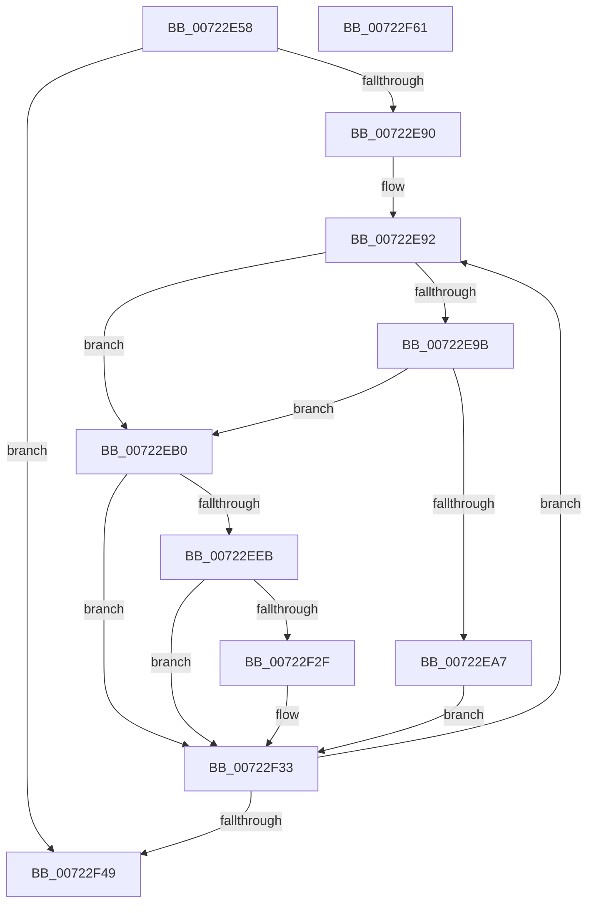

# IopRegistryInitializeCallbacks

- RVA: `0x00722E58`–`0x00722F62` (길이 `266` bytes)
- VA: `0x0000000140722E58`
- 실행 섹션: `PAGE`
- PDB 이름 있음: `예`; PDB Function 태그: `아니요`
- unwind 정보 RVA: `0x000C7E5C`
- 디코드: `70`개 명령, `266/266` bytes 표시
- 미해석 바이트: `0` (있으면 어셈블리에 `.byte`로 보존)

> 이 문서는 커널 이미지의 기계어와 PDB 기호를 분석해 생성했습니다. 4번과 5번은 함수 원형과 자료형을 바이너리 사용 방식에서 추정한 C 해석이며 원본 소스 복구 결과는 아닙니다.

## 1. Dependencies

- 직접 호출 지점: **4**; 고유 호출 대상: **4**
- 직접 호출자로 확인된 함수: **1**
- RIP 상대 이미지 참조: **3**

### Outgoing calls
- `0x00722E9E` → [guard_dispatch_icall](../../text/6B/guard_dispatch_icall_function_006BAAD0.md) (function, `0x006BAAD0`)
- `0x00722EB8` → [RtlInitUnicodeString](../../text/42/RtlInitUnicodeString_function_0042A780.md) (function, `0x0042A780`)
- `0x00722EE2` → [IopRegistryOpenDeepestPath](../A9/IopRegistryOpenDeepestPath_function_00A96114.md) (function, `0x00A96114`)
- `0x00722F20` → [ZwNotifyChangeKey](../../text/6A/ZwNotifyChangeKey_function_006AF550.md) (function, `0x006AF550`)

### Direct callers
- [IoInitSystem](../../init/C2/IoInitSystem_function_00C2ABB8.md) at `0x00C2AC20`

### Static image references
- `0x00722E6E` → RVA `0x00E00F10` (`.data`; read)
- `0x00722E75` → RVA `0x00E00F20` (`.data`; read)
- `0x00722EC2` → RVA `0x00A95FD0` (`IopRegistryCallback`; read)

## 2. Other-region calls and transfers

- 다른 실행 섹션으로 향하는 call: **3**
  - `0x00722E9E` → [guard_dispatch_icall](../../text/6B/guard_dispatch_icall_function_006BAAD0.md) (`PAGE` → `.text`)
  - `0x00722EB8` → [RtlInitUnicodeString](../../text/42/RtlInitUnicodeString_function_0042A780.md) (`PAGE` → `.text`)
  - `0x00722F20` → [ZwNotifyChangeKey](../../text/6A/ZwNotifyChangeKey_function_006AF550.md) (`PAGE` → `.text`)
- 별도 외부 분기/꼬리 이동을 확인하지 못했습니다.

## 3. Assembly (complete function range)

```asm
00722E58  48 8B C4                        mov rax, rsp
00722E5B  48 89 58 10                     mov qword ptr [rax + 0x10], rbx
00722E5F  48 89 70 18                     mov qword ptr [rax + 0x18], rsi
00722E63  57                              push rdi
00722E64  41 56                           push r14
00722E66  41 57                           push r15
00722E68  48 83 EC 60                     sub rsp, 0x60
00722E6C  33 FF                           xor edi, edi
00722E6E  4C 8D 3D 9B E0 6D 00            lea r15, [rip + 0x6de09b]
00722E75  48 39 3D A4 E0 6D 00            cmp qword ptr [rip + 0x6de0a4], rdi
00722E7C  0F 57 C0                        xorps xmm0, xmm0
00722E7F  0F 11 40 D8                     movups xmmword ptr [rax - 0x28], xmm0
00722E83  49 8B DF                        mov rbx, r15
00722E86  40 88 78 08                     mov byte ptr [rax + 8], dil
00722E8A  0F 84 B9 00 00 00               je 0x140722f49
00722E90  33 F6                           xor esi, esi
00722E92  48 8B 43 30                     mov rax, qword ptr [rbx + 0x30]
00722E96  48 85 C0                        test rax, rax
00722E99  74 15                           je 0x140722eb0
00722E9B  48 8B CB                        mov rcx, rbx
00722E9E  E8 2D 7C F9 FF                  call 0x1406baad0
00722EA3  85 C0                           test eax, eax
00722EA5  79 09                           jns 0x140722eb0
00722EA7  83 63 08 00                     and dword ptr [rbx + 8], 0
00722EAB  E9 83 00 00 00                  jmp 0x140722f33
00722EB0  48 8B 13                        mov rdx, qword ptr [rbx]
00722EB3  48 8D 4C 24 50                  lea rcx, [rsp + 0x50]
00722EB8  E8 C3 78 D0 FF                  call 0x14042a780
00722EBD  48 83 63 40 00                  and qword ptr [rbx + 0x40], 0
00722EC2  48 8D 05 07 31 37 00            lea rax, [rip + 0x373107]
00722EC9  4C 8D 84 24 80 00 00 00         lea r8, [rsp + 0x80]
00722ED1  48 89 43 50                     mov qword ptr [rbx + 0x50], rax
00722ED5  48 8D 53 20                     lea rdx, [rbx + 0x20]
00722ED9  48 89 73 58                     mov qword ptr [rbx + 0x58], rsi
00722EDD  48 8D 4C 24 50                  lea rcx, [rsp + 0x50]
00722EE2  E8 2D 32 37 00                  call 0x140a96114
00722EE7  85 C0                           test eax, eax
00722EE9  78 48                           js 0x140722f33
00722EEB  8B 43 08                        mov eax, dword ptr [rbx + 8]
00722EEE  48 8D 53 60                     lea rdx, [rbx + 0x60]
00722EF2  48 8B 4B 20                     mov rcx, qword ptr [rbx + 0x20]
00722EF6  4C 8D 43 40                     lea r8, [rbx + 0x40]
00722EFA  C6 44 24 48 01                  mov byte ptr [rsp + 0x48], 1
00722EFF  41 B9 01 00 00 00               mov r9d, 1
00722F05  83 64 24 40 00                  and dword ptr [rsp + 0x40], 0
00722F0A  48 83 64 24 38 00               and qword ptr [rsp + 0x38], 0
00722F10  C6 44 24 30 01                  mov byte ptr [rsp + 0x30], 1
00722F15  89 44 24 28                     mov dword ptr [rsp + 0x28], eax
00722F19  48 89 54 24 20                  mov qword ptr [rsp + 0x20], rdx
00722F1E  33 D2                           xor edx, edx
00722F20  E8 2B C6 F8 FF                  call 0x1406af550
00722F25  80 BC 24 80 00 00 00 00         cmp byte ptr [rsp + 0x80], 0
00722F2D  74 04                           je 0x140722f33
00722F2F  83 4B 28 01                     or dword ptr [rbx + 0x28], 1
00722F33  FF C7                           inc edi
00722F35  8B F7                           mov esi, edi
00722F37  48 6B DE 70                     imul rbx, rsi, 0x70
00722F3B  49 03 DF                        add rbx, r15
00722F3E  48 83 7B 10 00                  cmp qword ptr [rbx + 0x10], 0
00722F43  0F 85 49 FF FF FF               jne 0x140722e92
00722F49  4C 8D 5C 24 60                  lea r11, [rsp + 0x60]
00722F4E  33 C0                           xor eax, eax
00722F50  49 8B 5B 28                     mov rbx, qword ptr [r11 + 0x28]
00722F54  49 8B 73 30                     mov rsi, qword ptr [r11 + 0x30]
00722F58  49 8B E3                        mov rsp, r11
00722F5B  41 5F                           pop r15
00722F5D  41 5E                           pop r14
00722F5F  5F                              pop rdi
00722F60  C3                              ret
00722F61  CC                              int3
```

## 4. C-style interpretation (structured pseudocode)

```c
__int64 __fastcall IopRegistryInitializeCallbacks(void)
{
    __int64 result;
    __int64 v_rbx;
    __int64 v_rdi;
    __int64 v_rsi;
    __int64 v_rsp;
    unsigned __int64 v_stack_m18;
    unsigned __int64 v_stack_m28;
    unsigned __int8 v_stack_m30;
    unsigned int v_stack_m38;
    unsigned __int64 v_stack_m40;
    unsigned __int8 v_stack_m48;
    unsigned int v_stack_m50;
    unsigned __int64 v_stack_m58;
    unsigned __int64 v_stack_p8;

    *(unsigned __int64 *)(v_rsp + 16) = v_rbx;
    *(unsigned __int64 *)(v_rsp + 24) = v_rsi;
    v_rsp = (v_rsp) - (96);
    v_rdi = 0;
    *(unsigned __int64 *)(v_rsp - 40) = v_xmm0;
    *(unsigned __int8 *)(v_rsp + 8) = 0;
    if ((*(unsigned __int64 *)(v_rip + 7200932)) == 0) goto loc_00722F49;
    v_rsi = 0;
loc_00722E92:
    if (*(unsigned __int64 *)(v_rip + 7200923 + 48) == 0) goto loc_00722EB0;
    result = guard_dispatch_icall(v_rip + 7200923, a2, a3, a4);
    if (!sign_flag) goto loc_00722EB0;
    goto loc_00722F33;
loc_00722EB0:
    result = RtlInitUnicodeString(v_stack_m28, *(unsigned __int64 *)(v_rip + 7200923), a3, a4);
    *(unsigned __int64 *)(v_rip + 7200923 + 80) = v_rip + 3617031;
    *(unsigned __int64 *)(v_rip + 7200923 + 88) = 0;
    result = IopRegistryOpenDeepestPath(v_stack_m28, v_rip + 7200923 + 32, v_stack_p8, a4);
    if (sign_flag) goto loc_00722F33;
    v_stack_m30 = 1;
    v_stack_m48 = 1;
    v_stack_m50 = (unsigned int)((unsigned int)(*(unsigned int *)(v_rip + 7200923 + 8)));
    v_stack_m58 = v_rip + 7200923 + 96;
    a2 = 0;
    result = ZwNotifyChangeKey(*(unsigned __int64 *)(v_rip + 7200923 + 32), a2, v_rip + 7200923 + 64, 1);
    if (v_stack_p8 != 0) {
    }
    v_rdi = (unsigned int)((v_rdi) + 1);
    v_rbx = (v_rip + 7200923) * ((unsigned int)((unsigned int)(v_rdi)));
    v_rbx = (v_rbx) + (v_rip + 7200923);
    if ((*(unsigned __int64 *)(v_rbx + 16)) != 0) goto loc_00722E92;
loc_00722F49:
    result = 0;
    return result;
}
```

## 5. (Beta) C Style

```c
void IopRegistryInitializeCallbacks(void)
{
    int64_t result;
    int64_t local_rbx;
    int64_t local_rdi;
    int64_t local_rsi;
    int64_t local_rsp;
    uint64_t v_stack_m18;
    uint64_t v_stack_m28;
    uint8_t v_stack_m30;
    uint32_t v_stack_m38;
    uint64_t v_stack_m40;
    uint8_t v_stack_m48;
    uint32_t v_stack_m50;
    uint64_t v_stack_m58;
    uint64_t v_stack_p8;

    *(uint64_t *)(local_rsp + 0x10) = local_rbx;
    *(uint64_t *)(local_rsp + 0x18) = local_rsi;
    local_rsp = (local_rsp) - (96);
    local_rdi = 0;
    *(uint64_t *)(local_rsp - 0x28) = v_xmm0;
    *(uint8_t *)(local_rsp + 0x8) = 0;
    if ((*(uint64_t *)(v_rip + 0x6DE0A4)) == 0) goto loc_00722F49;
    local_rsi = 0;
loc_00722E92:
    if (*(uint64_t *)(v_rip + 0x6DE09B + 0x30) == 0) goto loc_00722EB0;
    result = guard_dispatch_icall(v_rip + 7200923, a2, a3, a4);
    if (!sign_flag) goto loc_00722EB0;
    goto loc_00722F33;
loc_00722EB0:
    result = RtlInitUnicodeString(v_stack_m28, *(uint64_t *)(v_rip + 0x6DE09B), a3, a4);
    *(uint64_t *)(v_rip + 0x6DE09B + 0x50) = v_rip + 3617031;
    *(uint64_t *)(v_rip + 0x6DE09B + 0x58) = 0;
    result = IopRegistryOpenDeepestPath(v_stack_m28, v_rip + 7200923 + 32, v_stack_p8, a4);
    if (sign_flag) goto loc_00722F33;
    v_stack_m30 = 1;
    v_stack_m48 = 1;
    v_stack_m50 = (uint32_t)((uint32_t)(*(uint32_t *)(v_rip + 0x6DE09B + 0x8)));
    v_stack_m58 = v_rip + 7200923 + 96;
    a2 = 0;
    result = ZwNotifyChangeKey(*(uint64_t *)(v_rip + 0x6DE09B + 0x20), a2, v_rip + 7200923 + 64, 1);
    if (v_stack_p8 != 0) {
    }
    local_rdi = (uint32_t)((local_rdi) + 1);
    local_rbx = (v_rip + 7200923) * ((uint32_t)((uint32_t)(local_rdi)));
    local_rbx = (local_rbx) + (v_rip + 7200923);
    if ((*(uint64_t *)(local_rbx + 0x10)) != 0) goto loc_00722E92;
loc_00722F49:
    result = 0;
    return result;
}
```

## 6. Execution-region graph

[열기: 2D/3D 그래프와 함수 탐색 컨트롤 패널](../../../control-panel.html?section=page&rva=0x00722E58&view=graph)

- 2D 그래프는 위에서 아래로 흐르고, 3D 그래프는 빈 공간을 드래그해 회전합니다. Shift+드래그는 이동, 휠은 확대·축소, 함수 노드 선택은 대상 보고서 이동입니다.

### Static fallback


