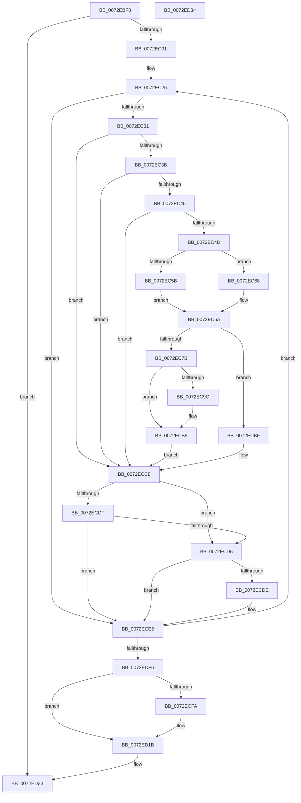

# IopReleaseFilteredBootResources

- RVA: `0x0072EBF8`–`0x0072ED35` (길이 `317` bytes)
- VA: `0x000000014072EBF8`
- 실행 섹션: `PAGE`
- PDB 이름 있음: `예`; PDB Function 태그: `아니요`
- unwind 정보 RVA: `0x000C8868`
- 디코드: `86`개 명령, `317/317` bytes 표시
- 미해석 바이트: `0` (있으면 어셈블리에 `.byte`로 보존)

> 이 문서는 커널 이미지의 기계어와 PDB 기호를 분석해 생성했습니다. 4번과 5번은 함수 원형과 자료형을 바이너리 사용 방식에서 추정한 C 해석이며 원본 소스 복구 결과는 아닙니다.

## 1. Dependencies

- 직접 호출 지점: **5**; 고유 호출 대상: **5**
- 직접 호출자로 확인된 함수: **1**
- RIP 상대 이미지 참조: **0**

### Outgoing calls
- `0x0072EC72` → [PnpNeedToReleaseBootResources](../AA/PnpNeedToReleaseBootResources_function_00AA69A8.md) (function, `0x00AA69A8`)
- `0x0072EC82` → [PnpReleaseBootResourcesForFilteredRequirements](../../text/5A/PnpReleaseBootResourcesForFilteredRequirements_function_005A79D4.md) (function, `0x005A79D4`)
- `0x0072EC92` → [PipClearDevNodeFlags](../8F/PipClearDevNodeFlags_function_008F9F54.md) (function, `0x008F9F54`)
- `0x0072ECAC` → [ExFreePoolWithTag](../../poolcode/B8/ExFreePoolWithTag_function_00B82870.md) (function, `0x00B82870`)
- `0x0072ED16` → [PnpRequestDeviceAction](../../text/47/PnpRequestDeviceAction_function_00477FF8.md) (function, `0x00477FF8`)

### Direct callers
- [sub_00B38CDE](../B3/Unknown_function_00B38CDE.md) at `0x00B39009`

### Static image references
- 디코드된 RIP-relative 메모리 참조가 없습니다.

## 2. Other-region calls and transfers

- 다른 실행 섹션으로 향하는 call: **3**
  - `0x0072EC82` → [PnpReleaseBootResourcesForFilteredRequirements](../../text/5A/PnpReleaseBootResourcesForFilteredRequirements_function_005A79D4.md) (`PAGE` → `.text`)
  - `0x0072ECAC` → [ExFreePoolWithTag](../../poolcode/B8/ExFreePoolWithTag_function_00B82870.md) (`PAGE` → `POOLCODE`)
  - `0x0072ED16` → [PnpRequestDeviceAction](../../text/47/PnpRequestDeviceAction_function_00477FF8.md) (`PAGE` → `.text`)
- 별도 외부 분기/꼬리 이동을 확인하지 못했습니다.

## 3. Assembly (complete function range)

```asm
0072EBF8  48 3B CA                        cmp rcx, rdx
0072EBFB  0F 83 32 01 00 00               jae 0x14072ed33
0072EC01  48 89 5C 24 10                  mov qword ptr [rsp + 0x10], rbx
0072EC06  48 89 6C 24 18                  mov qword ptr [rsp + 0x18], rbp
0072EC0B  48 89 74 24 20                  mov qword ptr [rsp + 0x20], rsi
0072EC10  57                              push rdi
0072EC11  41 54                           push r12
0072EC13  41 56                           push r14
0072EC15  48 83 EC 40                     sub rsp, 0x40
0072EC19  33 FF                           xor edi, edi
0072EC1B  48 8D 59 28                     lea rbx, [rcx + 0x28]
0072EC1F  48 8B EA                        mov rbp, rdx
0072EC22  44 8D 67 01                     lea r12d, [rdi + 1]
0072EC26  8B 43 E0                        mov eax, dword ptr [rbx - 0x20]
0072EC29  A8 28                           test al, 0x28
0072EC2B  0F 85 B4 00 00 00               jne 0x14072ece5
0072EC31  83 7B 10 00                     cmp dword ptr [rbx + 0x10], 0
0072EC35  0F 85 8D 00 00 00               jne 0x14072ecc8
0072EC3B  83 7B E4 04                     cmp dword ptr [rbx - 0x1c], 4
0072EC3F  0F 85 83 00 00 00               jne 0x14072ecc8
0072EC45  48 8B 13                        mov rdx, qword ptr [rbx]
0072EC48  48 85 D2                        test rdx, rdx
0072EC4B  74 7B                           je 0x14072ecc8
0072EC4D  83 64 24 60 00                  and dword ptr [rsp + 0x60], 0
0072EC52  48 8B 43 D8                     mov rax, qword ptr [rbx - 0x28]
0072EC56  48 85 C0                        test rax, rax
0072EC59  74 0D                           je 0x14072ec68
0072EC5B  48 8B 80 38 01 00 00            mov rax, qword ptr [rax + 0x138]
0072EC62  48 8B 70 28                     mov rsi, qword ptr [rax + 0x28]
0072EC66  EB 02                           jmp 0x14072ec6a
0072EC68  33 F6                           xor esi, esi
0072EC6A  4C 8D 44 24 60                  lea r8, [rsp + 0x60]
0072EC6F  48 8B CE                        mov rcx, rsi
0072EC72  E8 31 7D 37 00                  call 0x140aa69a8
0072EC77  85 C0                           test eax, eax
0072EC79  74 44                           je 0x14072ecbf
0072EC7B  48 8D 4B D8                     lea rcx, [rbx - 0x28]
0072EC7F  41 8B FC                        mov edi, r12d
0072EC82  E8 4D 8D E7 FF                  call 0x1405a79d4
0072EC87  BA 80 00 00 00                  mov edx, 0x80
0072EC8C  48 8B CE                        mov rcx, rsi
0072EC8F  44 8B F0                        mov r14d, eax
0072EC92  E8 BD B2 1C 00                  call 0x1408f9f54
0072EC97  45 85 F6                        test r14d, r14d
0072EC9A  79 19                           jns 0x14072ecb5
0072EC9C  48 8B 0B                        mov rcx, qword ptr [rbx]
0072EC9F  33 D2                           xor edx, edx
0072ECA1  C7 43 E0 10 00 00 00            mov dword ptr [rbx - 0x20], 0x10
0072ECA8  44 89 73 10                     mov dword ptr [rbx + 0x10], r14d
0072ECAC  E8 BF 3B 45 00                  call 0x140b82870
0072ECB1  48 83 23 00                     and qword ptr [rbx], 0
0072ECB5  48 83 A6 A0 01 00 00 00         and qword ptr [rsi + 0x1a0], 0
0072ECBD  EB 09                           jmp 0x14072ecc8
0072ECBF  83 7C 24 60 00                  cmp dword ptr [rsp + 0x60], 0
0072ECC4  41 0F 45 FC                     cmovne edi, r12d
0072ECC8  8B 43 E0                        mov eax, dword ptr [rbx - 0x20]
0072ECCB  A8 10                           test al, 0x10
0072ECCD  75 06                           jne 0x14072ecd5
0072ECCF  48 83 3B 00                     cmp qword ptr [rbx], 0
0072ECD3  75 10                           jne 0x14072ece5
0072ECD5  81 7B 10 08 09 00 C0            cmp dword ptr [rbx + 0x10], 0xc0000908
0072ECDC  74 07                           je 0x14072ece5
0072ECDE  C7 43 10 18 00 00 C0            mov dword ptr [rbx + 0x10], 0xc0000018
0072ECE5  48 83 C3 40                     add rbx, 0x40
0072ECE9  48 8D 43 D8                     lea rax, [rbx - 0x28]
0072ECED  48 3B C5                        cmp rax, rbp
0072ECF0  0F 82 30 FF FF FF               jb 0x14072ec26
0072ECF6  85 FF                           test edi, edi
0072ECF8  74 21                           je 0x14072ed1b
0072ECFA  48 83 64 24 30 00               and qword ptr [rsp + 0x30], 0
0072ED00  45 33 C9                        xor r9d, r9d
0072ED03  48 83 64 24 28 00               and qword ptr [rsp + 0x28], 0
0072ED09  45 33 C0                        xor r8d, r8d
0072ED0C  48 83 64 24 20 00               and qword ptr [rsp + 0x20], 0
0072ED12  33 D2                           xor edx, edx
0072ED14  33 C9                           xor ecx, ecx
0072ED16  E8 DD 92 D4 FF                  call 0x140477ff8
0072ED1B  48 8B 5C 24 68                  mov rbx, qword ptr [rsp + 0x68]
0072ED20  48 8B 6C 24 70                  mov rbp, qword ptr [rsp + 0x70]
0072ED25  48 8B 74 24 78                  mov rsi, qword ptr [rsp + 0x78]
0072ED2A  48 83 C4 40                     add rsp, 0x40
0072ED2E  41 5E                           pop r14
0072ED30  41 5C                           pop r12
0072ED32  5F                              pop rdi
0072ED33  C3                              ret
0072ED34  CC                              int3
```

## 4. C-style interpretation (structured pseudocode)

```c
__int64 __fastcall IopReleaseFilteredBootResources(__int64 a1, __int64 a2, __int64 a3, int a4)
{
    __int64 result;
    __int64 v_rbx;
    __int64 v_rdi;
    __int64 v_rsi;
    __int64 v_rsp;
    unsigned __int64 v_stack_m28;
    unsigned __int64 v_stack_m30;
    unsigned __int64 v_stack_m38;
    unsigned __int64 v_stack_p10;
    unsigned __int64 v_stack_p18;
    unsigned __int64 v_stack_p20;
    unsigned int v_stack_p8;

    if (a1 >= a2) goto loc_0072ED33;
    v_stack_p10 = v_rbx;
    v_stack_p18 = v_rbp;
    v_stack_p20 = v_rsi;
    v_rsp = (v_rsp) - (64);
    v_rdi = 0;
loc_0072EC26:
    if ((((unsigned __int8)((unsigned int)(*(unsigned int *)(a1 + 40 - 32)))) & (40)) != 0) goto loc_0072ECE5;
    if ((*(unsigned int *)(a1 + 40 + 16)) != 0) goto loc_0072ECC8;
    if ((*(unsigned int *)(a1 + 40 - 28)) != 4) goto loc_0072ECC8;
    if (*(unsigned __int64 *)(a1 + 40) == 0) goto loc_0072ECC8;
    if (*(unsigned __int64 *)(a1 + 40 - 40) == 0) goto loc_0072EC68;
    goto loc_0072EC6A;
loc_0072EC68:
    v_rsi = 0;
loc_0072EC6A:
    result = PnpNeedToReleaseBootResources(0, *(unsigned __int64 *)(a1 + 40), v_stack_p8, a4);
    if ((unsigned int)(result) == 0) goto loc_0072ECBF;
    result = PnpReleaseBootResourcesForFilteredRequirements(a1 + 40 - 40, *(unsigned __int64 *)(a1 + 40), v_stack_p8, a4);
    result = PipClearDevNodeFlags(0, 128, v_stack_p8, a4);
    if (sign_flag) {
        a1 = *(unsigned __int64 *)(a1 + 40);
        a2 = 0;
        *(unsigned int *)(a1 + 40 - 32) = 16;
        *(unsigned int *)(a1 + 40 + 16) = (unsigned int)((unsigned int)((unsigned int)(result)));
        result = ExFreePoolWithTag(a1, a2, v_stack_p8, a4);
    }
    goto loc_0072ECC8;
loc_0072ECBF:
    v_rdi = (unsigned int)((unsigned int)(v_rdi + 1));
    if (v_stack_p8 != 0) { v_rdi = (unsigned int)(v_rdi + 1); }
loc_0072ECC8:
    if ((((unsigned __int8)((unsigned int)(*(unsigned int *)(a1 + 40 - 32)))) & (16)) != 0) goto loc_0072ECD5;
    if ((*(unsigned __int64 *)(a1 + 40)) != 0) goto loc_0072ECE5;
loc_0072ECD5:
    if ((*(unsigned int *)(a1 + 40 + 16)) != 0xC0000908ULL) {
        *(unsigned int *)(a1 + 40 + 16) = 0xC0000018ULL;
    }
    v_rbx = (a1 + 40) + (64);
    if ((v_rbx - 40) < 0) goto loc_0072EC26;
    result = v_rbx - 40;
    if ((unsigned int)(v_rdi) != 0) {
        a4 = 0;
        a3 = 0;
        a2 = 0;
        a1 = 0;
        result = PnpRequestDeviceAction(a1, a2, a3, a4);
    }
    v_rsp = (v_rsp) + (64);
loc_0072ED33:
    return result;
}
```

## 5. (Beta) C Style

```c
int64_t IopReleaseFilteredBootResources(int64_t Arg1, int64_t Arg2, int64_t Arg3, int32_t Arg4)
{
    int64_t result;
    int64_t local_rbx;
    int64_t local_rdi;
    int64_t local_rsi;
    int64_t local_rsp;
    uint64_t v_stack_m28;
    uint64_t v_stack_m30;
    uint64_t v_stack_m38;
    uint64_t v_stack_p10;
    uint64_t v_stack_p18;
    uint64_t v_stack_p20;
    uint32_t v_stack_p8;

    if (Arg1 >= Arg2) goto loc_0072ED33;
    v_stack_p10 = local_rbx;
    v_stack_p18 = local_rbp;
    v_stack_p20 = local_rsi;
    local_rsp = (local_rsp) - (64);
    local_rdi = 0;
loc_0072EC26:
    if ((((uint8_t)((uint32_t)(*(uint32_t *)(Arg1 + 0x28 - 0x20)))) & (40)) != 0) goto loc_0072ECE5;
    if ((*(uint32_t *)(Arg1 + 0x28 + 0x10)) != 0) goto loc_0072ECC8;
    if ((*(uint32_t *)(Arg1 + 0x28 - 0x1C)) != 4) goto loc_0072ECC8;
    if (*(uint64_t *)(Arg1 + 0x28) == 0) goto loc_0072ECC8;
    if (*(uint64_t *)(Arg1 + 0x28 - 0x28) == 0) goto loc_0072EC68;
    goto loc_0072EC6A;
loc_0072EC68:
    local_rsi = 0;
loc_0072EC6A:
    result = PnpNeedToReleaseBootResources(0, *(uint64_t *)(Arg1 + 0x28), v_stack_p8, Arg4);
    if ((uint32_t)(result) == 0) goto loc_0072ECBF;
    result = PnpReleaseBootResourcesForFilteredRequirements(Arg1 + 40 - 40, *(uint64_t *)(Arg1 + 0x28), v_stack_p8, Arg4);
    result = PipClearDevNodeFlags(0, 128, v_stack_p8, Arg4);
    if (sign_flag) {
        Arg1 = *(uint64_t *)(Arg1 + 0x28);
        Arg2 = 0;
        *(uint32_t *)(Arg1 + 0x28 - 0x20) = 16;
        *(uint32_t *)(Arg1 + 0x28 + 0x10) = (uint32_t)((uint32_t)((uint32_t)(result)));
        result = ExFreePoolWithTag(Arg1, Arg2, v_stack_p8, Arg4);
    }
    goto loc_0072ECC8;
loc_0072ECBF:
    local_rdi = (uint32_t)((uint32_t)(local_rdi + 1));
    if (v_stack_p8 != 0) { local_rdi = (uint32_t)(local_rdi + 1); }
loc_0072ECC8:
    if ((((uint8_t)((uint32_t)(*(uint32_t *)(Arg1 + 0x28 - 0x20)))) & (16)) != 0) goto loc_0072ECD5;
    if ((*(uint64_t *)(Arg1 + 0x28)) != 0) goto loc_0072ECE5;
loc_0072ECD5:
    if ((*(uint32_t *)(Arg1 + 0x28 + 0x10)) != 0xC0000908ULL) {
        *(uint32_t *)(Arg1 + 0x28 + 0x10) = 0xC0000018ULL;
    }
    local_rbx = (Arg1 + 40) + (64);
    if ((local_rbx - 40) < 0) goto loc_0072EC26;
    result = local_rbx - 40;
    if ((uint32_t)(local_rdi) != 0) {
        Arg4 = 0;
        Arg3 = 0;
        Arg2 = 0;
        Arg1 = 0;
        result = PnpRequestDeviceAction(Arg1, Arg2, Arg3, Arg4);
    }
    local_rsp = (local_rsp) + (64);
loc_0072ED33:
    return result;
}
```

## 6. Execution-region graph

[열기: 2D/3D 그래프와 함수 탐색 컨트롤 패널](../../../control-panel.html?section=page&rva=0x0072EBF8&view=graph)

- 2D 그래프는 위에서 아래로 흐르고, 3D 그래프는 빈 공간을 드래그해 회전합니다. Shift+드래그는 이동, 휠은 확대·축소, 함수 노드 선택은 대상 보고서 이동입니다.

### Static fallback


