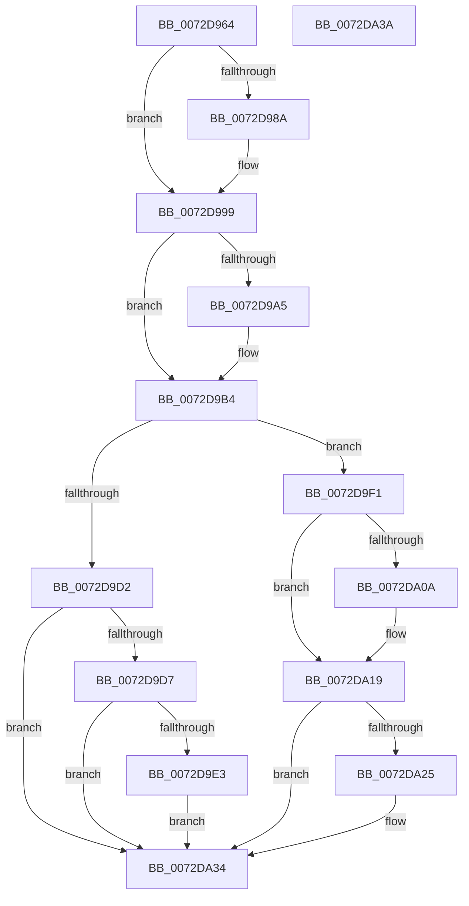

# IopReleaseResources

- RVA: `0x0072D964`–`0x0072DA3B` (길이 `215` bytes)
- VA: `0x000000014072D964`
- 실행 섹션: `PAGE`
- PDB 이름 있음: `예`; PDB Function 태그: `아니요`
- unwind 정보 RVA: `0x0005CF00`
- 디코드: `53`개 명령, `215/215` bytes 표시
- 미해석 바이트: `0` (있으면 어셈블리에 `.byte`로 보존)

> 이 문서는 커널 이미지의 기계어와 PDB 기호를 분석해 생성했습니다. 4번과 5번은 함수 원형과 자료형을 바이너리 사용 방식에서 추정한 C 해석이며 원본 소스 복구 결과는 아닙니다.

## 1. Dependencies

- 직접 호출 지점: **9**; 고유 호출 대상: **6**
- 직접 호출자로 확인된 함수: **1**
- RIP 상대 이미지 참조: **1**

### Outgoing calls
- `0x0072D96D` → [PnpReleaseResourcesInternal](../AA/PnpReleaseResourcesInternal_function_00AA5140.md) (function, `0x00AA5140`)
- `0x0072D979` → [ExAcquireFastMutex](../../text/20/ExAcquireFastMutex_function_0020E5A0.md) (function, `0x0020E5A0`)
- `0x0072D98C` → [ExFreePoolWithTag](../../poolcode/B8/ExFreePoolWithTag_function_00B82870.md) (function, `0x00B82870`)
- `0x0072D9A7` → [ExFreePoolWithTag](../../poolcode/B8/ExFreePoolWithTag_function_00B82870.md) (function, `0x00B82870`)
- `0x0072D9BB` → [ExReleaseFastMutex](../../text/25/ExReleaseFastMutex_function_002519C0.md) (function, `0x002519C0`)
- `0x0072D9EA` → [IopAllocateBootResourcesInternal](IopAllocateBootResourcesInternal_function_0072E708.md) (function, `0x0072E708`)
- `0x0072D9F9` → [PipClearDevNodeFlags](../8F/PipClearDevNodeFlags_function_008F9F54.md) (function, `0x008F9F54`)
- `0x0072DA0C` → [ExFreePoolWithTag](../../poolcode/B8/ExFreePoolWithTag_function_00B82870.md) (function, `0x00B82870`)
- `0x0072DA27` → [ExFreePoolWithTag](../../poolcode/B8/ExFreePoolWithTag_function_00B82870.md) (function, `0x00B82870`)

### Direct callers
- [IopLegacyResourceAllocation](../A0/IopLegacyResourceAllocation_function_00A07224.md) at `0x00A072EC`
- [IopLegacyResourceAllocation](../A0/IopLegacyResourceAllocation_function_00A07224.md) at `0x00A07408`

### Static image references
- `0x0072D972` → RVA `0x00F8C3E0` (`.data`; read)

## 2. Other-region calls and transfers

- 다른 실행 섹션으로 향하는 call: **6**
  - `0x0072D979` → [ExAcquireFastMutex](../../text/20/ExAcquireFastMutex_function_0020E5A0.md) (`PAGE` → `.text`)
  - `0x0072D98C` → [ExFreePoolWithTag](../../poolcode/B8/ExFreePoolWithTag_function_00B82870.md) (`PAGE` → `POOLCODE`)
  - `0x0072D9A7` → [ExFreePoolWithTag](../../poolcode/B8/ExFreePoolWithTag_function_00B82870.md) (`PAGE` → `POOLCODE`)
  - `0x0072D9BB` → [ExReleaseFastMutex](../../text/25/ExReleaseFastMutex_function_002519C0.md) (`PAGE` → `.text`)
  - `0x0072DA0C` → [ExFreePoolWithTag](../../poolcode/B8/ExFreePoolWithTag_function_00B82870.md) (`PAGE` → `POOLCODE`)
  - `0x0072DA27` → [ExFreePoolWithTag](../../poolcode/B8/ExFreePoolWithTag_function_00B82870.md) (`PAGE` → `POOLCODE`)
- 별도 외부 분기/꼬리 이동을 확인하지 못했습니다.

## 3. Assembly (complete function range)

```asm
0072D964  40 53                           push rbx
0072D966  48 83 EC 20                     sub rsp, 0x20
0072D96A  48 8B D9                        mov rbx, rcx
0072D96D  E8 CE 77 37 00                  call 0x140aa5140
0072D972  48 8D 0D 67 EA 85 00            lea rcx, [rip + 0x85ea67]
0072D979  E8 22 0C AE FF                  call 0x14020e5a0
0072D97E  48 8B 8B A0 01 00 00            mov rcx, qword ptr [rbx + 0x1a0]
0072D985  48 85 C9                        test rcx, rcx
0072D988  74 0F                           je 0x14072d999
0072D98A  33 D2                           xor edx, edx
0072D98C  E8 DF 4E 45 00                  call 0x140b82870
0072D991  48 83 A3 A0 01 00 00 00         and qword ptr [rbx + 0x1a0], 0
0072D999  48 8B 8B A8 01 00 00            mov rcx, qword ptr [rbx + 0x1a8]
0072D9A0  48 85 C9                        test rcx, rcx
0072D9A3  74 0F                           je 0x14072d9b4
0072D9A5  33 D2                           xor edx, edx
0072D9A7  E8 C4 4E 45 00                  call 0x140b82870
0072D9AC  48 83 A3 A8 01 00 00 00         and qword ptr [rbx + 0x1a8], 0
0072D9B4  48 8D 0D 25 EA 85 00            lea rcx, [rip + 0x85ea25]
0072D9BB  E8 00 40 B2 FF                  call 0x1402519c0
0072D9C0  8B 8B 8C 01 00 00               mov ecx, dword ptr [rbx + 0x18c]
0072D9C6  8B C1                           mov eax, ecx
0072D9C8  25 01 00 01 00                  and eax, 0x10001
0072D9CD  83 F8 01                        cmp eax, 1
0072D9D0  75 1F                           jne 0x14072d9f1
0072D9D2  F6 C1 40                        test cl, 0x40
0072D9D5  74 5D                           je 0x14072da34
0072D9D7  4C 8B 83 20 02 00 00            mov r8, qword ptr [rbx + 0x220]
0072D9DE  4D 85 C0                        test r8, r8
0072D9E1  74 51                           je 0x14072da34
0072D9E3  48 8B 53 20                     mov rdx, qword ptr [rbx + 0x20]
0072D9E7  8D 48 03                        lea ecx, [rax + 3]
0072D9EA  E8 19 0D 00 00                  call 0x14072e708
0072D9EF  EB 43                           jmp 0x14072da34
0072D9F1  BA C0 00 00 00                  mov edx, 0xc0
0072D9F6  48 8B CB                        mov rcx, rbx
0072D9F9  E8 56 C5 1C 00                  call 0x1408f9f54
0072D9FE  48 8B 8B 20 02 00 00            mov rcx, qword ptr [rbx + 0x220]
0072DA05  48 85 C9                        test rcx, rcx
0072DA08  74 0F                           je 0x14072da19
0072DA0A  33 D2                           xor edx, edx
0072DA0C  E8 5F 4E 45 00                  call 0x140b82870
0072DA11  48 83 A3 20 02 00 00 00         and qword ptr [rbx + 0x220], 0
0072DA19  48 8B 8B 28 02 00 00            mov rcx, qword ptr [rbx + 0x228]
0072DA20  48 85 C9                        test rcx, rcx
0072DA23  74 0F                           je 0x14072da34
0072DA25  33 D2                           xor edx, edx
0072DA27  E8 44 4E 45 00                  call 0x140b82870
0072DA2C  48 83 A3 28 02 00 00 00         and qword ptr [rbx + 0x228], 0
0072DA34  48 83 C4 20                     add rsp, 0x20
0072DA38  5B                              pop rbx
0072DA39  C3                              ret
0072DA3A  CC                              int3
```

## 4. C-style interpretation (structured pseudocode)

```c
__int64 __fastcall IopReleaseResources(__int64 a1, int a2)
{
    __int64 result;
    __int64 v_rsp;

    v_rsp = (v_rsp) - (32);
    result = PnpReleaseResourcesInternal(a1, a2, a3, a4);
    result = ExAcquireFastMutex(v_rip + 8776295, a2, a3, a4);
    if (*(unsigned __int64 *)(a1 + 416) != 0) {
        a2 = 0;
        result = ExFreePoolWithTag(*(unsigned __int64 *)(a1 + 416), a2, a3, a4);
    }
    if (*(unsigned __int64 *)(a1 + 424) != 0) {
        a2 = 0;
        result = ExFreePoolWithTag(*(unsigned __int64 *)(a1 + 424), a2, a3, a4);
    }
    result = ExReleaseFastMutex(v_rip + 8776229, a2, a3, a4);
    result = (unsigned int)(((unsigned int)((unsigned int)((unsigned int)(*(unsigned int *)(a1 + 396))))) & (0x10001ULL));
    if (((unsigned int)(result)) != 1) goto loc_0072D9F1;
    if ((((unsigned __int8)((unsigned int)(*(unsigned int *)(a1 + 396)))) & (64)) == 0) goto loc_0072DA34;
    if (*(unsigned __int64 *)(a1 + 544) == 0) goto loc_0072DA34;
    result = IopAllocateBootResourcesInternal(result + 3, *(unsigned __int64 *)(a1 + 32), *(unsigned __int64 *)(a1 + 544), a4);
    goto loc_0072DA34;
loc_0072D9F1:
    result = PipClearDevNodeFlags(a1, 192, *(unsigned __int64 *)(a1 + 544), a4);
    if (*(unsigned __int64 *)(a1 + 544) != 0) {
        a2 = 0;
        result = ExFreePoolWithTag(*(unsigned __int64 *)(a1 + 544), a2, *(unsigned __int64 *)(a1 + 544), a4);
    }
    if (*(unsigned __int64 *)(a1 + 552) != 0) {
        a2 = 0;
        result = ExFreePoolWithTag(*(unsigned __int64 *)(a1 + 552), a2, *(unsigned __int64 *)(a1 + 544), a4);
    }
    v_rsp = (v_rsp) + (32);
    return result;
}
```

## 5. (Beta) C Style

```c
int64_t IopReleaseResources(void *Arg1, int32_t Arg2)
{
    uint8_t *arg1 = (uint8_t *)Arg1;

    int64_t result;
    int64_t local_rsp;

    local_rsp = (local_rsp) - (32);
    result = PnpReleaseResourcesInternal(Arg1, Arg2, a3, a4);
    result = ExAcquireFastMutex(v_rip + 8776295, Arg2, a3, a4);
    if (*(uint64_t *)(arg1 + 0x1A0) != 0) {
        Arg2 = 0;
        result = ExFreePoolWithTag(*(uint64_t *)(arg1 + 0x1A0), Arg2, a3, a4);
    }
    if (*(uint64_t *)(arg1 + 0x1A8) != 0) {
        Arg2 = 0;
        result = ExFreePoolWithTag(*(uint64_t *)(arg1 + 0x1A8), Arg2, a3, a4);
    }
    result = ExReleaseFastMutex(v_rip + 8776229, Arg2, a3, a4);
    result = (uint32_t)(((uint32_t)((uint32_t)((uint32_t)(*(uint32_t *)(arg1 + 0x18C))))) & (0x10001ULL));
    if (((uint32_t)(result)) != 1) goto loc_0072D9F1;
    if ((((uint8_t)((uint32_t)(*(uint32_t *)(arg1 + 0x18C)))) & (64)) == 0) goto loc_0072DA34;
    if (*(uint64_t *)(arg1 + 0x220) == 0) goto loc_0072DA34;
    result = IopAllocateBootResourcesInternal(result + 3, *(uint64_t *)(arg1 + 0x20), *(uint64_t *)(arg1 + 0x220), a4);
    goto loc_0072DA34;
loc_0072D9F1:
    result = PipClearDevNodeFlags(Arg1, 192, *(uint64_t *)(arg1 + 0x220), a4);
    if (*(uint64_t *)(arg1 + 0x220) != 0) {
        Arg2 = 0;
        result = ExFreePoolWithTag(*(uint64_t *)(arg1 + 0x220), Arg2, *(uint64_t *)(arg1 + 0x220), a4);
    }
    if (*(uint64_t *)(arg1 + 0x228) != 0) {
        Arg2 = 0;
        result = ExFreePoolWithTag(*(uint64_t *)(arg1 + 0x228), Arg2, *(uint64_t *)(arg1 + 0x220), a4);
    }
    local_rsp = (local_rsp) + (32);
    return result;
}
```

### 관측된 메모리 오프셋

구조체 형식이 확인되지 않은 접근은 인자 기준의 오프셋으로만 기록했습니다.

| 기준 인자 | 오프셋 표현 | 폭 (bit) | 접근 |
|---|---:|---:|---|
| `Arg1` | `+ 0x20` | `64` | `R` |
| `Arg1` | `+ 0x18C` | `32` | `R` |
| `Arg1` | `+ 0x1A0` | `64` | `R` |
| `Arg1` | `+ 0x1A0` | `64` | `R/W` |
| `Arg1` | `+ 0x1A8` | `64` | `R` |
| `Arg1` | `+ 0x1A8` | `64` | `R/W` |
| `Arg1` | `+ 0x220` | `64` | `R` |
| `Arg1` | `+ 0x220` | `64` | `R/W` |
| `Arg1` | `+ 0x228` | `64` | `R` |
| `Arg1` | `+ 0x228` | `64` | `R/W` |

## 6. Execution-region graph

[열기: 2D/3D 그래프와 함수 탐색 컨트롤 패널](../../../control-panel.html?section=page&rva=0x0072D964&view=graph)

- 2D 그래프는 위에서 아래로 흐르고, 3D 그래프는 빈 공간을 드래그해 회전합니다. Shift+드래그는 이동, 휠은 확대·축소, 함수 노드 선택은 대상 보고서 이동입니다.

### Static fallback


