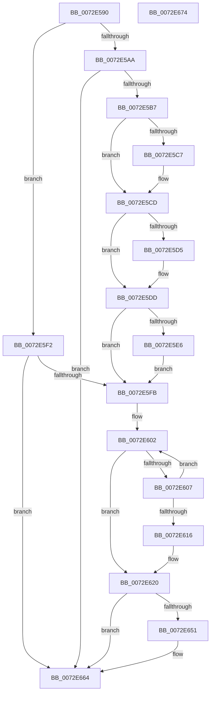

# IopRemoveLegacyDeviceNode

- RVA: `0x0072E590`–`0x0072E675` (길이 `229` bytes)
- VA: `0x000000014072E590`
- 실행 섹션: `PAGE`
- PDB 이름 있음: `예`; PDB Function 태그: `아니요`
- unwind 정보 RVA: `0x00060BC4`
- 디코드: `59`개 명령, `229/229` bytes 표시
- 미해석 바이트: `0` (있으면 어셈블리에 `.byte`로 보존)

> 이 문서는 커널 이미지의 기계어와 PDB 기호를 분석해 생성했습니다. 4번과 5번은 함수 원형과 자료형을 바이너리 사용 방식에서 추정한 C 해석이며 원본 소스 복구 결과는 아닙니다.

## 1. Dependencies

- 직접 호출 지점: **3**; 고유 호출 대상: **3**
- 직접 호출자로 확인된 함수: **1**
- RIP 상대 이미지 참조: **3**

### Outgoing calls
- `0x0072E63F` → [PipClearDevNodeFlags](../8F/PipClearDevNodeFlags_function_008F9F54.md) (function, `0x008F9F54`)
- `0x0072E647` → [IopDestroyDeviceNode](../A0/IopDestroyDeviceNode_function_00A06A3C.md) (function, `0x00A06A3C`)
- `0x0072E65F` → [IoDeleteDevice](../../text/26/IoDeleteDevice_function_0026FE90.md) (function, `0x0026FE90`)

### Direct callers
- [IopLegacyResourceAllocation](../A0/IopLegacyResourceAllocation_function_00A07224.md) at `0x00A07419`
- [IopLegacyResourceAllocation](../A0/IopLegacyResourceAllocation_function_00A07224.md) at `0x00A0742D`

### Static image references
- `0x0072E5DD` → RVA `0x00F8C140` (`.data`; read)
- `0x0072E5E9` → RVA `0x00F8C140` (`.data`; write)
- `0x0072E651` → RVA `0x00F8C440` (`.data`; read)

## 2. Other-region calls and transfers

- 다른 실행 섹션으로 향하는 call: **1**
  - `0x0072E65F` → [IoDeleteDevice](../../text/26/IoDeleteDevice_function_0026FE90.md) (`PAGE` → `.text`)
- 별도 외부 분기/꼬리 이동을 확인하지 못했습니다.

## 3. Assembly (complete function range)

```asm
0072E590  48 89 5C 24 08                  mov qword ptr [rsp + 8], rbx
0072E595  48 89 74 24 10                  mov qword ptr [rsp + 0x10], rsi
0072E59A  57                              push rdi
0072E59B  48 83 EC 20                     sub rsp, 0x20
0072E59F  48 8B DA                        mov rbx, rdx
0072E5A2  48 8B F1                        mov rsi, rcx
0072E5A5  48 85 C9                        test rcx, rcx
0072E5A8  75 48                           jne 0x14072e5f2
0072E5AA  48 39 8A B0 01 00 00            cmp qword ptr [rdx + 0x1b0], rcx
0072E5B1  0F 84 AD 00 00 00               je 0x14072e664
0072E5B7  48 21 8A B0 01 00 00            and qword ptr [rdx + 0x1b0], rcx
0072E5BE  48 8B 4A 08                     mov rcx, qword ptr [rdx + 8]
0072E5C2  48 85 C9                        test rcx, rcx
0072E5C5  74 06                           je 0x14072e5cd
0072E5C7  48 8B 02                        mov rax, qword ptr [rdx]
0072E5CA  48 89 01                        mov qword ptr [rcx], rax
0072E5CD  48 8B 0A                        mov rcx, qword ptr [rdx]
0072E5D0  48 85 C9                        test rcx, rcx
0072E5D3  74 08                           je 0x14072e5dd
0072E5D5  48 8B 42 08                     mov rax, qword ptr [rdx + 8]
0072E5D9  48 89 41 08                     mov qword ptr [rcx + 8], rax
0072E5DD  48 39 1D 5C DB 85 00            cmp qword ptr [rip + 0x85db5c], rbx
0072E5E4  75 15                           jne 0x14072e5fb
0072E5E6  48 8B 02                        mov rax, qword ptr [rdx]
0072E5E9  48 89 05 50 DB 85 00            mov qword ptr [rip + 0x85db50], rax
0072E5F0  EB 09                           jmp 0x14072e5fb
0072E5F2  F7 41 30 00 10 00 00            test dword ptr [rcx + 0x30], 0x1000
0072E5F9  75 69                           jne 0x14072e664
0072E5FB  48 8B 82 10 02 00 00            mov rax, qword ptr [rdx + 0x210]
0072E602  48 85 C0                        test rax, rax
0072E605  74 19                           je 0x14072e620
0072E607  48 8D 88 18 02 00 00            lea rcx, [rax + 0x218]
0072E60E  48 8B 01                        mov rax, qword ptr [rcx]
0072E611  48 3B C3                        cmp rax, rbx
0072E614  75 EC                           jne 0x14072e602
0072E616  48 8B 82 18 02 00 00            mov rax, qword ptr [rdx + 0x218]
0072E61D  48 89 01                        mov qword ptr [rcx], rax
0072E620  48 83 62 18 00                  and qword ptr [rdx + 0x18], 0
0072E625  48 8B CB                        mov rcx, rbx
0072E628  48 83 62 08 00                  and qword ptr [rdx + 8], 0
0072E62D  48 83 22 00                     and qword ptr [rdx], 0
0072E631  48 83 62 10 00                  and qword ptr [rdx + 0x10], 0
0072E636  48 8B 7A 20                     mov rdi, qword ptr [rdx + 0x20]
0072E63A  BA 00 00 02 00                  mov edx, 0x20000
0072E63F  E8 10 B9 1C 00                  call 0x1408f9f54
0072E644  48 8B CB                        mov rcx, rbx
0072E647  E8 F0 83 2D 00                  call 0x140a06a3c
0072E64C  48 85 F6                        test rsi, rsi
0072E64F  75 13                           jne 0x14072e664
0072E651  48 8B 05 E8 DD 85 00            mov rax, qword ptr [rip + 0x85dde8]
0072E658  48 8B CF                        mov rcx, rdi
0072E65B  48 89 47 08                     mov qword ptr [rdi + 8], rax
0072E65F  E8 2C 18 B4 FF                  call 0x14026fe90
0072E664  48 8B 5C 24 30                  mov rbx, qword ptr [rsp + 0x30]
0072E669  48 8B 74 24 38                  mov rsi, qword ptr [rsp + 0x38]
0072E66E  48 83 C4 20                     add rsp, 0x20
0072E672  5F                              pop rdi
0072E673  C3                              ret
0072E674  CC                              int3
```

## 4. C-style interpretation (structured pseudocode)

```c
__int64 __fastcall IopRemoveLegacyDeviceNode(__int64 a1, __int64 a2)
{
    __int64 result;
    __int64 v_rsp;
    unsigned __int64 v_stack_p10;
    unsigned __int64 v_stack_p8;

    v_stack_p8 = v_rbx;
    v_stack_p10 = v_rsi;
    v_rsp = (v_rsp) - (32);
    if (a1 != 0) goto loc_0072E5F2;
    if ((*(unsigned __int64 *)(a2 + 432)) == a1) goto loc_0072E664;
    if (*(unsigned __int64 *)(a2 + 8) != 0) {
        result = *(unsigned __int64 *)(a2);
        *(unsigned __int64 *)(*(unsigned __int64 *)(a2 + 8)) = result;
    }
    if (*(unsigned __int64 *)(a2) != 0) {
        result = *(unsigned __int64 *)(a2 + 8);
        *(unsigned __int64 *)(*(unsigned __int64 *)(a2) + 8) = result;
    }
    if ((*(unsigned __int64 *)(v_rip + 8772444)) != a2) goto loc_0072E5FB;
    *(unsigned __int64 *)(v_rip + 8772432) = *(unsigned __int64 *)(a2);
    goto loc_0072E5FB;
loc_0072E5F2:
    if (((*(unsigned int *)(*(unsigned __int64 *)(a2) + 48)) & (0x1000ULL)) != 0) goto loc_0072E664;
loc_0072E5FB:
loc_0072E602:
    if (*(unsigned __int64 *)(a2 + 528) == 0) goto loc_0072E620;
    if ((*(unsigned __int64 *)(*(unsigned __int64 *)(a2 + 528) + 536)) != a2) goto loc_0072E602;
    *(unsigned __int64 *)(*(unsigned __int64 *)(a2 + 528) + 536) = *(unsigned __int64 *)(a2 + 536);
loc_0072E620:
    result = PipClearDevNodeFlags(a2, (unsigned int)(0x20000ULL), a3, a4);
    result = IopDestroyDeviceNode(a2, (unsigned int)(0x20000ULL), a3, a4);
    if (a1 == 0) {
        result = *(unsigned __int64 *)(v_rip + 8773096);
        a1 = *(unsigned __int64 *)(a2 + 32);
        *(unsigned __int64 *)(*(unsigned __int64 *)(a2 + 32) + 8) = result;
        result = IoDeleteDevice(a1, (unsigned int)(0x20000ULL), a3, a4);
    }
    v_rsp = (v_rsp) + (32);
    return result;
}
```

## 5. (Beta) C Style

```c
int64_t IopRemoveLegacyDeviceNode(int64_t Arg1, void *Arg2)
{
    uint8_t *arg2 = (uint8_t *)Arg2;

    int64_t result;
    int64_t local_rsp;
    uint64_t v_stack_p10;
    uint64_t v_stack_p8;

    v_stack_p8 = local_rbx;
    v_stack_p10 = local_rsi;
    local_rsp = (local_rsp) - (32);
    if (Arg1 != 0) goto loc_0072E5F2;
    if ((*(uint64_t *)(arg2 + 0x1B0)) == Arg1) goto loc_0072E664;
    if (*(uint64_t *)(arg2 + 0x8) != 0) {
        result = *(uint64_t *)(arg2);
        *(uint64_t *)(*(uint64_t *)(arg2 + 0x8)) = result;
    }
    if (*(uint64_t *)(arg2) != 0) {
        result = *(uint64_t *)(arg2 + 0x8);
        *(uint64_t *)(*(uint64_t *)(arg2) + 0x8) = result;
    }
    if ((*(uint64_t *)(v_rip + 0x85DB5C)) != Arg2) goto loc_0072E5FB;
    *(uint64_t *)(v_rip + 0x85DB50) = *(uint64_t *)(arg2);
    goto loc_0072E5FB;
loc_0072E5F2:
    if (((*(uint32_t *)(*(uint64_t *)(arg2) + 0x30)) & (0x1000ULL)) != 0) goto loc_0072E664;
loc_0072E5FB:
loc_0072E602:
    if (*(uint64_t *)(arg2 + 0x210) == 0) goto loc_0072E620;
    if ((*(uint64_t *)(*(uint64_t *)(arg2 + 0x210) + 0x218)) != Arg2) goto loc_0072E602;
    *(uint64_t *)(*(uint64_t *)(arg2 + 0x210) + 0x218) = *(uint64_t *)(arg2 + 0x218);
loc_0072E620:
    result = PipClearDevNodeFlags(Arg2, (uint32_t)(0x20000ULL), a3, a4);
    result = IopDestroyDeviceNode(Arg2, (uint32_t)(0x20000ULL), a3, a4);
    if (Arg1 == 0) {
        result = *(uint64_t *)(v_rip + 0x85DDE8);
        Arg1 = *(uint64_t *)(arg2 + 0x20);
        *(uint64_t *)(*(uint64_t *)(arg2 + 0x20) + 0x8) = result;
        result = IoDeleteDevice(Arg1, (uint32_t)(0x20000ULL), a3, a4);
    }
    local_rsp = (local_rsp) + (32);
    return result;
}
```

### 관측된 메모리 오프셋

구조체 형식이 확인되지 않은 접근은 인자 기준의 오프셋으로만 기록했습니다.

| 기준 인자 | 오프셋 표현 | 폭 (bit) | 접근 |
|---|---:|---:|---|
| `Arg2` | `+ 0x0` | `64` | `R` |
| `Arg2` | `+ 0x0` | `64` | `R/W` |
| `Arg2` | `+ 0x8` | `64` | `R` |
| `Arg2` | `+ 0x8` | `64` | `R/W` |
| `Arg2` | `+ 0x10` | `64` | `R/W` |
| `Arg2` | `+ 0x18` | `64` | `R/W` |
| `Arg2` | `+ 0x20` | `64` | `R` |
| `Arg2` | `+ 0x1B0` | `64` | `R` |
| `Arg2` | `+ 0x1B0` | `64` | `R/W` |
| `Arg2` | `+ 0x210` | `64` | `R` |
| `Arg2` | `+ 0x218` | `64` | `R` |

## 6. Execution-region graph

[열기: 2D/3D 그래프와 함수 탐색 컨트롤 패널](../../../control-panel.html?section=page&rva=0x0072E590&view=graph)

- 2D 그래프는 위에서 아래로 흐르고, 3D 그래프는 빈 공간을 드래그해 회전합니다. Shift+드래그는 이동, 휠은 확대·축소, 함수 노드 선택은 대상 보고서 이동입니다.

### Static fallback


