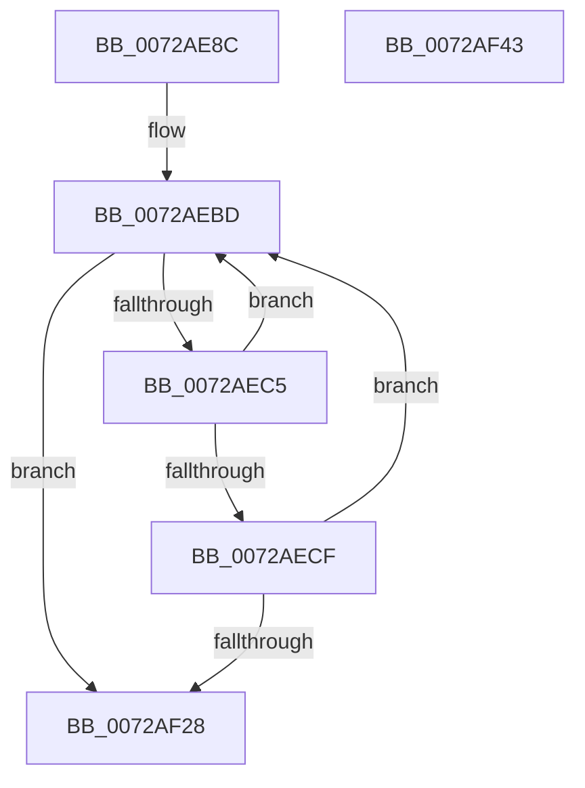

# IopRetestConfiguration

- RVA: `0x0072AE8C`–`0x0072AF44` (길이 `184` bytes)
- VA: `0x000000014072AE8C`
- 실행 섹션: `PAGE`
- PDB 이름 있음: `예`; PDB Function 태그: `아니요`
- unwind 정보 RVA: `0x00091ECC`
- 디코드: `50`개 명령, `184/184` bytes 표시
- 미해석 바이트: `0` (있으면 어셈블리에 `.byte`로 보존)

> 이 문서는 커널 이미지의 기계어와 PDB 기호를 분석해 생성했습니다. 4번과 5번은 함수 원형과 자료형을 바이너리 사용 방식에서 추정한 C 해석이며 원본 소스 복구 결과는 아닙니다.

## 1. Dependencies

- 직접 호출 지점: **2**; 고유 호출 대상: **2**
- 직접 호출자로 확인된 함수: **1**
- RIP 상대 이미지 참조: **0**

### Outgoing calls
- `0x0072AF08` → [PnpLookupArbitersNewResources](../AC/PnpLookupArbitersNewResources_function_00AC5F00.md) (function, `0x00AC5F00`)
- `0x0072AF1F` → [guard_dispatch_icall](../../text/6B/guard_dispatch_icall_function_006BAAD0.md) (function, `0x006BAAD0`)

### Direct callers
- [PnpFindBestConfigurationWorker](PnpFindBestConfigurationWorker_function_0072B688.md) at `0x0072B7F4`

### Static image references
- 디코드된 RIP-relative 메모리 참조가 없습니다.

## 2. Other-region calls and transfers

- 다른 실행 섹션으로 향하는 call: **1**
  - `0x0072AF1F` → [guard_dispatch_icall](../../text/6B/guard_dispatch_icall_function_006BAAD0.md) (`PAGE` → `.text`)
- 별도 외부 분기/꼬리 이동을 확인하지 못했습니다.

## 3. Assembly (complete function range)

```asm
0072AE8C  48 8B C4                        mov rax, rsp
0072AE8F  48 89 58 08                     mov qword ptr [rax + 8], rbx
0072AE93  48 89 68 10                     mov qword ptr [rax + 0x10], rbp
0072AE97  48 89 70 18                     mov qword ptr [rax + 0x18], rsi
0072AE9B  48 89 78 20                     mov qword ptr [rax + 0x20], rdi
0072AE9F  41 56                           push r14
0072AEA1  48 83 EC 50                     sub rsp, 0x50
0072AEA5  49 8B 38                        mov rdi, qword ptr [r8]
0072AEA8  0F 57 C0                        xorps xmm0, xmm0
0072AEAB  0F 11 40 D8                     movups xmmword ptr [rax - 0x28], xmm0
0072AEAF  49 8B F0                        mov rsi, r8
0072AEB2  8B EA                           mov ebp, edx
0072AEB4  0F 11 40 E8                     movups xmmword ptr [rax - 0x18], xmm0
0072AEB8  33 C0                           xor eax, eax
0072AEBA  4C 8B F1                        mov r14, rcx
0072AEBD  4C 8B C7                        mov r8, rdi
0072AEC0  48 3B FE                        cmp rdi, rsi
0072AEC3  74 63                           je 0x14072af28
0072AEC5  41 80 78 11 00                  cmp byte ptr [r8 + 0x11], 0
0072AECA  48 8B 3F                        mov rdi, qword ptr [rdi]
0072AECD  74 EE                           je 0x14072aebd
0072AECF  49 8B 58 C0                     mov rbx, qword ptr [r8 - 0x40]
0072AED3  49 8D 40 D0                     lea rax, [r8 - 0x30]
0072AED7  83 64 24 38 00                  and dword ptr [rsp + 0x38], 0
0072AEDC  8B D5                           mov edx, ebp
0072AEDE  48 83 64 24 40 00               and qword ptr [rsp + 0x40], 0
0072AEE4  49 8B CE                        mov rcx, r14
0072AEE7  48 89 44 24 30                  mov qword ptr [rsp + 0x30], rax
0072AEEC  48 8D 44 24 38                  lea rax, [rsp + 0x38]
0072AEF1  45 8A 48 B8                     mov r9b, byte ptr [r8 - 0x48]
0072AEF5  4D 8B 40 C8                     mov r8, qword ptr [r8 - 0x38]
0072AEF9  48 89 44 24 28                  mov qword ptr [rsp + 0x28], rax
0072AEFE  48 8D 44 24 40                  lea rax, [rsp + 0x40]
0072AF03  48 89 44 24 20                  mov qword ptr [rsp + 0x20], rax
0072AF08  E8 F3 AF 39 00                  call 0x140ac5f00
0072AF0D  48 8B 43 20                     mov rax, qword ptr [rbx + 0x20]
0072AF11  4C 8D 44 24 30                  lea r8, [rsp + 0x30]
0072AF16  48 8B 4B 08                     mov rcx, qword ptr [rbx + 8]
0072AF1A  BA 01 00 00 00                  mov edx, 1
0072AF1F  E8 AC FB F8 FF                  call 0x1406baad0
0072AF24  85 C0                           test eax, eax
0072AF26  79 95                           jns 0x14072aebd
0072AF28  48 8B 5C 24 60                  mov rbx, qword ptr [rsp + 0x60]
0072AF2D  48 8B 6C 24 68                  mov rbp, qword ptr [rsp + 0x68]
0072AF32  48 8B 74 24 70                  mov rsi, qword ptr [rsp + 0x70]
0072AF37  48 8B 7C 24 78                  mov rdi, qword ptr [rsp + 0x78]
0072AF3C  48 83 C4 50                     add rsp, 0x50
0072AF40  41 5E                           pop r14
0072AF42  C3                              ret
0072AF43  CC                              int3
```

## 4. C-style interpretation (structured pseudocode)

```c
__int64 __fastcall IopRetestConfiguration(__int64 a1, int a2, __int64 a3)
{
    __int64 result;
    __int64 v_rsp;
    unsigned __int64 v_stack_m18;
    unsigned int v_stack_m20;
    unsigned __int64 v_stack_m28;
    unsigned __int64 v_stack_m30;
    unsigned __int64 v_stack_m38;
    unsigned __int64 v_stack_p10;
    unsigned __int64 v_stack_p18;
    unsigned __int64 v_stack_p20;
    unsigned __int64 v_stack_p8;

    *(unsigned __int64 *)(v_rsp + 8) = v_rbx;
    *(unsigned __int64 *)(v_rsp + 16) = v_rbp;
    *(unsigned __int64 *)(v_rsp + 24) = v_rsi;
    *(unsigned __int64 *)(v_rsp + 32) = v_rdi;
    v_rsp = (v_rsp) - (80);
    *(unsigned __int64 *)(v_rsp - 40) = v_xmm0;
    *(unsigned __int64 *)(v_rsp - 24) = v_xmm0;
    result = 0;
loc_0072AEBD:
    if ((*(unsigned __int64 *)(a3)) == a3) goto loc_0072AF28;
    if ((*(unsigned __int8 *)(*(unsigned __int64 *)(a3) + 17)) == 0) goto loc_0072AEBD;
    v_stack_m28 = *(unsigned __int64 *)(a3) - 48;
    v_stack_m30 = v_stack_m20;
    v_stack_m38 = v_stack_m18;
    result = PnpLookupArbitersNewResources(a1, (unsigned int)((unsigned int)((unsigned int)(a2))), *(unsigned __int64 *)(*(unsigned __int64 *)(a3) - 56), *(unsigned __int8 *)(*(unsigned __int64 *)(a3) - 72));
    result = guard_dispatch_icall(*(unsigned __int64 *)(*(unsigned __int64 *)(*(unsigned __int64 *)(a3) - 64) + 8), 1, v_stack_m28, *(unsigned __int8 *)(*(unsigned __int64 *)(a3) - 72));
    if (!sign_flag) goto loc_0072AEBD;
loc_0072AF28:
    v_rsp = (v_rsp) + (80);
    return result;
}
```

## 5. (Beta) C Style

```c
int64_t IopRetestConfiguration(int64_t Arg1, int32_t Arg2, void *Arg3)
{
    uint8_t *arg3 = (uint8_t *)Arg3;

    int64_t result;
    int64_t local_rsp;
    uint64_t v_stack_m18;
    uint32_t v_stack_m20;
    uint64_t v_stack_m28;
    uint64_t v_stack_m30;
    uint64_t v_stack_m38;
    uint64_t v_stack_p10;
    uint64_t v_stack_p18;
    uint64_t v_stack_p20;
    uint64_t v_stack_p8;

    *(uint64_t *)(local_rsp + 0x8) = local_rbx;
    *(uint64_t *)(local_rsp + 0x10) = local_rbp;
    *(uint64_t *)(local_rsp + 0x18) = local_rsi;
    *(uint64_t *)(local_rsp + 0x20) = local_rdi;
    local_rsp = (local_rsp) - (80);
    *(uint64_t *)(local_rsp - 0x28) = v_xmm0;
    *(uint64_t *)(local_rsp - 0x18) = v_xmm0;
    result = 0;
loc_0072AEBD:
    if ((*(uint64_t *)(arg3)) == Arg3) goto loc_0072AF28;
    if ((*(uint8_t *)(*(uint64_t *)(arg3) + 0x11)) == 0) goto loc_0072AEBD;
    v_stack_m28 = *(uint64_t *)(arg3) - 48;
    v_stack_m30 = v_stack_m20;
    v_stack_m38 = v_stack_m18;
    result = PnpLookupArbitersNewResources(Arg1, (uint32_t)((uint32_t)((uint32_t)(Arg2))), *(uint64_t *)(*(uint64_t *)(arg3) - 0x38), *(uint8_t *)(*(uint64_t *)(arg3) - 0x48));
    result = guard_dispatch_icall(*(uint64_t *)(*(uint64_t *)(*(uint64_t *)(arg3) - 0x40) + 0x8), 1, v_stack_m28, *(uint8_t *)(*(uint64_t *)(arg3) - 0x48));
    if (!sign_flag) goto loc_0072AEBD;
loc_0072AF28:
    local_rsp = (local_rsp) + (80);
    return result;
}
```

### 관측된 메모리 오프셋

구조체 형식이 확인되지 않은 접근은 인자 기준의 오프셋으로만 기록했습니다.

| 기준 인자 | 오프셋 표현 | 폭 (bit) | 접근 |
|---|---:|---:|---|
| `Arg3` | `+ 0x0` | `64` | `R` |

## 6. Execution-region graph

[열기: 2D/3D 그래프와 함수 탐색 컨트롤 패널](../../../control-panel.html?section=page&rva=0x0072AE8C&view=graph)

- 2D 그래프는 위에서 아래로 흐르고, 3D 그래프는 빈 공간을 드래그해 회전합니다. Shift+드래그는 이동, 휠은 확대·축소, 함수 노드 선택은 대상 보고서 이동입니다.

### Static fallback


