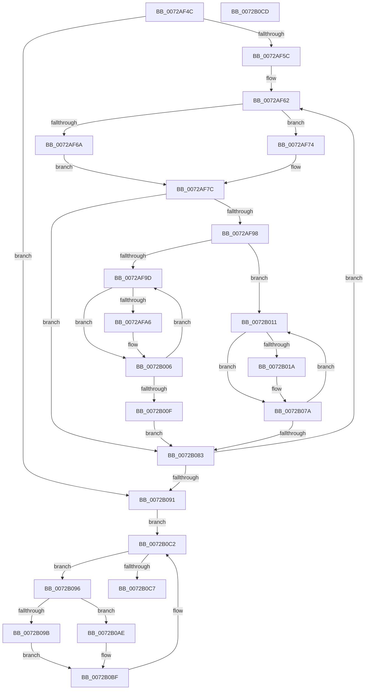

# IopSaveRestoreConfiguration

- RVA: `0x0072AF4C`–`0x0072B0CE` (길이 `386` bytes)
- VA: `0x000000014072AF4C`
- 실행 섹션: `PAGE`
- PDB 이름 있음: `예`; PDB Function 태그: `아니요`
- unwind 정보 RVA: `0x00071750`
- 디코드: `92`개 명령, `386/386` bytes 표시
- 미해석 바이트: `0` (있으면 어셈블리에 `.byte`로 보존)

> 이 문서는 커널 이미지의 기계어와 PDB 기호를 분석해 생성했습니다. 4번과 5번은 함수 원형과 자료형을 바이너리 사용 방식에서 추정한 C 해석이며 원본 소스 복구 결과는 아닙니다.

## 1. Dependencies

- 직접 호출 지점: **0**; 고유 호출 대상: **0**
- 직접 호출자로 확인된 함수: **1**
- RIP 상대 이미지 참조: **0**

### Outgoing calls
- 직접 디코드된 call 명령이 없습니다.

### Direct callers
- [PnpFindBestConfigurationWorker](PnpFindBestConfigurationWorker_function_0072B688.md) at `0x0072B73C`
- [PnpFindBestConfigurationWorker](PnpFindBestConfigurationWorker_function_0072B688.md) at `0x0072B7EA`

### Static image references
- 디코드된 RIP-relative 메모리 참조가 없습니다.

## 2. Other-region calls and transfers

- 다른 실행 섹션으로 향하는 call: **0**
- 별도 외부 분기/꼬리 이동을 확인하지 못했습니다.

## 3. Assembly (complete function range)

```asm
0072AF4C  48 89 5C 24 08                  mov qword ptr [rsp + 8], rbx
0072AF51  45 8A D9                        mov r11b, r9b
0072AF54  85 D2                           test edx, edx
0072AF56  0F 84 35 01 00 00               je 0x14072b091
0072AF5C  4C 8D 51 20                     lea r10, [rcx + 0x20]
0072AF60  8B DA                           mov ebx, edx
0072AF62  49 8B 02                        mov rax, qword ptr [r10]
0072AF65  45 84 DB                        test r11b, r11b
0072AF68  74 0A                           je 0x14072af74
0072AF6A  48 8B 48 10                     mov rcx, qword ptr [rax + 0x10]
0072AF6E  48 89 48 18                     mov qword ptr [rax + 0x18], rcx
0072AF72  EB 08                           jmp 0x14072af7c
0072AF74  48 8B 48 18                     mov rcx, qword ptr [rax + 0x18]
0072AF78  48 89 48 10                     mov qword ptr [rax + 0x10], rcx
0072AF7C  48 8B 09                        mov rcx, qword ptr [rcx]
0072AF7F  44 8B 49 14                     mov r9d, dword ptr [rcx + 0x14]
0072AF83  48 8D 51 18                     lea rdx, [rcx + 0x18]
0072AF87  49 83 C1 03                     add r9, 3
0072AF8B  4E 8D 0C C9                     lea r9, [rcx + r9*8]
0072AF8F  49 3B D1                        cmp rdx, r9
0072AF92  0F 83 EB 00 00 00               jae 0x14072b083
0072AF98  45 84 DB                        test r11b, r11b
0072AF9B  74 74                           je 0x14072b011
0072AF9D  48 8B 0A                        mov rcx, qword ptr [rdx]
0072AFA0  80 79 08 00                     cmp byte ptr [rcx + 8], 0
0072AFA4  74 60                           je 0x14072b006
0072AFA6  48 8B 49 20                     mov rcx, qword ptr [rcx + 0x20]
0072AFAA  0F 10 41 28                     movups xmm0, xmmword ptr [rcx + 0x28]
0072AFAE  8B 81 98 00 00 00               mov eax, dword ptr [rcx + 0x98]
0072AFB4  0F 10 49 38                     movups xmm1, xmmword ptr [rcx + 0x38]
0072AFB8  0F 11 81 A0 00 00 00            movups xmmword ptr [rcx + 0xa0], xmm0
0072AFBF  0F 10 41 48                     movups xmm0, xmmword ptr [rcx + 0x48]
0072AFC3  0F 11 89 B0 00 00 00            movups xmmword ptr [rcx + 0xb0], xmm1
0072AFCA  0F 10 49 58                     movups xmm1, xmmword ptr [rcx + 0x58]
0072AFCE  0F 11 81 C0 00 00 00            movups xmmword ptr [rcx + 0xc0], xmm0
0072AFD5  0F 10 41 68                     movups xmm0, xmmword ptr [rcx + 0x68]
0072AFD9  0F 11 89 D0 00 00 00            movups xmmword ptr [rcx + 0xd0], xmm1
0072AFE0  0F 10 49 78                     movups xmm1, xmmword ptr [rcx + 0x78]
0072AFE4  0F 11 81 E0 00 00 00            movups xmmword ptr [rcx + 0xe0], xmm0
0072AFEB  0F 10 81 88 00 00 00            movups xmm0, xmmword ptr [rcx + 0x88]
0072AFF2  0F 11 89 F0 00 00 00            movups xmmword ptr [rcx + 0xf0], xmm1
0072AFF9  0F 11 81 00 01 00 00            movups xmmword ptr [rcx + 0x100], xmm0
0072B000  89 81 10 01 00 00               mov dword ptr [rcx + 0x110], eax
0072B006  48 83 C2 08                     add rdx, 8
0072B00A  49 3B D1                        cmp rdx, r9
0072B00D  72 8E                           jb 0x14072af9d
0072B00F  EB 72                           jmp 0x14072b083
0072B011  48 8B 0A                        mov rcx, qword ptr [rdx]
0072B014  80 79 08 00                     cmp byte ptr [rcx + 8], 0
0072B018  74 60                           je 0x14072b07a
0072B01A  48 8B 49 20                     mov rcx, qword ptr [rcx + 0x20]
0072B01E  0F 10 81 A0 00 00 00            movups xmm0, xmmword ptr [rcx + 0xa0]
0072B025  8B 81 10 01 00 00               mov eax, dword ptr [rcx + 0x110]
0072B02B  0F 10 89 B0 00 00 00            movups xmm1, xmmword ptr [rcx + 0xb0]
0072B032  0F 11 41 28                     movups xmmword ptr [rcx + 0x28], xmm0
0072B036  0F 10 81 C0 00 00 00            movups xmm0, xmmword ptr [rcx + 0xc0]
0072B03D  0F 11 49 38                     movups xmmword ptr [rcx + 0x38], xmm1
0072B041  0F 10 89 D0 00 00 00            movups xmm1, xmmword ptr [rcx + 0xd0]
0072B048  0F 11 41 48                     movups xmmword ptr [rcx + 0x48], xmm0
0072B04C  0F 10 81 E0 00 00 00            movups xmm0, xmmword ptr [rcx + 0xe0]
0072B053  0F 11 49 58                     movups xmmword ptr [rcx + 0x58], xmm1
0072B057  0F 10 89 F0 00 00 00            movups xmm1, xmmword ptr [rcx + 0xf0]
0072B05E  0F 11 41 68                     movups xmmword ptr [rcx + 0x68], xmm0
0072B062  0F 10 81 00 01 00 00            movups xmm0, xmmword ptr [rcx + 0x100]
0072B069  0F 11 49 78                     movups xmmword ptr [rcx + 0x78], xmm1
0072B06D  0F 11 81 88 00 00 00            movups xmmword ptr [rcx + 0x88], xmm0
0072B074  89 81 98 00 00 00               mov dword ptr [rcx + 0x98], eax
0072B07A  48 83 C2 08                     add rdx, 8
0072B07E  49 3B D1                        cmp rdx, r9
0072B081  72 8E                           jb 0x14072b011
0072B083  49 83 C2 40                     add r10, 0x40
0072B087  48 83 EB 01                     sub rbx, 1
0072B08B  0F 85 D1 FE FF FF               jne 0x14072af62
0072B091  49 8B 00                        mov rax, qword ptr [r8]
0072B094  EB 2C                           jmp 0x14072b0c2
0072B096  45 84 DB                        test r11b, r11b
0072B099  74 13                           je 0x14072b0ae
0072B09B  0F 10 40 D0                     movups xmm0, xmmword ptr [rax - 0x30]
0072B09F  0F 10 08                        movups xmm1, xmmword ptr [rax]
0072B0A2  F3 0F 7F 40 E0                  movdqu xmmword ptr [rax - 0x20], xmm0
0072B0A7  F3 0F 7F 48 F0                  movdqu xmmword ptr [rax - 0x10], xmm1
0072B0AC  EB 11                           jmp 0x14072b0bf
0072B0AE  0F 10 40 E0                     movups xmm0, xmmword ptr [rax - 0x20]
0072B0B2  0F 10 48 F0                     movups xmm1, xmmword ptr [rax - 0x10]
0072B0B6  F3 0F 7F 40 D0                  movdqu xmmword ptr [rax - 0x30], xmm0
0072B0BB  F3 0F 7F 08                     movdqu xmmword ptr [rax], xmm1
0072B0BF  48 8B 00                        mov rax, qword ptr [rax]
0072B0C2  49 3B C0                        cmp rax, r8
0072B0C5  75 CF                           jne 0x14072b096
0072B0C7  48 8B 5C 24 08                  mov rbx, qword ptr [rsp + 8]
0072B0CC  C3                              ret
0072B0CD  CC                              int3
```

## 4. C-style interpretation (structured pseudocode)

```c
__int64 __fastcall IopSaveRestoreConfiguration(__int64 a1, int a2, __int64 a3, unsigned __int8 a4)
{
    __int64 result;
    __int64 v_r10;
    __int64 v_rbx;
    unsigned __int64 v_stack_p8;

    v_stack_p8 = v_rbx;
    if (a2 == 0) goto loc_0072B091;
loc_0072AF62:
    if (a4 == 0) goto loc_0072AF74;
    *(unsigned __int64 *)(*(unsigned __int64 *)(a1 + 32) + 24) = *(unsigned __int64 *)(*(unsigned __int64 *)(a1 + 32) + 16);
    goto loc_0072AF7C;
loc_0072AF74:
    *(unsigned __int64 *)(*(unsigned __int64 *)(a1 + 32) + 16) = *(unsigned __int64 *)(*(unsigned __int64 *)(a1 + 32) + 24);
loc_0072AF7C:
    a4 = ((unsigned int)(*(unsigned int *)(*(unsigned __int64 *)(*(unsigned __int64 *)(*(unsigned __int64 *)(a1 + 32) + 24)) + 20))) + (3);
    if ((*(unsigned __int64 *)(*(unsigned __int64 *)(*(unsigned __int64 *)(a1 + 32) + 24)) + 24) >= (*(unsigned __int64 *)(*(unsigned __int64 *)(*(unsigned __int64 *)(a1 + 32) + 24)) + a4 * 8)) goto loc_0072B083;
    if (a4 == 0) goto loc_0072B011;
loc_0072AF9D:
    result = *(unsigned __int64 *)(a1 + 32);
    if ((*(unsigned __int8 *)(*(unsigned __int64 *)(*(unsigned __int64 *)(*(unsigned __int64 *)(*(unsigned __int64 *)(a1 + 32) + 24)) + 24) + 8)) != 0) {
        a1 = *(unsigned __int64 *)(*(unsigned __int64 *)(*(unsigned __int64 *)(*(unsigned __int64 *)(*(unsigned __int64 *)(a1 + 32) + 24)) + 24) + 32);
        result = *(unsigned int *)(a1 + 152);
        *(unsigned __int64 *)(a1 + 160) = v_xmm0;
        *(unsigned __int64 *)(a1 + 176) = v_xmm1;
        *(unsigned __int64 *)(a1 + 192) = v_xmm0;
        *(unsigned __int64 *)(a1 + 208) = v_xmm1;
        *(unsigned __int64 *)(a1 + 224) = v_xmm0;
        *(unsigned __int64 *)(a1 + 240) = v_xmm1;
        *(unsigned __int64 *)(a1 + 256) = v_xmm0;
        *(unsigned int *)(a1 + 272) = (unsigned int)(result);
    }
    a2 = (*(unsigned __int64 *)(*(unsigned __int64 *)(*(unsigned __int64 *)(a1 + 32) + 24)) + 24) + (8);
    if (a2 < (*(unsigned __int64 *)(*(unsigned __int64 *)(*(unsigned __int64 *)(a1 + 32) + 24)) + a4 * 8)) goto loc_0072AF9D;
    goto loc_0072B083;
loc_0072B011:
    if ((*(unsigned __int8 *)(*(unsigned __int64 *)(a2) + 8)) != 0) {
        a1 = *(unsigned __int64 *)(*(unsigned __int64 *)(a2) + 32);
        result = *(unsigned int *)(a1 + 272);
        *(unsigned __int64 *)(a1 + 40) = v_xmm0;
        *(unsigned __int64 *)(a1 + 56) = v_xmm1;
        *(unsigned __int64 *)(a1 + 72) = v_xmm0;
        *(unsigned __int64 *)(a1 + 88) = v_xmm1;
        *(unsigned __int64 *)(a1 + 104) = v_xmm0;
        *(unsigned __int64 *)(a1 + 120) = v_xmm1;
        *(unsigned __int64 *)(a1 + 136) = v_xmm0;
        *(unsigned int *)(a1 + 152) = (unsigned int)(result);
    }
    a2 = (a2) + (8);
    if (a2 < (*(unsigned __int64 *)(*(unsigned __int64 *)(*(unsigned __int64 *)(a1 + 32) + 24)) + a4 * 8)) goto loc_0072B011;
loc_0072B083:
    v_r10 = (a1 + 32) + (64);
    v_rbx = ((unsigned int)(a2)) - (1);
    if (condition_is_not_equal) goto loc_0072AF62;
loc_0072B091:
    goto loc_0072B0C2;
loc_0072B096:
    if (a4 == 0) goto loc_0072B0AE;
    *(unsigned __int64 *)(*(unsigned __int64 *)(a3) - 32) = v_xmm0;
    *(unsigned __int64 *)(*(unsigned __int64 *)(a3) - 16) = v_xmm1;
    goto loc_0072B0BF;
loc_0072B0AE:
    *(unsigned __int64 *)(*(unsigned __int64 *)(a3) - 48) = v_xmm0;
    *(unsigned __int64 *)(*(unsigned __int64 *)(a3)) = v_xmm1;
loc_0072B0BF:
loc_0072B0C2:
    if ((*(unsigned __int64 *)(*(unsigned __int64 *)(a3))) != a3) goto loc_0072B096;
    return *(unsigned __int64 *)(*(unsigned __int64 *)(a3));
}
```

## 5. (Beta) C Style

```c
int64_t IopSaveRestoreConfiguration(void *Arg1, int32_t Arg2, void *Arg3, uint8_t Arg4)
{
    uint8_t *arg1 = (uint8_t *)Arg1;
    uint8_t *arg3 = (uint8_t *)Arg3;

    int64_t result;
    int64_t local_r10;
    int64_t local_rbx;
    uint64_t v_stack_p8;

    v_stack_p8 = local_rbx;
    if (Arg2 == 0) goto loc_0072B091;
loc_0072AF62:
    if (Arg4 == 0) goto loc_0072AF74;
    *(uint64_t *)(*(uint64_t *)(arg1 + 0x20) + 0x18) = *(uint64_t *)(*(uint64_t *)(arg1 + 0x20) + 0x10);
    goto loc_0072AF7C;
loc_0072AF74:
    *(uint64_t *)(*(uint64_t *)(arg1 + 0x20) + 0x10) = *(uint64_t *)(*(uint64_t *)(arg1 + 0x20) + 0x18);
loc_0072AF7C:
    Arg4 = ((uint32_t)(*(uint32_t *)(*(uint64_t *)(*(uint64_t *)(*(uint64_t *)(arg1 + 0x20) + 0x18)) + 0x14))) + (3);
    if ((*(uint64_t *)(*(uint64_t *)(*(uint64_t *)(arg1 + 0x20) + 0x18)) + 24) >= (*(uint64_t *)(*(uint64_t *)(*(uint64_t *)(arg1 + 0x20) + 0x18)) + Arg4 * 8)) goto loc_0072B083;
    if (Arg4 == 0) goto loc_0072B011;
loc_0072AF9D:
    result = *(uint64_t *)(arg1 + 0x20);
    if ((*(uint8_t *)(*(uint64_t *)(*(uint64_t *)(*(uint64_t *)(*(uint64_t *)(arg1 + 0x20) + 0x18)) + 0x18) + 0x8)) != 0) {
        Arg1 = *(uint64_t *)(*(uint64_t *)(*(uint64_t *)(*(uint64_t *)(*(uint64_t *)(arg1 + 0x20) + 0x18)) + 0x18) + 0x20);
        result = *(uint32_t *)(arg1 + 0x98);
        *(uint64_t *)(arg1 + 0xA0) = v_xmm0;
        *(uint64_t *)(arg1 + 0xB0) = v_xmm1;
        *(uint64_t *)(arg1 + 0xC0) = v_xmm0;
        *(uint64_t *)(arg1 + 0xD0) = v_xmm1;
        *(uint64_t *)(arg1 + 0xE0) = v_xmm0;
        *(uint64_t *)(arg1 + 0xF0) = v_xmm1;
        *(uint64_t *)(arg1 + 0x100) = v_xmm0;
        *(uint32_t *)(arg1 + 0x110) = (uint32_t)(result);
    }
    Arg2 = (*(uint64_t *)(*(uint64_t *)(*(uint64_t *)(arg1 + 0x20) + 0x18)) + 24) + (8);
    if (Arg2 < (*(uint64_t *)(*(uint64_t *)(*(uint64_t *)(arg1 + 0x20) + 0x18)) + Arg4 * 8)) goto loc_0072AF9D;
    goto loc_0072B083;
loc_0072B011:
    if ((*(uint8_t *)(*(uint64_t *)(Arg2) + 0x8)) != 0) {
        Arg1 = *(uint64_t *)(*(uint64_t *)(Arg2) + 0x20);
        result = *(uint32_t *)(arg1 + 0x110);
        *(uint64_t *)(arg1 + 0x28) = v_xmm0;
        *(uint64_t *)(arg1 + 0x38) = v_xmm1;
        *(uint64_t *)(arg1 + 0x48) = v_xmm0;
        *(uint64_t *)(arg1 + 0x58) = v_xmm1;
        *(uint64_t *)(arg1 + 0x68) = v_xmm0;
        *(uint64_t *)(arg1 + 0x78) = v_xmm1;
        *(uint64_t *)(arg1 + 0x88) = v_xmm0;
        *(uint32_t *)(arg1 + 0x98) = (uint32_t)(result);
    }
    Arg2 = (Arg2) + (8);
    if (Arg2 < (*(uint64_t *)(*(uint64_t *)(*(uint64_t *)(arg1 + 0x20) + 0x18)) + Arg4 * 8)) goto loc_0072B011;
loc_0072B083:
    local_r10 = (Arg1 + 32) + (64);
    local_rbx = ((uint32_t)(Arg2)) - (1);
    if (condition_is_not_equal) goto loc_0072AF62;
loc_0072B091:
    goto loc_0072B0C2;
loc_0072B096:
    if (Arg4 == 0) goto loc_0072B0AE;
    *(uint64_t *)(*(uint64_t *)(arg3) - 0x20) = v_xmm0;
    *(uint64_t *)(*(uint64_t *)(arg3) - 0x10) = v_xmm1;
    goto loc_0072B0BF;
loc_0072B0AE:
    *(uint64_t *)(*(uint64_t *)(arg3) - 0x30) = v_xmm0;
    *(uint64_t *)(*(uint64_t *)(arg3)) = v_xmm1;
loc_0072B0BF:
loc_0072B0C2:
    if ((*(uint64_t *)(*(uint64_t *)(arg3))) != Arg3) goto loc_0072B096;
    return *(uint64_t *)(*(uint64_t *)(arg3));
}
```

### 관측된 메모리 오프셋

구조체 형식이 확인되지 않은 접근은 인자 기준의 오프셋으로만 기록했습니다.

| 기준 인자 | 오프셋 표현 | 폭 (bit) | 접근 |
|---|---:|---:|---|
| `Arg1` | `+ 0x0` | `64` | `R` |
| `Arg1` | `+ 0x20` | `64` | `R` |
| `Arg3` | `+ 0x0` | `64` | `R` |

## 6. Execution-region graph

[열기: 2D/3D 그래프와 함수 탐색 컨트롤 패널](../../../control-panel.html?section=page&rva=0x0072AF4C&view=graph)

- 2D 그래프는 위에서 아래로 흐르고, 3D 그래프는 빈 공간을 드래그해 회전합니다. Shift+드래그는 이동, 휠은 확대·축소, 함수 노드 선택은 대상 보고서 이동입니다.

### Static fallback


