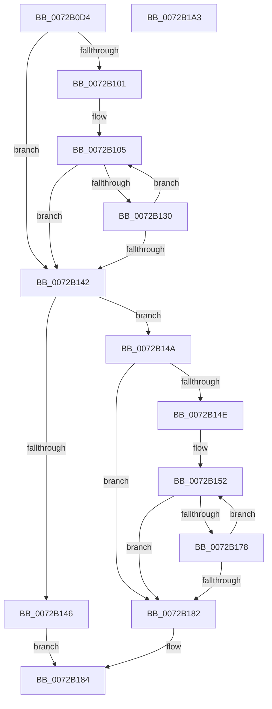

# IopSelectNextConfiguration

- RVA: `0x0072B0D4`–`0x0072B1A4` (길이 `208` bytes)
- VA: `0x000000014072B0D4`
- 실행 섹션: `PAGE`
- PDB 이름 있음: `예`; PDB Function 태그: `아니요`
- unwind 정보 RVA: `0x0005FEF8`
- 디코드: `68`개 명령, `208/208` bytes 표시
- 미해석 바이트: `0` (있으면 어셈블리에 `.byte`로 보존)

> 이 문서는 커널 이미지의 기계어와 PDB 기호를 분석해 생성했습니다. 4번과 5번은 함수 원형과 자료형을 바이너리 사용 방식에서 추정한 C 해석이며 원본 소스 복구 결과는 아닙니다.

## 1. Dependencies

- 직접 호출 지점: **2**; 고유 호출 대상: **1**
- 직접 호출자로 확인된 함수: **1**
- RIP 상대 이미지 참조: **0**

### Outgoing calls
- `0x0072B11C` → [IopAddRemoveReqDescs](../AB/IopAddRemoveReqDescs_function_00AB3FD0.md) (function, `0x00AB3FD0`)
- `0x0072B169` → [IopAddRemoveReqDescs](../AB/IopAddRemoveReqDescs_function_00AB3FD0.md) (function, `0x00AB3FD0`)

### Direct callers
- [PnpFindBestConfigurationWorker](PnpFindBestConfigurationWorker_function_0072B688.md) at `0x0072B770`

### Static image references
- 디코드된 RIP-relative 메모리 참조가 없습니다.

## 2. Other-region calls and transfers

- 다른 실행 섹션으로 향하는 call: **0**
- 별도 외부 분기/꼬리 이동을 확인하지 못했습니다.

## 3. Assembly (complete function range)

```asm
0072B0D4  48 8B C4                        mov rax, rsp
0072B0D7  48 89 58 08                     mov qword ptr [rax + 8], rbx
0072B0DB  48 89 68 10                     mov qword ptr [rax + 0x10], rbp
0072B0DF  48 89 70 18                     mov qword ptr [rax + 0x18], rsi
0072B0E3  48 89 78 20                     mov qword ptr [rax + 0x20], rdi
0072B0E7  41 54                           push r12
0072B0E9  41 56                           push r14
0072B0EB  41 57                           push r15
0072B0ED  48 83 EC 20                     sub rsp, 0x20
0072B0F1  33 FF                           xor edi, edi
0072B0F3  4D 8B E0                        mov r12, r8
0072B0F6  8B F2                           mov esi, edx
0072B0F8  4C 8B F9                        mov r15, rcx
0072B0FB  8B DF                           mov ebx, edi
0072B0FD  85 D2                           test edx, edx
0072B0FF  74 41                           je 0x14072b142
0072B101  4C 8D 71 20                     lea r14, [rcx + 0x20]
0072B105  49 8B 2E                        mov rbp, qword ptr [r14]
0072B108  45 33 C9                        xor r9d, r9d
0072B10B  45 33 C0                        xor r8d, r8d
0072B10E  48 8B 45 10                     mov rax, qword ptr [rbp + 0x10]
0072B112  48 8B 10                        mov rdx, qword ptr [rax]
0072B115  48 8D 4A 18                     lea rcx, [rdx + 0x18]
0072B119  8B 52 14                        mov edx, dword ptr [rdx + 0x14]
0072B11C  E8 AF 8E 38 00                  call 0x140ab3fd0
0072B121  48 83 45 10 08                  add qword ptr [rbp + 0x10], 8
0072B126  48 8B 45 10                     mov rax, qword ptr [rbp + 0x10]
0072B12A  48 3B 45 18                     cmp rax, qword ptr [rbp + 0x18]
0072B12E  72 12                           jb 0x14072b142
0072B130  FF C3                           inc ebx
0072B132  48 8D 45 28                     lea rax, [rbp + 0x28]
0072B136  49 83 C6 40                     add r14, 0x40
0072B13A  48 89 45 10                     mov qword ptr [rbp + 0x10], rax
0072B13E  3B DE                           cmp ebx, esi
0072B140  72 C3                           jb 0x14072b105
0072B142  3B DE                           cmp ebx, esi
0072B144  75 04                           jne 0x14072b14a
0072B146  32 C0                           xor al, al
0072B148  EB 3A                           jmp 0x14072b184
0072B14A  85 F6                           test esi, esi
0072B14C  74 34                           je 0x14072b182
0072B14E  4D 8D 77 20                     lea r14, [r15 + 0x20]
0072B152  49 8B 1E                        mov rbx, qword ptr [r14]
0072B155  41 B1 01                        mov r9b, 1
0072B158  4D 8B C4                        mov r8, r12
0072B15B  48 8B 43 10                     mov rax, qword ptr [rbx + 0x10]
0072B15F  48 8B 10                        mov rdx, qword ptr [rax]
0072B162  48 8D 4A 18                     lea rcx, [rdx + 0x18]
0072B166  8B 52 14                        mov edx, dword ptr [rdx + 0x14]
0072B169  E8 62 8E 38 00                  call 0x140ab3fd0
0072B16E  48 8D 4B 28                     lea rcx, [rbx + 0x28]
0072B172  48 39 4B 10                     cmp qword ptr [rbx + 0x10], rcx
0072B176  75 0A                           jne 0x14072b182
0072B178  FF C7                           inc edi
0072B17A  49 83 C6 40                     add r14, 0x40
0072B17E  3B FE                           cmp edi, esi
0072B180  72 D0                           jb 0x14072b152
0072B182  B0 01                           mov al, 1
0072B184  48 8B 5C 24 40                  mov rbx, qword ptr [rsp + 0x40]
0072B189  48 8B 6C 24 48                  mov rbp, qword ptr [rsp + 0x48]
0072B18E  48 8B 74 24 50                  mov rsi, qword ptr [rsp + 0x50]
0072B193  48 8B 7C 24 58                  mov rdi, qword ptr [rsp + 0x58]
0072B198  48 83 C4 20                     add rsp, 0x20
0072B19C  41 5F                           pop r15
0072B19E  41 5E                           pop r14
0072B1A0  41 5C                           pop r12
0072B1A2  C3                              ret
0072B1A3  CC                              int3
```

## 4. C-style interpretation (structured pseudocode)

```c
__int64 __fastcall IopSelectNextConfiguration(__int64 a1, int a2, __int64 a3, int a4)
{
    __int64 result;
    __int64 v_r14;
    __int64 v_rbx;
    __int64 v_rdi;
    __int64 v_rsp;
    unsigned __int64 v_stack_p10;
    unsigned __int64 v_stack_p18;
    unsigned __int64 v_stack_p20;
    unsigned __int64 v_stack_p8;

    *(unsigned __int64 *)(v_rsp + 8) = v_rbx;
    *(unsigned __int64 *)(v_rsp + 16) = v_rbp;
    *(unsigned __int64 *)(v_rsp + 24) = v_rsi;
    *(unsigned __int64 *)(v_rsp + 32) = v_rdi;
    v_rsp = (v_rsp) - (32);
    v_rdi = 0;
    if (a2 == 0) goto loc_0072B142;
loc_0072B105:
    a4 = 0;
    a3 = 0;
    result = IopAddRemoveReqDescs(*(unsigned __int64 *)(*(unsigned __int64 *)(*(unsigned __int64 *)(a1 + 32) + 16)) + 24, (unsigned int)(*(unsigned int *)(*(unsigned __int64 *)(*(unsigned __int64 *)(*(unsigned __int64 *)(a1 + 32) + 16)) + 20)), a3, a4);
    if ((*(unsigned __int64 *)(*(unsigned __int64 *)(a1 + 32) + 16)) < (*(unsigned __int64 *)(*(unsigned __int64 *)(a1 + 32) + 24))) goto loc_0072B142;
    v_rbx = (unsigned int)((0) + 1);
    v_r14 = (a1 + 32) + (64);
    *(unsigned __int64 *)(*(unsigned __int64 *)(a1 + 32) + 16) = *(unsigned __int64 *)(a1 + 32) + 40;
    if (((unsigned int)(v_rbx)) < ((unsigned int)((unsigned int)(a2)))) goto loc_0072B105;
loc_0072B142:
    if (((unsigned int)(v_rbx)) != ((unsigned int)((unsigned int)(a2)))) goto loc_0072B14A;
    result = 0;
    goto loc_0072B184;
loc_0072B14A:
    if ((unsigned int)((unsigned int)(a2)) == 0) goto loc_0072B182;
loc_0072B152:
    result = IopAddRemoveReqDescs(*(unsigned __int64 *)(*(unsigned __int64 *)(*(unsigned __int64 *)(a1 + 32) + 16)) + 24, (unsigned int)(*(unsigned int *)(*(unsigned __int64 *)(*(unsigned __int64 *)(*(unsigned __int64 *)(a1 + 32) + 16)) + 20)), 0, 1);
    if ((*(unsigned __int64 *)(*(unsigned __int64 *)(a1 + 32) + 16)) != (*(unsigned __int64 *)(a1 + 32) + 40)) goto loc_0072B182;
    v_rdi = (unsigned int)((v_rdi) + 1);
    v_r14 = (a1 + 32) + (64);
    if (((unsigned int)(v_rdi)) < ((unsigned int)((unsigned int)(a2)))) goto loc_0072B152;
loc_0072B182:
loc_0072B184:
    v_rsp = (v_rsp) + (32);
    return 1;
}
```

## 5. (Beta) C Style

```c
int64_t IopSelectNextConfiguration(void *Arg1, int32_t Arg2, int64_t Arg3, int32_t Arg4)
{
    uint8_t *arg1 = (uint8_t *)Arg1;

    int64_t result;
    int64_t local_r14;
    int64_t local_rbx;
    int64_t local_rdi;
    int64_t local_rsp;
    uint64_t v_stack_p10;
    uint64_t v_stack_p18;
    uint64_t v_stack_p20;
    uint64_t v_stack_p8;

    *(uint64_t *)(local_rsp + 0x8) = local_rbx;
    *(uint64_t *)(local_rsp + 0x10) = local_rbp;
    *(uint64_t *)(local_rsp + 0x18) = local_rsi;
    *(uint64_t *)(local_rsp + 0x20) = local_rdi;
    local_rsp = (local_rsp) - (32);
    local_rdi = 0;
    if (Arg2 == 0) goto loc_0072B142;
loc_0072B105:
    Arg4 = 0;
    Arg3 = 0;
    result = IopAddRemoveReqDescs(*(uint64_t *)(*(uint64_t *)(*(uint64_t *)(arg1 + 0x20) + 0x10)) + 24, (uint32_t)(*(uint32_t *)(*(uint64_t *)(*(uint64_t *)(*(uint64_t *)(arg1 + 0x20) + 0x10)) + 0x14)), Arg3, Arg4);
    if ((*(uint64_t *)(*(uint64_t *)(arg1 + 0x20) + 0x10)) < (*(uint64_t *)(*(uint64_t *)(arg1 + 0x20) + 0x18))) goto loc_0072B142;
    local_rbx = (uint32_t)((0) + 1);
    local_r14 = (Arg1 + 32) + (64);
    *(uint64_t *)(*(uint64_t *)(arg1 + 0x20) + 0x10) = *(uint64_t *)(arg1 + 0x20) + 40;
    if (((uint32_t)(local_rbx)) < ((uint32_t)((uint32_t)(Arg2)))) goto loc_0072B105;
loc_0072B142:
    if (((uint32_t)(local_rbx)) != ((uint32_t)((uint32_t)(Arg2)))) goto loc_0072B14A;
    result = 0;
    goto loc_0072B184;
loc_0072B14A:
    if ((uint32_t)((uint32_t)(Arg2)) == 0) goto loc_0072B182;
loc_0072B152:
    result = IopAddRemoveReqDescs(*(uint64_t *)(*(uint64_t *)(*(uint64_t *)(arg1 + 0x20) + 0x10)) + 24, (uint32_t)(*(uint32_t *)(*(uint64_t *)(*(uint64_t *)(*(uint64_t *)(arg1 + 0x20) + 0x10)) + 0x14)), 0, 1);
    if ((*(uint64_t *)(*(uint64_t *)(arg1 + 0x20) + 0x10)) != (*(uint64_t *)(arg1 + 0x20) + 40)) goto loc_0072B182;
    local_rdi = (uint32_t)((local_rdi) + 1);
    local_r14 = (Arg1 + 32) + (64);
    if (((uint32_t)(local_rdi)) < ((uint32_t)((uint32_t)(Arg2)))) goto loc_0072B152;
loc_0072B182:
loc_0072B184:
    local_rsp = (local_rsp) + (32);
    return 1;
}
```

### 관측된 메모리 오프셋

구조체 형식이 확인되지 않은 접근은 인자 기준의 오프셋으로만 기록했습니다.

| 기준 인자 | 오프셋 표현 | 폭 (bit) | 접근 |
|---|---:|---:|---|
| `Arg1` | `+ 0x0` | `64` | `R` |
| `Arg1` | `+ 0x20` | `64` | `R` |

## 6. Execution-region graph

[열기: 2D/3D 그래프와 함수 탐색 컨트롤 패널](../../../control-panel.html?section=page&rva=0x0072B0D4&view=graph)

- 2D 그래프는 위에서 아래로 흐르고, 3D 그래프는 빈 공간을 드래그해 회전합니다. Shift+드래그는 이동, 휠은 확대·축소, 함수 노드 선택은 대상 보고서 이동입니다.

### Static fallback


