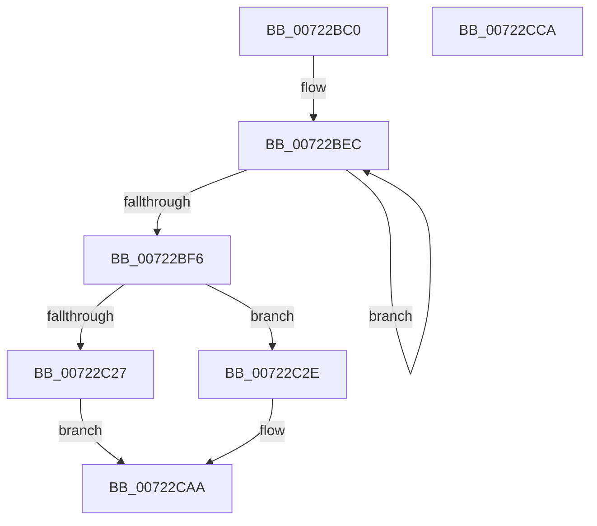

# IopSetEnvironmentVariableSysEnv

- RVA: `0x00722BC0`–`0x00722CCB` (길이 `267` bytes)
- VA: `0x0000000140722BC0`
- 실행 섹션: `PAGE`
- PDB 이름 있음: `예`; PDB Function 태그: `아니요`
- unwind 정보 RVA: `0x000C3AF8`
- 디코드: `74`개 명령, `267/267` bytes 표시
- 미해석 바이트: `0` (있으면 어셈블리에 `.byte`로 보존)

> 이 문서는 커널 이미지의 기계어와 PDB 기호를 분석해 생성했습니다. 4번과 5번은 함수 원형과 자료형을 바이너리 사용 방식에서 추정한 C 해석이며 원본 소스 복구 결과는 아닙니다.

## 1. Dependencies

- 직접 호출 지점: **5**; 고유 호출 대상: **4**
- 직접 호출자로 확인된 함수: **0**
- RIP 상대 이미지 참조: **0**

### Outgoing calls
- `0x00722C1A` → [ExAllocatePool2](../../poolcode/B8/ExAllocatePool2_function_00B820F0.md) (function, `0x00B820F0`)
- `0x00722C4D` → [memcpy](../../text/6C/memcpy_function_006C6840.md) (function, `0x006C6840`)
- `0x00722C64` → [memcpy](../../text/6C/memcpy_function_006C6840.md) (function, `0x006C6840`)
- `0x00722C99` → [IopIssueSystemEnvironmentRequest](IopIssueSystemEnvironmentRequest_function_00722878.md) (function, `0x00722878`)
- `0x00722CA5` → [ExFreePoolWithTag](../../poolcode/B8/ExFreePoolWithTag_function_00B82870.md) (function, `0x00B82870`)

### Direct callers
- 이 함수 시작 RVA로 연결되는 직접 call은 확인되지 않았습니다. 간접 호출은 완전히 역산할 수 없습니다.

### Static image references
- 디코드된 RIP-relative 메모리 참조가 없습니다.

## 2. Other-region calls and transfers

- 다른 실행 섹션으로 향하는 call: **4**
  - `0x00722C1A` → [ExAllocatePool2](../../poolcode/B8/ExAllocatePool2_function_00B820F0.md) (`PAGE` → `POOLCODE`)
  - `0x00722C4D` → [memcpy](../../text/6C/memcpy_function_006C6840.md) (`PAGE` → `.text`)
  - `0x00722C64` → [memcpy](../../text/6C/memcpy_function_006C6840.md) (`PAGE` → `.text`)
  - `0x00722CA5` → [ExFreePoolWithTag](../../poolcode/B8/ExFreePoolWithTag_function_00B82870.md) (`PAGE` → `POOLCODE`)
- 별도 외부 분기/꼬리 이동을 확인하지 못했습니다.

## 3. Assembly (complete function range)

```asm
00722BC0  48 89 5C 24 08                  mov qword ptr [rsp + 8], rbx
00722BC5  48 89 6C 24 10                  mov qword ptr [rsp + 0x10], rbp
00722BCA  48 89 74 24 18                  mov qword ptr [rsp + 0x18], rsi
00722BCF  57                              push rdi
00722BD0  41 54                           push r12
00722BD2  41 55                           push r13
00722BD4  41 56                           push r14
00722BD6  41 57                           push r15
00722BD8  48 83 EC 50                     sub rsp, 0x50
00722BDC  48 83 C8 FF                     or rax, 0xffffffffffffffff
00722BE0  49 8B D9                        mov rbx, r9
00722BE3  45 33 ED                        xor r13d, r13d
00722BE6  49 8B F0                        mov rsi, r8
00722BE9  4C 8B E2                        mov r12, rdx
00722BEC  48 FF C0                        inc rax
00722BEF  66 45 39 2C 40                  cmp word ptr [r8 + rax*2], r13w
00722BF4  75 F6                           jne 0x140722bec
00722BF6  44 8B B4 24 A8 00 00 00         mov r14d, dword ptr [rsp + 0xa8]
00722BFE  8D 2C 45 02 00 00 00            lea ebp, [rax*2 + 2]
00722C05  B9 00 01 00 00                  mov ecx, 0x100
00722C0A  41 B8 49 6F 53 79               mov r8d, 0x79536f49
00722C10  45 8D 7E 20                     lea r15d, [r14 + 0x20]
00722C14  44 03 FD                        add r15d, ebp
00722C17  41 8B D7                        mov edx, r15d
00722C1A  E8 D1 F4 45 00                  call 0x140b820f0
00722C1F  48 8B F8                        mov rdi, rax
00722C22  48 85 C0                        test rax, rax
00722C25  75 07                           jne 0x140722c2e
00722C27  BB 9A 00 00 C0                  mov ebx, 0xc000009a
00722C2C  EB 7C                           jmp 0x140722caa
00722C2E  0F 10 03                        movups xmm0, xmmword ptr [rbx]
00722C31  48 8D 4F 20                     lea rcx, [rdi + 0x20]
00722C35  44 8B C5                        mov r8d, ebp
00722C38  48 8B D6                        mov rdx, rsi
00722C3B  44 89 2F                        mov dword ptr [rdi], r13d
00722C3E  F3 0F 7F 40 10                  movdqu xmmword ptr [rax + 0x10], xmm0
00722C43  8B 84 24 B0 00 00 00            mov eax, dword ptr [rsp + 0xb0]
00722C4A  89 47 0C                        mov dword ptr [rdi + 0xc], eax
00722C4D  E8 EE 3B FA FF                  call 0x1406c6840
00722C52  48 8B 94 24 A0 00 00 00         mov rdx, qword ptr [rsp + 0xa0]
00722C5A  48 8D 4D 20                     lea rcx, [rbp + 0x20]
00722C5E  48 03 CF                        add rcx, rdi
00722C61  4D 8B C6                        mov r8, r14
00722C64  E8 D7 3B FA FF                  call 0x1406c6840
00722C69  4C 89 6C 24 40                  mov qword ptr [rsp + 0x40], r13
00722C6E  8D 45 20                        lea eax, [rbp + 0x20]
00722C71  44 89 6C 24 38                  mov dword ptr [rsp + 0x38], r13d
00722C76  4D 8B CC                        mov r9, r12
00722C79  4C 89 6C 24 30                  mov qword ptr [rsp + 0x30], r13
00722C7E  45 33 C0                        xor r8d, r8d
00722C81  44 89 7C 24 28                  mov dword ptr [rsp + 0x28], r15d
00722C86  B2 01                           mov dl, 1
00722C88  B9 08 00 52 00                  mov ecx, 0x520008
00722C8D  48 89 7C 24 20                  mov qword ptr [rsp + 0x20], rdi
00722C92  89 47 04                        mov dword ptr [rdi + 4], eax
00722C95  44 89 77 08                     mov dword ptr [rdi + 8], r14d
00722C99  E8 DA FB FF FF                  call 0x140722878
00722C9E  8B D8                           mov ebx, eax
00722CA0  33 D2                           xor edx, edx
00722CA2  48 8B CF                        mov rcx, rdi
00722CA5  E8 C6 FB 45 00                  call 0x140b82870
00722CAA  4C 8D 5C 24 50                  lea r11, [rsp + 0x50]
00722CAF  8B C3                           mov eax, ebx
00722CB1  49 8B 5B 30                     mov rbx, qword ptr [r11 + 0x30]
00722CB5  49 8B 6B 38                     mov rbp, qword ptr [r11 + 0x38]
00722CB9  49 8B 73 40                     mov rsi, qword ptr [r11 + 0x40]
00722CBD  49 8B E3                        mov rsp, r11
00722CC0  41 5F                           pop r15
00722CC2  41 5E                           pop r14
00722CC4  41 5D                           pop r13
00722CC6  41 5C                           pop r12
00722CC8  5F                              pop rdi
00722CC9  C3                              ret
00722CCA  CC                              int3
```

## 4. C-style interpretation (structured pseudocode)

```c
__int64 __fastcall IopSetEnvironmentVariableSysEnv(__int64 a1, __int64 a2, __int64 a3, __int64 a4, __int64 a5, unsigned int a6, unsigned int a7)
{
    __int64 result;
    __int64 v_r13;
    __int64 v_r15;
    __int64 v_rsp;
    unsigned __int64 v_stack_m28;
    unsigned __int64 v_stack_m38;
    unsigned int v_stack_m40;
    unsigned __int64 v_stack_m48;
    unsigned int v_stack_m50;
    unsigned __int64 v_stack_m58;
    unsigned __int64 v_stack_p10;
    unsigned __int64 v_stack_p18;
    unsigned __int64 v_stack_p8;

    v_stack_p8 = v_rbx;
    v_stack_p10 = v_rbp;
    v_stack_p18 = v_rsi;
    v_rsp = (v_rsp) - (80);
    result = (result) | (-1);
    v_r13 = 0;
loc_00722BEC:
    result = (result) + 1;
    if ((*(unsigned __int16 *)(a3 + result * 2)) != 0) goto loc_00722BEC;
    v_r15 = (unsigned int)(((unsigned int)(a6) + 32) + ((unsigned int)(result * 2 + 2)));
    result = ExAllocatePool2(256, (unsigned int)((unsigned int)(v_r15)), (unsigned int)(0x79536F49ULL), a4);
    if (result != 0) goto loc_00722C2E;
    goto loc_00722CAA;
loc_00722C2E:
    *(unsigned int *)(result) = 0;
    *(unsigned __int64 *)(result + 16) = v_xmm0;
    *(unsigned int *)(result + 12) = (unsigned int)((unsigned int)(a7));
    result = memcpy(result + 32, a3, (unsigned int)((unsigned int)(result * 2 + 2)), a4);
    a1 = (result * 2 + 2 + 32) + (result);
    result = memcpy(a1, a5, (unsigned int)(a6), a4);
    v_stack_m38 = 0;
    v_stack_m40 = 0;
    v_stack_m48 = 0;
    a3 = 0;
    v_stack_m50 = (unsigned int)(v_r15);
    v_stack_m58 = result;
    *(unsigned int *)(result + 4) = (unsigned int)(result * 2 + 2 + 32);
    *(unsigned int *)(result + 8) = (unsigned int)((unsigned int)(a6));
    result = IopIssueSystemEnvironmentRequest((unsigned int)(0x520008ULL), 1, a3, a2);
    a2 = 0;
    result = ExFreePoolWithTag(result, a2, a3, a2);
loc_00722CAA:
    return (unsigned int)((unsigned int)((unsigned int)((unsigned int)(result))));
}
```

## 5. (Beta) C Style

```c
int64_t IopSetEnvironmentVariableSysEnv(int64_t Arg1, int64_t Arg2, void *Arg3, void *Arg4, int64_t Arg5, void *Arg6, uint32_t Arg7)
{
    uint8_t *arg3 = (uint8_t *)Arg3;
    uint8_t *arg4 = (uint8_t *)Arg4;
    uint8_t *arg6 = (uint8_t *)Arg6;

    int64_t result;
    int64_t local_r13;
    int64_t local_r15;
    int64_t local_rsp;
    uint64_t v_stack_m28;
    uint64_t v_stack_m38;
    uint32_t v_stack_m40;
    uint64_t v_stack_m48;
    uint32_t v_stack_m50;
    uint64_t v_stack_m58;
    uint64_t v_stack_p10;
    uint64_t v_stack_p18;
    uint64_t v_stack_p8;

    v_stack_p8 = local_rbx;
    v_stack_p10 = local_rbp;
    v_stack_p18 = local_rsi;
    local_rsp = (local_rsp) - (80);
    result = (result) | (-1);
    local_r13 = 0;
loc_00722BEC:
    result = (result) + 1;
    if ((*(uint16_t *)(arg3 + result * 2)) != 0) goto loc_00722BEC;
    local_r15 = (uint32_t)(((uint32_t)(Arg6) + 32) + ((uint32_t)(result * 2 + 2)));
    result = ExAllocatePool2(256, (uint32_t)((uint32_t)(local_r15)), (uint32_t)(0x79536F49ULL), Arg4);
    if (result != 0) goto loc_00722C2E;
    goto loc_00722CAA;
loc_00722C2E:
    *(uint32_t *)(result) = 0;
    *(uint64_t *)(result + 0x10) = v_xmm0;
    *(uint32_t *)(result + 0xC) = (uint32_t)((uint32_t)(Arg7));
    result = memcpy(result + 32, Arg3, (uint32_t)((uint32_t)(result * 2 + 2)), Arg4);
    Arg1 = (result * 2 + 2 + 32) + (result);
    result = memcpy(Arg1, Arg5, (uint32_t)(Arg6), Arg4);
    v_stack_m38 = 0;
    v_stack_m40 = 0;
    v_stack_m48 = 0;
    Arg3 = 0;
    v_stack_m50 = (uint32_t)(local_r15);
    v_stack_m58 = result;
    *(uint32_t *)(result + 0x4) = (uint32_t)(result * 2 + 2 + 32);
    *(uint32_t *)(result + 0x8) = (uint32_t)((uint32_t)(Arg6));
    result = IopIssueSystemEnvironmentRequest((uint32_t)(0x520008ULL), 1, Arg3, Arg2);
    Arg2 = 0;
    result = ExFreePoolWithTag(result, Arg2, Arg3, Arg2);
loc_00722CAA:
    return (uint32_t)((uint32_t)((uint32_t)((uint32_t)(result))));
}
```

### 관측된 메모리 오프셋

구조체 형식이 확인되지 않은 접근은 인자 기준의 오프셋으로만 기록했습니다.

| 기준 인자 | 오프셋 표현 | 폭 (bit) | 접근 |
|---|---:|---:|---|
| `Arg3` | `+ 0x0 + rax*2` | `16` | `R` |
| `Arg4` | `+ 0x0` | `128` | `R` |
| `Arg6` | `+ 0x20` | `32` | `R` |

## 6. Execution-region graph

[열기: 2D/3D 그래프와 함수 탐색 컨트롤 패널](../../../control-panel.html?section=page&rva=0x00722BC0&view=graph)

- 2D 그래프는 위에서 아래로 흐르고, 3D 그래프는 빈 공간을 드래그해 회전합니다. Shift+드래그는 이동, 휠은 확대·축소, 함수 노드 선택은 대상 보고서 이동입니다.

### Static fallback


