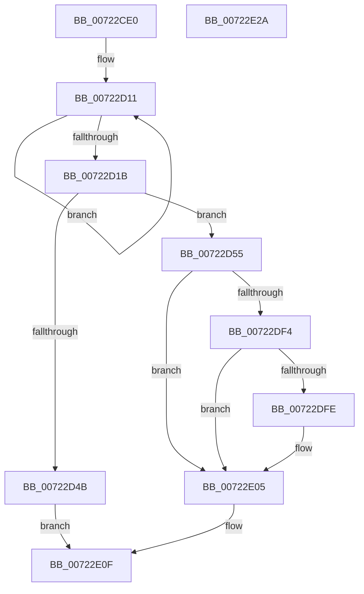

# IopSetEnvironmentVariableTrEE

- RVA: `0x00722CE0`–`0x00722E2B` (길이 `331` bytes)
- VA: `0x0000000140722CE0`
- 실행 섹션: `PAGE`
- PDB 이름 있음: `예`; PDB Function 태그: `아니요`
- unwind 정보 RVA: `0x000C7CCC`
- 디코드: `89`개 명령, `331/331` bytes 표시
- 미해석 바이트: `0` (있으면 어셈블리에 `.byte`로 보존)

> 이 문서는 커널 이미지의 기계어와 PDB 기호를 분석해 생성했습니다. 4번과 5번은 함수 원형과 자료형을 바이너리 사용 방식에서 추정한 C 해석이며 원본 소스 복구 결과는 아닙니다.

## 1. Dependencies

- 직접 호출 지점: **6**; 고유 호출 대상: **5**
- 직접 호출자로 확인된 함수: **0**
- RIP 상대 이미지 참조: **0**

### Outgoing calls
- `0x00722D3E` → [ExAllocatePool2](../../poolcode/B8/ExAllocatePool2_function_00B820F0.md) (function, `0x00B820F0`)
- `0x00722D8C` → [memcpy](../../text/6C/memcpy_function_006C6840.md) (function, `0x006C6840`)
- `0x00722DAB` → [memcpy](../../text/6C/memcpy_function_006C6840.md) (function, `0x006C6840`)
- `0x00722DE9` → [IopIssueTrEERequest](../../text/5A/IopIssueTrEERequest_function_005A041C.md) (function, `0x005A041C`)
- `0x00722DFE` → [IopEfiStatusToNTSTATUS](IopEfiStatusToNTSTATUS_function_00721E30.md) (function, `0x00721E30`)
- `0x00722E0A` → [ExFreePoolWithTag](../../poolcode/B8/ExFreePoolWithTag_function_00B82870.md) (function, `0x00B82870`)

### Direct callers
- 이 함수 시작 RVA로 연결되는 직접 call은 확인되지 않았습니다. 간접 호출은 완전히 역산할 수 없습니다.

### Static image references
- 디코드된 RIP-relative 메모리 참조가 없습니다.

## 2. Other-region calls and transfers

- 다른 실행 섹션으로 향하는 call: **5**
  - `0x00722D3E` → [ExAllocatePool2](../../poolcode/B8/ExAllocatePool2_function_00B820F0.md) (`PAGE` → `POOLCODE`)
  - `0x00722D8C` → [memcpy](../../text/6C/memcpy_function_006C6840.md) (`PAGE` → `.text`)
  - `0x00722DAB` → [memcpy](../../text/6C/memcpy_function_006C6840.md) (`PAGE` → `.text`)
  - `0x00722DE9` → [IopIssueTrEERequest](../../text/5A/IopIssueTrEERequest_function_005A041C.md) (`PAGE` → `.text`)
  - `0x00722E0A` → [ExFreePoolWithTag](../../poolcode/B8/ExFreePoolWithTag_function_00B82870.md) (`PAGE` → `POOLCODE`)
- 별도 외부 분기/꼬리 이동을 확인하지 못했습니다.

## 3. Assembly (complete function range)

```asm
00722CE0  48 8B C4                        mov rax, rsp
00722CE3  48 89 58 10                     mov qword ptr [rax + 0x10], rbx
00722CE7  48 89 68 18                     mov qword ptr [rax + 0x18], rbp
00722CEB  48 89 48 08                     mov qword ptr [rax + 8], rcx
00722CEF  56                              push rsi
00722CF0  57                              push rdi
00722CF1  41 54                           push r12
00722CF3  41 55                           push r13
00722CF5  41 56                           push r14
00722CF7  48 83 EC 60                     sub rsp, 0x60
00722CFB  33 C9                           xor ecx, ecx
00722CFD  4D 8B E1                        mov r12, r9
00722D00  89 48 C8                        mov dword ptr [rax - 0x38], ecx
00722D03  49 8B D8                        mov rbx, r8
00722D06  48 89 48 D0                     mov qword ptr [rax - 0x30], rcx
00722D0A  4C 8B EA                        mov r13, rdx
00722D0D  48 83 C8 FF                     or rax, 0xffffffffffffffff
00722D11  48 FF C0                        inc rax
00722D14  66 41 39 0C 40                  cmp word ptr [r8 + rax*2], cx
00722D19  75 F6                           jne 0x140722d11
00722D1B  8B AC 24 B8 00 00 00            mov ebp, dword ptr [rsp + 0xb8]
00722D22  8D 34 45 02 00 00 00            lea esi, [rax*2 + 2]
00722D29  B9 00 01 00 00                  mov ecx, 0x100
00722D2E  41 B8 49 6F 53 79               mov r8d, 0x79536f49
00722D34  44 8D 75 24                     lea r14d, [rbp + 0x24]
00722D38  44 03 F6                        add r14d, esi
00722D3B  41 8B D6                        mov edx, r14d
00722D3E  E8 AD F3 45 00                  call 0x140b820f0
00722D43  48 8B F8                        mov rdi, rax
00722D46  48 85 C0                        test rax, rax
00722D49  75 0A                           jne 0x140722d55
00722D4B  BB 9A 00 00 C0                  mov ebx, 0xc000009a
00722D50  E9 BA 00 00 00                  jmp 0x140722e0f
00722D55  41 0F 10 04 24                  movups xmm0, xmmword ptr [r12]
00722D5A  8B 8C 24 C0 00 00 00            mov ecx, dword ptr [rsp + 0xc0]
00722D61  48 8B D3                        mov rdx, rbx
00722D64  83 C9 06                        or ecx, 6
00722D67  44 8B C6                        mov r8d, esi
00722D6A  F6 84 24 C0 00 00 00 01         test byte ptr [rsp + 0xc0], 1
00722D72  F3 0F 7F 40 04                  movdqu xmmword ptr [rax + 4], xmm0
00722D77  0F 44 8C 24 C0 00 00 00         cmove ecx, dword ptr [rsp + 0xc0]
00722D7F  89 48 14                        mov dword ptr [rax + 0x14], ecx
00722D82  48 8D 48 24                     lea rcx, [rax + 0x24]
00722D86  C7 00 24 00 00 00               mov dword ptr [rax], 0x24
00722D8C  E8 AF 3A FA FF                  call 0x1406c6840
00722D91  48 8B 94 24 B0 00 00 00         mov rdx, qword ptr [rsp + 0xb0]
00722D99  8D 46 24                        lea eax, [rsi + 0x24]
00722D9C  8B C8                           mov ecx, eax
00722D9E  4C 8B C5                        mov r8, rbp
00722DA1  48 03 CF                        add rcx, rdi
00722DA4  89 47 20                        mov dword ptr [rdi + 0x20], eax
00722DA7  48 89 6F 18                     mov qword ptr [rdi + 0x18], rbp
00722DAB  E8 90 3A FA FF                  call 0x1406c6840
00722DB0  48 8B 94 24 90 00 00 00         mov rdx, qword ptr [rsp + 0x90]
00722DB8  48 8D 44 24 50                  lea rax, [rsp + 0x50]
00722DBD  48 89 44 24 40                  mov qword ptr [rsp + 0x40], rax
00722DC2  4C 8B CF                        mov r9, rdi
00722DC5  B8 08 00 00 00                  mov eax, 8
00722DCA  4D 8B C5                        mov r8, r13
00722DCD  89 44 24 38                     mov dword ptr [rsp + 0x38], eax
00722DD1  B9 02 00 00 00                  mov ecx, 2
00722DD6  89 44 24 30                     mov dword ptr [rsp + 0x30], eax
00722DDA  48 8D 44 24 58                  lea rax, [rsp + 0x58]
00722DDF  48 89 44 24 28                  mov qword ptr [rsp + 0x28], rax
00722DE4  44 89 74 24 20                  mov dword ptr [rsp + 0x20], r14d
00722DE9  E8 2E D6 E7 FF                  call 0x1405a041c
00722DEE  8B D8                           mov ebx, eax
00722DF0  85 C0                           test eax, eax
00722DF2  78 11                           js 0x140722e05
00722DF4  48 8B 4C 24 58                  mov rcx, qword ptr [rsp + 0x58]
00722DF9  48 85 C9                        test rcx, rcx
00722DFC  74 07                           je 0x140722e05
00722DFE  E8 2D F0 FF FF                  call 0x140721e30
00722E03  8B D8                           mov ebx, eax
00722E05  33 D2                           xor edx, edx
00722E07  48 8B CF                        mov rcx, rdi
00722E0A  E8 61 FA 45 00                  call 0x140b82870
00722E0F  4C 8D 5C 24 60                  lea r11, [rsp + 0x60]
00722E14  8B C3                           mov eax, ebx
00722E16  49 8B 5B 38                     mov rbx, qword ptr [r11 + 0x38]
00722E1A  49 8B 6B 40                     mov rbp, qword ptr [r11 + 0x40]
00722E1E  49 8B E3                        mov rsp, r11
00722E21  41 5E                           pop r14
00722E23  41 5D                           pop r13
00722E25  41 5C                           pop r12
00722E27  5F                              pop rdi
00722E28  5E                              pop rsi
00722E29  C3                              ret
00722E2A  CC                              int3
```

## 4. C-style interpretation (structured pseudocode)

```c
__int64 __fastcall IopSetEnvironmentVariableTrEE(__int64 a1, __int64 a2, __int64 a3, __int64 a4, __int64 a5, unsigned int a6, unsigned __int8 a7)
{
    __int64 result;
    __int64 v_r14;
    __int64 v_rbx;
    __int64 v_rsp;
    unsigned __int64 v_stack_m28;
    unsigned __int64 v_stack_m30;
    unsigned __int64 v_stack_m38;
    unsigned __int64 v_stack_m48;
    unsigned int v_stack_m50;
    unsigned int v_stack_m58;
    unsigned __int64 v_stack_m60;
    unsigned int v_stack_m68;
    unsigned __int64 v_stack_p8;

    *(unsigned __int64 *)(v_rsp + 16) = v_rbx;
    *(unsigned __int64 *)(v_rsp + 24) = v_rbp;
    *(unsigned __int64 *)(v_rsp + 8) = a1;
    v_rsp = (v_rsp) - (96);
    a1 = 0;
    *(unsigned int *)(v_rsp - 56) = 0;
    *(unsigned __int64 *)(v_rsp - 48) = 0;
    result = (v_rsp) | (-1);
loc_00722D11:
    result = (result) + 1;
    if ((*(unsigned __int16 *)(a3 + result * 2)) != 0) goto loc_00722D11;
    v_r14 = (unsigned int)(((unsigned int)(a6) + 36) + ((unsigned int)(result * 2 + 2)));
    result = ExAllocatePool2(256, (unsigned int)((unsigned int)(v_r14)), (unsigned int)(0x79536F49ULL), a4);
    if (result != 0) goto loc_00722D55;
    goto loc_00722E0F;
loc_00722D55:
    a1 = (unsigned int)(((unsigned int)(a7)) | (6));
    *(unsigned __int64 *)(result + 4) = v_xmm0;
    if (((a7) & (1)) == 0) { a1 = a7; }
    *(unsigned int *)(result + 20) = (unsigned int)(a1);
    *(unsigned int *)(result) = 36;
    result = memcpy(result + 36, (unsigned int)(0xC000009AULL), (unsigned int)((unsigned int)(result * 2 + 2)), a4);
    a1 = ((unsigned int)((unsigned int)(result * 2 + 2 + 36))) + (result);
    *(unsigned int *)(result + 32) = (unsigned int)(result * 2 + 2 + 36);
    *(unsigned __int64 *)(result + 24) = (unsigned int)(a6);
    result = memcpy(a1, a5, (unsigned int)(a6), a4);
    v_stack_m48 = v_stack_m38;
    v_stack_m50 = 8;
    v_stack_m58 = 8;
    v_stack_m60 = v_stack_m30;
    v_stack_m68 = (unsigned int)(v_r14);
    result = IopIssueTrEERequest(2, v_stack_p8, a2, result);
    if (sign_flag) goto loc_00722E05;
    v_rbx = (unsigned int)((unsigned int)(result));
    if (v_stack_m30 != 0) {
        result = IopEfiStatusToNTSTATUS(v_stack_m30, v_stack_p8, a2, result);
        v_rbx = (unsigned int)(result);
    }
    a2 = 0;
    result = ExFreePoolWithTag(result, a2, a2, result);
loc_00722E0F:
    return (unsigned int)((unsigned int)(v_rbx));
}
```

## 5. (Beta) C Style

```c
int64_t IopSetEnvironmentVariableTrEE(int64_t Arg1, int64_t Arg2, void *Arg3, void *Arg4, int64_t Arg5, void *Arg6, uint8_t Arg7)
{
    uint8_t *arg3 = (uint8_t *)Arg3;
    uint8_t *arg4 = (uint8_t *)Arg4;
    uint8_t *arg6 = (uint8_t *)Arg6;

    int64_t result;
    int64_t local_r14;
    int64_t local_rbx;
    int64_t local_rsp;
    uint64_t v_stack_m28;
    uint64_t v_stack_m30;
    uint64_t v_stack_m38;
    uint64_t v_stack_m48;
    uint32_t v_stack_m50;
    uint32_t v_stack_m58;
    uint64_t v_stack_m60;
    uint32_t v_stack_m68;
    uint64_t v_stack_p8;

    *(uint64_t *)(local_rsp + 0x10) = local_rbx;
    *(uint64_t *)(local_rsp + 0x18) = local_rbp;
    *(uint64_t *)(local_rsp + 0x8) = Arg1;
    local_rsp = (local_rsp) - (96);
    Arg1 = 0;
    *(uint32_t *)(local_rsp - 0x38) = 0;
    *(uint64_t *)(local_rsp - 0x30) = 0;
    result = (local_rsp) | (-1);
loc_00722D11:
    result = (result) + 1;
    if ((*(uint16_t *)(arg3 + result * 2)) != 0) goto loc_00722D11;
    local_r14 = (uint32_t)(((uint32_t)(Arg6) + 36) + ((uint32_t)(result * 2 + 2)));
    result = ExAllocatePool2(256, (uint32_t)((uint32_t)(local_r14)), (uint32_t)(0x79536F49ULL), Arg4);
    if (result != 0) goto loc_00722D55;
    goto loc_00722E0F;
loc_00722D55:
    Arg1 = (uint32_t)(((uint32_t)(Arg7)) | (6));
    *(uint64_t *)(result + 0x4) = v_xmm0;
    if (((Arg7) & (1)) == 0) { Arg1 = Arg7; }
    *(uint32_t *)(result + 0x14) = (uint32_t)(Arg1);
    *(uint32_t *)(result) = 36;
    result = memcpy(result + 36, (uint32_t)(0xC000009AULL), (uint32_t)((uint32_t)(result * 2 + 2)), Arg4);
    Arg1 = ((uint32_t)((uint32_t)(result * 2 + 2 + 36))) + (result);
    *(uint32_t *)(result + 0x20) = (uint32_t)(result * 2 + 2 + 36);
    *(uint64_t *)(result + 0x18) = (uint32_t)(Arg6);
    result = memcpy(Arg1, Arg5, (uint32_t)(Arg6), Arg4);
    v_stack_m48 = v_stack_m38;
    v_stack_m50 = 8;
    v_stack_m58 = 8;
    v_stack_m60 = v_stack_m30;
    v_stack_m68 = (uint32_t)(local_r14);
    result = IopIssueTrEERequest(2, v_stack_p8, Arg2, result);
    if (sign_flag) goto loc_00722E05;
    local_rbx = (uint32_t)((uint32_t)(result));
    if (v_stack_m30 != 0) {
        result = IopEfiStatusToNTSTATUS(v_stack_m30, v_stack_p8, Arg2, result);
        local_rbx = (uint32_t)(result);
    }
    Arg2 = 0;
    result = ExFreePoolWithTag(result, Arg2, Arg2, result);
loc_00722E0F:
    return (uint32_t)((uint32_t)(local_rbx));
}
```

### 관측된 메모리 오프셋

구조체 형식이 확인되지 않은 접근은 인자 기준의 오프셋으로만 기록했습니다.

| 기준 인자 | 오프셋 표현 | 폭 (bit) | 접근 |
|---|---:|---:|---|
| `Arg3` | `+ 0x0 + rax*2` | `16` | `R` |
| `Arg4` | `+ 0x0` | `128` | `R` |
| `Arg6` | `+ 0x24` | `32` | `R` |

## 6. Execution-region graph

[열기: 2D/3D 그래프와 함수 탐색 컨트롤 패널](../../../control-panel.html?section=page&rva=0x00722CE0&view=graph)

- 2D 그래프는 위에서 아래로 흐르고, 3D 그래프는 빈 공간을 드래그해 회전합니다. Shift+드래그는 이동, 휠은 확대·축소, 함수 노드 선택은 대상 보고서 이동입니다.

### Static fallback


