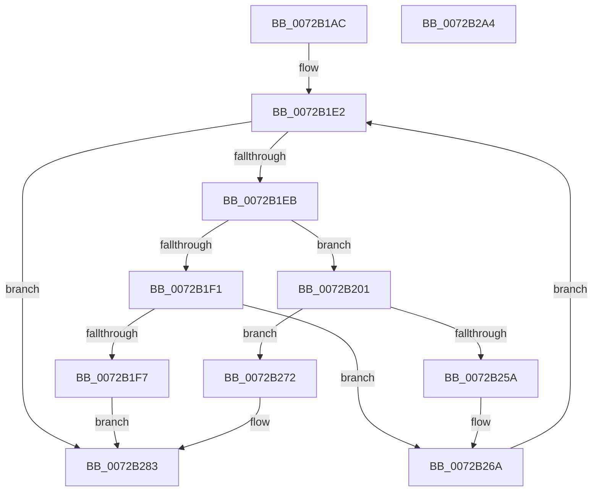

# IopTestConfiguration

- RVA: `0x0072B1AC`–`0x0072B2A5` (길이 `249` bytes)
- VA: `0x000000014072B1AC`
- 실행 섹션: `PAGE`
- PDB 이름 있음: `예`; PDB Function 태그: `아니요`
- unwind 정보 RVA: `0x0007FF48`
- 디코드: `70`개 명령, `249/249` bytes 표시
- 미해석 바이트: `0` (있으면 어셈블리에 `.byte`로 보존)

> 이 문서는 커널 이미지의 기계어와 PDB 기호를 분석해 생성했습니다. 4번과 5번은 함수 원형과 자료형을 바이너리 사용 방식에서 추정한 C 해석이며 원본 소스 복구 결과는 아닙니다.

## 1. Dependencies

- 직접 호출 지점: **3**; 고유 호출 대상: **3**
- 직접 호출자로 확인된 함수: **1**
- RIP 상대 이미지 참조: **0**

### Outgoing calls
- `0x0072B23B` → [PnpLookupArbitersNewResources](../AC/PnpLookupArbitersNewResources_function_00AC5F00.md) (function, `0x00AC5F00`)
- `0x0072B24F` → [guard_dispatch_icall](../../text/6B/guard_dispatch_icall_function_006BAAD0.md) (function, `0x006BAAD0`)
- `0x0072B27A` → [PnpLogDeviceConflictingResource](../73/PnpLogDeviceConflictingResource_function_0073D8A8.md) (function, `0x0073D8A8`)

### Direct callers
- [PnpFindBestConfigurationWorker](PnpFindBestConfigurationWorker_function_0072B688.md) at `0x0072B6E9`

### Static image references
- 디코드된 RIP-relative 메모리 참조가 없습니다.

## 2. Other-region calls and transfers

- 다른 실행 섹션으로 향하는 call: **1**
  - `0x0072B24F` → [guard_dispatch_icall](../../text/6B/guard_dispatch_icall_function_006BAAD0.md) (`PAGE` → `.text`)
- 별도 외부 분기/꼬리 이동을 확인하지 못했습니다.

## 3. Assembly (complete function range)

```asm
0072B1AC  48 8B C4                        mov rax, rsp
0072B1AF  48 89 58 08                     mov qword ptr [rax + 8], rbx
0072B1B3  48 89 68 10                     mov qword ptr [rax + 0x10], rbp
0072B1B7  48 89 70 18                     mov qword ptr [rax + 0x18], rsi
0072B1BB  48 89 78 20                     mov qword ptr [rax + 0x20], rdi
0072B1BF  41 54                           push r12
0072B1C1  41 56                           push r14
0072B1C3  41 57                           push r15
0072B1C5  48 83 EC 50                     sub rsp, 0x50
0072B1C9  49 8B 38                        mov rdi, qword ptr [r8]
0072B1CC  0F 57 C0                        xorps xmm0, xmm0
0072B1CF  0F 11 40 C8                     movups xmmword ptr [rax - 0x38], xmm0
0072B1D3  4D 8B F0                        mov r14, r8
0072B1D6  44 8B FA                        mov r15d, edx
0072B1D9  0F 11 40 D8                     movups xmmword ptr [rax - 0x28], xmm0
0072B1DD  4C 8B E1                        mov r12, rcx
0072B1E0  33 F6                           xor esi, esi
0072B1E2  49 3B FE                        cmp rdi, r14
0072B1E5  0F 84 98 00 00 00               je 0x14072b283
0072B1EB  80 7F 11 00                     cmp byte ptr [rdi + 0x11], 0
0072B1EF  75 10                           jne 0x14072b201
0072B1F1  F6 47 10 02                     test byte ptr [rdi + 0x10], 2
0072B1F5  74 73                           je 0x14072b26a
0072B1F7  BE 01 00 00 C0                  mov esi, 0xc0000001
0072B1FC  E9 82 00 00 00                  jmp 0x14072b283
0072B201  48 8B 6F C0                     mov rbp, qword ptr [rdi - 0x40]
0072B205  48 8D 47 D0                     lea rax, [rdi - 0x30]
0072B209  83 64 24 38 00                  and dword ptr [rsp + 0x38], 0
0072B20E  41 8B D7                        mov edx, r15d
0072B211  48 83 64 24 40 00               and qword ptr [rsp + 0x40], 0
0072B217  49 8B CC                        mov rcx, r12
0072B21A  48 89 44 24 30                  mov qword ptr [rsp + 0x30], rax
0072B21F  48 8D 44 24 38                  lea rax, [rsp + 0x38]
0072B224  44 8A 4F B8                     mov r9b, byte ptr [rdi - 0x48]
0072B228  4C 8B 47 C8                     mov r8, qword ptr [rdi - 0x38]
0072B22C  48 89 44 24 28                  mov qword ptr [rsp + 0x28], rax
0072B231  48 8D 44 24 40                  lea rax, [rsp + 0x40]
0072B236  48 89 44 24 20                  mov qword ptr [rsp + 0x20], rax
0072B23B  E8 C0 AC 39 00                  call 0x140ac5f00
0072B240  48 8B 45 20                     mov rax, qword ptr [rbp + 0x20]
0072B244  4C 8D 44 24 30                  lea r8, [rsp + 0x30]
0072B249  48 8B 4D 08                     mov rcx, qword ptr [rbp + 8]
0072B24D  33 D2                           xor edx, edx
0072B24F  E8 7C F8 F8 FF                  call 0x1406baad0
0072B254  8B F0                           mov esi, eax
0072B256  85 C0                           test eax, eax
0072B258  78 18                           js 0x14072b272
0072B25A  8A 4F 10                        mov cl, byte ptr [rdi + 0x10]
0072B25D  80 E1 FD                        and cl, 0xfd
0072B260  C6 47 11 00                     mov byte ptr [rdi + 0x11], 0
0072B264  80 C9 01                        or cl, 1
0072B267  88 4F 10                        mov byte ptr [rdi + 0x10], cl
0072B26A  48 8B 3F                        mov rdi, qword ptr [rdi]
0072B26D  E9 70 FF FF FF                  jmp 0x14072b1e2
0072B272  48 8B 55 08                     mov rdx, qword ptr [rbp + 8]
0072B276  48 8D 4F A8                     lea rcx, [rdi - 0x58]
0072B27A  E8 29 26 01 00                  call 0x14073d8a8
0072B27F  80 4F 10 02                     or byte ptr [rdi + 0x10], 2
0072B283  4C 8D 5C 24 50                  lea r11, [rsp + 0x50]
0072B288  8B C6                           mov eax, esi
0072B28A  49 8B 5B 20                     mov rbx, qword ptr [r11 + 0x20]
0072B28E  49 8B 6B 28                     mov rbp, qword ptr [r11 + 0x28]
0072B292  49 8B 73 30                     mov rsi, qword ptr [r11 + 0x30]
0072B296  49 8B 7B 38                     mov rdi, qword ptr [r11 + 0x38]
0072B29A  49 8B E3                        mov rsp, r11
0072B29D  41 5F                           pop r15
0072B29F  41 5E                           pop r14
0072B2A1  41 5C                           pop r12
0072B2A3  C3                              ret
0072B2A4  CC                              int3
```

## 4. C-style interpretation (structured pseudocode)

```c
__int64 __fastcall IopTestConfiguration(__int64 a1, int a2, __int64 a3)
{
    __int64 result;
    __int64 v_rsi;
    __int64 v_rsp;
    unsigned __int64 v_stack_m18;
    unsigned __int64 v_stack_m28;
    unsigned int v_stack_m30;
    unsigned __int64 v_stack_m38;
    unsigned __int64 v_stack_m40;
    unsigned __int64 v_stack_m48;

    *(unsigned __int64 *)(v_rsp + 8) = v_rbx;
    *(unsigned __int64 *)(v_rsp + 16) = v_rbp;
    *(unsigned __int64 *)(v_rsp + 24) = v_rsi;
    *(unsigned __int64 *)(v_rsp + 32) = v_rdi;
    v_rsp = (v_rsp) - (80);
    *(unsigned __int64 *)(v_rsp - 56) = v_xmm0;
    *(unsigned __int64 *)(v_rsp - 40) = v_xmm0;
    v_rsi = 0;
loc_0072B1E2:
    if ((*(unsigned __int64 *)(a3)) == a3) goto loc_0072B283;
    if ((*(unsigned __int8 *)(*(unsigned __int64 *)(a3) + 17)) != 0) goto loc_0072B201;
    if (((*(unsigned __int8 *)(*(unsigned __int64 *)(a3) + 16)) & (2)) == 0) goto loc_0072B26A;
    goto loc_0072B283;
loc_0072B201:
    v_stack_m38 = *(unsigned __int64 *)(a3) - 48;
    v_stack_m40 = v_stack_m30;
    v_stack_m48 = v_stack_m28;
    result = PnpLookupArbitersNewResources(a1, (unsigned int)((unsigned int)((unsigned int)(a2))), *(unsigned __int64 *)(*(unsigned __int64 *)(a3) - 56), *(unsigned __int8 *)(*(unsigned __int64 *)(a3) - 72));
    a2 = 0;
    result = guard_dispatch_icall(*(unsigned __int64 *)(*(unsigned __int64 *)(*(unsigned __int64 *)(a3) - 64) + 8), a2, v_stack_m38, *(unsigned __int8 *)(*(unsigned __int64 *)(a3) - 72));
    if (sign_flag) goto loc_0072B272;
    a1 = (unsigned __int8)((*(unsigned __int8 *)(*(unsigned __int64 *)(a3) + 16)) & (253));
    *(unsigned __int8 *)(*(unsigned __int64 *)(a3) + 17) = 0;
    a1 = (unsigned __int8)((a1) | (1));
    *(unsigned __int8 *)(*(unsigned __int64 *)(a3) + 16) = (unsigned __int8)(a1);
loc_0072B26A:
    goto loc_0072B1E2;
loc_0072B272:
    result = PnpLogDeviceConflictingResource(*(unsigned __int64 *)(*(unsigned __int64 *)(a3)) - 88, *(unsigned __int64 *)(*(unsigned __int64 *)(*(unsigned __int64 *)(a3) - 64) + 8), v_stack_m38, *(unsigned __int8 *)(*(unsigned __int64 *)(a3) - 72));
loc_0072B283:
    return (unsigned int)((unsigned int)((unsigned int)((unsigned int)(result))));
}
```

## 5. (Beta) C Style

```c
int64_t IopTestConfiguration(int64_t Arg1, int32_t Arg2, void *Arg3)
{
    uint8_t *arg3 = (uint8_t *)Arg3;

    int64_t result;
    int64_t local_rsi;
    int64_t local_rsp;
    uint64_t v_stack_m18;
    uint64_t v_stack_m28;
    uint32_t v_stack_m30;
    uint64_t v_stack_m38;
    uint64_t v_stack_m40;
    uint64_t v_stack_m48;

    *(uint64_t *)(local_rsp + 0x8) = local_rbx;
    *(uint64_t *)(local_rsp + 0x10) = local_rbp;
    *(uint64_t *)(local_rsp + 0x18) = local_rsi;
    *(uint64_t *)(local_rsp + 0x20) = local_rdi;
    local_rsp = (local_rsp) - (80);
    *(uint64_t *)(local_rsp - 0x38) = v_xmm0;
    *(uint64_t *)(local_rsp - 0x28) = v_xmm0;
    local_rsi = 0;
loc_0072B1E2:
    if ((*(uint64_t *)(arg3)) == Arg3) goto loc_0072B283;
    if ((*(uint8_t *)(*(uint64_t *)(arg3) + 0x11)) != 0) goto loc_0072B201;
    if (((*(uint8_t *)(*(uint64_t *)(arg3) + 0x10)) & (2)) == 0) goto loc_0072B26A;
    goto loc_0072B283;
loc_0072B201:
    v_stack_m38 = *(uint64_t *)(arg3) - 48;
    v_stack_m40 = v_stack_m30;
    v_stack_m48 = v_stack_m28;
    result = PnpLookupArbitersNewResources(Arg1, (uint32_t)((uint32_t)((uint32_t)(Arg2))), *(uint64_t *)(*(uint64_t *)(arg3) - 0x38), *(uint8_t *)(*(uint64_t *)(arg3) - 0x48));
    Arg2 = 0;
    result = guard_dispatch_icall(*(uint64_t *)(*(uint64_t *)(*(uint64_t *)(arg3) - 0x40) + 0x8), Arg2, v_stack_m38, *(uint8_t *)(*(uint64_t *)(arg3) - 0x48));
    if (sign_flag) goto loc_0072B272;
    Arg1 = (uint8_t)((*(uint8_t *)(*(uint64_t *)(arg3) + 0x10)) & (253));
    *(uint8_t *)(*(uint64_t *)(arg3) + 0x11) = 0;
    Arg1 = (uint8_t)((Arg1) | (1));
    *(uint8_t *)(*(uint64_t *)(arg3) + 0x10) = (uint8_t)(Arg1);
loc_0072B26A:
    goto loc_0072B1E2;
loc_0072B272:
    result = PnpLogDeviceConflictingResource(*(uint64_t *)(*(uint64_t *)(arg3)) - 88, *(uint64_t *)(*(uint64_t *)(*(uint64_t *)(arg3) - 0x40) + 0x8), v_stack_m38, *(uint8_t *)(*(uint64_t *)(arg3) - 0x48));
loc_0072B283:
    return (uint32_t)((uint32_t)((uint32_t)((uint32_t)(result))));
}
```

### 관측된 메모리 오프셋

구조체 형식이 확인되지 않은 접근은 인자 기준의 오프셋으로만 기록했습니다.

| 기준 인자 | 오프셋 표현 | 폭 (bit) | 접근 |
|---|---:|---:|---|
| `Arg3` | `+ 0x0` | `64` | `R` |

## 6. Execution-region graph

[열기: 2D/3D 그래프와 함수 탐색 컨트롤 패널](../../../control-panel.html?section=page&rva=0x0072B1AC&view=graph)

- 2D 그래프는 위에서 아래로 흐르고, 3D 그래프는 빈 공간을 드래그해 회전합니다. Shift+드래그는 이동, 휠은 확대·축소, 함수 노드 선택은 대상 보고서 이동입니다.

### Static fallback


