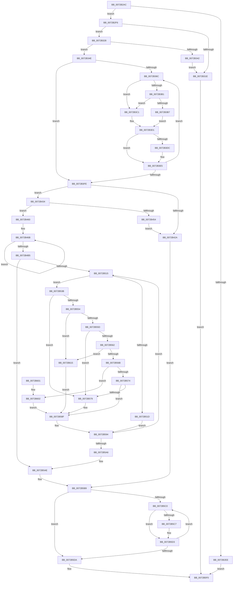

# IopTranslateAndAdjustReqDesc

- RVA: `0x0072B2AC`–`0x0072B628` (길이 `892` bytes)
- VA: `0x000000014072B2AC`
- 실행 섹션: `PAGE`
- PDB 이름 있음: `예`; PDB Function 태그: `아니요`
- unwind 정보 RVA: `0x000C8548`
- 디코드: `239`개 명령, `892/892` bytes 표시
- 미해석 바이트: `0` (있으면 어셈블리에 `.byte`로 보존)

> 이 문서는 커널 이미지의 기계어와 PDB 기호를 분석해 생성했습니다. 4번과 5번은 함수 원형과 자료형을 바이너리 사용 방식에서 추정한 C 해석이며 원본 소스 복구 결과는 아닙니다.

## 1. Dependencies

- 직접 호출 지점: **11**; 고유 호출 대상: **4**
- 직접 호출자로 확인된 함수: **1**
- RIP 상대 이미지 참조: **0**

### Outgoing calls
- `0x0072B311` → [ExAllocatePool2](../../poolcode/B8/ExAllocatePool2_function_00B820F0.md) (function, `0x00B820F0`)
- `0x0072B335` → [ExAllocatePool2](../../poolcode/B8/ExAllocatePool2_function_00B820F0.md) (function, `0x00B820F0`)
- `0x0072B347` → [ExFreePoolWithTag](../../poolcode/B8/ExFreePoolWithTag_function_00B82870.md) (function, `0x00B82870`)
- `0x0072B3A1` → [guard_dispatch_icall](../../text/6B/guard_dispatch_icall_function_006BAAD0.md) (function, `0x006BAAD0`)
- `0x0072B41D` → [ExAllocatePool2](../../poolcode/B8/ExAllocatePool2_function_00B820F0.md) (function, `0x00B820F0`)
- `0x0072B43F` → [ExAllocatePool2](../../poolcode/B8/ExAllocatePool2_function_00B820F0.md) (function, `0x00B820F0`)
- `0x0072B459` → [ExFreePoolWithTag](../../poolcode/B8/ExFreePoolWithTag_function_00B82870.md) (function, `0x00B82870`)
- `0x0072B52C` → [memcpy](../../text/6C/memcpy_function_006C6840.md) (function, `0x006C6840`)
- `0x0072B5CE` → [ExFreePoolWithTag](../../poolcode/B8/ExFreePoolWithTag_function_00B82870.md) (function, `0x00B82870`)
- `0x0072B5DF` → [ExFreePoolWithTag](../../poolcode/B8/ExFreePoolWithTag_function_00B82870.md) (function, `0x00B82870`)
- `0x0072B5E9` → [ExFreePoolWithTag](../../poolcode/B8/ExFreePoolWithTag_function_00B82870.md) (function, `0x00B82870`)

### Direct callers
- [sub_00B43B26](../B4/Unknown_function_00B43B26.md) at `0x00B43CBD`

### Static image references
- 디코드된 RIP-relative 메모리 참조가 없습니다.

## 2. Other-region calls and transfers

- 다른 실행 섹션으로 향하는 call: **11**
  - `0x0072B311` → [ExAllocatePool2](../../poolcode/B8/ExAllocatePool2_function_00B820F0.md) (`PAGE` → `POOLCODE`)
  - `0x0072B335` → [ExAllocatePool2](../../poolcode/B8/ExAllocatePool2_function_00B820F0.md) (`PAGE` → `POOLCODE`)
  - `0x0072B347` → [ExFreePoolWithTag](../../poolcode/B8/ExFreePoolWithTag_function_00B82870.md) (`PAGE` → `POOLCODE`)
  - `0x0072B3A1` → [guard_dispatch_icall](../../text/6B/guard_dispatch_icall_function_006BAAD0.md) (`PAGE` → `.text`)
  - `0x0072B41D` → [ExAllocatePool2](../../poolcode/B8/ExAllocatePool2_function_00B820F0.md) (`PAGE` → `POOLCODE`)
  - `0x0072B43F` → [ExAllocatePool2](../../poolcode/B8/ExAllocatePool2_function_00B820F0.md) (`PAGE` → `POOLCODE`)
  - `0x0072B459` → [ExFreePoolWithTag](../../poolcode/B8/ExFreePoolWithTag_function_00B82870.md) (`PAGE` → `POOLCODE`)
  - `0x0072B52C` → [memcpy](../../text/6C/memcpy_function_006C6840.md) (`PAGE` → `.text`)
  - `0x0072B5CE` → [ExFreePoolWithTag](../../poolcode/B8/ExFreePoolWithTag_function_00B82870.md) (`PAGE` → `POOLCODE`)
  - `0x0072B5DF` → [ExFreePoolWithTag](../../poolcode/B8/ExFreePoolWithTag_function_00B82870.md) (`PAGE` → `POOLCODE`)
  - `0x0072B5E9` → [ExFreePoolWithTag](../../poolcode/B8/ExFreePoolWithTag_function_00B82870.md) (`PAGE` → `POOLCODE`)
- 별도 외부 분기/꼬리 이동을 확인하지 못했습니다.

## 3. Assembly (complete function range)

```asm
0072B2AC  4C 89 44 24 18                  mov qword ptr [rsp + 0x18], r8
0072B2B1  48 89 54 24 10                  mov qword ptr [rsp + 0x10], rdx
0072B2B6  53                              push rbx
0072B2B7  55                              push rbp
0072B2B8  56                              push rsi
0072B2B9  57                              push rdi
0072B2BA  41 54                           push r12
0072B2BC  41 55                           push r13
0072B2BE  41 56                           push r14
0072B2C0  41 57                           push r15
0072B2C2  48 83 EC 68                     sub rsp, 0x68
0072B2C6  48 8B 42 18                     mov rax, qword ptr [rdx + 0x18]
0072B2CA  4C 8D 71 38                     lea r14, [rcx + 0x38]
0072B2CE  33 DB                           xor ebx, ebx
0072B2D0  48 89 44 24 40                  mov qword ptr [rsp + 0x40], rax
0072B2D5  41 8B 06                        mov eax, dword ptr [r14]
0072B2D8  45 33 FF                        xor r15d, r15d
0072B2DB  88 9C 24 B0 00 00 00            mov byte ptr [rsp + 0xb0], bl
0072B2E2  48 8B F1                        mov rsi, rcx
0072B2E5  BF 01 00 00 C0                  mov edi, 0xc0000001
0072B2EA  85 C0                           test eax, eax
0072B2EC  75 08                           jne 0x14072b2f6
0072B2EE  8D 47 0C                        lea eax, [rdi + 0xc]
0072B2F1  E9 FA 02 00 00                  jmp 0x14072b5f0
0072B2F6  49 21 18                        and qword ptr [r8], rbx
0072B2F9  48 8B D0                        mov rdx, rax
0072B2FC  BD 50 70 20 20                  mov ebp, 0x20207050
0072B301  48 C1 E2 03                     shl rdx, 3
0072B305  41 BC 00 01 00 00               mov r12d, 0x100
0072B30B  44 8B C5                        mov r8d, ebp
0072B30E  41 8B CC                        mov ecx, r12d
0072B311  E8 DA 6D 45 00                  call 0x140b820f0
0072B316  4C 8B E8                        mov r13, rax
0072B319  48 85 C0                        test rax, rax
0072B31C  75 0A                           jne 0x14072b328
0072B31E  B8 9A 00 00 C0                  mov eax, 0xc000009a
0072B323  E9 C8 02 00 00                  jmp 0x14072b5f0
0072B328  41 8B 16                        mov edx, dword ptr [r14]
0072B32B  44 8B C5                        mov r8d, ebp
0072B32E  48 C1 E2 02                     shl rdx, 2
0072B332  49 8B CC                        mov rcx, r12
0072B335  E8 B6 6D 45 00                  call 0x140b820f0
0072B33A  4C 8B E0                        mov r12, rax
0072B33D  48 85 C0                        test rax, rax
0072B340  75 0C                           jne 0x14072b34e
0072B342  33 D2                           xor edx, edx
0072B344  49 8B CD                        mov rcx, r13
0072B347  E8 24 75 45 00                  call 0x140b82870
0072B34C  EB D0                           jmp 0x14072b31e
0072B34E  48 8D 46 40                     lea rax, [rsi + 0x40]
0072B352  48 8B 28                        mov rbp, qword ptr [rax]
0072B355  48 89 44 24 50                  mov qword ptr [rsp + 0x50], rax
0072B35A  33 C0                           xor eax, eax
0072B35C  89 84 24 C8 00 00 00            mov dword ptr [rsp + 0xc8], eax
0072B363  41 39 06                        cmp dword ptr [r14], eax
0072B366  0F 86 92 00 00 00               jbe 0x14072b3fe
0072B36C  4C 8B 54 24 40                  mov r10, qword ptr [rsp + 0x40]
0072B371  49 8D 0C 84                     lea rcx, [r12 + rax*4]
0072B375  4C 8B 46 48                     mov r8, qword ptr [rsi + 0x48]
0072B379  48 8D 14 C5 00 00 00 00         lea rdx, [rax*8]
0072B381  49 03 D5                        add rdx, r13
0072B384  48 89 4C 24 30                  mov qword ptr [rsp + 0x30], rcx
0072B389  48 89 54 24 48                  mov qword ptr [rsp + 0x48], rdx
0072B38E  4C 8B C9                        mov r9, rcx
0072B391  49 8B 42 28                     mov rax, qword ptr [r10 + 0x28]
0072B395  49 8B 4A 08                     mov rcx, qword ptr [r10 + 8]
0072B399  48 89 54 24 20                  mov qword ptr [rsp + 0x20], rdx
0072B39E  48 8B D5                        mov rdx, rbp
0072B3A1  E8 2A F7 F8 FF                  call 0x1406baad0
0072B3A6  48 8B 4C 24 30                  mov rcx, qword ptr [rsp + 0x30]
0072B3AB  8B F8                           mov edi, eax
0072B3AD  85 C0                           test eax, eax
0072B3AF  78 10                           js 0x14072b3c1
0072B3B1  8B 01                           mov eax, dword ptr [rcx]
0072B3B3  85 C0                           test eax, eax
0072B3B5  74 0A                           je 0x14072b3c1
0072B3B7  C6 84 24 B0 00 00 00 01         mov byte ptr [rsp + 0xb0], 1
0072B3BF  EB 10                           jmp 0x14072b3d1
0072B3C1  48 8B 44 24 48                  mov rax, qword ptr [rsp + 0x48]
0072B3C6  48 89 28                        mov qword ptr [rax], rbp
0072B3C9  B8 01 00 00 00                  mov eax, 1
0072B3CE  83 21 00                        and dword ptr [rcx], 0
0072B3D1  44 03 F8                        add r15d, eax
0072B3D4  48 83 C5 20                     add rbp, 0x20
0072B3D8  85 FF                           test edi, edi
0072B3DA  78 09                           js 0x14072b3e5
0072B3DC  81 FB 20 01 00 00               cmp ebx, 0x120
0072B3E2  0F 45 DF                        cmovne ebx, edi
0072B3E5  8B 84 24 C8 00 00 00            mov eax, dword ptr [rsp + 0xc8]
0072B3EC  FF C0                           inc eax
0072B3EE  89 84 24 C8 00 00 00            mov dword ptr [rsp + 0xc8], eax
0072B3F5  41 3B 06                        cmp eax, dword ptr [r14]
0072B3F8  0F 82 6E FF FF FF               jb 0x14072b36c
0072B3FE  80 BC 24 B0 00 00 00 00         cmp byte ptr [rsp + 0xb0], 0
0072B406  BD 50 70 20 20                  mov ebp, 0x20207050
0072B40B  41 8B D7                        mov edx, r15d
0072B40E  44 8B C5                        mov r8d, ebp
0072B411  0F 45 FB                        cmovne edi, ebx
0072B414  B9 00 01 00 00                  mov ecx, 0x100
0072B419  48 C1 E2 05                     shl rdx, 5
0072B41D  E8 CE 6C 45 00                  call 0x140b820f0
0072B422  48 8B D8                        mov rbx, rax
0072B425  48 85 C0                        test rax, rax
0072B428  75 0A                           jne 0x14072b434
0072B42A  BF 9A 00 00 C0                  mov edi, 0xc000009a
0072B42F  E9 85 01 00 00                  jmp 0x14072b5b9
0072B434  BA 28 01 00 00                  mov edx, 0x128
0072B439  44 8B C5                        mov r8d, ebp
0072B43C  8D 4A D8                        lea ecx, [rdx - 0x28]
0072B43F  E8 AC 6C 45 00                  call 0x140b820f0
0072B444  48 89 84 24 B0 00 00 00         mov qword ptr [rsp + 0xb0], rax
0072B44C  48 8B E8                        mov rbp, rax
0072B44F  48 85 C0                        test rax, rax
0072B452  75 0C                           jne 0x14072b460
0072B454  33 D2                           xor edx, edx
0072B456  48 8B CB                        mov rcx, rbx
0072B459  E8 12 74 45 00                  call 0x140b82870
0072B45E  EB CA                           jmp 0x14072b42a
0072B460  B8 02 00 00 00                  mov eax, 2
0072B465  48 8B CD                        mov rcx, rbp
0072B468  8D 50 7E                        lea edx, [rax + 0x7e]
0072B46B  0F 10 06                        movups xmm0, xmmword ptr [rsi]
0072B46E  0F 11 01                        movups xmmword ptr [rcx], xmm0
0072B471  0F 10 4E 10                     movups xmm1, xmmword ptr [rsi + 0x10]
0072B475  0F 11 49 10                     movups xmmword ptr [rcx + 0x10], xmm1
0072B479  0F 10 46 20                     movups xmm0, xmmword ptr [rsi + 0x20]
0072B47D  0F 11 41 20                     movups xmmword ptr [rcx + 0x20], xmm0
0072B481  0F 10 4E 30                     movups xmm1, xmmword ptr [rsi + 0x30]
0072B485  0F 11 49 30                     movups xmmword ptr [rcx + 0x30], xmm1
0072B489  0F 10 46 40                     movups xmm0, xmmword ptr [rsi + 0x40]
0072B48D  0F 11 41 40                     movups xmmword ptr [rcx + 0x40], xmm0
0072B491  0F 10 4E 50                     movups xmm1, xmmword ptr [rsi + 0x50]
0072B495  0F 11 49 50                     movups xmmword ptr [rcx + 0x50], xmm1
0072B499  0F 10 46 60                     movups xmm0, xmmword ptr [rsi + 0x60]
0072B49D  0F 11 41 60                     movups xmmword ptr [rcx + 0x60], xmm0
0072B4A1  48 03 CA                        add rcx, rdx
0072B4A4  0F 10 4E 70                     movups xmm1, xmmword ptr [rsi + 0x70]
0072B4A8  48 03 F2                        add rsi, rdx
0072B4AB  0F 11 49 F0                     movups xmmword ptr [rcx - 0x10], xmm1
0072B4AF  48 83 E8 01                     sub rax, 1
0072B4B3  75 B6                           jne 0x14072b46b
0072B4B5  0F 10 06                        movups xmm0, xmmword ptr [rsi]
0072B4B8  0F 11 01                        movups xmmword ptr [rcx], xmm0
0072B4BB  0F 10 4E 10                     movups xmm1, xmmword ptr [rsi + 0x10]
0072B4BF  0F 11 49 10                     movups xmmword ptr [rcx + 0x10], xmm1
0072B4C3  48 8B 46 20                     mov rax, qword ptr [rsi + 0x20]
0072B4C7  33 F6                           xor esi, esi
0072B4C9  48 89 41 20                     mov qword ptr [rcx + 0x20], rax
0072B4CD  48 8D 4D 28                     lea rcx, [rbp + 0x28]
0072B4D1  48 83 65 10 00                  and qword ptr [rbp + 0x10], 0
0072B4D6  48 83 65 20 00                  and qword ptr [rbp + 0x20], 0
0072B4DB  48 8B 84 24 B8 00 00 00         mov rax, qword ptr [rsp + 0xb8]
0072B4E3  48 89 85 20 01 00 00            mov qword ptr [rbp + 0x120], rax
0072B4EA  48 8D 85 88 00 00 00            lea rax, [rbp + 0x88]
0072B4F1  48 89 49 08                     mov qword ptr [rcx + 8], rcx
0072B4F5  48 89 09                        mov qword ptr [rcx], rcx
0072B4F8  44 89 79 10                     mov dword ptr [rcx + 0x10], r15d
0072B4FC  4C 8B 7C 24 50                  mov r15, qword ptr [rsp + 0x50]
0072B501  48 89 59 18                     mov qword ptr [rcx + 0x18], rbx
0072B505  48 89 41 48                     mov qword ptr [rcx + 0x48], rax
0072B509  4D 8B 3F                        mov r15, qword ptr [r15]
0072B50C  41 39 36                        cmp dword ptr [r14], esi
0072B50F  0F 86 99 00 00 00               jbe 0x14072b5ae
0072B515  41 8B 04 B4                     mov eax, dword ptr [r12 + rsi*4]
0072B519  85 C0                           test eax, eax
0072B51B  74 1E                           je 0x14072b53b
0072B51D  49 8B 54 F5 00                  mov rdx, qword ptr [r13 + rsi*8]
0072B522  44 8B C0                        mov r8d, eax
0072B525  49 C1 E0 05                     shl r8, 5
0072B529  48 8B CB                        mov rcx, rbx
0072B52C  E8 0F B3 F9 FF                  call 0x1406c6840
0072B531  41 8B 04 B4                     mov eax, dword ptr [r12 + rsi*4]
0072B535  48 C1 E0 05                     shl rax, 5
0072B539  EB 59                           jmp 0x14072b594
0072B53B  41 0F 10 07                     movups xmm0, xmmword ptr [r15]
0072B53F  0F 11 03                        movups xmmword ptr [rbx], xmm0
0072B542  41 0F 10 4F 10                  movups xmm1, xmmword ptr [r15 + 0x10]
0072B547  0F 11 4B 10                     movups xmmword ptr [rbx + 0x10], xmm1
0072B54B  0F B6 4B 01                     movzx ecx, byte ptr [rbx + 1]
0072B54F  83 E9 01                        sub ecx, 1
0072B552  74 25                           je 0x14072b579
0072B554  83 E9 01                        sub ecx, 1
0072B557  0F 84 B8 00 00 00               je 0x14072b615
0072B55D  83 E9 01                        sub ecx, 1
0072B560  74 17                           je 0x14072b579
0072B562  83 E9 01                        sub ecx, 1
0072B565  0F 84 AA 00 00 00               je 0x14072b615
0072B56B  83 E9 02                        sub ecx, 2
0072B56E  0F 84 8E 00 00 00               je 0x14072b602
0072B574  83 F9 01                        cmp ecx, 1
0072B577  75 16                           jne 0x14072b58f
0072B579  83 63 14 00                     and dword ptr [rbx + 0x14], 0
0072B57D  83 63 1C 00                     and dword ptr [rbx + 0x1c], 0
0072B581  C7 43 10 02 00 00 00            mov dword ptr [rbx + 0x10], 2
0072B588  C7 43 18 01 00 00 00            mov dword ptr [rbx + 0x18], 1
0072B58F  B8 20 00 00 00                  mov eax, 0x20
0072B594  49 83 C7 20                     add r15, 0x20
0072B598  FF C6                           inc esi
0072B59A  48 03 D8                        add rbx, rax
0072B59D  41 3B 36                        cmp esi, dword ptr [r14]
0072B5A0  0F 82 6F FF FF FF               jb 0x14072b515
0072B5A6  48 8B AC 24 B0 00 00 00         mov rbp, qword ptr [rsp + 0xb0]
0072B5AE  48 8B 84 24 C0 00 00 00         mov rax, qword ptr [rsp + 0xc0]
0072B5B6  48 89 28                        mov qword ptr [rax], rbp
0072B5B9  33 DB                           xor ebx, ebx
0072B5BB  41 39 1E                        cmp dword ptr [r14], ebx
0072B5BE  76 1A                           jbe 0x14072b5da
0072B5C0  41 83 3C 9C 00                  cmp dword ptr [r12 + rbx*4], 0
0072B5C5  74 0C                           je 0x14072b5d3
0072B5C7  49 8B 4C DD 00                  mov rcx, qword ptr [r13 + rbx*8]
0072B5CC  33 D2                           xor edx, edx
0072B5CE  E8 9D 72 45 00                  call 0x140b82870
0072B5D3  FF C3                           inc ebx
0072B5D5  41 3B 1E                        cmp ebx, dword ptr [r14]
0072B5D8  72 E6                           jb 0x14072b5c0
0072B5DA  33 D2                           xor edx, edx
0072B5DC  49 8B CD                        mov rcx, r13
0072B5DF  E8 8C 72 45 00                  call 0x140b82870
0072B5E4  33 D2                           xor edx, edx
0072B5E6  49 8B CC                        mov rcx, r12
0072B5E9  E8 82 72 45 00                  call 0x140b82870
0072B5EE  8B C7                           mov eax, edi
0072B5F0  48 83 C4 68                     add rsp, 0x68
0072B5F4  41 5F                           pop r15
0072B5F6  41 5E                           pop r14
0072B5F8  41 5D                           pop r13
0072B5FA  41 5C                           pop r12
0072B5FC  5F                              pop rdi
0072B5FD  5E                              pop rsi
0072B5FE  5D                              pop rbp
0072B5FF  5B                              pop rbx
0072B600  C3                              ret
0072B601  CC                              int3
0072B602  C7 43 0C 02 00 00 00            mov dword ptr [rbx + 0xc], 2
0072B609  C7 43 10 01 00 00 00            mov dword ptr [rbx + 0x10], 1
0072B610  E9 7A FF FF FF                  jmp 0x14072b58f
0072B615  C7 43 08 02 00 00 00            mov dword ptr [rbx + 8], 2
0072B61C  C7 43 0C 01 00 00 00            mov dword ptr [rbx + 0xc], 1
0072B623  E9 67 FF FF FF                  jmp 0x14072b58f
```

## 4. C-style interpretation (structured pseudocode)

```c
__int64 __fastcall IopTranslateAndAdjustReqDesc(__int64 a1, __int64 a2, __int64 a3)
{
    __int64 result;
    __int64 v_r15;
    __int64 v_rbp;
    __int64 v_rbx;
    __int64 v_rdi;
    __int64 v_rsi;
    __int64 v_rsp;
    unsigned __int64 v_stack_m58;
    unsigned __int64 v_stack_m60;
    unsigned __int64 v_stack_m68;
    unsigned __int64 v_stack_m78;
    unsigned __int64 v_stack_m88;
    unsigned __int64 v_stack_p10;
    unsigned __int64 v_stack_p18;
    unsigned int v_stack_p20;
    unsigned __int8 v_stack_p8;

    v_stack_p18 = a3;
    v_stack_p10 = a2;
    v_rsp = (v_rsp) - (104);
    v_rbx = 0;
    v_stack_m68 = *(unsigned __int64 *)(a2 + 24);
    v_r15 = 0;
    v_stack_p8 = 0;
    if ((unsigned int)((unsigned int)(*(unsigned int *)(a1 + 56))) != 0) goto loc_0072B2F6;
    goto loc_0072B5F0;
loc_0072B2F6:
    a2 = ((unsigned int)(0xC0000001ULL) + 12) << (3);
    result = ExAllocatePool2(256, a2, (unsigned int)((unsigned int)((unsigned int)(0x20207050ULL))), a4);
    if (result != 0) goto loc_0072B328;
loc_0072B31E:
    goto loc_0072B5F0;
loc_0072B328:
    a2 = ((unsigned int)(*(unsigned int *)(a1 + 56))) << (2);
    result = ExAllocatePool2(256, a2, (unsigned int)((unsigned int)((unsigned int)(0x20207050ULL))), a4);
    if (result != 0) goto loc_0072B34E;
    a2 = 0;
    result = ExFreePoolWithTag(result, a2, (unsigned int)((unsigned int)((unsigned int)(0x20207050ULL))), a4);
    goto loc_0072B31E;
loc_0072B34E:
    v_stack_m58 = a1 + 64;
    result = 0;
    v_stack_p20 = 0;
    if ((*(unsigned int *)(a1 + 56)) <= 0) goto loc_0072B3FE;
loc_0072B36C:
    a2 = (result * 8) + (0);
    v_stack_m78 = result + result * 4;
    v_stack_m60 = a2;
    v_stack_m88 = a2;
    result = guard_dispatch_icall(*(unsigned __int64 *)(v_stack_m68 + 8), *(unsigned __int64 *)(a1 + 64), *(unsigned __int64 *)(a1 + 72), result + result * 4);
    if (sign_flag) goto loc_0072B3C1;
    if ((unsigned int)((unsigned int)(*(unsigned int *)(v_stack_m78))) == 0) goto loc_0072B3C1;
    v_stack_p8 = 1;
    goto loc_0072B3D1;
loc_0072B3C1:
    *(unsigned __int64 *)(v_stack_m60) = *(unsigned __int64 *)(a1 + 64);
loc_0072B3D1:
    v_r15 = (unsigned int)((v_r15) + (1));
    v_rbp = (*(unsigned __int64 *)(a1 + 64)) + (32);
    if (!(sign_flag)) {
        if (0 != 288) { v_rbx = (unsigned int)((unsigned int)((unsigned int)(result))); }
    }
    result = (unsigned int)(((unsigned int)(v_stack_p20)) + 1);
    v_stack_p20 = (unsigned int)(result);
    if (((unsigned int)(result)) < (*(unsigned int *)(a1 + 56))) goto loc_0072B36C;
loc_0072B3FE:
    v_rdi = (unsigned int)((unsigned int)(result));
    if (v_stack_p8 != 0) { v_rdi = (unsigned int)(v_rbx); }
    a2 = ((unsigned int)((unsigned int)(v_r15))) << (5);
    result = ExAllocatePool2(256, a2, (unsigned int)((unsigned int)((unsigned int)(0x20207050ULL))), result + result * 4);
    if (result != 0) goto loc_0072B434;
loc_0072B42A:
    goto loc_0072B5B9;
loc_0072B434:
    result = ExAllocatePool2(296 - 40, 296, (unsigned int)((unsigned int)((unsigned int)(0x20207050ULL))), result + result * 4);
    v_stack_p8 = result;
    if (result != 0) goto loc_0072B460;
    a2 = 0;
    result = ExFreePoolWithTag(result, a2, (unsigned int)((unsigned int)((unsigned int)(0x20207050ULL))), result + result * 4);
    goto loc_0072B42A;
loc_0072B460:
loc_0072B46B:
    *(unsigned __int64 *)(result) = v_xmm0;
    *(unsigned __int64 *)(result + 16) = v_xmm1;
    *(unsigned __int64 *)(result + 32) = v_xmm0;
    *(unsigned __int64 *)(result + 48) = v_xmm1;
    *(unsigned __int64 *)(result + 64) = v_xmm0;
    *(unsigned __int64 *)(result + 80) = v_xmm1;
    *(unsigned __int64 *)(result + 96) = v_xmm0;
    a1 = (result) + (2 + 126);
    v_rsi = (a1) + (2 + 126);
    *(unsigned __int64 *)(a1 - 16) = v_xmm1;
    result = (2) - (1);
    if (condition_is_not_equal) goto loc_0072B46B;
    *(unsigned __int64 *)(a1) = v_xmm0;
    *(unsigned __int64 *)(a1 + 16) = v_xmm1;
    v_rsi = 0;
    *(unsigned __int64 *)(a1 + 32) = *(unsigned __int64 *)(v_rsi + 32);
    *(unsigned __int64 *)(result + 288) = v_stack_p10;
    *(unsigned __int64 *)(result + 40 + 8) = result + 40;
    *(unsigned __int64 *)(result + 40) = result + 40;
    *(unsigned int *)(result + 40 + 16) = (unsigned int)(v_r15);
    *(unsigned __int64 *)(result + 40 + 24) = result;
    *(unsigned __int64 *)(result + 40 + 72) = result + 136;
    if ((*(unsigned int *)(a1 + 56)) <= 0) goto loc_0072B5AE;
loc_0072B515:
    if ((unsigned int)((unsigned int)(*(unsigned int *)(result + v_rsi * 4))) == 0) goto loc_0072B53B;
    a3 = ((unsigned int)((unsigned int)((unsigned int)(*(unsigned int *)(result + v_rsi * 4))))) << (5);
    result = memcpy(result, *(unsigned __int64 *)(result + v_rsi * 8), a3, result + result * 4);
    result = ((unsigned int)(*(unsigned int *)(result + v_rsi * 4))) << (5);
    goto loc_0072B594;
loc_0072B53B:
    *(unsigned __int64 *)(result) = v_xmm0;
    *(unsigned __int64 *)(result + 16) = v_xmm1;
    a1 = (unsigned int)((*(unsigned __int8 *)(result + 1)) - (1));
    if (condition_is_equal) goto loc_0072B579;
    a1 = (unsigned int)((a1) - (1));
    if (condition_is_equal) goto loc_0072B615;
    a1 = (unsigned int)((a1) - (1));
    if (condition_is_equal) goto loc_0072B579;
    a1 = (unsigned int)((a1) - (1));
    if (condition_is_equal) goto loc_0072B615;
    a1 = (unsigned int)((a1) - (2));
    if (condition_is_equal) goto loc_0072B602;
    if (((unsigned int)(a1)) == 1) {
        *(unsigned int *)(result + 16) = 2;
        *(unsigned int *)(result + 24) = 1;
    }
loc_0072B594:
    v_r15 = (*(unsigned __int64 *)(v_stack_m58)) + (32);
    v_rsi = (unsigned int)((v_rsi) + 1);
    v_rbx = (result) + (32);
    if (((unsigned int)(v_rsi)) < (*(unsigned int *)(a1 + 56))) goto loc_0072B515;
loc_0072B5AE:
    *(unsigned __int64 *)(v_stack_p18) = v_stack_p8;
loc_0072B5B9:
    v_rbx = 0;
    if ((*(unsigned int *)(a1 + 56)) <= 0) goto loc_0072B5DA;
loc_0072B5C0:
    result = v_stack_p18;
    if ((*(unsigned int *)(result + v_rbx * 4)) != 0) {
        a1 = *(unsigned __int64 *)(result + v_rbx * 8);
        a2 = 0;
        result = ExFreePoolWithTag(a1, a2, a3, result + result * 4);
    }
    v_rbx = (unsigned int)((v_rbx) + 1);
    if (((unsigned int)(v_rbx)) < (*(unsigned int *)(a1 + 56))) goto loc_0072B5C0;
loc_0072B5DA:
    a2 = 0;
    result = ExFreePoolWithTag(result, a2, a3, result + result * 4);
    a2 = 0;
    result = ExFreePoolWithTag(result, a2, a3, result + result * 4);
loc_0072B5F0:
    v_rsp = (v_rsp) + (104);
    return (unsigned int)((unsigned int)((unsigned int)(0xC000009AULL)));
loc_0072B602:
    *(unsigned int *)(v_rbx + 12) = 2;
    *(unsigned int *)(v_rbx + 16) = 1;
    goto loc_0072B58F;
loc_0072B615:
    *(unsigned int *)(v_rbx + 8) = 2;
    *(unsigned int *)(v_rbx + 12) = 1;
    goto loc_0072B58F;
}
```

## 5. (Beta) C Style

```c
int64_t IopTranslateAndAdjustReqDesc(void *Arg1, void *Arg2, void *Arg3)
{
    uint8_t *arg1 = (uint8_t *)Arg1;
    uint8_t *arg2 = (uint8_t *)Arg2;
    uint8_t *arg3 = (uint8_t *)Arg3;

    int64_t result;
    int64_t local_r15;
    int64_t local_rbp;
    int64_t local_rbx;
    int64_t local_rdi;
    int64_t local_rsi;
    int64_t local_rsp;
    uint64_t v_stack_m58;
    uint64_t v_stack_m60;
    uint64_t v_stack_m68;
    uint64_t v_stack_m78;
    uint64_t v_stack_m88;
    uint64_t v_stack_p10;
    uint64_t v_stack_p18;
    uint32_t v_stack_p20;
    uint8_t v_stack_p8;

    v_stack_p18 = Arg3;
    v_stack_p10 = Arg2;
    local_rsp = (local_rsp) - (104);
    local_rbx = 0;
    v_stack_m68 = *(uint64_t *)(arg2 + 0x18);
    local_r15 = 0;
    v_stack_p8 = 0;
    if ((uint32_t)((uint32_t)(*(uint32_t *)(arg1 + 0x38))) != 0) goto loc_0072B2F6;
    goto loc_0072B5F0;
loc_0072B2F6:
    Arg2 = ((uint32_t)(0xC0000001ULL) + 12) << (3);
    result = ExAllocatePool2(256, Arg2, (uint32_t)((uint32_t)((uint32_t)(0x20207050ULL))), a4);
    if (result != 0) goto loc_0072B328;
loc_0072B31E:
    goto loc_0072B5F0;
loc_0072B328:
    Arg2 = ((uint32_t)(*(uint32_t *)(arg1 + 0x38))) << (2);
    result = ExAllocatePool2(256, Arg2, (uint32_t)((uint32_t)((uint32_t)(0x20207050ULL))), a4);
    if (result != 0) goto loc_0072B34E;
    Arg2 = 0;
    result = ExFreePoolWithTag(result, Arg2, (uint32_t)((uint32_t)((uint32_t)(0x20207050ULL))), a4);
    goto loc_0072B31E;
loc_0072B34E:
    v_stack_m58 = Arg1 + 64;
    result = 0;
    v_stack_p20 = 0;
    if ((*(uint32_t *)(arg1 + 0x38)) <= 0) goto loc_0072B3FE;
loc_0072B36C:
    Arg2 = (result * 8) + (0);
    v_stack_m78 = result + result * 4;
    v_stack_m60 = Arg2;
    v_stack_m88 = Arg2;
    result = guard_dispatch_icall(*(uint64_t *)(v_stack_m68 + 0x8), *(uint64_t *)(arg1 + 0x40), *(uint64_t *)(arg1 + 0x48), result + result * 4);
    if (sign_flag) goto loc_0072B3C1;
    if ((uint32_t)((uint32_t)(*(uint32_t *)(v_stack_m78))) == 0) goto loc_0072B3C1;
    v_stack_p8 = 1;
    goto loc_0072B3D1;
loc_0072B3C1:
    *(uint64_t *)(v_stack_m60) = *(uint64_t *)(arg1 + 0x40);
loc_0072B3D1:
    local_r15 = (uint32_t)((local_r15) + (1));
    local_rbp = (*(uint64_t *)(arg1 + 0x40)) + (32);
    if (!(sign_flag)) {
        if (0 != 288) { local_rbx = (uint32_t)((uint32_t)((uint32_t)(result))); }
    }
    result = (uint32_t)(((uint32_t)(v_stack_p20)) + 1);
    v_stack_p20 = (uint32_t)(result);
    if (((uint32_t)(result)) < (*(uint32_t *)(arg1 + 0x38))) goto loc_0072B36C;
loc_0072B3FE:
    local_rdi = (uint32_t)((uint32_t)(result));
    if (v_stack_p8 != 0) { local_rdi = (uint32_t)(local_rbx); }
    Arg2 = ((uint32_t)((uint32_t)(local_r15))) << (5);
    result = ExAllocatePool2(256, Arg2, (uint32_t)((uint32_t)((uint32_t)(0x20207050ULL))), result + result * 4);
    if (result != 0) goto loc_0072B434;
loc_0072B42A:
    goto loc_0072B5B9;
loc_0072B434:
    result = ExAllocatePool2(296 - 40, 296, (uint32_t)((uint32_t)((uint32_t)(0x20207050ULL))), result + result * 4);
    v_stack_p8 = result;
    if (result != 0) goto loc_0072B460;
    Arg2 = 0;
    result = ExFreePoolWithTag(result, Arg2, (uint32_t)((uint32_t)((uint32_t)(0x20207050ULL))), result + result * 4);
    goto loc_0072B42A;
loc_0072B460:
loc_0072B46B:
    *(uint64_t *)(result) = v_xmm0;
    *(uint64_t *)(result + 0x10) = v_xmm1;
    *(uint64_t *)(result + 0x20) = v_xmm0;
    *(uint64_t *)(result + 0x30) = v_xmm1;
    *(uint64_t *)(result + 0x40) = v_xmm0;
    *(uint64_t *)(result + 0x50) = v_xmm1;
    *(uint64_t *)(result + 0x60) = v_xmm0;
    Arg1 = (result) + (2 + 126);
    local_rsi = (Arg1) + (2 + 126);
    *(uint64_t *)(arg1 - 0x10) = v_xmm1;
    result = (2) - (1);
    if (condition_is_not_equal) goto loc_0072B46B;
    *(uint64_t *)(arg1) = v_xmm0;
    *(uint64_t *)(arg1 + 0x10) = v_xmm1;
    local_rsi = 0;
    *(uint64_t *)(arg1 + 0x20) = *(uint64_t *)(local_rsi + 0x20);
    *(uint64_t *)(result + 0x120) = v_stack_p10;
    *(uint64_t *)(result + 0x28 + 0x8) = result + 40;
    *(uint64_t *)(result + 0x28) = result + 40;
    *(uint32_t *)(result + 0x28 + 0x10) = (uint32_t)(local_r15);
    *(uint64_t *)(result + 0x28 + 0x18) = result;
    *(uint64_t *)(result + 0x28 + 0x48) = result + 136;
    if ((*(uint32_t *)(arg1 + 0x38)) <= 0) goto loc_0072B5AE;
loc_0072B515:
    if ((uint32_t)((uint32_t)(*(uint32_t *)(result + local_rsi * 4))) == 0) goto loc_0072B53B;
    Arg3 = ((uint32_t)((uint32_t)((uint32_t)(*(uint32_t *)(result + local_rsi * 4))))) << (5);
    result = memcpy(result, *(uint64_t *)(result + local_rsi * 8), Arg3, result + result * 4);
    result = ((uint32_t)(*(uint32_t *)(result + local_rsi * 4))) << (5);
    goto loc_0072B594;
loc_0072B53B:
    *(uint64_t *)(result) = v_xmm0;
    *(uint64_t *)(result + 0x10) = v_xmm1;
    Arg1 = (uint32_t)((*(uint8_t *)(result + 0x1)) - (1));
    if (condition_is_equal) goto loc_0072B579;
    Arg1 = (uint32_t)((Arg1) - (1));
    if (condition_is_equal) goto loc_0072B615;
    Arg1 = (uint32_t)((Arg1) - (1));
    if (condition_is_equal) goto loc_0072B579;
    Arg1 = (uint32_t)((Arg1) - (1));
    if (condition_is_equal) goto loc_0072B615;
    Arg1 = (uint32_t)((Arg1) - (2));
    if (condition_is_equal) goto loc_0072B602;
    if (((uint32_t)(Arg1)) == 1) {
        *(uint32_t *)(result + 0x10) = 2;
        *(uint32_t *)(result + 0x18) = 1;
    }
loc_0072B594:
    local_r15 = (*(uint64_t *)(v_stack_m58)) + (32);
    local_rsi = (uint32_t)((local_rsi) + 1);
    local_rbx = (result) + (32);
    if (((uint32_t)(local_rsi)) < (*(uint32_t *)(arg1 + 0x38))) goto loc_0072B515;
loc_0072B5AE:
    *(uint64_t *)(v_stack_p18) = v_stack_p8;
loc_0072B5B9:
    local_rbx = 0;
    if ((*(uint32_t *)(arg1 + 0x38)) <= 0) goto loc_0072B5DA;
loc_0072B5C0:
    result = v_stack_p18;
    if ((*(uint32_t *)(result + local_rbx * 4)) != 0) {
        Arg1 = *(uint64_t *)(result + local_rbx * 8);
        Arg2 = 0;
        result = ExFreePoolWithTag(Arg1, Arg2, Arg3, result + result * 4);
    }
    local_rbx = (uint32_t)((local_rbx) + 1);
    if (((uint32_t)(local_rbx)) < (*(uint32_t *)(arg1 + 0x38))) goto loc_0072B5C0;
loc_0072B5DA:
    Arg2 = 0;
    result = ExFreePoolWithTag(result, Arg2, Arg3, result + result * 4);
    Arg2 = 0;
    result = ExFreePoolWithTag(result, Arg2, Arg3, result + result * 4);
loc_0072B5F0:
    local_rsp = (local_rsp) + (104);
    return (uint32_t)((uint32_t)((uint32_t)(0xC000009AULL)));
loc_0072B602:
    *(uint32_t *)(local_rbx + 0xC) = 2;
    *(uint32_t *)(local_rbx + 0x10) = 1;
    goto loc_0072B58F;
loc_0072B615:
    *(uint32_t *)(local_rbx + 0x8) = 2;
    *(uint32_t *)(local_rbx + 0xC) = 1;
    goto loc_0072B58F;
}
```

### 관측된 메모리 오프셋

구조체 형식이 확인되지 않은 접근은 인자 기준의 오프셋으로만 기록했습니다.

| 기준 인자 | 오프셋 표현 | 폭 (bit) | 접근 |
|---|---:|---:|---|
| `Arg1` | `+ 0x0` | `32` | `R` |
| `Arg1` | `+ 0x0` | `64` | `R` |
| `Arg1` | `+ 0x0` | `128` | `R` |
| `Arg1` | `+ 0x10` | `128` | `R` |
| `Arg1` | `+ 0x20` | `64` | `R` |
| `Arg1` | `+ 0x20` | `128` | `R` |
| `Arg1` | `+ 0x30` | `128` | `R` |
| `Arg1` | `+ 0x38` | `64` | `R` |
| `Arg1` | `+ 0x40` | `64` | `R` |
| `Arg1` | `+ 0x40` | `128` | `R` |
| `Arg1` | `+ 0x48` | `64` | `R` |
| `Arg1` | `+ 0x50` | `128` | `R` |
| `Arg1` | `+ 0x60` | `128` | `R` |
| `Arg1` | `+ 0x70` | `128` | `R` |
| `Arg2` | `+ 0x18` | `64` | `R` |
| `Arg3` | `+ 0x0` | `64` | `R/W` |

## 6. Execution-region graph

[열기: 2D/3D 그래프와 함수 탐색 컨트롤 패널](../../../control-panel.html?section=page&rva=0x0072B2AC&view=graph)

- 2D 그래프는 위에서 아래로 흐르고, 3D 그래프는 빈 공간을 드래그해 회전합니다. Shift+드래그는 이동, 휠은 확대·축소, 함수 노드 선택은 대상 보고서 이동입니다.

### Static fallback


