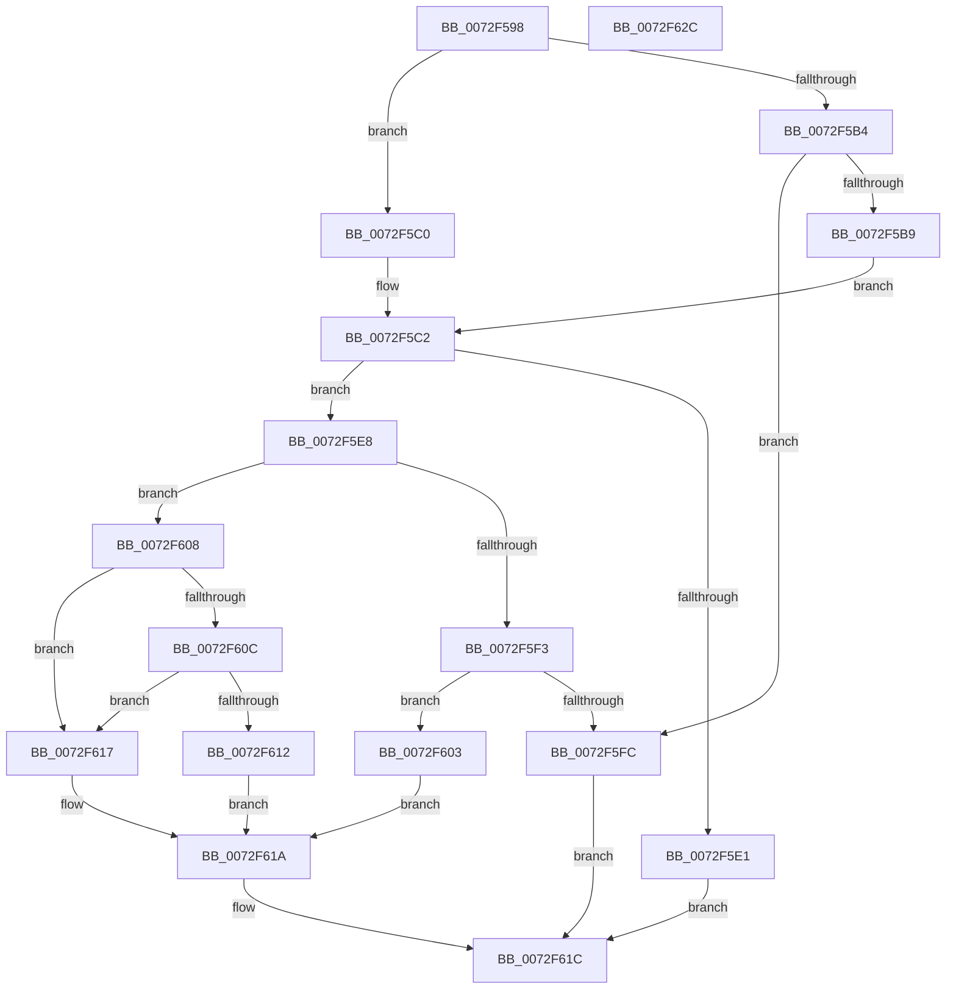

# IopTranslateBusAddress

- RVA: `0x0072F598`–`0x0072F62D` (길이 `149` bytes)
- VA: `0x000000014072F598`
- 실행 섹션: `PAGE`
- PDB 이름 있음: `예`; PDB Function 태그: `아니요`
- unwind 정보 RVA: `0x0009A6A8`
- 디코드: `49`개 명령, `149/149` bytes 표시
- 미해석 바이트: `0` (있으면 어셈블리에 `.byte`로 보존)

> 이 문서는 커널 이미지의 기계어와 PDB 기호를 분석해 생성했습니다. 4번과 5번은 함수 원형과 자료형을 바이너리 사용 방식에서 추정한 C 해석이며 원본 소스 복구 결과는 아닙니다.

## 1. Dependencies

- 직접 호출 지점: **1**; 고유 호출 대상: **1**
- 직접 호출자로 확인된 함수: **1**
- RIP 상대 이미지 참조: **0**

### Outgoing calls
- `0x0072F5D8` → [HalTranslateBusAddress](../../text/46/HalTranslateBusAddress_function_004610B0.md) (function, `0x004610B0`)

### Direct callers
- [IopGenericTranslateOrdering](IopGenericTranslateOrdering_function_0072EE00.md) at `0x0072EE4D`
- [IopGenericTranslateOrdering](IopGenericTranslateOrdering_function_0072EE00.md) at `0x0072EE66`

### Static image references
- 디코드된 RIP-relative 메모리 참조가 없습니다.

## 2. Other-region calls and transfers

- 다른 실행 섹션으로 향하는 call: **1**
  - `0x0072F5D8` → [HalTranslateBusAddress](../../text/46/HalTranslateBusAddress_function_004610B0.md) (`PAGE` → `.text`)
- 별도 외부 분기/꼬리 이동을 확인하지 못했습니다.

## 3. Assembly (complete function range)

```asm
0072F598  48 89 5C 24 08                  mov qword ptr [rsp + 8], rbx
0072F59D  48 89 74 24 18                  mov qword ptr [rsp + 0x18], rsi
0072F5A2  57                              push rdi
0072F5A3  48 83 EC 30                     sub rsp, 0x30
0072F5A7  40 8A F2                        mov sil, dl
0072F5AA  49 8B D9                        mov rbx, r9
0072F5AD  8D 46 FD                        lea eax, [rsi - 3]
0072F5B0  A8 FB                           test al, 0xfb
0072F5B2  74 0C                           je 0x14072f5c0
0072F5B4  80 FA 01                        cmp dl, 1
0072F5B7  75 43                           jne 0x14072f5fc
0072F5B9  BF 01 00 00 00                  mov edi, 1
0072F5BE  EB 02                           jmp 0x14072f5c2
0072F5C0  33 FF                           xor edi, edi
0072F5C2  33 D2                           xor edx, edx
0072F5C4  4C 89 44 24 20                  mov qword ptr [rsp + 0x20], r8
0072F5C9  4C 8B C1                        mov r8, rcx
0072F5CC  89 7C 24 48                     mov dword ptr [rsp + 0x48], edi
0072F5D0  4C 8D 4C 24 48                  lea r9, [rsp + 0x48]
0072F5D5  8D 4A 01                        lea ecx, [rdx + 1]
0072F5D8  E8 D3 1A D3 FF                  call 0x1404610b0
0072F5DD  84 C0                           test al, al
0072F5DF  75 07                           jne 0x14072f5e8
0072F5E1  B8 01 00 00 C0                  mov eax, 0xc0000001
0072F5E6  EB 34                           jmp 0x14072f61c
0072F5E8  8B 44 24 48                     mov eax, dword ptr [rsp + 0x48]
0072F5EC  A9 F9 FF FF FF                  test eax, 0xfffffff9
0072F5F1  74 15                           je 0x14072f608
0072F5F3  FF C8                           dec eax
0072F5F5  A9 FD FF FF FF                  test eax, 0xfffffffd
0072F5FA  74 07                           je 0x14072f603
0072F5FC  B8 0D 00 00 C0                  mov eax, 0xc000000d
0072F601  EB 19                           jmp 0x14072f61c
0072F603  C6 03 01                        mov byte ptr [rbx], 1
0072F606  EB 12                           jmp 0x14072f61a
0072F608  85 FF                           test edi, edi
0072F60A  75 0B                           jne 0x14072f617
0072F60C  40 80 FE 07                     cmp sil, 7
0072F610  75 05                           jne 0x14072f617
0072F612  40 88 33                        mov byte ptr [rbx], sil
0072F615  EB 03                           jmp 0x14072f61a
0072F617  C6 03 03                        mov byte ptr [rbx], 3
0072F61A  33 C0                           xor eax, eax
0072F61C  48 8B 5C 24 40                  mov rbx, qword ptr [rsp + 0x40]
0072F621  48 8B 74 24 50                  mov rsi, qword ptr [rsp + 0x50]
0072F626  48 83 C4 30                     add rsp, 0x30
0072F62A  5F                              pop rdi
0072F62B  C3                              ret
0072F62C  CC                              int3
```

## 4. C-style interpretation (structured pseudocode)

```c
__int64 __fastcall IopTranslateBusAddress(__int64 a1, int a2, __int64 a3, __int64 a4)
{
    __int64 result;
    __int64 v_rdi;
    __int64 v_rsp;
    unsigned __int64 v_stack_m18;
    unsigned int v_stack_p10;
    unsigned __int64 v_stack_p18;
    unsigned __int64 v_stack_p8;

    v_stack_p8 = v_rbx;
    v_stack_p18 = v_rsi;
    v_rsp = (v_rsp) - (48);
    if ((((unsigned __int8)((unsigned __int8)(a2) - 3)) & (251)) == 0) goto loc_0072F5C0;
    if (((unsigned __int8)(a2)) != 1) goto loc_0072F5FC;
    goto loc_0072F5C2;
loc_0072F5C0:
    v_rdi = 0;
loc_0072F5C2:
    a2 = 0;
    v_stack_m18 = a3;
    v_stack_p10 = 0;
    result = HalTranslateBusAddress(a2 + 1, a2, a1, v_stack_p10);
    if ((unsigned __int8)(result) != 0) goto loc_0072F5E8;
    goto loc_0072F61C;
loc_0072F5E8:
    if ((((unsigned int)((unsigned int)(v_stack_p10))) & (0xFFFFFFF9ULL)) == 0) goto loc_0072F608;
    result = (unsigned int)(((unsigned int)(v_stack_p10)) - 1);
    if ((((unsigned int)(result)) & (0xFFFFFFFDULL)) == 0) goto loc_0072F603;
loc_0072F5FC:
    goto loc_0072F61C;
loc_0072F603:
    *(unsigned __int8 *)(a4) = 1;
    goto loc_0072F61A;
loc_0072F608:
    if (0 != 0) goto loc_0072F617;
    if (((unsigned __int8)((unsigned __int8)(a2))) != 7) goto loc_0072F617;
    *(unsigned __int8 *)(a4) = (unsigned __int8)((unsigned __int8)(a2));
    goto loc_0072F61A;
loc_0072F617:
    *(unsigned __int8 *)(a4) = 3;
loc_0072F61A:
    result = 0;
loc_0072F61C:
    v_rsp = (v_rsp) + (48);
    return result;
}
```

## 5. (Beta) C Style

```c
int64_t IopTranslateBusAddress(int64_t Arg1, void *Arg2, int64_t Arg3, void *Arg4)
{
    uint8_t *arg2 = (uint8_t *)Arg2;
    uint8_t *arg4 = (uint8_t *)Arg4;

    int64_t result;
    int64_t local_rdi;
    int64_t local_rsp;
    uint64_t v_stack_m18;
    uint32_t v_stack_p10;
    uint64_t v_stack_p18;
    uint64_t v_stack_p8;

    v_stack_p8 = local_rbx;
    v_stack_p18 = local_rsi;
    local_rsp = (local_rsp) - (48);
    if ((((uint8_t)((uint8_t)(Arg2) - 3)) & (251)) == 0) goto loc_0072F5C0;
    if (((uint8_t)(Arg2)) != 1) goto loc_0072F5FC;
    goto loc_0072F5C2;
loc_0072F5C0:
    local_rdi = 0;
loc_0072F5C2:
    Arg2 = 0;
    v_stack_m18 = Arg3;
    v_stack_p10 = 0;
    result = HalTranslateBusAddress(Arg2 + 1, Arg2, Arg1, v_stack_p10);
    if ((uint8_t)(result) != 0) goto loc_0072F5E8;
    goto loc_0072F61C;
loc_0072F5E8:
    if ((((uint32_t)((uint32_t)(v_stack_p10))) & (0xFFFFFFF9ULL)) == 0) goto loc_0072F608;
    result = (uint32_t)(((uint32_t)(v_stack_p10)) - 1);
    if ((((uint32_t)(result)) & (0xFFFFFFFDULL)) == 0) goto loc_0072F603;
loc_0072F5FC:
    goto loc_0072F61C;
loc_0072F603:
    *(uint8_t *)(arg4) = 1;
    goto loc_0072F61A;
loc_0072F608:
    if (0 != 0) goto loc_0072F617;
    if (((uint8_t)((uint8_t)(Arg2))) != 7) goto loc_0072F617;
    *(uint8_t *)(arg4) = (uint8_t)((uint8_t)(Arg2));
    goto loc_0072F61A;
loc_0072F617:
    *(uint8_t *)(arg4) = 3;
loc_0072F61A:
    result = 0;
loc_0072F61C:
    local_rsp = (local_rsp) + (48);
    return result;
}
```

### 관측된 메모리 오프셋

구조체 형식이 확인되지 않은 접근은 인자 기준의 오프셋으로만 기록했습니다.

| 기준 인자 | 오프셋 표현 | 폭 (bit) | 접근 |
|---|---:|---:|---|
| `Arg2` | `- 0x3` | `32` | `R` |
| `Arg4` | `+ 0x0` | `8` | `W` |

## 6. Execution-region graph

[열기: 2D/3D 그래프와 함수 탐색 컨트롤 패널](../../../control-panel.html?section=page&rva=0x0072F598&view=graph)

- 2D 그래프는 위에서 아래로 흐르고, 3D 그래프는 빈 공간을 드래그해 회전합니다. Shift+드래그는 이동, 휠은 확대·축소, 함수 노드 선택은 대상 보고서 이동입니다.

### Static fallback


