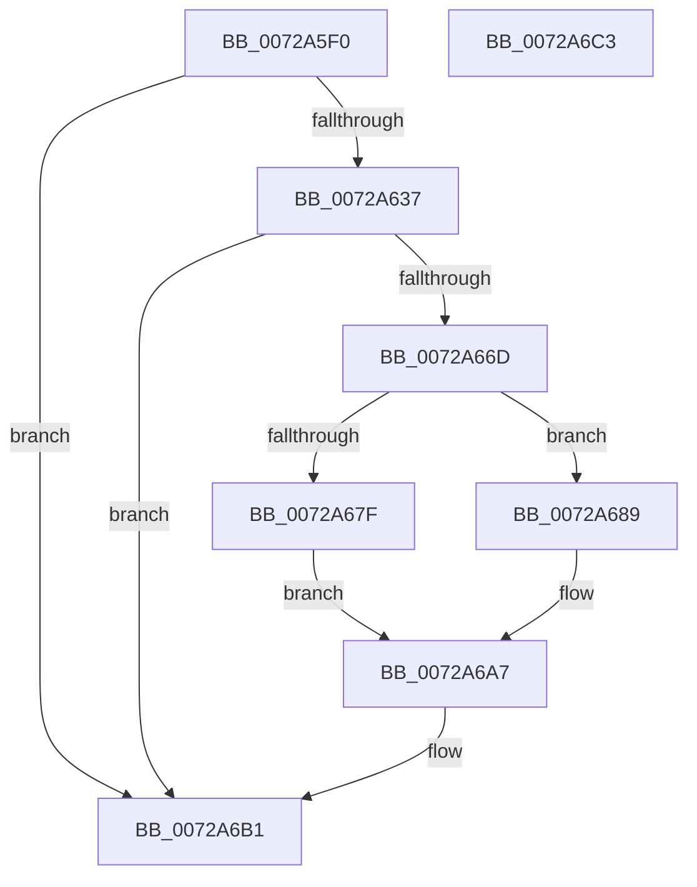

# IopWriteResourceList

- RVA: `0x0072A5F0`–`0x0072A6C4` (길이 `212` bytes)
- VA: `0x000000014072A5F0`
- 실행 섹션: `PAGE`
- PDB 이름 있음: `예`; PDB Function 태그: `아니요`
- unwind 정보 RVA: `0x000718AC`
- 디코드: `56`개 명령, `212/212` bytes 표시
- 미해석 바이트: `0` (있으면 어셈블리에 `.byte`로 보존)

> 이 문서는 커널 이미지의 기계어와 PDB 기호를 분석해 생성했습니다. 4번과 5번은 함수 원형과 자료형을 바이너리 사용 방식에서 추정한 C 해석이며 원본 소스 복구 결과는 아닙니다.

## 1. Dependencies

- 직접 호출 지점: **6**; 고유 호출 대상: **4**
- 직접 호출자로 확인된 함수: **3**
- RIP 상대 이미지 참조: **0**

### Outgoing calls
- `0x0072A62C` → [IopCreateRegistryKeyEx](../A8/IopCreateRegistryKeyEx_function_00A89038.md) (function, `0x00A89038`)
- `0x0072A658` → [IopCreateRegistryKeyEx](../A8/IopCreateRegistryKeyEx_function_00A89038.md) (function, `0x00A89038`)
- `0x0072A664` → [ZwClose](../../text/6A/ZwClose_function_006AD2B0.md) (function, `0x006AD2B0`)
- `0x0072A682` → [ZwDeleteValueKey](../../text/6A/ZwDeleteValueKey_function_006AECB0.md) (function, `0x006AECB0`)
- `0x0072A6A2` → [ZwSetValueKey](../../text/6A/ZwSetValueKey_function_006ADCD0.md) (function, `0x006ADCD0`)
- `0x0072A6AC` → [ZwClose](../../text/6A/ZwClose_function_006AD2B0.md) (function, `0x006AD2B0`)

### Direct callers
- [PnpBuildCmResourceList](../AA/PnpBuildCmResourceList_function_00AAB034.md) at `0x00AAB42E`
- [PnpBuildCmResourceList](../AA/PnpBuildCmResourceList_function_00AAB034.md) at `0x00AAB46E`
- [IoReportHalResourceUsage](../../init/C3/IoReportHalResourceUsage_function_00C32FB0.md) at `0x00C3309B`
- [IoReportHalResourceUsage](../../init/C3/IoReportHalResourceUsage_function_00C32FB0.md) at `0x00C33100`
- [IopInitializeResourceMap](../../init/C3/IopInitializeResourceMap_function_00C33198.md) at `0x00C334EC`

### Static image references
- 디코드된 RIP-relative 메모리 참조가 없습니다.

## 2. Other-region calls and transfers

- 다른 실행 섹션으로 향하는 call: **4**
  - `0x0072A664` → [ZwClose](../../text/6A/ZwClose_function_006AD2B0.md) (`PAGE` → `.text`)
  - `0x0072A682` → [ZwDeleteValueKey](../../text/6A/ZwDeleteValueKey_function_006AECB0.md) (`PAGE` → `.text`)
  - `0x0072A6A2` → [ZwSetValueKey](../../text/6A/ZwSetValueKey_function_006ADCD0.md) (`PAGE` → `.text`)
  - `0x0072A6AC` → [ZwClose](../../text/6A/ZwClose_function_006AD2B0.md) (`PAGE` → `.text`)
- 별도 외부 분기/꼬리 이동을 확인하지 못했습니다.

## 3. Assembly (complete function range)

```asm
0072A5F0  48 8B C4                        mov rax, rsp
0072A5F3  48 89 58 08                     mov qword ptr [rax + 8], rbx
0072A5F7  48 89 70 10                     mov qword ptr [rax + 0x10], rsi
0072A5FB  57                              push rdi
0072A5FC  48 83 EC 40                     sub rsp, 0x40
0072A600  48 83 60 E0 00                  and qword ptr [rax - 0x20], 0
0072A605  49 8B F0                        mov rsi, r8
0072A608  48 83 60 E8 00                  and qword ptr [rax - 0x18], 0
0072A60D  4C 8B C2                        mov r8, rdx
0072A610  48 83 60 F0 00                  and qword ptr [rax - 0x10], 0
0072A615  48 8B D1                        mov rdx, rcx
0072A618  49 8B D9                        mov rbx, r9
0072A61B  C7 40 D8 01 00 00 00            mov dword ptr [rax - 0x28], 1
0072A622  48 8D 48 E8                     lea rcx, [rax - 0x18]
0072A626  41 B9 1F 00 02 00               mov r9d, 0x2001f
0072A62C  E8 07 EA 35 00                  call 0x140a89038
0072A631  8B F8                           mov edi, eax
0072A633  85 C0                           test eax, eax
0072A635  78 7A                           js 0x14072a6b1
0072A637  48 83 64 24 28 00               and qword ptr [rsp + 0x28], 0
0072A63D  48 8D 4C 24 38                  lea rcx, [rsp + 0x38]
0072A642  48 8B 54 24 30                  mov rdx, qword ptr [rsp + 0x30]
0072A647  41 B9 1F 00 02 00               mov r9d, 0x2001f
0072A64D  4C 8B C6                        mov r8, rsi
0072A650  C7 44 24 20 01 00 00 00         mov dword ptr [rsp + 0x20], 1
0072A658  E8 DB E9 35 00                  call 0x140a89038
0072A65D  48 8B 4C 24 30                  mov rcx, qword ptr [rsp + 0x30]
0072A662  8B F8                           mov edi, eax
0072A664  E8 47 2C F8 FF                  call 0x1406ad2b0
0072A669  85 FF                           test edi, edi
0072A66B  78 44                           js 0x14072a6b1
0072A66D  48 8B 4C 24 70                  mov rcx, qword ptr [rsp + 0x70]
0072A672  48 8B D3                        mov rdx, rbx
0072A675  48 8B 5C 24 38                  mov rbx, qword ptr [rsp + 0x38]
0072A67A  83 39 00                        cmp dword ptr [rcx], 0
0072A67D  75 0A                           jne 0x14072a689
0072A67F  48 8B CB                        mov rcx, rbx
0072A682  E8 29 46 F8 FF                  call 0x1406aecb0
0072A687  EB 1E                           jmp 0x14072a6a7
0072A689  8B 44 24 78                     mov eax, dword ptr [rsp + 0x78]
0072A68D  41 B9 08 00 00 00               mov r9d, 8
0072A693  89 44 24 28                     mov dword ptr [rsp + 0x28], eax
0072A697  45 33 C0                        xor r8d, r8d
0072A69A  48 89 4C 24 20                  mov qword ptr [rsp + 0x20], rcx
0072A69F  48 8B CB                        mov rcx, rbx
0072A6A2  E8 29 36 F8 FF                  call 0x1406adcd0
0072A6A7  48 8B CB                        mov rcx, rbx
0072A6AA  8B F8                           mov edi, eax
0072A6AC  E8 FF 2B F8 FF                  call 0x1406ad2b0
0072A6B1  48 8B 5C 24 50                  mov rbx, qword ptr [rsp + 0x50]
0072A6B6  8B C7                           mov eax, edi
0072A6B8  48 8B 74 24 58                  mov rsi, qword ptr [rsp + 0x58]
0072A6BD  48 83 C4 40                     add rsp, 0x40
0072A6C1  5F                              pop rdi
0072A6C2  C3                              ret
0072A6C3  CC                              int3
```

## 4. C-style interpretation (structured pseudocode)

```c
__int64 __fastcall IopWriteResourceList(__int64 a1, __int64 a2, __int64 a3, __int64 a4, __int64 a5, unsigned int a6)
{
    __int64 result;
    __int64 v_rsp;
    unsigned __int64 v_stack_m10;
    unsigned __int64 v_stack_m18;
    unsigned __int64 v_stack_m20;
    unsigned int v_stack_m28;
    unsigned __int64 v_stack_p10;
    unsigned __int64 v_stack_p8;

    *(unsigned __int64 *)(v_rsp + 8) = v_rbx;
    *(unsigned __int64 *)(v_rsp + 16) = v_rsi;
    v_rsp = (v_rsp) - (64);
    *(unsigned int *)(v_rsp - 40) = 1;
    result = IopCreateRegistryKeyEx(v_rsp - 24, a1, a2, (unsigned int)(0x2001FULL));
    if (sign_flag) goto loc_0072A6B1;
    v_stack_m28 = 1;
    result = IopCreateRegistryKeyEx(v_stack_m10, v_stack_m18, a3, (unsigned int)(0x2001FULL));
    result = ZwClose(v_stack_m18, v_stack_m18, a3, (unsigned int)(0x2001FULL));
    if (sign_flag) goto loc_0072A6B1;
    if ((*(unsigned int *)(a5)) != 0) goto loc_0072A689;
    result = ZwDeleteValueKey(v_stack_m10, a4, a3, (unsigned int)(0x2001FULL));
    goto loc_0072A6A7;
loc_0072A689:
    v_stack_m20 = (unsigned int)((unsigned int)(a6));
    a3 = 0;
    v_stack_m28 = v_stack_m10;
    result = ZwSetValueKey(v_stack_m10, a4, a3, 8);
loc_0072A6A7:
    result = ZwClose(v_stack_m10, a4, a3, 8);
loc_0072A6B1:
    v_rsp = (v_rsp) + (64);
    return (unsigned int)((unsigned int)((unsigned int)((unsigned int)(result))));
}
```

## 5. (Beta) C Style

```c
int64_t IopWriteResourceList(int64_t Arg1, int64_t Arg2, int64_t Arg3, int64_t Arg4, void *Arg5, uint32_t Arg6)
{
    uint8_t *arg5 = (uint8_t *)Arg5;

    int64_t result;
    int64_t local_rsp;
    uint64_t v_stack_m10;
    uint64_t v_stack_m18;
    uint64_t v_stack_m20;
    uint32_t v_stack_m28;
    uint64_t v_stack_p10;
    uint64_t v_stack_p8;

    *(uint64_t *)(local_rsp + 0x8) = local_rbx;
    *(uint64_t *)(local_rsp + 0x10) = local_rsi;
    local_rsp = (local_rsp) - (64);
    *(uint32_t *)(local_rsp - 0x28) = 1;
    result = IopCreateRegistryKeyEx(local_rsp - 24, Arg1, Arg2, (uint32_t)(0x2001FULL));
    if (sign_flag) goto loc_0072A6B1;
    v_stack_m28 = 1;
    result = IopCreateRegistryKeyEx(v_stack_m10, v_stack_m18, Arg3, (uint32_t)(0x2001FULL));
    result = ZwClose(v_stack_m18, v_stack_m18, Arg3, (uint32_t)(0x2001FULL));
    if (sign_flag) goto loc_0072A6B1;
    if ((*(uint32_t *)(arg5)) != 0) goto loc_0072A689;
    result = ZwDeleteValueKey(v_stack_m10, Arg4, Arg3, (uint32_t)(0x2001FULL));
    goto loc_0072A6A7;
loc_0072A689:
    v_stack_m20 = (uint32_t)((uint32_t)(Arg6));
    Arg3 = 0;
    v_stack_m28 = v_stack_m10;
    result = ZwSetValueKey(v_stack_m10, Arg4, Arg3, 8);
loc_0072A6A7:
    result = ZwClose(v_stack_m10, Arg4, Arg3, 8);
loc_0072A6B1:
    local_rsp = (local_rsp) + (64);
    return (uint32_t)((uint32_t)((uint32_t)((uint32_t)(result))));
}
```

### 관측된 메모리 오프셋

구조체 형식이 확인되지 않은 접근은 인자 기준의 오프셋으로만 기록했습니다.

| 기준 인자 | 오프셋 표현 | 폭 (bit) | 접근 |
|---|---:|---:|---|
| `Arg5` | `+ 0x0` | `32` | `R` |

## 6. Execution-region graph

[열기: 2D/3D 그래프와 함수 탐색 컨트롤 패널](../../../control-panel.html?section=page&rva=0x0072A5F0&view=graph)

- 2D 그래프는 위에서 아래로 흐르고, 3D 그래프는 빈 공간을 드래그해 회전합니다. Shift+드래그는 이동, 휠은 확대·축소, 함수 노드 선택은 대상 보고서 이동입니다.

### Static fallback


