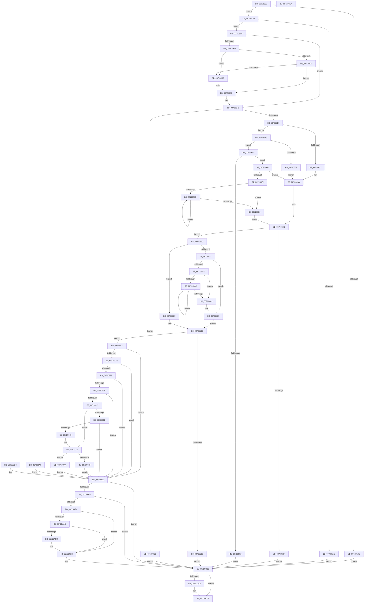

# NtCreateIoRing

- RVA: `0x00720530`–`0x00720CEB` (길이 `1,979` bytes)
- VA: `0x0000000140720530`
- 실행 섹션: `PAGE`
- PDB 이름 있음: `예`; PDB Function 태그: `아니요`
- unwind 정보 RVA: `0x000C7860`
- 디코드: `405`개 명령, `1,979/1,979` bytes 표시
- 미해석 바이트: `0` (있으면 어셈블리에 `.byte`로 보존)

> 이 문서는 커널 이미지의 기계어와 PDB 기호를 분석해 생성했습니다. 4번과 5번은 함수 원형과 자료형을 바이너리 사용 방식에서 추정한 C 해석이며 원본 소스 복구 결과는 아닙니다.

## 1. Dependencies

- 직접 호출 지점: **17**; 고유 호출 대상: **16**
- 직접 호출자로 확인된 함수: **0**
- RIP 상대 이미지 참조: **6**

### Outgoing calls
- `0x007205F1` → [ProbeForWrite](../8E/ProbeForWrite_function_008E91C0.md) (function, `0x008E91C0`)
- `0x00720736` → [ObCreateObjectEx](../89/ObCreateObjectEx_function_0089B1E0.md) (function, `0x0089B1E0`)
- `0x00720758` → [memset](../../text/6C/memset_function_006C6C40.md) (function, `0x006C6C40`)
- `0x007207CD` → [KeInitializeEvent](../../text/40/KeInitializeEvent_function_0040DD10.md) (function, `0x0040DD10`)
- `0x00720824` → [MmCreateSection](../98/MmCreateSection_function_009838B0.md) (function, `0x009838B0`)
- `0x00720848` → [MmMapViewInSessionSpace](../98/MmMapViewInSessionSpace_function_00982480.md) (function, `0x00982480`)
- `0x00720882` → [IopAllocateAndLockMdl](../71/IopAllocateAndLockMdl_function_0071AC6C.md) (function, `0x0071AC6C`)
- `0x00720903` → [MmMapViewOfSection](../98/MmMapViewOfSection_function_00981680.md) (function, `0x00981680`)
- `0x00720964` → [ObInsertObjectEx](../8B/ObInsertObjectEx_function_008B97A0.md) (function, `0x008B97A0`)
- `0x007209BF` → [ObCloseHandle](../8A/ObCloseHandle_function_008A1870.md) (function, `0x008A1870`)
- `0x00720A04` → [PsGetProcessImageFileName](../../text/45/PsGetProcessImageFileName_function_00453720.md) (function, `0x00453720`)
- `0x00720A2F` → [tlgKeywordOn](../../text/42/tlgKeywordOn_function_0042EAA0.md) (function, `0x0042EAA0`)
- `0x00720A81` → [tlgCreate1Sz_char](../../text/42/tlgCreate1Sz_char_function_00427304.md) (function, `0x00427304`)
- `0x00720A91` → [tlgCreate1Sz_char](../../text/42/tlgCreate1Sz_char_function_00427304.md) (function, `0x00427304`)
- `0x00720CAD` → [tlgWriteAgg](../../text/2F/tlgWriteAgg_function_002F0F7C.md) (function, `0x002F0F7C`)
- `0x00720CC0` → [ObfDereferenceObject](../../text/2F/ObfDereferenceObject_function_002F9350.md) (function, `0x002F9350`)
- `0x00720CD2` → [_security_check_cookie](../../text/6A/_security_check_cookie_function_006AC640.md) (function, `0x006AC640`)

### Direct callers
- 이 함수 시작 RVA로 연결되는 직접 call은 확인되지 않았습니다. 간접 호출은 완전히 역산할 수 없습니다.

### Static image references
- `0x00720543` → RVA `0x00E0A740` (`.data`; read)
- `0x0072072D` → RVA `0x00FC7078` (`ALMOSTRO`; read)
- `0x00720A11` → RVA `0x00E06E68` (`.data`; read)
- `0x00720A64` → RVA `0x00AFCF80` (` ?? ::NNGAKEGL::`string'`; read)
- `0x00720A6B` → RVA `0x00AFCF70` (` ?? ::NNGAKEGL::`string'`; read)
- `0x00720C9F` → RVA `0x00045DDF` (`.rdata`; read)

## 2. Other-region calls and transfers

- 다른 실행 섹션으로 향하는 call: **9**
  - `0x00720758` → [memset](../../text/6C/memset_function_006C6C40.md) (`PAGE` → `.text`)
  - `0x007207CD` → [KeInitializeEvent](../../text/40/KeInitializeEvent_function_0040DD10.md) (`PAGE` → `.text`)
  - `0x00720A04` → [PsGetProcessImageFileName](../../text/45/PsGetProcessImageFileName_function_00453720.md) (`PAGE` → `.text`)
  - `0x00720A2F` → [tlgKeywordOn](../../text/42/tlgKeywordOn_function_0042EAA0.md) (`PAGE` → `.text`)
  - `0x00720A81` → [tlgCreate1Sz_char](../../text/42/tlgCreate1Sz_char_function_00427304.md) (`PAGE` → `.text`)
  - `0x00720A91` → [tlgCreate1Sz_char](../../text/42/tlgCreate1Sz_char_function_00427304.md) (`PAGE` → `.text`)
  - `0x00720CAD` → [tlgWriteAgg](../../text/2F/tlgWriteAgg_function_002F0F7C.md) (`PAGE` → `.text`)
  - `0x00720CC0` → [ObfDereferenceObject](../../text/2F/ObfDereferenceObject_function_002F9350.md) (`PAGE` → `.text`)
  - `0x00720CD2` → [_security_check_cookie](../../text/6A/_security_check_cookie_function_006AC640.md) (`PAGE` → `.text`)
- 별도 외부 분기/꼬리 이동을 확인하지 못했습니다.

## 3. Assembly (complete function range)

```asm
00720530  40 53                           push rbx
00720532  56                              push rsi
00720533  57                              push rdi
00720534  41 54                           push r12
00720536  41 55                           push r13
00720538  41 56                           push r14
0072053A  41 57                           push r15
0072053C  48 81 EC 40 02 00 00            sub rsp, 0x240
00720543  48 8B 05 F6 A1 6E 00            mov rax, qword ptr [rip + 0x6ea1f6]
0072054A  48 33 C4                        xor rax, rsp
0072054D  48 89 84 24 30 02 00 00         mov qword ptr [rsp + 0x230], rax
00720555  49 8B F8                        mov rdi, r8
00720558  4C 8B C1                        mov r8, rcx
0072055B  48 89 8C 24 C0 00 00 00         mov qword ptr [rsp + 0xc0], rcx
00720563  4C 8B AC 24 A0 02 00 00         mov r13, qword ptr [rsp + 0x2a0]
0072056B  33 DB                           xor ebx, ebx
0072056D  89 5C 24 5C                     mov dword ptr [rsp + 0x5c], ebx
00720571  65 48 8B 04 25 88 01 00 00      mov rax, qword ptr gs:[0x188]
0072057A  44 8A B8 32 02 00 00            mov r15b, byte ptr [rax + 0x232]
00720581  44 88 7C 24 58                  mov byte ptr [rsp + 0x58], r15b
00720586  0F 57 C0                        xorps xmm0, xmm0
00720589  33 C0                           xor eax, eax
0072058B  0F 11 44 24 60                  movups xmmword ptr [rsp + 0x60], xmm0
00720590  89 44 24 70                     mov dword ptr [rsp + 0x70], eax
00720594  48 89 5C 24 50                  mov qword ptr [rsp + 0x50], rbx
00720599  83 FA 14                        cmp edx, 0x14
0072059C  73 0A                           jae 0x1407205a8
0072059E  BF F0 00 00 C0                  mov edi, 0xc00000f0
007205A3  E9 0E 07 00 00                  jmp 0x140720cb6
007205A8  41 83 F9 30                     cmp r9d, 0x30
007205AC  73 0A                           jae 0x1407205b8
007205AE  BF 23 00 00 C0                  mov edi, 0xc0000023
007205B3  E9 FE 06 00 00                  jmp 0x140720cb6
007205B8  45 84 FF                        test r15b, r15b
007205BB  74 39                           je 0x1407205f6
007205BD  8B D2                           mov edx, edx
007205BF  48 03 D7                        add rdx, rdi
007205C2  48 B9 00 00 FF FF FF 7F 00 00   movabs rcx, 0x7fffffff0000
007205CC  48 3B D1                        cmp rdx, rcx
007205CF  77 05                           ja 0x1407205d6
007205D1  48 3B D7                        cmp rdx, rdi
007205D4  73 02                           jae 0x1407205d8
007205D6  8A 01                           mov al, byte ptr [rcx]
007205D8  4C 3B C1                        cmp r8, rcx
007205DB  49 0F 42 C8                     cmovb rcx, r8
007205DF  48 8B 01                        mov rax, qword ptr [rcx]
007205E2  48 89 01                        mov qword ptr [rcx], rax
007205E5  41 8B D1                        mov edx, r9d
007205E8  41 B8 01 00 00 00               mov r8d, 1
007205EE  49 8B CD                        mov rcx, r13
007205F1  E8 CA 8B 1C 00                  call 0x1408e91c0
007205F6  0F 10 07                        movups xmm0, xmmword ptr [rdi]
007205F9  0F 11 44 24 60                  movups xmmword ptr [rsp + 0x60], xmm0
007205FE  8B 47 10                        mov eax, dword ptr [rdi + 0x10]
00720601  89 44 24 70                     mov dword ptr [rsp + 0x70], eax
00720605  44 8B 64 24 60                  mov r12d, dword ptr [rsp + 0x60]
0072060A  41 8D 44 24 FF                  lea eax, [r12 - 1]
0072060F  3D 8F 01 00 00                  cmp eax, 0x18f
00720614  0F 87 B2 03 00 00               ja 0x1407209cc
0072061A  48 8B 44 24 60                  mov rax, qword ptr [rsp + 0x60]
0072061F  48 C1 E8 20                     shr rax, 0x20
00720623  85 C0                           test eax, eax
00720625  75 22                           jne 0x140720649
00720627  8D 70 20                        lea esi, [rax + 0x20]
0072062A  83 CA FF                        or edx, 0xffffffff
0072062D  89 74 24 64                     mov dword ptr [rsp + 0x64], esi
00720631  44 8B 74 24 68                  mov r14d, dword ptr [rsp + 0x68]
00720636  41 81 FE 00 00 02 00            cmp r14d, 0x20000
0072063D  76 4D                           jbe 0x14072068c
0072063F  BF 05 00 46 C0                  mov edi, 0xc0460005
00720644  E9 6D 06 00 00                  jmp 0x140720cb6
00720649  8B 74 24 64                     mov esi, dword ptr [rsp + 0x64]
0072064D  83 FE 08                        cmp esi, 8
00720650  73 07                           jae 0x140720659
00720652  BE 08 00 00 00                  mov esi, 8
00720657  EB D1                           jmp 0x14072062a
00720659  81 FE 00 00 01 00               cmp esi, 0x10000
0072065F  76 0A                           jbe 0x14072066b
00720661  BF 04 00 46 C0                  mov edi, 0xc0460004
00720666  E9 4B 06 00 00                  jmp 0x140720cb6
0072066B  8D 46 FF                        lea eax, [rsi - 1]
0072066E  85 C6                           test esi, eax
00720670  74 B8                           je 0x14072062a
00720672  83 CA FF                        or edx, 0xffffffff
00720675  8B CA                           mov ecx, edx
00720677  85 F6                           test esi, esi
00720679  74 06                           je 0x140720681
0072067B  FF C1                           inc ecx
0072067D  D1 EE                           shr esi, 1
0072067F  75 FA                           jne 0x14072067b
00720681  FF C1                           inc ecx
00720683  BE 01 00 00 00                  mov esi, 1
00720688  D3 E6                           shl esi, cl
0072068A  EB A1                           jmp 0x14072062d
0072068C  8D 04 36                        lea eax, [rsi + rsi]
0072068F  44 3B F0                        cmp r14d, eax
00720692  76 28                           jbe 0x1407206bc
00720694  41 8D 46 FF                     lea eax, [r14 - 1]
00720698  41 85 C6                        test r14d, eax
0072069B  74 18                           je 0x1407206b5
0072069D  45 85 F6                        test r14d, r14d
007206A0  74 07                           je 0x1407206a9
007206A2  FF C2                           inc edx
007206A4  41 D1 EE                        shr r14d, 1
007206A7  75 F9                           jne 0x1407206a2
007206A9  8D 4A 01                        lea ecx, [rdx + 1]
007206AC  41 BE 01 00 00 00               mov r14d, 1
007206B2  41 D3 E6                        shl r14d, cl
007206B5  44 89 74 24 68                  mov dword ptr [rsp + 0x68], r14d
007206BA  EB 07                           jmp 0x1407206c3
007206BC  44 8B F0                        mov r14d, eax
007206BF  89 44 24 68                     mov dword ptr [rsp + 0x68], eax
007206C3  39 5C 24 6C                     cmp dword ptr [rsp + 0x6c], ebx
007206C7  74 0A                           je 0x1407206d3
007206C9  BF 01 00 46 C0                  mov edi, 0xc0460001
007206CE  E9 E3 05 00 00                  jmp 0x140720cb6
007206D3  48 C7 84 24 D8 00 00 00 30 00 00 00  mov qword ptr [rsp + 0xd8], 0x30
007206DF  48 89 9C 24 F0 00 00 00         mov qword ptr [rsp + 0xf0], rbx
007206E7  48 89 9C 24 E0 00 00 00         mov qword ptr [rsp + 0xe0], rbx
007206EF  48 89 9C 24 E8 00 00 00         mov qword ptr [rsp + 0xe8], rbx
007206F7  0F 57 C0                        xorps xmm0, xmm0
007206FA  F3 0F 7F 84 24 F8 00 00 00      movdqu xmmword ptr [rsp + 0xf8], xmm0
00720703  48 89 5C 24 48                  mov qword ptr [rsp + 0x48], rbx
00720708  48 8D 44 24 50                  lea rax, [rsp + 0x50]
0072070D  48 89 44 24 40                  mov qword ptr [rsp + 0x40], rax
00720712  89 5C 24 38                     mov dword ptr [rsp + 0x38], ebx
00720716  89 5C 24 30                     mov dword ptr [rsp + 0x30], ebx
0072071A  C7 44 24 28 D0 00 00 00         mov dword ptr [rsp + 0x28], 0xd0
00720722  45 8A CF                        mov r9b, r15b
00720725  4C 8D 84 24 D8 00 00 00         lea r8, [rsp + 0xd8]
0072072D  48 8B 15 44 69 8A 00            mov rdx, qword ptr [rip + 0x8a6944]
00720734  33 C9                           xor ecx, ecx
00720736  E8 A5 AA 17 00                  call 0x14089b1e0
0072073B  8B F8                           mov edi, eax
0072073D  89 44 24 5C                     mov dword ptr [rsp + 0x5c], eax
00720741  85 C0                           test eax, eax
00720743  0F 88 98 02 00 00               js 0x1407209e1
00720749  BF D0 00 00 00                  mov edi, 0xd0
0072074E  44 8B C7                        mov r8d, edi
00720751  33 D2                           xor edx, edx
00720753  48 8B 4C 24 50                  mov rcx, qword ptr [rsp + 0x50]
00720758  E8 E3 64 FA FF                  call 0x1406c6c40
0072075D  48 8B 44 24 50                  mov rax, qword ptr [rsp + 0x50]
00720762  66 C7 00 0E 00                  mov word ptr [rax], 0xe
00720767  48 8B 44 24 50                  mov rax, qword ptr [rsp + 0x50]
0072076C  66 89 78 02                     mov word ptr [rax + 2], di
00720770  48 8B 44 24 50                  mov rax, qword ptr [rsp + 0x50]
00720775  44 89 60 08                     mov dword ptr [rax + 8], r12d
00720779  48 8B 44 24 50                  mov rax, qword ptr [rsp + 0x50]
0072077E  89 70 14                        mov dword ptr [rax + 0x14], esi
00720781  48 8B 44 24 50                  mov rax, qword ptr [rsp + 0x50]
00720786  44 89 70 1C                     mov dword ptr [rax + 0x1c], r14d
0072078A  48 8B 44 24 50                  mov rax, qword ptr [rsp + 0x50]
0072078F  89 58 0C                        mov dword ptr [rax + 0xc], ebx
00720792  48 8B 44 24 50                  mov rax, qword ptr [rsp + 0x50]
00720797  89 58 10                        mov dword ptr [rax + 0x10], ebx
0072079A  8D 4E FF                        lea ecx, [rsi - 1]
0072079D  48 8B 44 24 50                  mov rax, qword ptr [rsp + 0x50]
007207A2  89 48 18                        mov dword ptr [rax + 0x18], ecx
007207A5  41 8D 4E FF                     lea ecx, [r14 - 1]
007207A9  48 8B 44 24 50                  mov rax, qword ptr [rsp + 0x50]
007207AE  89 48 20                        mov dword ptr [rax + 0x20], ecx
007207B1  48 8B 44 24 50                  mov rax, qword ptr [rsp + 0x50]
007207B6  48 89 58 68                     mov qword ptr [rax + 0x68], rbx
007207BA  48 8B 4C 24 50                  mov rcx, qword ptr [rsp + 0x50]
007207BF  48 81 C1 88 00 00 00            add rcx, 0x88
007207C6  45 33 C0                        xor r8d, r8d
007207C9  41 8D 50 01                     lea edx, [r8 + 1]
007207CD  E8 3E D5 CE FF                  call 0x14040dd10
007207D2  44 8B E6                        mov r12d, esi
007207D5  49 C1 E4 06                     shl r12, 6
007207D9  49 83 C4 57                     add r12, 0x57
007207DD  49 83 E4 F8                     and r12, 0xfffffffffffffff8
007207E1  41 8B C6                        mov eax, r14d
007207E4  48 8D 48 02                     lea rcx, [rax + 2]
007207E8  48 8D 0C 48                     lea rcx, [rax + rcx*2]
007207EC  49 8D 04 CC                     lea rax, [r12 + rcx*8]
007207F0  48 89 44 24 78                  mov qword ptr [rsp + 0x78], rax
007207F5  48 8B 4C 24 50                  mov rcx, qword ptr [rsp + 0x50]
007207FA  48 83 C1 38                     add rcx, 0x38
007207FE  48 89 5C 24 38                  mov qword ptr [rsp + 0x38], rbx
00720803  48 89 5C 24 30                  mov qword ptr [rsp + 0x30], rbx
00720808  C7 44 24 28 00 00 00 08         mov dword ptr [rsp + 0x28], 0x8000000
00720810  BE 04 00 00 00                  mov esi, 4
00720815  89 74 24 20                     mov dword ptr [rsp + 0x20], esi
00720819  4C 8D 4C 24 78                  lea r9, [rsp + 0x78]
0072081E  45 33 C0                        xor r8d, r8d
00720821  8D 56 02                        lea edx, [rsi + 2]
00720824  E8 87 30 26 00                  call 0x1409838b0
00720829  8B F8                           mov edi, eax
0072082B  89 44 24 5C                     mov dword ptr [rsp + 0x5c], eax
0072082F  85 C0                           test eax, eax
00720831  0F 88 AA 01 00 00               js 0x1407209e1
00720837  48 8B 4C 24 50                  mov rcx, qword ptr [rsp + 0x50]
0072083C  4C 8D 41 58                     lea r8, [rcx + 0x58]
00720840  48 8D 51 40                     lea rdx, [rcx + 0x40]
00720844  48 8B 49 38                     mov rcx, qword ptr [rcx + 0x38]
00720848  E8 33 1C 26 00                  call 0x140982480
0072084D  8B F8                           mov edi, eax
0072084F  89 44 24 5C                     mov dword ptr [rsp + 0x5c], eax
00720853  85 C0                           test eax, eax
00720855  0F 88 86 01 00 00               js 0x1407209e1
0072085B  48 8B 44 24 50                  mov rax, qword ptr [rsp + 0x50]
00720860  4C 8D 40 50                     lea r8, [rax + 0x50]
00720864  4C 8D 48 48                     lea r9, [rax + 0x48]
00720868  8B 50 58                        mov edx, dword ptr [rax + 0x58]
0072086B  41 2B D4                        sub edx, r12d
0072086E  48 8B 48 40                     mov rcx, qword ptr [rax + 0x40]
00720872  49 03 CC                        add rcx, r12
00720875  4C 89 44 24 28                  mov qword ptr [rsp + 0x28], r8
0072087A  4C 89 4C 24 20                  mov qword ptr [rsp + 0x20], r9
0072087F  45 33 C0                        xor r8d, r8d
00720882  E8 E5 A3 FF FF                  call 0x14071ac6c
00720887  8B F8                           mov edi, eax
00720889  89 44 24 5C                     mov dword ptr [rsp + 0x5c], eax
0072088D  85 C0                           test eax, eax
0072088F  0F 88 4C 01 00 00               js 0x1407209e1
00720895  45 84 FF                        test r15b, r15b
00720898  0F 84 93 00 00 00               je 0x140720931
0072089E  48 89 9C 24 A8 00 00 00         mov qword ptr [rsp + 0xa8], rbx
007208A6  48 89 9C 24 B0 00 00 00         mov qword ptr [rsp + 0xb0], rbx
007208AE  48 89 5C 24 78                  mov qword ptr [rsp + 0x78], rbx
007208B3  65 48 8B 04 25 88 01 00 00      mov rax, qword ptr gs:[0x188]
007208BC  48 8B 90 B8 00 00 00            mov rdx, qword ptr [rax + 0xb8]
007208C3  89 74 24 48                     mov dword ptr [rsp + 0x48], esi
007208C7  89 5C 24 40                     mov dword ptr [rsp + 0x40], ebx
007208CB  C7 44 24 38 01 00 00 00         mov dword ptr [rsp + 0x38], 1
007208D3  48 8D 84 24 B0 00 00 00         lea rax, [rsp + 0xb0]
007208DB  48 89 44 24 30                  mov qword ptr [rsp + 0x30], rax
007208E0  48 8D 84 24 A8 00 00 00         lea rax, [rsp + 0xa8]
007208E8  48 89 44 24 28                  mov qword ptr [rsp + 0x28], rax
007208ED  48 89 5C 24 20                  mov qword ptr [rsp + 0x20], rbx
007208F2  45 33 C9                        xor r9d, r9d
007208F5  4C 8D 44 24 78                  lea r8, [rsp + 0x78]
007208FA  48 8B 4C 24 50                  mov rcx, qword ptr [rsp + 0x50]
007208FF  48 8B 49 38                     mov rcx, qword ptr [rcx + 0x38]
00720903  E8 78 0D 26 00                  call 0x140981680
00720908  8B F8                           mov edi, eax
0072090A  89 44 24 5C                     mov dword ptr [rsp + 0x5c], eax
0072090E  85 C0                           test eax, eax
00720910  0F 88 CB 00 00 00               js 0x1407209e1
00720916  48 8B 4C 24 78                  mov rcx, qword ptr [rsp + 0x78]
0072091B  4A 8D 14 21                     lea rdx, [rcx + r12]
0072091F  48 8B 44 24 50                  mov rax, qword ptr [rsp + 0x50]
00720924  48 89 48 28                     mov qword ptr [rax + 0x28], rcx
00720928  48 8B 44 24 50                  mov rax, qword ptr [rsp + 0x50]
0072092D  48 89 50 30                     mov qword ptr [rax + 0x30], rdx
00720931  48 89 9C 24 B8 00 00 00         mov qword ptr [rsp + 0xb8], rbx
00720939  48 8D 84 24 B8 00 00 00         lea rax, [rsp + 0xb8]
00720941  48 89 44 24 30                  mov qword ptr [rsp + 0x30], rax
00720946  48 8D 44 24 50                  lea rax, [rsp + 0x50]
0072094B  48 89 44 24 28                  mov qword ptr [rsp + 0x28], rax
00720950  89 5C 24 20                     mov dword ptr [rsp + 0x20], ebx
00720954  41 B9 01 00 00 00               mov r9d, 1
0072095A  45 33 C0                        xor r8d, r8d
0072095D  33 D2                           xor edx, edx
0072095F  48 8B 4C 24 50                  mov rcx, qword ptr [rsp + 0x50]
00720964  E8 37 8E 19 00                  call 0x1408b97a0
00720969  8B F8                           mov edi, eax
0072096B  89 44 24 5C                     mov dword ptr [rsp + 0x5c], eax
0072096F  85 C0                           test eax, eax
00720971  79 07                           jns 0x14072097a
00720973  48 89 5C 24 50                  mov qword ptr [rsp + 0x50], rbx
00720978  EB 67                           jmp 0x1407209e1
0072097A  48 8B 84 24 B8 00 00 00         mov rax, qword ptr [rsp + 0xb8]
00720982  48 8B 8C 24 C0 00 00 00         mov rcx, qword ptr [rsp + 0xc0]
0072098A  48 89 01                        mov qword ptr [rcx], rax
0072098D  48 8B 44 24 50                  mov rax, qword ptr [rsp + 0x50]
00720992  0F 10 40 08                     movups xmm0, xmmword ptr [rax + 8]
00720996  41 0F 11 45 00                  movups xmmword ptr [r13], xmm0
0072099B  0F 10 48 18                     movups xmm1, xmmword ptr [rax + 0x18]
0072099F  41 0F 11 4D 10                  movups xmmword ptr [r13 + 0x10], xmm1
007209A4  0F 10 40 28                     movups xmm0, xmmword ptr [rax + 0x28]
007209A8  41 0F 11 45 20                  movups xmmword ptr [r13 + 0x20], xmm0
007209AD  EB 32                           jmp 0x1407209e1
007209AF  44 8A 7C 24 58                  mov r15b, byte ptr [rsp + 0x58]
007209B4  41 8A D7                        mov dl, r15b
007209B7  48 8B 8C 24 B8 00 00 00         mov rcx, qword ptr [rsp + 0xb8]
007209BF  E8 AC 0E 18 00                  call 0x1408a1870
007209C4  33 DB                           xor ebx, ebx
007209C6  8B 7C 24 5C                     mov edi, dword ptr [rsp + 0x5c]
007209CA  EB 15                           jmp 0x1407209e1
007209CC  BF 03 00 46 C0                  mov edi, 0xc0460003
007209D1  E9 E0 02 00 00                  jmp 0x140720cb6
007209D6  33 DB                           xor ebx, ebx
007209D8  8B 7C 24 5C                     mov edi, dword ptr [rsp + 0x5c]
007209DC  44 8A 7C 24 58                  mov r15b, byte ptr [rsp + 0x58]
007209E1  85 FF                           test edi, edi
007209E3  0F 88 CD 02 00 00               js 0x140720cb6
007209E9  48 39 5C 24 50                  cmp qword ptr [rsp + 0x50], rbx
007209EE  0F 84 C2 02 00 00               je 0x140720cb6
007209F4  65 48 8B 0C 25 88 01 00 00      mov rcx, qword ptr gs:[0x188]
007209FD  48 8B 89 B8 00 00 00            mov rcx, qword ptr [rcx + 0xb8]
00720A04  E8 17 2D D3 FF                  call 0x140453720
00720A09  4C 8B C8                        mov r9, rax
00720A0C  4C 8B 44 24 50                  mov r8, qword ptr [rsp + 0x50]
00720A11  83 3D 50 64 6E 00 05            cmp dword ptr [rip + 0x6e6450], 5
00720A18  0F 86 94 02 00 00               jbe 0x140720cb2
00720A1E  48 BA 00 00 00 00 00 40 00 00   movabs rdx, 0x400000000000
00720A28  48 8D 0D 39 64 6E 00            lea rcx, [rip + 0x6e6439]
00720A2F  E8 6C E0 D0 FF                  call 0x14042eaa0
00720A34  84 C0                           test al, al
00720A36  0F 84 76 02 00 00               je 0x140720cb2
00720A3C  48 C7 84 24 C8 00 00 00 01 00 00 00  mov qword ptr [rsp + 0xc8], 1
00720A48  48 8D 84 24 C8 00 00 00         lea rax, [rsp + 0xc8]
00720A50  48 89 84 24 30 01 00 00         mov qword ptr [rsp + 0x130], rax
00720A58  48 C7 84 24 38 01 00 00 08 00 00 00  mov qword ptr [rsp + 0x138], 8
00720A64  48 8D 05 15 C5 3D 00            lea rax, [rip + 0x3dc515]
00720A6B  48 8D 15 FE C4 3D 00            lea rdx, [rip + 0x3dc4fe]
00720A72  45 84 FF                        test r15b, r15b
00720A75  48 0F 44 D0                     cmove rdx, rax
00720A79  48 8D 8C 24 40 01 00 00         lea rcx, [rsp + 0x140]
00720A81  E8 7E 68 D0 FF                  call 0x140427304
00720A86  49 8B D1                        mov rdx, r9
00720A89  48 8D 8C 24 50 01 00 00         lea rcx, [rsp + 0x150]
00720A91  E8 6E 68 D0 FF                  call 0x140427304
00720A96  8B 4C 24 60                     mov ecx, dword ptr [rsp + 0x60]
00720A9A  89 8C 24 80 00 00 00            mov dword ptr [rsp + 0x80], ecx
00720AA1  48 8D 84 24 80 00 00 00         lea rax, [rsp + 0x80]
00720AA9  48 89 84 24 60 01 00 00         mov qword ptr [rsp + 0x160], rax
00720AB1  48 C7 84 24 68 01 00 00 04 00 00 00  mov qword ptr [rsp + 0x168], 4
00720ABD  8B 44 24 6C                     mov eax, dword ptr [rsp + 0x6c]
00720AC1  89 84 24 84 00 00 00            mov dword ptr [rsp + 0x84], eax
00720AC8  48 8D 84 24 84 00 00 00         lea rax, [rsp + 0x84]
00720AD0  48 89 84 24 70 01 00 00         mov qword ptr [rsp + 0x170], rax
00720AD8  48 C7 84 24 78 01 00 00 04 00 00 00  mov qword ptr [rsp + 0x178], 4
00720AE4  8B 44 24 70                     mov eax, dword ptr [rsp + 0x70]
00720AE8  89 84 24 88 00 00 00            mov dword ptr [rsp + 0x88], eax
00720AEF  48 8D 84 24 88 00 00 00         lea rax, [rsp + 0x88]
00720AF7  48 89 84 24 80 01 00 00         mov qword ptr [rsp + 0x180], rax
00720AFF  48 C7 84 24 88 01 00 00 04 00 00 00  mov qword ptr [rsp + 0x188], 4
00720B0B  8B 44 24 64                     mov eax, dword ptr [rsp + 0x64]
00720B0F  89 84 24 8C 00 00 00            mov dword ptr [rsp + 0x8c], eax
00720B16  48 8D 84 24 8C 00 00 00         lea rax, [rsp + 0x8c]
00720B1E  48 89 84 24 90 01 00 00         mov qword ptr [rsp + 0x190], rax
00720B26  48 C7 84 24 98 01 00 00 04 00 00 00  mov qword ptr [rsp + 0x198], 4
00720B32  8B 44 24 68                     mov eax, dword ptr [rsp + 0x68]
00720B36  89 84 24 90 00 00 00            mov dword ptr [rsp + 0x90], eax
00720B3D  48 8D 84 24 90 00 00 00         lea rax, [rsp + 0x90]
00720B45  48 89 84 24 A0 01 00 00         mov qword ptr [rsp + 0x1a0], rax
00720B4D  48 C7 84 24 A8 01 00 00 04 00 00 00  mov qword ptr [rsp + 0x1a8], 4
00720B59  41 8B 40 08                     mov eax, dword ptr [r8 + 8]
00720B5D  89 84 24 94 00 00 00            mov dword ptr [rsp + 0x94], eax
00720B64  48 8D 84 24 94 00 00 00         lea rax, [rsp + 0x94]
00720B6C  48 89 84 24 B0 01 00 00         mov qword ptr [rsp + 0x1b0], rax
00720B74  48 C7 84 24 B8 01 00 00 04 00 00 00  mov qword ptr [rsp + 0x1b8], 4
00720B80  41 8B 40 0C                     mov eax, dword ptr [r8 + 0xc]
00720B84  89 84 24 98 00 00 00            mov dword ptr [rsp + 0x98], eax
00720B8B  48 8D 84 24 98 00 00 00         lea rax, [rsp + 0x98]
00720B93  48 89 84 24 C0 01 00 00         mov qword ptr [rsp + 0x1c0], rax
00720B9B  48 C7 84 24 C8 01 00 00 04 00 00 00  mov qword ptr [rsp + 0x1c8], 4
00720BA7  41 8B 40 10                     mov eax, dword ptr [r8 + 0x10]
00720BAB  89 84 24 9C 00 00 00            mov dword ptr [rsp + 0x9c], eax
00720BB2  48 8D 84 24 9C 00 00 00         lea rax, [rsp + 0x9c]
00720BBA  48 89 84 24 D0 01 00 00         mov qword ptr [rsp + 0x1d0], rax
00720BC2  48 C7 84 24 D8 01 00 00 04 00 00 00  mov qword ptr [rsp + 0x1d8], 4
00720BCE  41 8B 40 14                     mov eax, dword ptr [r8 + 0x14]
00720BD2  89 84 24 A0 00 00 00            mov dword ptr [rsp + 0xa0], eax
00720BD9  48 8D 84 24 A0 00 00 00         lea rax, [rsp + 0xa0]
00720BE1  48 89 84 24 E0 01 00 00         mov qword ptr [rsp + 0x1e0], rax
00720BE9  48 C7 84 24 E8 01 00 00 04 00 00 00  mov qword ptr [rsp + 0x1e8], 4
00720BF5  41 8B 40 18                     mov eax, dword ptr [r8 + 0x18]
00720BF9  89 84 24 A8 00 00 00            mov dword ptr [rsp + 0xa8], eax
00720C00  48 8D 84 24 A8 00 00 00         lea rax, [rsp + 0xa8]
00720C08  48 89 84 24 F0 01 00 00         mov qword ptr [rsp + 0x1f0], rax
00720C10  48 C7 84 24 F8 01 00 00 04 00 00 00  mov qword ptr [rsp + 0x1f8], 4
00720C1C  41 8B 40 1C                     mov eax, dword ptr [r8 + 0x1c]
00720C20  89 84 24 B0 00 00 00            mov dword ptr [rsp + 0xb0], eax
00720C27  48 8D 84 24 B0 00 00 00         lea rax, [rsp + 0xb0]
00720C2F  48 89 84 24 00 02 00 00         mov qword ptr [rsp + 0x200], rax
00720C37  48 C7 84 24 08 02 00 00 04 00 00 00  mov qword ptr [rsp + 0x208], 4
00720C43  41 8B 40 20                     mov eax, dword ptr [r8 + 0x20]
00720C47  89 44 24 78                     mov dword ptr [rsp + 0x78], eax
00720C4B  48 8D 44 24 78                  lea rax, [rsp + 0x78]
00720C50  48 89 84 24 10 02 00 00         mov qword ptr [rsp + 0x210], rax
00720C58  48 C7 84 24 18 02 00 00 04 00 00 00  mov qword ptr [rsp + 0x218], 4
00720C64  48 C7 84 24 D0 00 00 00 00 00 00 01  mov qword ptr [rsp + 0xd0], 0x1000000
00720C70  48 8D 84 24 D0 00 00 00         lea rax, [rsp + 0xd0]
00720C78  48 89 84 24 20 02 00 00         mov qword ptr [rsp + 0x220], rax
00720C80  48 C7 84 24 28 02 00 00 08 00 00 00  mov qword ptr [rsp + 0x228], 8
00720C8C  48 8D 84 24 10 01 00 00         lea rax, [rsp + 0x110]
00720C94  48 89 44 24 20                  mov qword ptr [rsp + 0x20], rax
00720C99  41 B9 12 00 00 00               mov r9d, 0x12
00720C9F  48 8D 15 39 51 92 FF            lea rdx, [rip - 0x6daec7]
00720CA6  48 8D 0D BB 61 6E 00            lea rcx, [rip + 0x6e61bb]
00720CAD  E8 CA 02 BD FF                  call 0x1402f0f7c
00720CB2  8B 7C 24 5C                     mov edi, dword ptr [rsp + 0x5c]
00720CB6  48 8B 4C 24 50                  mov rcx, qword ptr [rsp + 0x50]
00720CBB  48 85 C9                        test rcx, rcx
00720CBE  74 05                           je 0x140720cc5
00720CC0  E8 8B 86 BD FF                  call 0x1402f9350
00720CC5  8B C7                           mov eax, edi
00720CC7  48 8B 8C 24 30 02 00 00         mov rcx, qword ptr [rsp + 0x230]
00720CCF  48 33 CC                        xor rcx, rsp
00720CD2  E8 69 B9 F8 FF                  call 0x1406ac640
00720CD7  48 81 C4 40 02 00 00            add rsp, 0x240
00720CDE  41 5F                           pop r15
00720CE0  41 5E                           pop r14
00720CE2  41 5D                           pop r13
00720CE4  41 5C                           pop r12
00720CE6  5F                              pop rdi
00720CE7  5E                              pop rsi
00720CE8  5B                              pop rbx
00720CE9  C3                              ret
00720CEA  CC                              int3
```

## 4. C-style interpretation (structured pseudocode)

```c
__int64 __fastcall NtCreateIoRing(__int64 a1, int a2, __int64 a3, int a4, __int64 a5)
{
    __int64 result;
    __int64 v_r12;
    __int64 v_r14;
    __int64 v_rbx;
    __int64 v_rsi;
    __int64 v_rsp;
    unsigned __int64 v_stack_m100;
    unsigned __int64 v_stack_m108;
    unsigned __int64 v_stack_m110;
    unsigned __int64 v_stack_m118;
    unsigned __int64 v_stack_m128;
    unsigned __int64 v_stack_m138;
    unsigned __int64 v_stack_m140;
    unsigned __int64 v_stack_m148;
    unsigned __int64 v_stack_m168;
    unsigned __int64 v_stack_m180;
    unsigned __int64 v_stack_m188;
    unsigned __int64 v_stack_m190;
    unsigned __int64 v_stack_m198;
    unsigned __int64 v_stack_m1A0;
    unsigned __int64 v_stack_m1A8;
    unsigned __int64 v_stack_m1B0;
    unsigned __int64 v_stack_m1B8;
    unsigned __int64 v_stack_m1C0;
    unsigned __int64 v_stack_m1C8;
    unsigned __int64 v_stack_m1D0;
    unsigned int v_stack_m1D8;
    unsigned int v_stack_m1DC;
    unsigned int v_stack_m1E0;
    unsigned int v_stack_m1E4;
    unsigned int v_stack_m1E8;
    unsigned int v_stack_m1EC;
    unsigned int v_stack_m1F0;
    unsigned int v_stack_m1F4;
    unsigned int v_stack_m1F8;
    unsigned __int64 v_stack_m200;
    unsigned int v_stack_m208;
    unsigned int v_stack_m20C;
    unsigned int v_stack_m210;
    unsigned int v_stack_m214;
    unsigned __int64 v_stack_m218;
    unsigned int v_stack_m21C;
    unsigned __int8 v_stack_m220;
    unsigned __int64 v_stack_m228;
    unsigned __int64 v_stack_m230;
    unsigned __int64 v_stack_m238;
    unsigned int v_stack_m240;
    unsigned int v_stack_m248;
    unsigned int v_stack_m250;
    unsigned int v_stack_m258;
    unsigned __int64 v_stack_m48;
    unsigned __int64 v_stack_m50;
    unsigned __int64 v_stack_m58;
    unsigned __int64 v_stack_m60;
    unsigned __int64 v_stack_m68;
    unsigned __int64 v_stack_m70;
    unsigned __int64 v_stack_m78;
    unsigned __int64 v_stack_m80;
    unsigned __int64 v_stack_m88;
    unsigned __int64 v_stack_m90;
    unsigned __int64 v_stack_m98;
    unsigned __int64 v_stack_mA0;
    unsigned __int64 v_stack_mA8;
    unsigned __int64 v_stack_mB0;
    unsigned __int64 v_stack_mB8;
    unsigned __int64 v_stack_mC0;
    unsigned __int64 v_stack_mC8;
    unsigned __int64 v_stack_mD0;
    unsigned __int64 v_stack_mD8;
    unsigned __int64 v_stack_mE0;
    unsigned __int64 v_stack_mE8;
    unsigned __int64 v_stack_mF0;
    unsigned __int64 v_stack_mF8;

    v_rsp = (v_rsp) - (576);
    result = (*(unsigned __int64 *)(v_rip + 7250422)) ^ (v_rsp);
    v_stack_m48 = result;
    v_stack_m1B8 = a1;
    v_rbx = 0;
    v_stack_m21C = 0;
    v_stack_m220 = (unsigned __int8)(*(unsigned __int8 *)(*(unsigned __int64 *)(gs_base + (0 + 392)) + 562));
    result = 0;
    v_stack_m218 = v_xmm0;
    v_stack_m208 = 0;
    v_stack_m228 = 0;
    if (a2 >= 20) goto loc_007205A8;
    goto loc_00720CB6;
loc_007205A8:
    if (a4 >= 48) goto loc_007205B8;
    goto loc_00720CB6;
loc_007205B8:
    if ((unsigned __int8)(*(unsigned __int8 *)(*(unsigned __int64 *)(gs_base + (0 + 392)) + 562)) == 0) goto loc_007205F6;
    a2 = ((unsigned int)(a2)) + ((unsigned int)(0xC0000023ULL));
    if (a2 > a1) goto loc_007205D6;
    if (a2 < ((unsigned int)(0xC0000023ULL))) {
        result = *(unsigned __int8 *)(a1);
    }
    if (a1 < a1) { a1 = a1; }
    *(unsigned __int64 *)(a1) = *(unsigned __int64 *)(a1);
    result = ProbeForWrite(a5, (unsigned int)(a4), 1, a4);
loc_007205F6:
    v_stack_m218 = v_xmm0;
    v_stack_m208 = (unsigned int)((unsigned int)(*(unsigned int *)((unsigned int)(0xC0000023ULL) + 16)));
    if (((unsigned int)((unsigned int)(v_stack_m218) - 1)) > 399) goto loc_007209CC;
    result = (v_stack_m218) >> (32);
    if ((unsigned int)(result) != 0) goto loc_00720649;
loc_0072062A:
    a2 = (unsigned int)(((unsigned int)(a4)) | (0xFFFFFFFFULL));
loc_0072062D:
    v_stack_m214 = (unsigned int)(result + 32);
    if (((unsigned int)((unsigned int)(v_stack_m210))) <= 0x20000ULL) goto loc_0072068C;
    goto loc_00720CB6;
loc_00720649:
    if (((unsigned int)((unsigned int)(v_stack_m214))) >= 8) goto loc_00720659;
    goto loc_0072062A;
loc_00720659:
    if (8 <= 0x10000ULL) goto loc_0072066B;
    goto loc_00720CB6;
loc_0072066B:
    if (((8) & ((unsigned int)(8 - 1))) == 0) goto loc_0072062A;
    a2 = (unsigned int)((a2) | (0xFFFFFFFFULL));
    if (8 == 0) goto loc_00720681;
loc_0072067B:
    a1 = (unsigned int)(((unsigned int)(a2)) + 1);
    v_rsi = (unsigned int)((8) >> (1));
    if (condition_is_not_equal) goto loc_0072067B;
loc_00720681:
    a1 = (unsigned int)((a1) + 1);
    v_rsi = (unsigned int)((1) << ((unsigned __int8)(a1)));
    goto loc_0072062D;
loc_0072068C:
    if (((unsigned int)((unsigned int)(v_stack_m210))) <= ((unsigned int)(v_rsi + v_rsi * 1))) goto loc_007206BC;
    if ((((unsigned int)((unsigned int)(v_stack_m210))) & ((unsigned int)((unsigned int)(v_stack_m210) - 1))) == 0) goto loc_007206B5;
    if ((unsigned int)((unsigned int)(v_stack_m210)) == 0) goto loc_007206A9;
loc_007206A2:
    a2 = (unsigned int)((a2) + 1);
    v_r14 = (unsigned int)(((unsigned int)(v_stack_m210)) >> (1));
    if (condition_is_not_equal) goto loc_007206A2;
loc_007206A9:
    v_r14 = (unsigned int)((1) << ((unsigned __int8)(a2 + 1)));
loc_007206B5:
    v_stack_m210 = (unsigned int)(v_r14);
    goto loc_007206C3;
loc_007206BC:
    v_stack_m210 = (unsigned int)((unsigned int)(v_stack_m210) - 1);
loc_007206C3:
    if (v_stack_m20C == 0) goto loc_007206D3;
    goto loc_00720CB6;
loc_007206D3:
    v_stack_m1A0 = 48;
    v_stack_m188 = 0;
    v_stack_m198 = 0;
    v_stack_m190 = 0;
    v_stack_m180 = v_xmm0;
    v_stack_m230 = 0;
    v_stack_m238 = v_stack_m228;
    v_stack_m240 = 0;
    v_stack_m248 = 0;
    v_stack_m250 = 208;
    a1 = 0;
    result = ObCreateObjectEx(a1, *(unsigned __int64 *)(v_rip + 9070916), v_stack_m1A0, (unsigned __int8)(*(unsigned __int8 *)(*(unsigned __int64 *)(gs_base + (0 + 392)) + 562)));
    v_stack_m21C = (unsigned int)(result);
    if (sign_flag) goto loc_007209E1;
    a2 = 0;
    result = memset(v_stack_m228, a2, 208, (unsigned __int8)(*(unsigned __int8 *)(*(unsigned __int64 *)(gs_base + (0 + 392)) + 562)));
    *(unsigned __int16 *)(v_stack_m228) = 14;
    *(unsigned __int16 *)(v_stack_m228 + 2) = 208;
    *(unsigned int *)(v_stack_m228 + 8) = (unsigned int)((unsigned int)(v_stack_m218));
    *(unsigned int *)(v_stack_m228 + 20) = (unsigned int)(v_rsi);
    *(unsigned int *)(v_stack_m228 + 28) = (unsigned int)((unsigned int)((unsigned int)((unsigned int)(v_stack_m210) - 1)));
    *(unsigned int *)(v_stack_m228 + 12) = 0;
    *(unsigned int *)(v_stack_m228 + 16) = 0;
    *(unsigned int *)(v_stack_m228 + 24) = (unsigned int)(v_rsi - 1);
    *(unsigned int *)(v_stack_m228 + 32) = (unsigned int)((unsigned int)((unsigned int)((unsigned int)(v_stack_m210) - 1)) - 1);
    *(unsigned __int64 *)(v_stack_m228 + 104) = 0;
    a1 = (v_stack_m228) + (136);
    a3 = 0;
    result = KeInitializeEvent(a1, a3 + 1, a3, (unsigned __int8)(*(unsigned __int8 *)(*(unsigned __int64 *)(gs_base + (0 + 392)) + 562)));
    v_r12 = ((unsigned int)((unsigned int)(v_rsi))) << (6);
    v_r12 = (v_r12) + (87);
    v_r12 = (v_r12) & (-8);
    v_stack_m200 = v_r12 + (unsigned int)((unsigned int)((unsigned int)((unsigned int)((unsigned int)(v_stack_m210) - 1)))) + (unsigned int)((unsigned int)((unsigned int)((unsigned int)((unsigned int)(v_stack_m210) - 1)))) + 2 * 2 * 8;
    a1 = (v_stack_m228) + (56);
    v_stack_m240 = 0;
    v_stack_m248 = 0;
    v_stack_m250 = 0x8000000ULL;
    v_stack_m258 = 4;
    a3 = 0;
    result = MmCreateSection(a1, 4 + 2, a3, v_stack_m200);
    v_stack_m21C = (unsigned int)(result);
    if (sign_flag) goto loc_007209E1;
    result = MmMapViewInSessionSpace(*(unsigned __int64 *)(v_stack_m228 + 56), v_stack_m228 + 64, v_stack_m228 + 88, v_stack_m200);
    v_stack_m21C = (unsigned int)(result);
    if (sign_flag) goto loc_007209E1;
    a2 = (unsigned int)(((unsigned int)(*(unsigned int *)(v_stack_m228 + 88))) - ((unsigned int)(v_r12)));
    a1 = (*(unsigned __int64 *)(v_stack_m228 + 64)) + (v_r12);
    v_stack_m250 = v_stack_m228 + 80;
    v_stack_m258 = v_stack_m228 + 72;
    a3 = 0;
    result = IopAllocateAndLockMdl(a1, a2, a3, v_stack_m228 + 72);
    v_stack_m21C = (unsigned int)(result);
    if (sign_flag) goto loc_007209E1;
    if ((unsigned __int8)(*(unsigned __int8 *)(*(unsigned __int64 *)(gs_base + (0 + 392)) + 562)) == 0) goto loc_00720931;
    v_stack_m1D0 = 0;
    v_stack_m1C8 = 0;
    v_stack_m200 = 0;
    v_stack_m230 = 4;
    v_stack_m238 = 0;
    v_stack_m240 = 1;
    v_stack_m248 = v_stack_m1C8;
    v_stack_m250 = v_stack_m1D0;
    v_stack_m258 = 0;
    a4 = 0;
    result = MmMapViewOfSection(*(unsigned __int64 *)(v_stack_m228 + 56), *(unsigned __int64 *)(*(unsigned __int64 *)(gs_base + (0 + 392)) + 184), v_stack_m200, a4);
    v_stack_m21C = (unsigned int)(result);
    if (sign_flag) goto loc_007209E1;
    *(unsigned __int64 *)(v_stack_m228 + 40) = v_stack_m200;
    *(unsigned __int64 *)(v_stack_m228 + 48) = v_stack_m200 + v_r12 * 1;
loc_00720931:
    v_stack_m1C0 = 0;
    v_stack_m248 = v_stack_m1C0;
    v_stack_m250 = v_stack_m228;
    v_stack_m258 = 0;
    a3 = 0;
    a2 = 0;
    result = ObInsertObjectEx(v_stack_m228, a2, a3, 1);
    v_stack_m21C = (unsigned int)(result);
    if (!sign_flag) goto loc_0072097A;
    v_stack_m228 = 0;
    goto loc_007209E1;
loc_0072097A:
    *(unsigned __int64 *)(v_stack_m1B8) = v_stack_m1C0;
    *(unsigned __int64 *)(a5) = v_xmm0;
    *(unsigned __int64 *)(a5 + 16) = v_xmm1;
    *(unsigned __int64 *)(a5 + 32) = v_xmm0;
    goto loc_007209E1;
loc_007209CC:
    goto loc_00720CB6;
loc_007209E1:
    if (sign_flag) goto loc_00720CB6;
    if (v_stack_m228 == 0) goto loc_00720CB6;
    result = PsGetProcessImageFileName(*(unsigned __int64 *)(*(unsigned __int64 *)(gs_base + (0 + 392)) + 184), a2, a3, 1);
    if ((*(unsigned int *)(v_rip + 7234640)) <= 5) goto loc_00720CB2;
    result = tlgKeywordOn(v_rip + 7234617, a2, v_stack_m228, result);
    if ((unsigned __int8)(result) != 0) {
        v_stack_m1B0 = 1;
        result = v_stack_m1B0;
        v_stack_m148 = result;
        v_stack_m140 = 8;
        result = v_rip + 4048149;
        a2 = v_rip + 4048126;
        if ((unsigned __int8)(*(unsigned __int8 *)(*(unsigned __int64 *)(gs_base + (0 + 392)) + 562)) == 0) { a2 = result; }
        a1 = v_stack_m138;
        result = tlgCreate1Sz_char(a1, a2, v_stack_m228, result);
        a2 = result;
        a1 = v_stack_m128;
        result = tlgCreate1Sz_char(a1, a2, v_stack_m228, result);
        a1 = v_stack_m218;
        v_stack_m1F8 = (unsigned int)(a1);
        result = v_stack_m1F8;
        v_stack_m118 = result;
        v_stack_m110 = 4;
        result = v_stack_m20C;
        v_stack_m1F4 = (unsigned int)(result);
        result = v_stack_m1F4;
        v_stack_m108 = result;
        v_stack_m100 = 4;
        result = v_stack_m208;
        v_stack_m1F0 = (unsigned int)(result);
        result = v_stack_m1F0;
        v_stack_mF8 = result;
        v_stack_mF0 = 4;
        result = v_stack_m214;
        v_stack_m1EC = (unsigned int)(result);
        result = v_stack_m1EC;
        v_stack_mE8 = result;
        v_stack_mE0 = 4;
        result = v_stack_m210;
        v_stack_m1E8 = (unsigned int)(result);
        result = v_stack_m1E8;
        v_stack_mD8 = result;
        v_stack_mD0 = 4;
        result = *(unsigned int *)(v_stack_m228 + 8);
        v_stack_m1E4 = (unsigned int)(result);
        result = v_stack_m1E4;
        v_stack_mC8 = result;
        v_stack_mC0 = 4;
        result = *(unsigned int *)(v_stack_m228 + 12);
        v_stack_m1E0 = (unsigned int)(result);
        result = v_stack_m1E0;
        v_stack_mB8 = result;
        v_stack_mB0 = 4;
        result = *(unsigned int *)(v_stack_m228 + 16);
        v_stack_m1DC = (unsigned int)(result);
        result = v_stack_m1DC;
        v_stack_mA8 = result;
        v_stack_mA0 = 4;
        result = *(unsigned int *)(v_stack_m228 + 20);
        v_stack_m1D8 = (unsigned int)(result);
        result = v_stack_m1D8;
        v_stack_m98 = result;
        v_stack_m90 = 4;
        result = *(unsigned int *)(v_stack_m228 + 24);
        v_stack_m1D0 = (unsigned int)(result);
        result = v_stack_m1D0;
        v_stack_m88 = result;
        v_stack_m80 = 4;
        result = *(unsigned int *)(v_stack_m228 + 28);
        v_stack_m1C8 = (unsigned int)(result);
        result = v_stack_m1C8;
        v_stack_m78 = result;
        v_stack_m70 = 4;
        result = *(unsigned int *)(v_stack_m228 + 32);
        v_stack_m200 = (unsigned int)(result);
        result = v_stack_m200;
        v_stack_m68 = result;
        v_stack_m60 = 4;
        v_stack_m1A8 = 0x1000000ULL;
        result = v_stack_m1A8;
        v_stack_m58 = result;
        v_stack_m50 = 8;
        result = v_stack_m168;
        v_stack_m258 = result;
        a4 = 18;
        a2 = v_rip - 7188167;
        a1 = v_rip + 7233979;
        result = tlgWriteAgg(a1, a2, v_stack_m228, a4);
    }
loc_00720CB6:
    if (v_stack_m228 != 0) {
        result = ObfDereferenceObject(v_stack_m228, a2, v_stack_m228, a4);
    }
    a1 = (v_stack_m48) ^ (v_rsp);
    result = _security_check_cookie(a1, a2, v_stack_m228, a4);
    v_rsp = (v_rsp) + (576);
    return result;
}
```

## 5. (Beta) C Style

```c
int64_t NtCreateIoRing(int64_t Arg1, int32_t Arg2, void *Arg3, int32_t Arg4, void *Arg5)
{
    uint8_t *arg3 = (uint8_t *)Arg3;
    uint8_t *arg5 = (uint8_t *)Arg5;

    int64_t result;
    int64_t local_r12;
    int64_t local_r14;
    int64_t local_rbx;
    int64_t local_rsi;
    int64_t local_rsp;
    uint64_t v_stack_m100;
    uint64_t v_stack_m108;
    uint64_t v_stack_m110;
    uint64_t v_stack_m118;
    uint64_t v_stack_m128;
    uint64_t v_stack_m138;
    uint64_t v_stack_m140;
    uint64_t v_stack_m148;
    uint64_t v_stack_m168;
    uint64_t v_stack_m180;
    uint64_t v_stack_m188;
    uint64_t v_stack_m190;
    uint64_t v_stack_m198;
    uint64_t v_stack_m1A0;
    uint64_t v_stack_m1A8;
    uint64_t v_stack_m1B0;
    uint64_t v_stack_m1B8;
    uint64_t v_stack_m1C0;
    uint64_t v_stack_m1C8;
    uint64_t v_stack_m1D0;
    uint32_t v_stack_m1D8;
    uint32_t v_stack_m1DC;
    uint32_t v_stack_m1E0;
    uint32_t v_stack_m1E4;
    uint32_t v_stack_m1E8;
    uint32_t v_stack_m1EC;
    uint32_t v_stack_m1F0;
    uint32_t v_stack_m1F4;
    uint32_t v_stack_m1F8;
    uint64_t v_stack_m200;
    uint32_t v_stack_m208;
    uint32_t v_stack_m20C;
    uint32_t v_stack_m210;
    uint32_t v_stack_m214;
    uint64_t v_stack_m218;
    uint32_t v_stack_m21C;
    uint8_t v_stack_m220;
    uint64_t v_stack_m228;
    uint64_t v_stack_m230;
    uint64_t v_stack_m238;
    uint32_t v_stack_m240;
    uint32_t v_stack_m248;
    uint32_t v_stack_m250;
    uint32_t v_stack_m258;
    uint64_t v_stack_m48;
    uint64_t v_stack_m50;
    uint64_t v_stack_m58;
    uint64_t v_stack_m60;
    uint64_t v_stack_m68;
    uint64_t v_stack_m70;
    uint64_t v_stack_m78;
    uint64_t v_stack_m80;
    uint64_t v_stack_m88;
    uint64_t v_stack_m90;
    uint64_t v_stack_m98;
    uint64_t v_stack_mA0;
    uint64_t v_stack_mA8;
    uint64_t v_stack_mB0;
    uint64_t v_stack_mB8;
    uint64_t v_stack_mC0;
    uint64_t v_stack_mC8;
    uint64_t v_stack_mD0;
    uint64_t v_stack_mD8;
    uint64_t v_stack_mE0;
    uint64_t v_stack_mE8;
    uint64_t v_stack_mF0;
    uint64_t v_stack_mF8;

    local_rsp = (local_rsp) - (576);
    result = (*(uint64_t *)(v_rip + 0x6EA1F6)) ^ (local_rsp);
    v_stack_m48 = result;
    v_stack_m1B8 = Arg1;
    local_rbx = 0;
    v_stack_m21C = 0;
    v_stack_m220 = (uint8_t)(*(uint8_t *)(*(uint64_t *)(gs_base + (0 + 0x188)) + 0x232));
    result = 0;
    v_stack_m218 = v_xmm0;
    v_stack_m208 = 0;
    v_stack_m228 = 0;
    if (Arg2 >= 20) goto loc_007205A8;
    goto loc_00720CB6;
loc_007205A8:
    if (Arg4 >= 48) goto loc_007205B8;
    goto loc_00720CB6;
loc_007205B8:
    if ((uint8_t)(*(uint8_t *)(*(uint64_t *)(gs_base + (0 + 0x188)) + 0x232)) == 0) goto loc_007205F6;
    Arg2 = ((uint32_t)(Arg2)) + ((uint32_t)(0xC0000023ULL));
    if (Arg2 > Arg1) goto loc_007205D6;
    if (Arg2 < ((uint32_t)(0xC0000023ULL))) {
        result = *(uint8_t *)(Arg1);
    }
    if (Arg1 < Arg1) { Arg1 = Arg1; }
    *(uint64_t *)(Arg1) = *(uint64_t *)(Arg1);
    result = ProbeForWrite(Arg5, (uint32_t)(Arg4), 1, Arg4);
loc_007205F6:
    v_stack_m218 = v_xmm0;
    v_stack_m208 = (uint32_t)((uint32_t)(*(uint32_t *)((uint32_t)(0xC0000023ULL) + 0x10)));
    if (((uint32_t)((uint32_t)(v_stack_m218) - 1)) > 399) goto loc_007209CC;
    result = (v_stack_m218) >> (32);
    if ((uint32_t)(result) != 0) goto loc_00720649;
loc_0072062A:
    Arg2 = (uint32_t)(((uint32_t)(Arg4)) | (0xFFFFFFFFULL));
loc_0072062D:
    v_stack_m214 = (uint32_t)(result + 32);
    if (((uint32_t)((uint32_t)(v_stack_m210))) <= 0x20000ULL) goto loc_0072068C;
    goto loc_00720CB6;
loc_00720649:
    if (((uint32_t)((uint32_t)(v_stack_m214))) >= 8) goto loc_00720659;
    goto loc_0072062A;
loc_00720659:
    if (8 <= 0x10000ULL) goto loc_0072066B;
    goto loc_00720CB6;
loc_0072066B:
    if (((8) & ((uint32_t)(8 - 1))) == 0) goto loc_0072062A;
    Arg2 = (uint32_t)((Arg2) | (0xFFFFFFFFULL));
    if (8 == 0) goto loc_00720681;
loc_0072067B:
    Arg1 = (uint32_t)(((uint32_t)(Arg2)) + 1);
    local_rsi = (uint32_t)((8) >> (1));
    if (condition_is_not_equal) goto loc_0072067B;
loc_00720681:
    Arg1 = (uint32_t)((Arg1) + 1);
    local_rsi = (uint32_t)((1) << ((uint8_t)(Arg1)));
    goto loc_0072062D;
loc_0072068C:
    if (((uint32_t)((uint32_t)(v_stack_m210))) <= ((uint32_t)(local_rsi + local_rsi * 1))) goto loc_007206BC;
    if ((((uint32_t)((uint32_t)(v_stack_m210))) & ((uint32_t)((uint32_t)(v_stack_m210) - 1))) == 0) goto loc_007206B5;
    if ((uint32_t)((uint32_t)(v_stack_m210)) == 0) goto loc_007206A9;
loc_007206A2:
    Arg2 = (uint32_t)((Arg2) + 1);
    local_r14 = (uint32_t)(((uint32_t)(v_stack_m210)) >> (1));
    if (condition_is_not_equal) goto loc_007206A2;
loc_007206A9:
    local_r14 = (uint32_t)((1) << ((uint8_t)(Arg2 + 1)));
loc_007206B5:
    v_stack_m210 = (uint32_t)(local_r14);
    goto loc_007206C3;
loc_007206BC:
    v_stack_m210 = (uint32_t)((uint32_t)(v_stack_m210) - 1);
loc_007206C3:
    if (v_stack_m20C == 0) goto loc_007206D3;
    goto loc_00720CB6;
loc_007206D3:
    v_stack_m1A0 = 48;
    v_stack_m188 = 0;
    v_stack_m198 = 0;
    v_stack_m190 = 0;
    v_stack_m180 = v_xmm0;
    v_stack_m230 = 0;
    v_stack_m238 = v_stack_m228;
    v_stack_m240 = 0;
    v_stack_m248 = 0;
    v_stack_m250 = 208;
    Arg1 = 0;
    result = ObCreateObjectEx(Arg1, *(uint64_t *)(v_rip + 0x8A6944), v_stack_m1A0, (uint8_t)(*(uint8_t *)(*(uint64_t *)(gs_base + (0 + 0x188)) + 0x232)));
    v_stack_m21C = (uint32_t)(result);
    if (sign_flag) goto loc_007209E1;
    Arg2 = 0;
    result = memset(v_stack_m228, Arg2, 208, (uint8_t)(*(uint8_t *)(*(uint64_t *)(gs_base + (0 + 0x188)) + 0x232)));
    *(uint16_t *)(v_stack_m228) = 14;
    *(uint16_t *)(v_stack_m228 + 0x2) = 208;
    *(uint32_t *)(v_stack_m228 + 0x8) = (uint32_t)((uint32_t)(v_stack_m218));
    *(uint32_t *)(v_stack_m228 + 0x14) = (uint32_t)(local_rsi);
    *(uint32_t *)(v_stack_m228 + 0x1C) = (uint32_t)((uint32_t)((uint32_t)((uint32_t)(v_stack_m210) - 1)));
    *(uint32_t *)(v_stack_m228 + 0xC) = 0;
    *(uint32_t *)(v_stack_m228 + 0x10) = 0;
    *(uint32_t *)(v_stack_m228 + 0x18) = (uint32_t)(local_rsi - 1);
    *(uint32_t *)(v_stack_m228 + 0x20) = (uint32_t)((uint32_t)((uint32_t)((uint32_t)(v_stack_m210) - 1)) - 1);
    *(uint64_t *)(v_stack_m228 + 0x68) = 0;
    Arg1 = (v_stack_m228) + (136);
    Arg3 = 0;
    result = KeInitializeEvent(Arg1, Arg3 + 1, Arg3, (uint8_t)(*(uint8_t *)(*(uint64_t *)(gs_base + (0 + 0x188)) + 0x232)));
    local_r12 = ((uint32_t)((uint32_t)(local_rsi))) << (6);
    local_r12 = (local_r12) + (87);
    local_r12 = (local_r12) & (-8);
    v_stack_m200 = local_r12 + (uint32_t)((uint32_t)((uint32_t)((uint32_t)((uint32_t)(v_stack_m210) - 1)))) + (uint32_t)((uint32_t)((uint32_t)((uint32_t)((uint32_t)(v_stack_m210) - 1)))) + 2 * 2 * 8;
    Arg1 = (v_stack_m228) + (56);
    v_stack_m240 = 0;
    v_stack_m248 = 0;
    v_stack_m250 = 0x8000000ULL;
    v_stack_m258 = 4;
    Arg3 = 0;
    result = MmCreateSection(Arg1, 4 + 2, Arg3, v_stack_m200);
    v_stack_m21C = (uint32_t)(result);
    if (sign_flag) goto loc_007209E1;
    result = MmMapViewInSessionSpace(*(uint64_t *)(v_stack_m228 + 0x38), v_stack_m228 + 64, v_stack_m228 + 88, v_stack_m200);
    v_stack_m21C = (uint32_t)(result);
    if (sign_flag) goto loc_007209E1;
    Arg2 = (uint32_t)(((uint32_t)(*(uint32_t *)(v_stack_m228 + 0x58))) - ((uint32_t)(local_r12)));
    Arg1 = (*(uint64_t *)(v_stack_m228 + 0x40)) + (local_r12);
    v_stack_m250 = v_stack_m228 + 80;
    v_stack_m258 = v_stack_m228 + 72;
    Arg3 = 0;
    result = IopAllocateAndLockMdl(Arg1, Arg2, Arg3, v_stack_m228 + 72);
    v_stack_m21C = (uint32_t)(result);
    if (sign_flag) goto loc_007209E1;
    if ((uint8_t)(*(uint8_t *)(*(uint64_t *)(gs_base + (0 + 0x188)) + 0x232)) == 0) goto loc_00720931;
    v_stack_m1D0 = 0;
    v_stack_m1C8 = 0;
    v_stack_m200 = 0;
    v_stack_m230 = 4;
    v_stack_m238 = 0;
    v_stack_m240 = 1;
    v_stack_m248 = v_stack_m1C8;
    v_stack_m250 = v_stack_m1D0;
    v_stack_m258 = 0;
    Arg4 = 0;
    result = MmMapViewOfSection(*(uint64_t *)(v_stack_m228 + 0x38), *(uint64_t *)(*(uint64_t *)(gs_base + (0 + 0x188)) + 0xB8), v_stack_m200, Arg4);
    v_stack_m21C = (uint32_t)(result);
    if (sign_flag) goto loc_007209E1;
    *(uint64_t *)(v_stack_m228 + 0x28) = v_stack_m200;
    *(uint64_t *)(v_stack_m228 + 0x30) = v_stack_m200 + local_r12 * 1;
loc_00720931:
    v_stack_m1C0 = 0;
    v_stack_m248 = v_stack_m1C0;
    v_stack_m250 = v_stack_m228;
    v_stack_m258 = 0;
    Arg3 = 0;
    Arg2 = 0;
    result = ObInsertObjectEx(v_stack_m228, Arg2, Arg3, 1);
    v_stack_m21C = (uint32_t)(result);
    if (!sign_flag) goto loc_0072097A;
    v_stack_m228 = 0;
    goto loc_007209E1;
loc_0072097A:
    *(uint64_t *)(v_stack_m1B8) = v_stack_m1C0;
    *(uint64_t *)(arg5) = v_xmm0;
    *(uint64_t *)(arg5 + 0x10) = v_xmm1;
    *(uint64_t *)(arg5 + 0x20) = v_xmm0;
    goto loc_007209E1;
loc_007209CC:
    goto loc_00720CB6;
loc_007209E1:
    if (sign_flag) goto loc_00720CB6;
    if (v_stack_m228 == 0) goto loc_00720CB6;
    result = PsGetProcessImageFileName(*(uint64_t *)(*(uint64_t *)(gs_base + (0 + 0x188)) + 0xB8), Arg2, Arg3, 1);
    if ((*(uint32_t *)(v_rip + 0x6E6450)) <= 5) goto loc_00720CB2;
    result = tlgKeywordOn(v_rip + 7234617, Arg2, v_stack_m228, result);
    if ((uint8_t)(result) != 0) {
        v_stack_m1B0 = 1;
        result = v_stack_m1B0;
        v_stack_m148 = result;
        v_stack_m140 = 8;
        result = v_rip + 4048149;
        Arg2 = v_rip + 4048126;
        if ((uint8_t)(*(uint8_t *)(*(uint64_t *)(gs_base + (0 + 0x188)) + 0x232)) == 0) { Arg2 = result; }
        Arg1 = v_stack_m138;
        result = tlgCreate1Sz_char(Arg1, Arg2, v_stack_m228, result);
        Arg2 = result;
        Arg1 = v_stack_m128;
        result = tlgCreate1Sz_char(Arg1, Arg2, v_stack_m228, result);
        Arg1 = v_stack_m218;
        v_stack_m1F8 = (uint32_t)(Arg1);
        result = v_stack_m1F8;
        v_stack_m118 = result;
        v_stack_m110 = 4;
        result = v_stack_m20C;
        v_stack_m1F4 = (uint32_t)(result);
        result = v_stack_m1F4;
        v_stack_m108 = result;
        v_stack_m100 = 4;
        result = v_stack_m208;
        v_stack_m1F0 = (uint32_t)(result);
        result = v_stack_m1F0;
        v_stack_mF8 = result;
        v_stack_mF0 = 4;
        result = v_stack_m214;
        v_stack_m1EC = (uint32_t)(result);
        result = v_stack_m1EC;
        v_stack_mE8 = result;
        v_stack_mE0 = 4;
        result = v_stack_m210;
        v_stack_m1E8 = (uint32_t)(result);
        result = v_stack_m1E8;
        v_stack_mD8 = result;
        v_stack_mD0 = 4;
        result = *(uint32_t *)(v_stack_m228 + 0x8);
        v_stack_m1E4 = (uint32_t)(result);
        result = v_stack_m1E4;
        v_stack_mC8 = result;
        v_stack_mC0 = 4;
        result = *(uint32_t *)(v_stack_m228 + 0xC);
        v_stack_m1E0 = (uint32_t)(result);
        result = v_stack_m1E0;
        v_stack_mB8 = result;
        v_stack_mB0 = 4;
        result = *(uint32_t *)(v_stack_m228 + 0x10);
        v_stack_m1DC = (uint32_t)(result);
        result = v_stack_m1DC;
        v_stack_mA8 = result;
        v_stack_mA0 = 4;
        result = *(uint32_t *)(v_stack_m228 + 0x14);
        v_stack_m1D8 = (uint32_t)(result);
        result = v_stack_m1D8;
        v_stack_m98 = result;
        v_stack_m90 = 4;
        result = *(uint32_t *)(v_stack_m228 + 0x18);
        v_stack_m1D0 = (uint32_t)(result);
        result = v_stack_m1D0;
        v_stack_m88 = result;
        v_stack_m80 = 4;
        result = *(uint32_t *)(v_stack_m228 + 0x1C);
        v_stack_m1C8 = (uint32_t)(result);
        result = v_stack_m1C8;
        v_stack_m78 = result;
        v_stack_m70 = 4;
        result = *(uint32_t *)(v_stack_m228 + 0x20);
        v_stack_m200 = (uint32_t)(result);
        result = v_stack_m200;
        v_stack_m68 = result;
        v_stack_m60 = 4;
        v_stack_m1A8 = 0x1000000ULL;
        result = v_stack_m1A8;
        v_stack_m58 = result;
        v_stack_m50 = 8;
        result = v_stack_m168;
        v_stack_m258 = result;
        Arg4 = 18;
        Arg2 = v_rip - 7188167;
        Arg1 = v_rip + 7233979;
        result = tlgWriteAgg(Arg1, Arg2, v_stack_m228, Arg4);
    }
loc_00720CB6:
    if (v_stack_m228 != 0) {
        result = ObfDereferenceObject(v_stack_m228, Arg2, v_stack_m228, Arg4);
    }
    Arg1 = (v_stack_m48) ^ (local_rsp);
    result = _security_check_cookie(Arg1, Arg2, v_stack_m228, Arg4);
    local_rsp = (local_rsp) + (576);
    return result;
}
```

### 관측된 메모리 오프셋

구조체 형식이 확인되지 않은 접근은 인자 기준의 오프셋으로만 기록했습니다.

| 기준 인자 | 오프셋 표현 | 폭 (bit) | 접근 |
|---|---:|---:|---|
| `Arg3` | `+ 0x0` | `128` | `R` |
| `Arg3` | `+ 0x10` | `32` | `R` |
| `Arg5` | `+ 0x0` | `128` | `R` |
| `Arg5` | `+ 0x10` | `128` | `R` |
| `Arg5` | `+ 0x20` | `128` | `R` |

## 6. Execution-region graph

[열기: 2D/3D 그래프와 함수 탐색 컨트롤 패널](../../../control-panel.html?section=page&rva=0x00720530&view=graph)

- 2D 그래프는 위에서 아래로 흐르고, 3D 그래프는 빈 공간을 드래그해 회전합니다. Shift+드래그는 이동, 휠은 확대·축소, 함수 노드 선택은 대상 보고서 이동입니다.

### Static fallback


