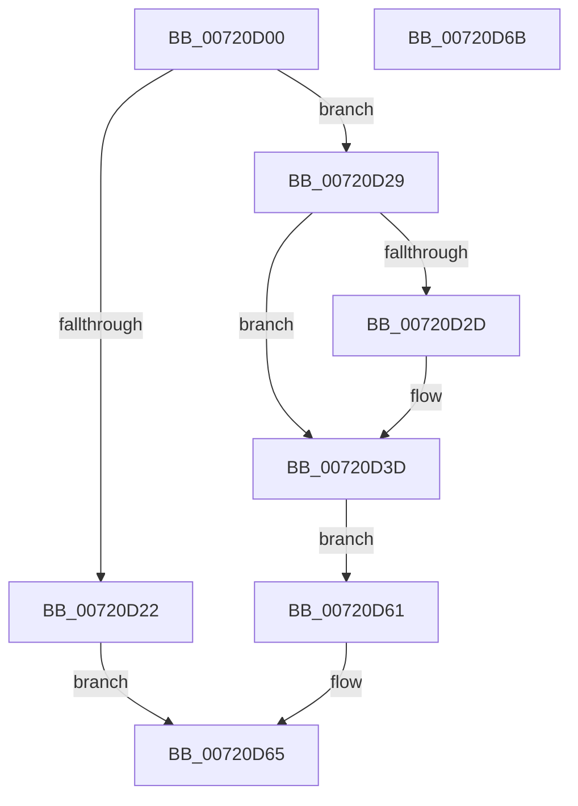

# NtQueryIoRingCapabilities

- RVA: `0x00720D00`–`0x00720D6C` (길이 `108` bytes)
- VA: `0x0000000140720D00`
- 실행 섹션: `PAGE`
- PDB 이름 있음: `예`; PDB Function 태그: `아니요`
- unwind 정보 RVA: `0x000C77F8`
- 디코드: `27`개 명령, `108/108` bytes 표시
- 미해석 바이트: `0` (있으면 어셈블리에 `.byte`로 보존)

> 이 문서는 커널 이미지의 기계어와 PDB 기호를 분석해 생성했습니다. 4번과 5번은 함수 원형과 자료형을 바이너리 사용 방식에서 추정한 C 해석이며 원본 소스 복구 결과는 아닙니다.

## 1. Dependencies

- 직접 호출 지점: **1**; 고유 호출 대상: **1**
- 직접 호출자로 확인된 함수: **0**
- RIP 상대 이미지 참조: **0**

### Outgoing calls
- `0x00720D38` → [ProbeForWrite](../8E/ProbeForWrite_function_008E91C0.md) (function, `0x008E91C0`)

### Direct callers
- 이 함수 시작 RVA로 연결되는 직접 call은 확인되지 않았습니다. 간접 호출은 완전히 역산할 수 없습니다.

### Static image references
- 디코드된 RIP-relative 메모리 참조가 없습니다.

## 2. Other-region calls and transfers

- 다른 실행 섹션으로 향하는 call: **0**
- 별도 외부 분기/꼬리 이동을 확인하지 못했습니다.

## 3. Assembly (complete function range)

```asm
00720D00  40 53                           push rbx
00720D02  48 83 EC 30                     sub rsp, 0x30
00720D06  48 8B DA                        mov rbx, rdx
00720D09  83 64 24 20 00                  and dword ptr [rsp + 0x20], 0
00720D0E  65 48 8B 04 25 88 01 00 00      mov rax, qword ptr gs:[0x188]
00720D17  8A 90 32 02 00 00               mov dl, byte ptr [rax + 0x232]
00720D1D  83 F9 14                        cmp ecx, 0x14
00720D20  73 07                           jae 0x140720d29
00720D22  B8 23 00 00 C0                  mov eax, 0xc0000023
00720D27  EB 3C                           jmp 0x140720d65
00720D29  84 D2                           test dl, dl
00720D2B  74 10                           je 0x140720d3d
00720D2D  8B D1                           mov edx, ecx
00720D2F  41 B8 01 00 00 00               mov r8d, 1
00720D35  48 8B CB                        mov rcx, rbx
00720D38  E8 83 84 1C 00                  call 0x1408e91c0
00720D3D  C7 03 90 01 00 00               mov dword ptr [rbx], 0x190
00720D43  C7 43 04 09 00 00 00            mov dword ptr [rbx + 4], 9
00720D4A  C7 43 08 02 00 00 00            mov dword ptr [rbx + 8], 2
00720D51  C7 43 0C 00 00 01 00            mov dword ptr [rbx + 0xc], 0x10000
00720D58  C7 43 10 00 00 02 00            mov dword ptr [rbx + 0x10], 0x20000
00720D5F  EB 00                           jmp 0x140720d61
00720D61  8B 44 24 20                     mov eax, dword ptr [rsp + 0x20]
00720D65  48 83 C4 30                     add rsp, 0x30
00720D69  5B                              pop rbx
00720D6A  C3                              ret
00720D6B  CC                              int3
```

## 4. C-style interpretation (structured pseudocode)

```c
__int64 __fastcall NtQueryIoRingCapabilities(int a1, __int64 a2)
{
    __int64 result;
    __int64 v_rsp;
    unsigned int v_stack_m18;

    v_rsp = (v_rsp) - (48);
    if (a1 >= 20) goto loc_00720D29;
    goto loc_00720D65;
loc_00720D29:
    result = (unsigned int)(0xC0000023ULL);
    if ((unsigned __int8)(*(unsigned __int8 *)(*(unsigned __int64 *)(gs_base + (0 + 392)) + 562)) != 0) {
        a2 = a1;
        a3 = 1;
        a1 = a2;
        result = ProbeForWrite(a1, a2, a3, a4);
    }
    *(unsigned int *)(a2) = 400;
    *(unsigned int *)(a2 + 4) = 9;
    *(unsigned int *)(a2 + 8) = 2;
    *(unsigned int *)(a2 + 12) = 0x10000ULL;
    *(unsigned int *)(a2 + 16) = 0x20000ULL;
    goto loc_00720D61;
loc_00720D61:
loc_00720D65:
    v_rsp = (v_rsp) + (48);
    return (unsigned int)(v_stack_m18);
}
```

## 5. (Beta) C Style

```c
int64_t NtQueryIoRingCapabilities(int32_t Arg1, void *Arg2)
{
    uint8_t *arg2 = (uint8_t *)Arg2;

    int64_t result;
    int64_t local_rsp;
    uint32_t v_stack_m18;

    local_rsp = (local_rsp) - (48);
    if (Arg1 >= 20) goto loc_00720D29;
    goto loc_00720D65;
loc_00720D29:
    result = (uint32_t)(0xC0000023ULL);
    if ((uint8_t)(*(uint8_t *)(*(uint64_t *)(gs_base + (0 + 0x188)) + 0x232)) != 0) {
        Arg2 = Arg1;
        a3 = 1;
        Arg1 = Arg2;
        result = ProbeForWrite(Arg1, Arg2, a3, a4);
    }
    *(uint32_t *)(arg2) = 400;
    *(uint32_t *)(arg2 + 0x4) = 9;
    *(uint32_t *)(arg2 + 0x8) = 2;
    *(uint32_t *)(arg2 + 0xC) = 0x10000ULL;
    *(uint32_t *)(arg2 + 0x10) = 0x20000ULL;
    goto loc_00720D61;
loc_00720D61:
loc_00720D65:
    local_rsp = (local_rsp) + (48);
    return (uint32_t)(v_stack_m18);
}
```

### 관측된 메모리 오프셋

구조체 형식이 확인되지 않은 접근은 인자 기준의 오프셋으로만 기록했습니다.

| 기준 인자 | 오프셋 표현 | 폭 (bit) | 접근 |
|---|---:|---:|---|
| `Arg2` | `+ 0x0` | `32` | `W` |
| `Arg2` | `+ 0x4` | `32` | `W` |
| `Arg2` | `+ 0x8` | `32` | `W` |
| `Arg2` | `+ 0xC` | `32` | `W` |
| `Arg2` | `+ 0x10` | `32` | `W` |

## 6. Execution-region graph

[열기: 2D/3D 그래프와 함수 탐색 컨트롤 패널](../../../control-panel.html?section=page&rva=0x00720D00&view=graph)

- 2D 그래프는 위에서 아래로 흐르고, 3D 그래프는 빈 공간을 드래그해 회전합니다. Shift+드래그는 이동, 휠은 확대·축소, 함수 노드 선택은 대상 보고서 이동입니다.

### Static fallback


