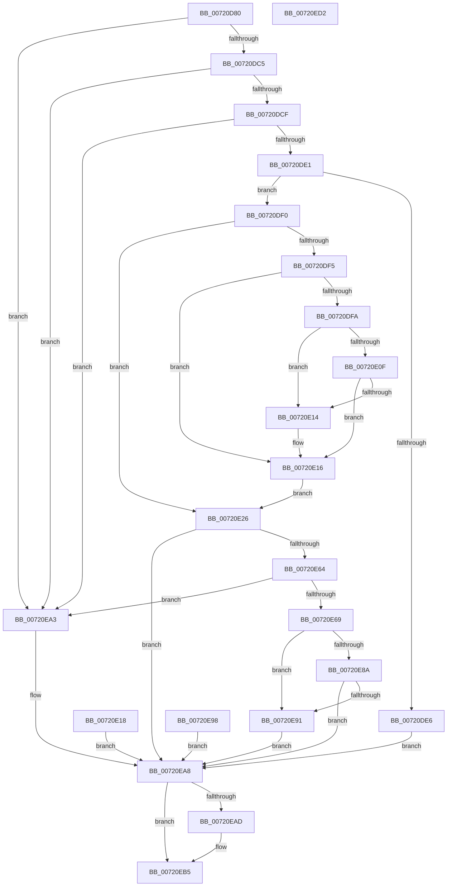

# NtSetInformationIoRing

- RVA: `0x00720D80`–`0x00720ED3` (길이 `339` bytes)
- VA: `0x0000000140720D80`
- 실행 섹션: `PAGE`
- PDB 이름 있음: `예`; PDB Function 태그: `아니요`
- unwind 정보 RVA: `0x000C781C`
- 디코드: `90`개 명령, `339/339` bytes 표시
- 미해석 바이트: `0` (있으면 어셈블리에 `.byte`로 보존)

> 이 문서는 커널 이미지의 기계어와 PDB 기호를 분석해 생성했습니다. 4번과 5번은 함수 원형과 자료형을 바이너리 사용 방식에서 추정한 C 해석이며 원본 소스 복구 결과는 아닙니다.

## 1. Dependencies

- 직접 호출 지점: **3**; 고유 호출 대상: **3**
- 직접 호출자로 확인된 함수: **0**
- RIP 상대 이미지 참조: **2**

### Outgoing calls
- `0x00720E4B` → [ObReferenceObjectByHandle](../86/ObReferenceObjectByHandle_function_00868DB0.md) (function, `0x00868DB0`)
- `0x00720E7C` → [IopIoRingUpdateCompletionUserEvent](../../text/59/IopIoRingUpdateCompletionUserEvent_function_0059886C.md) (function, `0x0059886C`)
- `0x00720EB0` → [ObfDereferenceObject](../../text/2F/ObfDereferenceObject_function_002F9350.md) (function, `0x002F9350`)

### Direct callers
- 이 함수 시작 RVA로 연결되는 직접 call은 확인되지 않았습니다. 간접 호출은 완전히 역산할 수 없습니다.

### Static image references
- `0x00720DCF` → RVA `0x00027838` (`.rdata`; read)
- `0x00720E26` → RVA `0x00FC7078` (`ALMOSTRO`; read)

## 2. Other-region calls and transfers

- 다른 실행 섹션으로 향하는 call: **2**
  - `0x00720E7C` → [IopIoRingUpdateCompletionUserEvent](../../text/59/IopIoRingUpdateCompletionUserEvent_function_0059886C.md) (`PAGE` → `.text`)
  - `0x00720EB0` → [ObfDereferenceObject](../../text/2F/ObfDereferenceObject_function_002F9350.md) (`PAGE` → `.text`)
- 별도 외부 분기/꼬리 이동을 확인하지 못했습니다.

## 3. Assembly (complete function range)

```asm
00720D80  48 8B C4                        mov rax, rsp
00720D83  48 89 58 08                     mov qword ptr [rax + 8], rbx
00720D87  48 89 70 10                     mov qword ptr [rax + 0x10], rsi
00720D8B  48 89 78 18                     mov qword ptr [rax + 0x18], rdi
00720D8F  4C 89 70 20                     mov qword ptr [rax + 0x20], r14
00720D93  41 57                           push r15
00720D95  48 83 EC 50                     sub rsp, 0x50
00720D99  4D 8B F1                        mov r14, r9
00720D9C  48 63 F2                        movsxd rsi, edx
00720D9F  4C 8B D1                        mov r10, rcx
00720DA2  83 60 D8 00                     and dword ptr [rax - 0x28], 0
00720DA6  65 48 8B 04 25 88 01 00 00      mov rax, qword ptr gs:[0x188]
00720DAF  44 8A B8 32 02 00 00            mov r15b, byte ptr [rax + 0x232]
00720DB6  33 FF                           xor edi, edi
00720DB8  48 89 7C 24 38                  mov qword ptr [rsp + 0x38], rdi
00720DBD  85 D2                           test edx, edx
00720DBF  0F 88 DE 00 00 00               js 0x140720ea3
00720DC5  48 83 FE 02                     cmp rsi, 2
00720DC9  0F 83 D4 00 00 00               jae 0x140720ea3
00720DCF  48 8D 0D 62 6A 90 FF            lea rcx, [rip - 0x6f959e]
00720DD6  8B 0C B1                        mov ecx, dword ptr [rcx + rsi*4]
00720DD9  85 C9                           test ecx, ecx
00720DDB  0F 84 C2 00 00 00               je 0x140720ea3
00720DE1  44 3B C1                        cmp r8d, ecx
00720DE4  73 0A                           jae 0x140720df0
00720DE6  BB 04 00 00 C0                  mov ebx, 0xc0000004
00720DEB  E9 B8 00 00 00                  jmp 0x140720ea8
00720DF0  45 84 FF                        test r15b, r15b
00720DF3  74 31                           je 0x140720e26
00720DF5  45 85 C0                        test r8d, r8d
00720DF8  74 1C                           je 0x140720e16
00720DFA  41 8B C8                        mov ecx, r8d
00720DFD  49 03 CE                        add rcx, r14
00720E00  48 B8 00 00 FF FF FF 7F 00 00   movabs rax, 0x7fffffff0000
00720E0A  48 3B C8                        cmp rcx, rax
00720E0D  77 05                           ja 0x140720e14
00720E0F  49 3B CE                        cmp rcx, r14
00720E12  73 02                           jae 0x140720e16
00720E14  8A 00                           mov al, byte ptr [rax]
00720E16  EB 0E                           jmp 0x140720e26
00720E18  8B 5C 24 30                     mov ebx, dword ptr [rsp + 0x30]
00720E1C  48 8B 7C 24 38                  mov rdi, qword ptr [rsp + 0x38]
00720E21  E9 82 00 00 00                  jmp 0x140720ea8
00720E26  4C 8B 05 4B 62 8A 00            mov r8, qword ptr [rip + 0x8a624b]
00720E2D  48 83 64 24 38 00               and qword ptr [rsp + 0x38], 0
00720E33  48 83 64 24 28 00               and qword ptr [rsp + 0x28], 0
00720E39  48 8D 44 24 38                  lea rax, [rsp + 0x38]
00720E3E  48 89 44 24 20                  mov qword ptr [rsp + 0x20], rax
00720E43  45 8A CF                        mov r9b, r15b
00720E46  33 D2                           xor edx, edx
00720E48  49 8B CA                        mov rcx, r10
00720E4B  E8 60 7F 14 00                  call 0x140868db0
00720E50  8B D8                           mov ebx, eax
00720E52  48 8B 7C 24 38                  mov rdi, qword ptr [rsp + 0x38]
00720E57  48 89 7C 24 38                  mov qword ptr [rsp + 0x38], rdi
00720E5C  89 44 24 30                     mov dword ptr [rsp + 0x30], eax
00720E60  85 C0                           test eax, eax
00720E62  78 44                           js 0x140720ea8
00720E64  83 FE 01                        cmp esi, 1
00720E67  75 3A                           jne 0x140720ea3
00720E69  49 8B 06                        mov rax, qword ptr [r14]
00720E6C  48 89 44 24 40                  mov qword ptr [rsp + 0x40], rax
00720E71  45 8A C7                        mov r8b, r15b
00720E74  48 8D 54 24 40                  lea rdx, [rsp + 0x40]
00720E79  48 8B CF                        mov rcx, rdi
00720E7C  E8 EB 79 E7 FF                  call 0x14059886c
00720E81  8B D8                           mov ebx, eax
00720E83  3D 08 00 00 C0                  cmp eax, 0xc0000008
00720E88  74 07                           je 0x140720e91
00720E8A  3D 24 00 00 C0                  cmp eax, 0xc0000024
00720E8F  75 17                           jne 0x140720ea8
00720E91  BB F2 00 00 C0                  mov ebx, 0xc00000f2
00720E96  EB 10                           jmp 0x140720ea8
00720E98  8B 5C 24 30                     mov ebx, dword ptr [rsp + 0x30]
00720E9C  48 8B 7C 24 38                  mov rdi, qword ptr [rsp + 0x38]
00720EA1  EB 05                           jmp 0x140720ea8
00720EA3  BB 03 00 00 C0                  mov ebx, 0xc0000003
00720EA8  48 85 FF                        test rdi, rdi
00720EAB  74 08                           je 0x140720eb5
00720EAD  48 8B CF                        mov rcx, rdi
00720EB0  E8 9B 84 BD FF                  call 0x1402f9350
00720EB5  8B C3                           mov eax, ebx
00720EB7  48 8B 5C 24 60                  mov rbx, qword ptr [rsp + 0x60]
00720EBC  48 8B 74 24 68                  mov rsi, qword ptr [rsp + 0x68]
00720EC1  48 8B 7C 24 70                  mov rdi, qword ptr [rsp + 0x70]
00720EC6  4C 8B 74 24 78                  mov r14, qword ptr [rsp + 0x78]
00720ECB  48 83 C4 50                     add rsp, 0x50
00720ECF  41 5F                           pop r15
00720ED1  C3                              ret
00720ED2  CC                              int3
```

## 4. C-style interpretation (structured pseudocode)

```c
__int64 __fastcall NtSetInformationIoRing(__int64 a1, int a2, int a3, __int64 a4)
{
    __int64 result;
    __int64 v_rdi;
    __int64 v_rsp;
    unsigned __int64 v_stack_m18;
    unsigned __int64 v_stack_m20;
    unsigned int v_stack_m28;
    unsigned __int64 v_stack_m30;
    unsigned __int64 v_stack_m38;
    unsigned __int64 v_stack_p10;
    unsigned __int64 v_stack_p18;
    unsigned __int64 v_stack_p20;
    unsigned __int64 v_stack_p8;

    *(unsigned __int64 *)(v_rsp + 8) = v_rbx;
    *(unsigned __int64 *)(v_rsp + 16) = v_rsi;
    *(unsigned __int64 *)(v_rsp + 24) = v_rdi;
    *(unsigned __int64 *)(v_rsp + 32) = v_r14;
    v_rsp = (v_rsp) - (80);
    v_rdi = 0;
    v_stack_m20 = 0;
    if (sign_flag) goto loc_00720EA3;
    if (((int)(a2)) >= 2) goto loc_00720EA3;
    if ((unsigned int)((unsigned int)(*(unsigned int *)(v_rip - 7312798 + (int)(a2) * 4))) == 0) goto loc_00720EA3;
    if (a3 >= ((unsigned int)((unsigned int)(*(unsigned int *)(v_rip - 7312798 + (int)(a2) * 4))))) goto loc_00720DF0;
    goto loc_00720EA8;
loc_00720DF0:
    if ((unsigned __int8)(*(unsigned __int8 *)(*(unsigned __int64 *)(gs_base + (0 + 392)) + 562)) == 0) goto loc_00720E26;
    if (a3 == 0) goto loc_00720E16;
    a1 = ((unsigned int)(a3)) + (a4);
    if (a1 > (*(unsigned __int64 *)(gs_base + (0 + 392)))) goto loc_00720E14;
    result = *(unsigned __int64 *)(gs_base + (0 + 392));
    if (a1 < a4) {
        result = *(unsigned __int8 *)(*(unsigned __int64 *)(gs_base + (0 + 392)));
    }
    goto loc_00720E26;
loc_00720E26:
    v_stack_m38 = v_stack_m20;
    a2 = 0;
    result = ObReferenceObjectByHandle(a1, a2, *(unsigned __int64 *)(v_rip + 9069131), (unsigned __int8)(*(unsigned __int8 *)(*(unsigned __int64 *)(gs_base + (0 + 392)) + 562)));
    v_stack_m20 = v_stack_m20;
    v_stack_m28 = (unsigned int)(result);
    if (sign_flag) goto loc_00720EA8;
    if (((unsigned int)((int)(a2))) != 1) goto loc_00720EA3;
    v_stack_m18 = *(unsigned __int64 *)(a4);
    result = IopIoRingUpdateCompletionUserEvent(v_stack_m20, v_stack_m18, (unsigned __int8)(*(unsigned __int8 *)(*(unsigned __int64 *)(gs_base + (0 + 392)) + 562)), (unsigned __int8)(*(unsigned __int8 *)(*(unsigned __int64 *)(gs_base + (0 + 392)) + 562)));
    if (((unsigned int)(result)) == 0xC0000008ULL) goto loc_00720E91;
    if (((unsigned int)(result)) != 0xC0000024ULL) goto loc_00720EA8;
loc_00720E91:
    goto loc_00720EA8;
loc_00720EA3:
loc_00720EA8:
    if (v_stack_m20 != 0) {
        a1 = v_stack_m20;
        result = ObfDereferenceObject(a1, v_stack_m18, (unsigned __int8)(*(unsigned __int8 *)(*(unsigned __int64 *)(gs_base + (0 + 392)) + 562)), (unsigned __int8)(*(unsigned __int8 *)(*(unsigned __int64 *)(gs_base + (0 + 392)) + 562)));
    }
    v_rsp = (v_rsp) + (80);
    return (unsigned int)((unsigned int)((unsigned int)(0xC0000003ULL)));
}
```

## 5. (Beta) C Style

```c
int64_t NtSetInformationIoRing(int64_t Arg1, int32_t Arg2, int32_t Arg3, void *Arg4)
{
    uint8_t *arg4 = (uint8_t *)Arg4;

    int64_t result;
    int64_t local_rdi;
    int64_t local_rsp;
    uint64_t v_stack_m18;
    uint64_t v_stack_m20;
    uint32_t v_stack_m28;
    uint64_t v_stack_m30;
    uint64_t v_stack_m38;
    uint64_t v_stack_p10;
    uint64_t v_stack_p18;
    uint64_t v_stack_p20;
    uint64_t v_stack_p8;

    *(uint64_t *)(local_rsp + 0x8) = local_rbx;
    *(uint64_t *)(local_rsp + 0x10) = local_rsi;
    *(uint64_t *)(local_rsp + 0x18) = local_rdi;
    *(uint64_t *)(local_rsp + 0x20) = local_r14;
    local_rsp = (local_rsp) - (80);
    local_rdi = 0;
    v_stack_m20 = 0;
    if (sign_flag) goto loc_00720EA3;
    if (((int32_t)(Arg2)) >= 2) goto loc_00720EA3;
    if ((uint32_t)((uint32_t)(*(uint32_t *)(v_rip - 0x6F959E + (int32_t)(Arg2) * 4))) == 0) goto loc_00720EA3;
    if (Arg3 >= ((uint32_t)((uint32_t)(*(uint32_t *)(v_rip - 0x6F959E + (int32_t)(Arg2) * 4))))) goto loc_00720DF0;
    goto loc_00720EA8;
loc_00720DF0:
    if ((uint8_t)(*(uint8_t *)(*(uint64_t *)(gs_base + (0 + 0x188)) + 0x232)) == 0) goto loc_00720E26;
    if (Arg3 == 0) goto loc_00720E16;
    Arg1 = ((uint32_t)(Arg3)) + (Arg4);
    if (Arg1 > (*(uint64_t *)(gs_base + (0 + 0x188)))) goto loc_00720E14;
    result = *(uint64_t *)(gs_base + (0 + 0x188));
    if (Arg1 < Arg4) {
        result = *(uint8_t *)(*(uint64_t *)(gs_base + (0 + 0x188)));
    }
    goto loc_00720E26;
loc_00720E26:
    v_stack_m38 = v_stack_m20;
    Arg2 = 0;
    result = ObReferenceObjectByHandle(Arg1, Arg2, *(uint64_t *)(v_rip + 0x8A624B), (uint8_t)(*(uint8_t *)(*(uint64_t *)(gs_base + (0 + 0x188)) + 0x232)));
    v_stack_m20 = v_stack_m20;
    v_stack_m28 = (uint32_t)(result);
    if (sign_flag) goto loc_00720EA8;
    if (((uint32_t)((int32_t)(Arg2))) != 1) goto loc_00720EA3;
    v_stack_m18 = *(uint64_t *)(arg4);
    result = IopIoRingUpdateCompletionUserEvent(v_stack_m20, v_stack_m18, (uint8_t)(*(uint8_t *)(*(uint64_t *)(gs_base + (0 + 0x188)) + 0x232)), (uint8_t)(*(uint8_t *)(*(uint64_t *)(gs_base + (0 + 0x188)) + 0x232)));
    if (((uint32_t)(result)) == 0xC0000008ULL) goto loc_00720E91;
    if (((uint32_t)(result)) != 0xC0000024ULL) goto loc_00720EA8;
loc_00720E91:
    goto loc_00720EA8;
loc_00720EA3:
loc_00720EA8:
    if (v_stack_m20 != 0) {
        Arg1 = v_stack_m20;
        result = ObfDereferenceObject(Arg1, v_stack_m18, (uint8_t)(*(uint8_t *)(*(uint64_t *)(gs_base + (0 + 0x188)) + 0x232)), (uint8_t)(*(uint8_t *)(*(uint64_t *)(gs_base + (0 + 0x188)) + 0x232)));
    }
    local_rsp = (local_rsp) + (80);
    return (uint32_t)((uint32_t)((uint32_t)(0xC0000003ULL)));
}
```

### 관측된 메모리 오프셋

구조체 형식이 확인되지 않은 접근은 인자 기준의 오프셋으로만 기록했습니다.

| 기준 인자 | 오프셋 표현 | 폭 (bit) | 접근 |
|---|---:|---:|---|
| `Arg4` | `+ 0x0` | `64` | `R` |

## 6. Execution-region graph

[열기: 2D/3D 그래프와 함수 탐색 컨트롤 패널](../../../control-panel.html?section=page&rva=0x00720D80&view=graph)

- 2D 그래프는 위에서 아래로 흐르고, 3D 그래프는 빈 공간을 드래그해 회전합니다. Shift+드래그는 이동, 휠은 확대·축소, 함수 노드 선택은 대상 보고서 이동입니다.

### Static fallback


