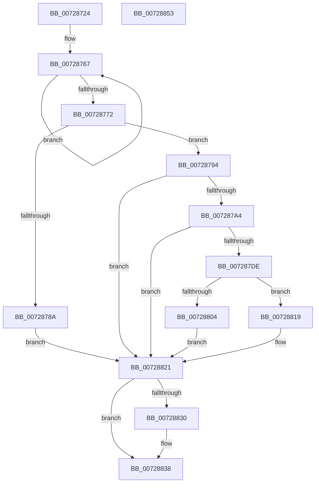

# PiBuildAndOpenDeviceDirectoryPath

- RVA: `0x00728724`–`0x00728854` (길이 `304` bytes)
- VA: `0x0000000140728724`
- 실행 섹션: `PAGE`
- PDB 이름 있음: `예`; PDB Function 태그: `아니요`
- unwind 정보 RVA: `0x000C838C`
- 디코드: `85`개 명령, `304/304` bytes 표시
- 미해석 바이트: `0` (있으면 어셈블리에 `.byte`로 보존)

> 이 문서는 커널 이미지의 기계어와 PDB 기호를 분석해 생성했습니다. 4번과 5번은 함수 원형과 자료형을 바이너리 사용 방식에서 추정한 C 해석이며 원본 소스 복구 결과는 아닙니다.

## 1. Dependencies

- 직접 호출 지점: **6**; 고유 호출 대상: **6**
- 직접 호출자로 확인된 함수: **1**
- RIP 상대 이미지 참조: **2**

### Outgoing calls
- `0x0072875E` → [RtlInitUnicodeString](../../text/42/RtlInitUnicodeString_function_0042A780.md) (function, `0x0042A780`)
- `0x00728799` → [IopAllocateUnicodeString](../95/IopAllocateUnicodeString_function_00951F0C.md) (function, `0x00951F0C`)
- `0x007287D3` → [RtlUnicodeStringPrintfEx](../../text/4A/RtlUnicodeStringPrintfEx_function_004A8FD0.md) (function, `0x004A8FD0`)
- `0x007287F9` → [PiOpenDirectoryWithRoot](PiOpenDirectoryWithRoot_function_00729198.md) (function, `0x00729198`)
- `0x00728826` → [RtlFreeAnsiString](../9C/RtlFreeAnsiString_function_009C0800.md) (function, `0x009C0800`)
- `0x00728833` → [ZwClose](../../text/6A/ZwClose_function_006AD2B0.md) (function, `0x006AD2B0`)

### Direct callers
- [IoGetDeviceDirectory](IoGetDeviceDirectory_function_00728370.md) at `0x0072855B`
- [IoGetDeviceDirectory](IoGetDeviceDirectory_function_00728370.md) at `0x007285E5`
- [IoGetDeviceDirectory](IoGetDeviceDirectory_function_00728370.md) at `0x0072863F`

### Static image references
- `0x007287A9` → RVA `0x00AFD740` (` ?? ::NNGAKEGL::`string'`; read)
- `0x007287B5` → RVA `0x00AFD750` (` ?? ::NNGAKEGL::`string'`; read)

## 2. Other-region calls and transfers

- 다른 실행 섹션으로 향하는 call: **3**
  - `0x0072875E` → [RtlInitUnicodeString](../../text/42/RtlInitUnicodeString_function_0042A780.md) (`PAGE` → `.text`)
  - `0x007287D3` → [RtlUnicodeStringPrintfEx](../../text/4A/RtlUnicodeStringPrintfEx_function_004A8FD0.md) (`PAGE` → `.text`)
  - `0x00728833` → [ZwClose](../../text/6A/ZwClose_function_006AD2B0.md) (`PAGE` → `.text`)
- 별도 외부 분기/꼬리 이동을 확인하지 못했습니다.

## 3. Assembly (complete function range)

```asm
00728724  48 8B C4                        mov rax, rsp
00728727  48 89 58 10                     mov qword ptr [rax + 0x10], rbx
0072872B  48 89 68 18                     mov qword ptr [rax + 0x18], rbp
0072872F  56                              push rsi
00728730  57                              push rdi
00728731  41 54                           push r12
00728733  41 56                           push r14
00728735  41 57                           push r15
00728737  48 83 EC 50                     sub rsp, 0x50
0072873B  4C 8B F2                        mov r14, rdx
0072873E  48 8B F1                        mov rsi, rcx
00728741  0F 57 C0                        xorps xmm0, xmm0
00728744  48 8D 48 C8                     lea rcx, [rax - 0x38]
00728748  45 33 E4                        xor r12d, r12d
0072874B  33 D2                           xor edx, edx
0072874D  0F 11 40 C8                     movups xmmword ptr [rax - 0x38], xmm0
00728751  41 8B FC                        mov edi, r12d
00728754  4C 89 60 08                     mov qword ptr [rax + 8], r12
00728758  45 8A F9                        mov r15b, r9b
0072875B  49 8B E8                        mov rbp, r8
0072875E  E8 1D 20 D0 FF                  call 0x14042a780
00728763  49 83 C9 FF                     or r9, 0xffffffffffffffff
00728767  49 FF C1                        inc r9
0072876A  66 46 39 64 4D 00               cmp word ptr [rbp + r9*2], r12w
00728770  75 F5                           jne 0x140728767
00728772  0F B7 16                        movzx edx, word ptr [rsi]
00728775  41 0F B7 06                     movzx eax, word ptr [r14]
00728779  83 C2 14                        add edx, 0x14
0072877C  42 8D 14 4A                     lea edx, [rdx + r9*2]
00728780  03 D0                           add edx, eax
00728782  81 FA FE FF 00 00               cmp edx, 0xfffe
00728788  76 0A                           jbe 0x140728794
0072878A  BB 05 00 00 80                  mov ebx, 0x80000005
0072878F  E9 8D 00 00 00                  jmp 0x140728821
00728794  48 8D 4C 24 40                  lea rcx, [rsp + 0x40]
00728799  E8 6E 97 22 00                  call 0x140951f0c
0072879E  8B D8                           mov ebx, eax
007287A0  85 C0                           test eax, eax
007287A2  78 7D                           js 0x140728821
007287A4  48 89 6C 24 38                  mov qword ptr [rsp + 0x38], rbp
007287A9  48 8D 05 90 4F 3D 00            lea rax, [rip + 0x3d4f90]
007287B0  4C 89 74 24 30                  mov qword ptr [rsp + 0x30], r14
007287B5  4C 8D 0D 94 4F 3D 00            lea r9, [rip + 0x3d4f94]
007287BC  48 89 44 24 28                  mov qword ptr [rsp + 0x28], rax
007287C1  48 8D 4C 24 40                  lea rcx, [rsp + 0x40]
007287C6  33 D2                           xor edx, edx
007287C8  48 89 74 24 20                  mov qword ptr [rsp + 0x20], rsi
007287CD  41 B8 00 08 00 00               mov r8d, 0x800
007287D3  E8 F8 07 D8 FF                  call 0x1404a8fd0
007287D8  8B D8                           mov ebx, eax
007287DA  85 C0                           test eax, eax
007287DC  78 43                           js 0x140728821
007287DE  48 8D 84 24 80 00 00 00         lea rax, [rsp + 0x80]
007287E6  45 33 C9                        xor r9d, r9d
007287E9  45 8A C7                        mov r8b, r15b
007287EC  48 89 44 24 20                  mov qword ptr [rsp + 0x20], rax
007287F1  48 8D 54 24 40                  lea rdx, [rsp + 0x40]
007287F6  48 8B CE                        mov rcx, rsi
007287F9  E8 9A 09 00 00                  call 0x140729198
007287FE  8B D8                           mov ebx, eax
00728800  85 C0                           test eax, eax
00728802  78 15                           js 0x140728819
00728804  48 8B 8C 24 A0 00 00 00         mov rcx, qword ptr [rsp + 0xa0]
0072880C  48 8B 84 24 80 00 00 00         mov rax, qword ptr [rsp + 0x80]
00728814  48 89 01                        mov qword ptr [rcx], rax
00728817  EB 08                           jmp 0x140728821
00728819  48 8B BC 24 80 00 00 00         mov rdi, qword ptr [rsp + 0x80]
00728821  48 8D 4C 24 40                  lea rcx, [rsp + 0x40]
00728826  E8 D5 7F 29 00                  call 0x1409c0800
0072882B  48 85 FF                        test rdi, rdi
0072882E  74 08                           je 0x140728838
00728830  48 8B CF                        mov rcx, rdi
00728833  E8 78 4A F8 FF                  call 0x1406ad2b0
00728838  4C 8D 5C 24 50                  lea r11, [rsp + 0x50]
0072883D  8B C3                           mov eax, ebx
0072883F  49 8B 5B 38                     mov rbx, qword ptr [r11 + 0x38]
00728843  49 8B 6B 40                     mov rbp, qword ptr [r11 + 0x40]
00728847  49 8B E3                        mov rsp, r11
0072884A  41 5F                           pop r15
0072884C  41 5E                           pop r14
0072884E  41 5C                           pop r12
00728850  5F                              pop rdi
00728851  5E                              pop rsi
00728852  C3                              ret
00728853  CC                              int3
```

## 4. C-style interpretation (structured pseudocode)

```c
__int64 __fastcall PiBuildAndOpenDeviceDirectoryPath(__int64 a1, __int64 a2, __int64 a3, __int64 a4, __int64 a5)
{
    __int64 result;
    __int64 v_r12;
    __int64 v_rsp;
    unsigned __int64 v_stack_m28;
    unsigned __int64 v_stack_m38;
    unsigned __int64 v_stack_m40;
    unsigned __int64 v_stack_m48;
    unsigned __int64 v_stack_m50;
    unsigned __int64 v_stack_m58;
    unsigned __int64 v_stack_p8;

    *(unsigned __int64 *)(v_rsp + 16) = v_rbx;
    *(unsigned __int64 *)(v_rsp + 24) = v_rbp;
    v_rsp = (v_rsp) - (80);
    v_r12 = 0;
    a2 = 0;
    *(unsigned __int64 *)(v_rsp - 56) = v_xmm0;
    *(unsigned __int64 *)(v_rsp + 8) = 0;
    result = RtlInitUnicodeString(v_rsp - 56, a2, a3, a4);
    a4 = (a4) | (-1);
loc_00728767:
    a4 = (a4) + 1;
    if ((*(unsigned __int16 *)(a3 + a4 * 2)) != 0) goto loc_00728767;
    a2 = (unsigned int)((*(unsigned __int16 *)(a1)) + (20));
    a2 = (unsigned int)((a2 + a4 * 2) + ((unsigned int)(*(unsigned __int16 *)(a2))));
    if (((unsigned int)(a2)) <= 0xFFFEULL) goto loc_00728794;
    goto loc_00728821;
loc_00728794:
    result = IopAllocateUnicodeString(v_stack_m38, a2, a3, a4);
    if (sign_flag) goto loc_00728821;
    v_stack_m40 = a3;
    v_stack_m48 = a2;
    v_stack_m50 = v_rip + 4018064;
    a2 = 0;
    v_stack_m58 = a1;
    result = RtlUnicodeStringPrintfEx(v_stack_m38, a2, (unsigned int)(0x800ULL), v_rip + 4018068);
    if (sign_flag) goto loc_00728821;
    a4 = 0;
    v_stack_m58 = v_stack_p8;
    result = PiOpenDirectoryWithRoot(a1, v_stack_m38, (unsigned __int8)((unsigned __int8)(a4)), a4);
    if (sign_flag) goto loc_00728819;
    *(unsigned __int64 *)(a5) = v_stack_p8;
    goto loc_00728821;
loc_00728819:
loc_00728821:
    result = RtlFreeAnsiString(v_stack_m38, v_stack_m38, (unsigned __int8)((unsigned __int8)(a4)), a4);
    if (v_stack_p8 != 0) {
        a1 = v_stack_p8;
        result = ZwClose(a1, v_stack_m38, (unsigned __int8)((unsigned __int8)(a4)), a4);
    }
    return (unsigned int)((unsigned int)((unsigned int)((unsigned int)(result))));
}
```

## 5. (Beta) C Style

```c
int64_t PiBuildAndOpenDeviceDirectoryPath(void *Arg1, void *Arg2, void *Arg3, int64_t Arg4, void *Arg5)
{
    uint8_t *arg1 = (uint8_t *)Arg1;
    uint8_t *arg2 = (uint8_t *)Arg2;
    uint8_t *arg3 = (uint8_t *)Arg3;
    uint8_t *arg5 = (uint8_t *)Arg5;

    int64_t result;
    int64_t local_r12;
    int64_t local_rsp;
    uint64_t v_stack_m28;
    uint64_t v_stack_m38;
    uint64_t v_stack_m40;
    uint64_t v_stack_m48;
    uint64_t v_stack_m50;
    uint64_t v_stack_m58;
    uint64_t v_stack_p8;

    *(uint64_t *)(local_rsp + 0x10) = local_rbx;
    *(uint64_t *)(local_rsp + 0x18) = local_rbp;
    local_rsp = (local_rsp) - (80);
    local_r12 = 0;
    Arg2 = 0;
    *(uint64_t *)(local_rsp - 0x38) = v_xmm0;
    *(uint64_t *)(local_rsp + 0x8) = 0;
    result = RtlInitUnicodeString(local_rsp - 56, Arg2, Arg3, Arg4);
    Arg4 = (Arg4) | (-1);
loc_00728767:
    Arg4 = (Arg4) + 1;
    if ((*(uint16_t *)(arg3 + Arg4 * 2)) != 0) goto loc_00728767;
    Arg2 = (uint32_t)((*(uint16_t *)(arg1)) + (20));
    Arg2 = (uint32_t)((Arg2 + Arg4 * 2) + ((uint32_t)(*(uint16_t *)(arg2))));
    if (((uint32_t)(Arg2)) <= 0xFFFEULL) goto loc_00728794;
    goto loc_00728821;
loc_00728794:
    result = IopAllocateUnicodeString(v_stack_m38, Arg2, Arg3, Arg4);
    if (sign_flag) goto loc_00728821;
    v_stack_m40 = Arg3;
    v_stack_m48 = Arg2;
    v_stack_m50 = v_rip + 4018064;
    Arg2 = 0;
    v_stack_m58 = Arg1;
    result = RtlUnicodeStringPrintfEx(v_stack_m38, Arg2, (uint32_t)(0x800ULL), v_rip + 4018068);
    if (sign_flag) goto loc_00728821;
    Arg4 = 0;
    v_stack_m58 = v_stack_p8;
    result = PiOpenDirectoryWithRoot(Arg1, v_stack_m38, (uint8_t)((uint8_t)(Arg4)), Arg4);
    if (sign_flag) goto loc_00728819;
    *(uint64_t *)(arg5) = v_stack_p8;
    goto loc_00728821;
loc_00728819:
loc_00728821:
    result = RtlFreeAnsiString(v_stack_m38, v_stack_m38, (uint8_t)((uint8_t)(Arg4)), Arg4);
    if (v_stack_p8 != 0) {
        Arg1 = v_stack_p8;
        result = ZwClose(Arg1, v_stack_m38, (uint8_t)((uint8_t)(Arg4)), Arg4);
    }
    return (uint32_t)((uint32_t)((uint32_t)((uint32_t)(result))));
}
```

### 관측된 메모리 오프셋

구조체 형식이 확인되지 않은 접근은 인자 기준의 오프셋으로만 기록했습니다.

| 기준 인자 | 오프셋 표현 | 폭 (bit) | 접근 |
|---|---:|---:|---|
| `Arg1` | `+ 0x0` | `16` | `R` |
| `Arg2` | `+ 0x0` | `16` | `R` |
| `Arg3` | `+ 0x0 + r9*2` | `16` | `R` |
| `Arg5` | `+ 0x0` | `64` | `W` |

## 6. Execution-region graph

[열기: 2D/3D 그래프와 함수 탐색 컨트롤 패널](../../../control-panel.html?section=page&rva=0x00728724&view=graph)

- 2D 그래프는 위에서 아래로 흐르고, 3D 그래프는 빈 공간을 드래그해 회전합니다. Shift+드래그는 이동, 휠은 확대·축소, 함수 노드 선택은 대상 보고서 이동입니다.

### Static fallback


