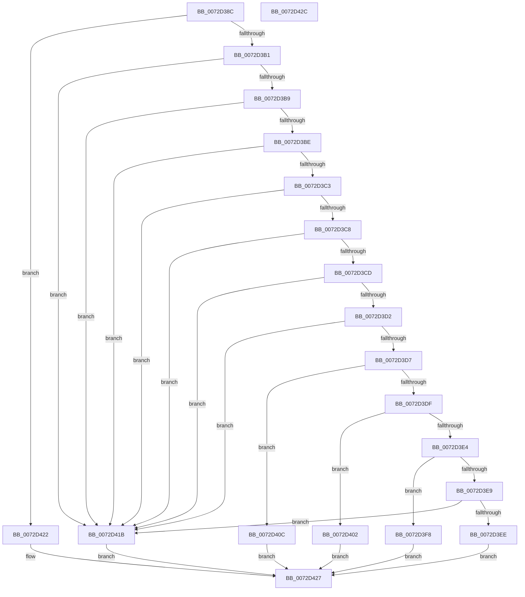

# PiConfigureDevice

- RVA: `0x0072D38C`–`0x0072D42D` (길이 `161` bytes)
- VA: `0x000000014072D38C`
- 실행 섹션: `PAGE`
- PDB 이름 있음: `예`; PDB Function 태그: `아니요`
- unwind 정보 RVA: `0x0005C788`
- 디코드: `51`개 명령, `161/161` bytes 표시
- 미해석 바이트: `0` (있으면 어셈블리에 `.byte`로 보존)

> 이 문서는 커널 이미지의 기계어와 PDB 기호를 분석해 생성했습니다. 4번과 5번은 함수 원형과 자료형을 바이너리 사용 방식에서 추정한 C 해석이며 원본 소스 복구 결과는 아닙니다.

## 1. Dependencies

- 직접 호출 지점: **4**; 고유 호출 대상: **4**
- 직접 호출자로 확인된 함수: **1**
- RIP 상대 이미지 참조: **0**

### Outgoing calls
- `0x0072D3F1` → [PpDevCfgProcessDeviceReset](../96/PpDevCfgProcessDeviceReset_function_00965498.md) (function, `0x00965498`)
- `0x0072D3FB` → [PpDevCfgProcessDeviceExtensions](../73/PpDevCfgProcessDeviceExtensions_function_00736C2C.md) (function, `0x00736C2C`)
- `0x0072D405` → [PpDevCfgProcessDeviceClass](../73/PpDevCfgProcessDeviceClass_function_00736824.md) (function, `0x00736824`)
- `0x0072D414` → [PpDevCfgProcessDevice](../AB/PpDevCfgProcessDevice_function_00AB6DB0.md) (function, `0x00AB6DB0`)

### Direct callers
- [sub_006F45AA](../../text/6F/Unknown_function_006F45AA.md) at `0x006F46F9`

### Static image references
- 디코드된 RIP-relative 메모리 참조가 없습니다.

## 2. Other-region calls and transfers

- 다른 실행 섹션으로 향하는 call: **0**
- 별도 외부 분기/꼬리 이동을 확인하지 못했습니다.

## 3. Assembly (complete function range)

```asm
0072D38C  48 83 EC 28                     sub rsp, 0x28
0072D390  48 8B 41 10                     mov rax, qword ptr [rcx + 0x10]
0072D394  48 8B 90 38 01 00 00            mov rdx, qword ptr [rax + 0x138]
0072D39B  4C 8B 4A 28                     mov r9, qword ptr [rdx + 0x28]
0072D39F  41 8B 91 2C 01 00 00            mov edx, dword ptr [r9 + 0x12c]
0072D3A6  8D 82 EB FC FF FF               lea eax, [rdx - 0x315]
0072D3AC  83 F8 01                        cmp eax, 1
0072D3AF  76 71                           jbe 0x14072d422
0072D3B1  81 EA 00 03 00 00               sub edx, 0x300
0072D3B7  74 62                           je 0x14072d41b
0072D3B9  83 EA 10                        sub edx, 0x10
0072D3BC  74 5D                           je 0x14072d41b
0072D3BE  83 EA 01                        sub edx, 1
0072D3C1  74 58                           je 0x14072d41b
0072D3C3  83 EA 01                        sub edx, 1
0072D3C6  74 53                           je 0x14072d41b
0072D3C8  83 EA 01                        sub edx, 1
0072D3CB  74 4E                           je 0x14072d41b
0072D3CD  83 EA 02                        sub edx, 2
0072D3D0  74 49                           je 0x14072d41b
0072D3D2  83 FA 01                        cmp edx, 1
0072D3D5  74 44                           je 0x14072d41b
0072D3D7  8B 49 18                        mov ecx, dword ptr [rcx + 0x18]
0072D3DA  83 E9 15                        sub ecx, 0x15
0072D3DD  74 2D                           je 0x14072d40c
0072D3DF  83 E9 01                        sub ecx, 1
0072D3E2  74 1E                           je 0x14072d402
0072D3E4  83 E9 01                        sub ecx, 1
0072D3E7  74 0F                           je 0x14072d3f8
0072D3E9  83 F9 01                        cmp ecx, 1
0072D3EC  75 2D                           jne 0x14072d41b
0072D3EE  49 8B C9                        mov rcx, r9
0072D3F1  E8 A2 80 23 00                  call 0x140965498
0072D3F6  EB 2F                           jmp 0x14072d427
0072D3F8  49 8B C9                        mov rcx, r9
0072D3FB  E8 2C 98 00 00                  call 0x140736c2c
0072D400  EB 25                           jmp 0x14072d427
0072D402  49 8B C9                        mov rcx, r9
0072D405  E8 1A 94 00 00                  call 0x140736824
0072D40A  EB 1B                           jmp 0x14072d427
0072D40C  45 33 C0                        xor r8d, r8d
0072D40F  33 D2                           xor edx, edx
0072D411  49 8B C9                        mov rcx, r9
0072D414  E8 97 99 38 00                  call 0x140ab6db0
0072D419  EB 0C                           jmp 0x14072d427
0072D41B  B8 01 00 00 C0                  mov eax, 0xc0000001
0072D420  EB 05                           jmp 0x14072d427
0072D422  B8 56 00 00 C0                  mov eax, 0xc0000056
0072D427  48 83 C4 28                     add rsp, 0x28
0072D42B  C3                              ret
0072D42C  CC                              int3
```

## 4. C-style interpretation (structured pseudocode)

```c
__int64 __fastcall PiConfigureDevice(__int64 a1, __int64 a2, int a3)
{
    __int64 result;
    __int64 v_rsp;

    v_rsp = (v_rsp) - (40);
    if (((unsigned int)((unsigned int)(*(unsigned int *)(*(unsigned __int64 *)(*(unsigned __int64 *)(*(unsigned __int64 *)(a1 + 16) + 312) + 40) + 300)) - 789)) <= 1) goto loc_0072D422;
    a2 = (unsigned int)(((unsigned int)(*(unsigned int *)(*(unsigned __int64 *)(*(unsigned __int64 *)(*(unsigned __int64 *)(a1 + 16) + 312) + 40) + 300))) - (768));
    if (condition_is_equal) goto loc_0072D41B;
    a2 = (unsigned int)((a2) - (16));
    if (condition_is_equal) goto loc_0072D41B;
    a2 = (unsigned int)((a2) - (1));
    if (condition_is_equal) goto loc_0072D41B;
    a2 = (unsigned int)((a2) - (1));
    if (condition_is_equal) goto loc_0072D41B;
    a2 = (unsigned int)((a2) - (1));
    if (condition_is_equal) goto loc_0072D41B;
    a2 = (unsigned int)((a2) - (2));
    if (condition_is_equal) goto loc_0072D41B;
    if (((unsigned int)(a2)) == 1) goto loc_0072D41B;
    a1 = (unsigned int)(((unsigned int)(*(unsigned int *)(a1 + 24))) - (21));
    if (condition_is_equal) goto loc_0072D40C;
    a1 = (unsigned int)((a1) - (1));
    if (condition_is_equal) goto loc_0072D402;
    a1 = (unsigned int)((a1) - (1));
    if (condition_is_equal) goto loc_0072D3F8;
    if (((unsigned int)(a1)) != 1) goto loc_0072D41B;
    result = PpDevCfgProcessDeviceReset(*(unsigned __int64 *)(*(unsigned __int64 *)(*(unsigned __int64 *)(a1 + 16) + 312) + 40), a2, a3, *(unsigned __int64 *)(*(unsigned __int64 *)(*(unsigned __int64 *)(a1 + 16) + 312) + 40));
    goto loc_0072D427;
loc_0072D3F8:
    result = PpDevCfgProcessDeviceExtensions(*(unsigned __int64 *)(*(unsigned __int64 *)(*(unsigned __int64 *)(a1 + 16) + 312) + 40), a2, a3, *(unsigned __int64 *)(*(unsigned __int64 *)(*(unsigned __int64 *)(a1 + 16) + 312) + 40));
    goto loc_0072D427;
loc_0072D402:
    result = PpDevCfgProcessDeviceClass(*(unsigned __int64 *)(*(unsigned __int64 *)(*(unsigned __int64 *)(a1 + 16) + 312) + 40), a2, a3, *(unsigned __int64 *)(*(unsigned __int64 *)(*(unsigned __int64 *)(a1 + 16) + 312) + 40));
    goto loc_0072D427;
loc_0072D40C:
    a3 = 0;
    a2 = 0;
    result = PpDevCfgProcessDevice(*(unsigned __int64 *)(*(unsigned __int64 *)(*(unsigned __int64 *)(a1 + 16) + 312) + 40), a2, a3, *(unsigned __int64 *)(*(unsigned __int64 *)(*(unsigned __int64 *)(a1 + 16) + 312) + 40));
    goto loc_0072D427;
loc_0072D41B:
    goto loc_0072D427;
loc_0072D422:
loc_0072D427:
    v_rsp = (v_rsp) + (40);
    return (unsigned int)(0xC0000056ULL);
}
```

## 5. (Beta) C Style

```c
int64_t PiConfigureDevice(void *Arg1, int64_t Arg2, int32_t Arg3)
{
    uint8_t *arg1 = (uint8_t *)Arg1;

    int64_t result;
    int64_t local_rsp;

    local_rsp = (local_rsp) - (40);
    if (((uint32_t)((uint32_t)(*(uint32_t *)(*(uint64_t *)(*(uint64_t *)(*(uint64_t *)(arg1 + 0x10) + 0x138) + 0x28) + 0x12C)) - 789)) <= 1) goto loc_0072D422;
    Arg2 = (uint32_t)(((uint32_t)(*(uint32_t *)(*(uint64_t *)(*(uint64_t *)(*(uint64_t *)(arg1 + 0x10) + 0x138) + 0x28) + 0x12C))) - (768));
    if (condition_is_equal) goto loc_0072D41B;
    Arg2 = (uint32_t)((Arg2) - (16));
    if (condition_is_equal) goto loc_0072D41B;
    Arg2 = (uint32_t)((Arg2) - (1));
    if (condition_is_equal) goto loc_0072D41B;
    Arg2 = (uint32_t)((Arg2) - (1));
    if (condition_is_equal) goto loc_0072D41B;
    Arg2 = (uint32_t)((Arg2) - (1));
    if (condition_is_equal) goto loc_0072D41B;
    Arg2 = (uint32_t)((Arg2) - (2));
    if (condition_is_equal) goto loc_0072D41B;
    if (((uint32_t)(Arg2)) == 1) goto loc_0072D41B;
    Arg1 = (uint32_t)(((uint32_t)(*(uint32_t *)(arg1 + 0x18))) - (21));
    if (condition_is_equal) goto loc_0072D40C;
    Arg1 = (uint32_t)((Arg1) - (1));
    if (condition_is_equal) goto loc_0072D402;
    Arg1 = (uint32_t)((Arg1) - (1));
    if (condition_is_equal) goto loc_0072D3F8;
    if (((uint32_t)(Arg1)) != 1) goto loc_0072D41B;
    result = PpDevCfgProcessDeviceReset(*(uint64_t *)(*(uint64_t *)(*(uint64_t *)(arg1 + 0x10) + 0x138) + 0x28), Arg2, Arg3, *(uint64_t *)(*(uint64_t *)(*(uint64_t *)(arg1 + 0x10) + 0x138) + 0x28));
    goto loc_0072D427;
loc_0072D3F8:
    result = PpDevCfgProcessDeviceExtensions(*(uint64_t *)(*(uint64_t *)(*(uint64_t *)(arg1 + 0x10) + 0x138) + 0x28), Arg2, Arg3, *(uint64_t *)(*(uint64_t *)(*(uint64_t *)(arg1 + 0x10) + 0x138) + 0x28));
    goto loc_0072D427;
loc_0072D402:
    result = PpDevCfgProcessDeviceClass(*(uint64_t *)(*(uint64_t *)(*(uint64_t *)(arg1 + 0x10) + 0x138) + 0x28), Arg2, Arg3, *(uint64_t *)(*(uint64_t *)(*(uint64_t *)(arg1 + 0x10) + 0x138) + 0x28));
    goto loc_0072D427;
loc_0072D40C:
    Arg3 = 0;
    Arg2 = 0;
    result = PpDevCfgProcessDevice(*(uint64_t *)(*(uint64_t *)(*(uint64_t *)(arg1 + 0x10) + 0x138) + 0x28), Arg2, Arg3, *(uint64_t *)(*(uint64_t *)(*(uint64_t *)(arg1 + 0x10) + 0x138) + 0x28));
    goto loc_0072D427;
loc_0072D41B:
    goto loc_0072D427;
loc_0072D422:
loc_0072D427:
    local_rsp = (local_rsp) + (40);
    return (uint32_t)(0xC0000056ULL);
}
```

### 관측된 메모리 오프셋

구조체 형식이 확인되지 않은 접근은 인자 기준의 오프셋으로만 기록했습니다.

| 기준 인자 | 오프셋 표현 | 폭 (bit) | 접근 |
|---|---:|---:|---|
| `Arg1` | `+ 0x10` | `64` | `R` |
| `Arg1` | `+ 0x18` | `32` | `R` |

## 6. Execution-region graph

[열기: 2D/3D 그래프와 함수 탐색 컨트롤 패널](../../../control-panel.html?section=page&rva=0x0072D38C&view=graph)

- 2D 그래프는 위에서 아래로 흐르고, 3D 그래프는 빈 공간을 드래그해 회전합니다. Shift+드래그는 이동, 휠은 확대·축소, 함수 노드 선택은 대상 보고서 이동입니다.

### Static fallback


