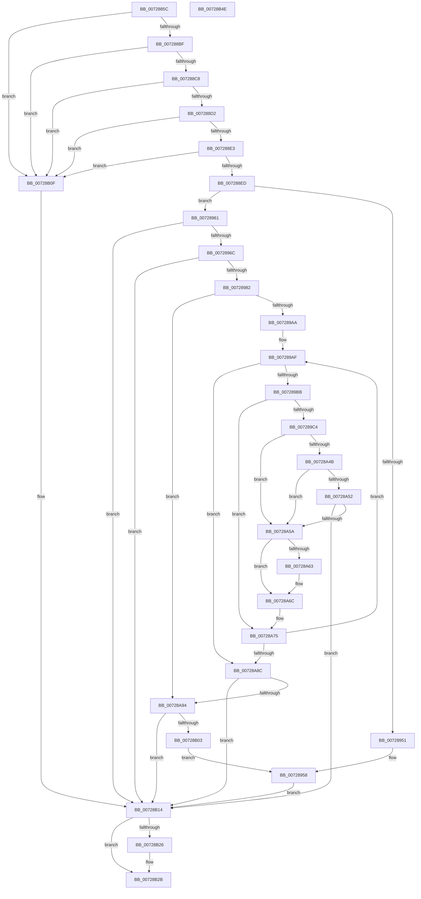

# PiCreateDirectoryPath

- RVA: `0x0072885C`–`0x00728B4F` (길이 `755` bytes)
- VA: `0x000000014072885C`
- 실행 섹션: `PAGE`
- PDB 이름 있음: `예`; PDB Function 태그: `아니요`
- unwind 정보 RVA: `0x000C83C8`
- 디코드: `185`개 명령, `755/755` bytes 표시
- 미해석 바이트: `0` (있으면 어셈블리에 `.byte`로 보존)

> 이 문서는 커널 이미지의 기계어와 PDB 기호를 분석해 생성했습니다. 4번과 5번은 함수 원형과 자료형을 바이너리 사용 방식에서 추정한 C 해석이며 원본 소스 복구 결과는 아닙니다.

## 1. Dependencies

- 직접 호출 지점: **8**; 고유 호출 대상: **5**
- 직접 호출자로 확인된 함수: **1**
- RIP 상대 이미지 참조: **0**

### Outgoing calls
- `0x007288B1` → [RtlInitUnicodeString](../../text/42/RtlInitUnicodeString_function_0042A780.md) (function, `0x0042A780`)
- `0x00728946` → [ZwCreateFile](../../text/6A/ZwCreateFile_function_006ADB70.md) (function, `0x006ADB70`)
- `0x00728973` → [PnpConcatenateUnicodeStrings](../95/PnpConcatenateUnicodeStrings_function_00951ED0.md) (function, `0x00951ED0`)
- `0x00728A38` → [ZwCreateFile](../../text/6A/ZwCreateFile_function_006ADB70.md) (function, `0x006ADB70`)
- `0x00728A63` → [ZwClose](../../text/6A/ZwClose_function_006AD2B0.md) (function, `0x006AD2B0`)
- `0x00728AF8` → [ZwCreateFile](../../text/6A/ZwCreateFile_function_006ADB70.md) (function, `0x006ADB70`)
- `0x00728B18` → [RtlFreeAnsiString](../9C/RtlFreeAnsiString_function_009C0800.md) (function, `0x009C0800`)
- `0x00728B26` → [ZwClose](../../text/6A/ZwClose_function_006AD2B0.md) (function, `0x006AD2B0`)

### Direct callers
- [PiOpenDirectoryWithRoot](PiOpenDirectoryWithRoot_function_00729198.md) at `0x007292A8`
- [PiOpenDirectoryWithRoot](PiOpenDirectoryWithRoot_function_00729198.md) at `0x007292E6`

### Static image references
- 디코드된 RIP-relative 메모리 참조가 없습니다.

## 2. Other-region calls and transfers

- 다른 실행 섹션으로 향하는 call: **6**
  - `0x007288B1` → [RtlInitUnicodeString](../../text/42/RtlInitUnicodeString_function_0042A780.md) (`PAGE` → `.text`)
  - `0x00728946` → [ZwCreateFile](../../text/6A/ZwCreateFile_function_006ADB70.md) (`PAGE` → `.text`)
  - `0x00728A38` → [ZwCreateFile](../../text/6A/ZwCreateFile_function_006ADB70.md) (`PAGE` → `.text`)
  - `0x00728A63` → [ZwClose](../../text/6A/ZwClose_function_006AD2B0.md) (`PAGE` → `.text`)
  - `0x00728AF8` → [ZwCreateFile](../../text/6A/ZwCreateFile_function_006ADB70.md) (`PAGE` → `.text`)
  - `0x00728B26` → [ZwClose](../../text/6A/ZwClose_function_006AD2B0.md) (`PAGE` → `.text`)
- 별도 외부 분기/꼬리 이동을 확인하지 못했습니다.

## 3. Assembly (complete function range)

```asm
0072885C  48 8B C4                        mov rax, rsp
0072885F  48 89 58 10                     mov qword ptr [rax + 0x10], rbx
00728863  48 89 70 18                     mov qword ptr [rax + 0x18], rsi
00728867  48 89 78 20                     mov qword ptr [rax + 0x20], rdi
0072886B  55                              push rbp
0072886C  41 54                           push r12
0072886E  41 55                           push r13
00728870  41 56                           push r14
00728872  41 57                           push r15
00728874  48 8D 68 A1                     lea rbp, [rax - 0x5f]
00728878  48 81 EC B0 00 00 00            sub rsp, 0xb0
0072887F  0F 57 C0                        xorps xmm0, xmm0
00728882  33 C0                           xor eax, eax
00728884  4C 8B E2                        mov r12, rdx
00728887  48 89 45 27                     mov qword ptr [rbp + 0x27], rax
0072888B  48 8B F9                        mov rdi, rcx
0072888E  89 45 2F                        mov dword ptr [rbp + 0x2f], eax
00728891  45 33 ED                        xor r13d, r13d
00728894  48 8D 4D E7                     lea rcx, [rbp - 0x19]
00728898  33 D2                           xor edx, edx
0072889A  4C 89 6D 67                     mov qword ptr [rbp + 0x67], r13
0072889E  0F 11 45 F7                     movups xmmword ptr [rbp - 9], xmm0
007288A2  49 8B F0                        mov rsi, r8
007288A5  0F 11 45 07                     movups xmmword ptr [rbp + 7], xmm0
007288A9  0F 11 45 17                     movups xmmword ptr [rbp + 0x17], xmm0
007288AD  0F 11 45 E7                     movups xmmword ptr [rbp - 0x19], xmm0
007288B1  E8 CA 1E D0 FF                  call 0x14042a780
007288B6  48 85 FF                        test rdi, rdi
007288B9  0F 84 50 02 00 00               je 0x140728b0f
007288BF  48 85 F6                        test rsi, rsi
007288C2  0F 84 47 02 00 00               je 0x140728b0f
007288C8  66 83 3F 04                     cmp word ptr [rdi], 4
007288CC  0F 82 3D 02 00 00               jb 0x140728b0f
007288D2  48 8B 47 08                     mov rax, qword ptr [rdi + 8]
007288D6  41 8D 4D 5C                     lea ecx, [r13 + 0x5c]
007288DA  66 39 08                        cmp word ptr [rax], cx
007288DD  0F 85 2C 02 00 00               jne 0x140728b0f
007288E3  66 39 48 02                     cmp word ptr [rax + 2], cx
007288E7  0F 84 22 02 00 00               je 0x140728b0f
007288ED  44 89 6C 24 50                  mov dword ptr [rsp + 0x50], r13d
007288F2  8D 41 A7                        lea eax, [rcx - 0x59]
007288F5  4C 89 6C 24 48                  mov qword ptr [rsp + 0x48], r13
007288FA  4C 8D 4D F7                     lea r9, [rbp - 9]
007288FE  C7 44 24 40 21 00 00 00         mov dword ptr [rsp + 0x40], 0x21
00728906  4C 8D 45 07                     lea r8, [rbp + 7]
0072890A  89 44 24 38                     mov dword ptr [rsp + 0x38], eax
0072890E  48 8D 4D 67                     lea rcx, [rbp + 0x67]
00728912  89 44 24 30                     mov dword ptr [rsp + 0x30], eax
00728916  BA 01 00 10 00                  mov edx, 0x100001
0072891B  C7 44 24 28 80 00 00 00         mov dword ptr [rsp + 0x28], 0x80
00728923  4C 89 6C 24 20                  mov qword ptr [rsp + 0x20], r13
00728928  C7 45 07 30 00 00 00            mov dword ptr [rbp + 7], 0x30
0072892F  4C 89 6D 0F                     mov qword ptr [rbp + 0xf], r13
00728933  C7 45 1F 40 02 00 00            mov dword ptr [rbp + 0x1f], 0x240
0072893A  48 89 7D 17                     mov qword ptr [rbp + 0x17], rdi
0072893E  4C 89 65 27                     mov qword ptr [rbp + 0x27], r12
00728942  4C 89 6D 2F                     mov qword ptr [rbp + 0x2f], r13
00728946  E8 25 52 F8 FF                  call 0x1406adb70
0072894B  8B D8                           mov ebx, eax
0072894D  85 C0                           test eax, eax
0072894F  78 10                           js 0x140728961
00728951  48 8B 4D 67                     mov rcx, qword ptr [rbp + 0x67]
00728955  48 89 0E                        mov qword ptr [rsi], rcx
00728958  4C 89 6D 67                     mov qword ptr [rbp + 0x67], r13
0072895C  E9 B3 01 00 00                  jmp 0x140728b14
00728961  3D 3A 00 00 C0                  cmp eax, 0xc000003a
00728966  0F 85 A8 01 00 00               jne 0x140728b14
0072896C  48 8B D7                        mov rdx, rdi
0072896F  48 8D 4D E7                     lea rcx, [rbp - 0x19]
00728973  E8 58 95 22 00                  call 0x140951ed0
00728978  8B D8                           mov ebx, eax
0072897A  85 C0                           test eax, eax
0072897C  0F 88 92 01 00 00               js 0x140728b14
00728982  48 8B 4D EF                     mov rcx, qword ptr [rbp - 0x11]
00728986  44 0F B7 7D E7                  movzx r15d, word ptr [rbp - 0x19]
0072898B  45 0F B7 F7                     movzx r14d, r15w
0072898F  66 41 D1 EE                     shr r14w, 1
00728993  48 8D 79 04                     lea rdi, [rcx + 4]
00728997  48 8B C7                        mov rax, rdi
0072899A  48 2B C1                        sub rax, rcx
0072899D  48 D1 F8                        sar rax, 1
007289A0  66 41 3B C6                     cmp ax, r14w
007289A4  0F 83 EA 00 00 00               jae 0x140728a94
007289AA  BA 5C 00 00 00                  mov edx, 0x5c
007289AF  0F B7 07                        movzx eax, word ptr [rdi]
007289B2  66 85 C0                        test ax, ax
007289B5  0F 84 D1 00 00 00               je 0x140728a8c
007289BB  66 3B C2                        cmp ax, dx
007289BE  0F 85 B1 00 00 00               jne 0x140728a75
007289C4  66 44 89 2F                     mov word ptr [rdi], r13w
007289C8  4C 8D 4D F7                     lea r9, [rbp - 9]
007289CC  44 89 6C 24 50                  mov dword ptr [rsp + 0x50], r13d
007289D1  4C 8D 45 07                     lea r8, [rbp + 7]
007289D5  4C 89 6C 24 48                  mov qword ptr [rsp + 0x48], r13
007289DA  48 8D 4D 67                     lea rcx, [rbp + 0x67]
007289DE  C7 44 24 40 21 00 00 00         mov dword ptr [rsp + 0x40], 0x21
007289E6  0F 57 C0                        xorps xmm0, xmm0
007289E9  48 8B C7                        mov rax, rdi
007289EC  C7 45 07 30 00 00 00            mov dword ptr [rbp + 7], 0x30
007289F3  48 2B 45 EF                     sub rax, qword ptr [rbp - 0x11]
007289F7  BA 01 00 10 00                  mov edx, 0x100001
007289FC  48 D1 F8                        sar rax, 1
007289FF  66 03 C0                        add ax, ax
00728A02  4C 89 6D 0F                     mov qword ptr [rbp + 0xf], r13
00728A06  66 89 45 E7                     mov word ptr [rbp - 0x19], ax
00728A0A  48 8D 45 E7                     lea rax, [rbp - 0x19]
00728A0E  48 89 45 17                     mov qword ptr [rbp + 0x17], rax
00728A12  B8 03 00 00 00                  mov eax, 3
00728A17  89 44 24 38                     mov dword ptr [rsp + 0x38], eax
00728A1B  89 44 24 30                     mov dword ptr [rsp + 0x30], eax
00728A1F  C7 44 24 28 80 00 00 00         mov dword ptr [rsp + 0x28], 0x80
00728A27  4C 89 6C 24 20                  mov qword ptr [rsp + 0x20], r13
00728A2C  C7 45 1F 40 02 00 00            mov dword ptr [rbp + 0x1f], 0x240
00728A33  F3 0F 7F 45 27                  movdqu xmmword ptr [rbp + 0x27], xmm0
00728A38  E8 33 51 F8 FF                  call 0x1406adb70
00728A3D  66 C7 07 5C 00                  mov word ptr [rdi], 0x5c
00728A42  8B D8                           mov ebx, eax
00728A44  3D 24 00 00 C0                  cmp eax, 0xc0000024
00728A49  74 0F                           je 0x140728a5a
00728A4B  3D 0D 00 00 C0                  cmp eax, 0xc000000d
00728A50  74 08                           je 0x140728a5a
00728A52  85 C0                           test eax, eax
00728A54  0F 88 BA 00 00 00               js 0x140728b14
00728A5A  48 8B 4D 67                     mov rcx, qword ptr [rbp + 0x67]
00728A5E  48 85 C9                        test rcx, rcx
00728A61  74 09                           je 0x140728a6c
00728A63  E8 48 48 F8 FF                  call 0x1406ad2b0
00728A68  4C 89 6D 67                     mov qword ptr [rbp + 0x67], r13
00728A6C  48 8B 4D EF                     mov rcx, qword ptr [rbp - 0x11]
00728A70  BA 5C 00 00 00                  mov edx, 0x5c
00728A75  48 83 C7 02                     add rdi, 2
00728A79  48 8B C7                        mov rax, rdi
00728A7C  48 2B C1                        sub rax, rcx
00728A7F  48 D1 F8                        sar rax, 1
00728A82  66 41 3B C6                     cmp ax, r14w
00728A86  0F 82 23 FF FF FF               jb 0x1407289af
00728A8C  85 DB                           test ebx, ebx
00728A8E  0F 88 80 00 00 00               js 0x140728b14
00728A94  44 89 6C 24 50                  mov dword ptr [rsp + 0x50], r13d
00728A99  48 8D 45 E7                     lea rax, [rbp - 0x19]
00728A9D  4C 89 6C 24 48                  mov qword ptr [rsp + 0x48], r13
00728AA2  4C 8D 4D F7                     lea r9, [rbp - 9]
00728AA6  C7 44 24 40 21 00 00 00         mov dword ptr [rsp + 0x40], 0x21
00728AAE  4C 8D 45 07                     lea r8, [rbp + 7]
00728AB2  48 89 45 17                     mov qword ptr [rbp + 0x17], rax
00728AB6  48 8D 4D 67                     lea rcx, [rbp + 0x67]
00728ABA  B8 03 00 00 00                  mov eax, 3
00728ABF  66 44 89 7D E7                  mov word ptr [rbp - 0x19], r15w
00728AC4  89 44 24 38                     mov dword ptr [rsp + 0x38], eax
00728AC8  BA 01 00 10 00                  mov edx, 0x100001
00728ACD  89 44 24 30                     mov dword ptr [rsp + 0x30], eax
00728AD1  C7 44 24 28 80 00 00 00         mov dword ptr [rsp + 0x28], 0x80
00728AD9  4C 89 6C 24 20                  mov qword ptr [rsp + 0x20], r13
00728ADE  C7 45 07 30 00 00 00            mov dword ptr [rbp + 7], 0x30
00728AE5  4C 89 6D 0F                     mov qword ptr [rbp + 0xf], r13
00728AE9  C7 45 1F 40 02 00 00            mov dword ptr [rbp + 0x1f], 0x240
00728AF0  4C 89 65 27                     mov qword ptr [rbp + 0x27], r12
00728AF4  4C 89 6D 2F                     mov qword ptr [rbp + 0x2f], r13
00728AF8  E8 73 50 F8 FF                  call 0x1406adb70
00728AFD  8B D8                           mov ebx, eax
00728AFF  85 C0                           test eax, eax
00728B01  78 11                           js 0x140728b14
00728B03  48 8B 45 67                     mov rax, qword ptr [rbp + 0x67]
00728B07  48 89 06                        mov qword ptr [rsi], rax
00728B0A  E9 49 FE FF FF                  jmp 0x140728958
00728B0F  BB 0D 00 00 C0                  mov ebx, 0xc000000d
00728B14  48 8D 4D E7                     lea rcx, [rbp - 0x19]
00728B18  E8 E3 7C 29 00                  call 0x1409c0800
00728B1D  48 8B 4D 67                     mov rcx, qword ptr [rbp + 0x67]
00728B21  48 85 C9                        test rcx, rcx
00728B24  74 05                           je 0x140728b2b
00728B26  E8 85 47 F8 FF                  call 0x1406ad2b0
00728B2B  4C 8D 9C 24 B0 00 00 00         lea r11, [rsp + 0xb0]
00728B33  8B C3                           mov eax, ebx
00728B35  49 8B 5B 38                     mov rbx, qword ptr [r11 + 0x38]
00728B39  49 8B 73 40                     mov rsi, qword ptr [r11 + 0x40]
00728B3D  49 8B 7B 48                     mov rdi, qword ptr [r11 + 0x48]
00728B41  49 8B E3                        mov rsp, r11
00728B44  41 5F                           pop r15
00728B46  41 5E                           pop r14
00728B48  41 5D                           pop r13
00728B4A  41 5C                           pop r12
00728B4C  5D                              pop rbp
00728B4D  C3                              ret
00728B4E  CC                              int3
```

## 4. C-style interpretation (structured pseudocode)

```c
__int64 __fastcall PiCreateDirectoryPath(__int64 a1, __int64 a2, __int64 a3)
{
    __int64 result;
    __int64 v_r13;
    __int64 v_r14;
    __int64 v_rdi;
    __int64 v_rsp;
    unsigned __int64 v_stack_m28;
    unsigned int v_stack_m88;
    unsigned __int64 v_stack_m90;
    unsigned int v_stack_m98;
    unsigned int v_stack_mA0;
    unsigned int v_stack_mA8;
    unsigned int v_stack_mB0;
    unsigned __int64 v_stack_mB8;

    *(unsigned __int64 *)(v_rsp + 16) = v_rbx;
    *(unsigned __int64 *)(v_rsp + 24) = v_rsi;
    *(unsigned __int64 *)(v_rsp + 32) = v_rdi;
    v_rsp = (v_rsp) - (176);
    result = 0;
    *(unsigned __int64 *)(v_rsp - 95 + 39) = 0;
    *(unsigned int *)(v_rsp - 95 + 47) = 0;
    v_r13 = 0;
    a2 = 0;
    *(unsigned __int64 *)(v_rsp - 95 + 103) = 0;
    *(unsigned __int64 *)(v_rsp - 95 - 9) = v_xmm0;
    *(unsigned __int64 *)(v_rsp - 95 + 7) = v_xmm0;
    *(unsigned __int64 *)(v_rsp - 95 + 23) = v_xmm0;
    *(unsigned __int64 *)(v_rsp - 95 - 25) = v_xmm0;
    result = RtlInitUnicodeString(v_rsp - 95 - 25, a2, a3, a4);
    if (a1 == 0) goto loc_00728B0F;
    if (a3 == 0) goto loc_00728B0F;
    if ((*(unsigned __int16 *)(a1)) < 4) goto loc_00728B0F;
    if ((*(unsigned __int16 *)(*(unsigned __int64 *)(a1 + 8))) != ((unsigned __int16)(v_r13 + 92))) goto loc_00728B0F;
    if ((*(unsigned __int16 *)(*(unsigned __int64 *)(a1 + 8) + 2)) == ((unsigned __int16)(v_r13 + 92))) goto loc_00728B0F;
    v_stack_m88 = 0;
    v_stack_m90 = 0;
    v_stack_m98 = 33;
    v_stack_mA0 = (unsigned int)(v_r13 + 92 - 89);
    v_stack_mA8 = (unsigned int)(v_r13 + 92 - 89);
    v_stack_mB0 = 128;
    v_stack_mB8 = 0;
    *(unsigned int *)(v_rsp - 95 + 7) = 48;
    *(unsigned __int64 *)(v_rsp - 95 + 15) = 0;
    *(unsigned int *)(v_rsp - 95 + 31) = 576;
    *(unsigned __int64 *)(v_rsp - 95 + 23) = a1;
    *(unsigned __int64 *)(v_rsp - 95 + 39) = 0;
    *(unsigned __int64 *)(v_rsp - 95 + 47) = 0;
    result = ZwCreateFile(v_rsp - 95 + 103, (unsigned int)(0x100001ULL), v_rsp - 95 + 7, v_rsp - 95 - 9);
    if (sign_flag) goto loc_00728961;
    *(unsigned __int64 *)(a3) = *(unsigned __int64 *)(v_rsp - 95 + 103);
loc_00728958:
    *(unsigned __int64 *)(v_rsp - 95 + 103) = 0;
    goto loc_00728B14;
loc_00728961:
    if (((unsigned int)(result)) != 0xC000003AULL) goto loc_00728B14;
    result = PnpConcatenateUnicodeStrings(v_rsp - 95 - 25, a1, v_rsp - 95 + 7, v_rsp - 95 - 9);
    if (sign_flag) goto loc_00728B14;
    v_r14 = (unsigned __int16)(((unsigned __int16)(*(unsigned __int16 *)(v_rsp - 95 - 25))) >> (1));
    result = (*(unsigned __int64 *)(v_rsp - 95 - 17) + 4) - (*(unsigned __int64 *)(v_rsp - 95 - 17));
    result = (result) >> (1);
    if (((unsigned __int16)(result)) >= ((unsigned __int16)(v_r14))) goto loc_00728A94;
loc_007289AF:
    if ((unsigned __int16)(*(unsigned __int16 *)(*(unsigned __int64 *)(v_rsp - 95 - 17) + 4)) == 0) goto loc_00728A8C;
    if (((unsigned __int16)(*(unsigned __int16 *)(*(unsigned __int64 *)(v_rsp - 95 - 17) + 4))) != 92) goto loc_00728A75;
    *(unsigned __int16 *)(*(unsigned __int64 *)(v_rsp - 95 - 17) + 4) = 0;
    v_stack_m88 = 0;
    v_stack_m90 = 0;
    v_stack_m98 = 33;
    *(unsigned int *)(v_rsp - 95 + 7) = 48;
    result = (*(unsigned __int64 *)(v_rsp - 95 - 17) + 4) - (*(unsigned __int64 *)(v_rsp - 95 - 17));
    result = (result) >> (1);
    result = (unsigned __int16)((result) + ((unsigned __int16)(result)));
    *(unsigned __int64 *)(v_rsp - 95 + 15) = 0;
    *(unsigned __int16 *)(v_rsp - 95 - 25) = (unsigned __int16)(result);
    *(unsigned __int64 *)(v_rsp - 95 + 23) = v_rsp - 95 - 25;
    v_stack_mA0 = 3;
    v_stack_mA8 = 3;
    v_stack_mB0 = 128;
    v_stack_mB8 = 0;
    *(unsigned int *)(v_rsp - 95 + 31) = 576;
    *(unsigned __int64 *)(v_rsp - 95 + 39) = v_xmm0;
    result = ZwCreateFile(v_rsp - 95 + 103, (unsigned int)(0x100001ULL), v_rsp - 95 + 7, v_rsp - 95 - 9);
    *(unsigned __int16 *)(*(unsigned __int64 *)(v_rsp - 95 - 17) + 4) = 92;
    if (((unsigned int)(result)) == 0xC0000024ULL) goto loc_00728A5A;
    if (((unsigned int)(result)) == 0xC000000DULL) goto loc_00728A5A;
    if (sign_flag) goto loc_00728B14;
loc_00728A5A:
    if (*(unsigned __int64 *)(v_rsp - 95 + 103) != 0) {
        result = ZwClose(*(unsigned __int64 *)(v_rsp - 95 + 103), (unsigned int)(0x100001ULL), v_rsp - 95 + 7, v_rsp - 95 - 9);
        *(unsigned __int64 *)(v_rsp - 95 + 103) = 0;
    }
loc_00728A75:
    v_rdi = (*(unsigned __int64 *)(v_rsp - 95 - 17) + 4) + (2);
    result = (v_rdi) - (*(unsigned __int64 *)(v_rsp - 95 - 17));
    result = (result) >> (1);
    if (((unsigned __int16)(result)) < ((unsigned __int16)(v_r14))) goto loc_007289AF;
loc_00728A8C:
    if (sign_flag) goto loc_00728B14;
loc_00728A94:
    v_stack_m88 = 0;
    v_stack_m90 = 0;
    v_stack_m98 = 33;
    *(unsigned __int64 *)(v_rsp - 95 + 23) = v_rsp - 95 - 25;
    *(unsigned __int16 *)(v_rsp - 95 - 25) = (unsigned __int16)(*(unsigned __int16 *)(v_rsp - 95 - 25));
    v_stack_mA0 = 3;
    v_stack_mA8 = 3;
    v_stack_mB0 = 128;
    v_stack_mB8 = 0;
    *(unsigned int *)(v_rsp - 95 + 7) = 48;
    *(unsigned __int64 *)(v_rsp - 95 + 15) = 0;
    *(unsigned int *)(v_rsp - 95 + 31) = 576;
    *(unsigned __int64 *)(v_rsp - 95 + 39) = 0;
    *(unsigned __int64 *)(v_rsp - 95 + 47) = 0;
    result = ZwCreateFile(v_rsp - 95 + 103, (unsigned int)(0x100001ULL), v_rsp - 95 + 7, v_rsp - 95 - 9);
    if (sign_flag) goto loc_00728B14;
    *(unsigned __int64 *)(a3) = *(unsigned __int64 *)(v_rsp - 95 + 103);
    goto loc_00728958;
loc_00728B0F:
loc_00728B14:
    result = RtlFreeAnsiString(v_rsp - 95 - 25, (unsigned int)(0x100001ULL), v_rsp - 95 + 7, v_rsp - 95 - 9);
    if (*(unsigned __int64 *)(v_rsp - 95 + 103) != 0) {
        result = ZwClose(*(unsigned __int64 *)(v_rsp - 95 + 103), (unsigned int)(0x100001ULL), v_rsp - 95 + 7, v_rsp - 95 - 9);
    }
    return (unsigned int)((unsigned int)((unsigned int)(0xC000000DULL)));
}
```

## 5. (Beta) C Style

```c
int64_t PiCreateDirectoryPath(int64_t Arg1, int64_t Arg2, int64_t Arg3)
{
    int64_t result;
    int64_t local_r13;
    int64_t local_r14;
    int64_t local_rdi;
    int64_t local_rsp;
    uint64_t v_stack_m28;
    uint32_t v_stack_m88;
    uint64_t v_stack_m90;
    uint32_t v_stack_m98;
    uint32_t v_stack_mA0;
    uint32_t v_stack_mA8;
    uint32_t v_stack_mB0;
    uint64_t v_stack_mB8;

    *(uint64_t *)(local_rsp + 0x10) = local_rbx;
    *(uint64_t *)(local_rsp + 0x18) = local_rsi;
    *(uint64_t *)(local_rsp + 0x20) = local_rdi;
    local_rsp = (local_rsp) - (176);
    result = 0;
    *(uint64_t *)(local_rsp - 0x5F + 0x27) = 0;
    *(uint32_t *)(local_rsp - 0x5F + 0x2F) = 0;
    local_r13 = 0;
    Arg2 = 0;
    *(uint64_t *)(local_rsp - 0x5F + 0x67) = 0;
    *(uint64_t *)(local_rsp - 0x5F - 0x9) = v_xmm0;
    *(uint64_t *)(local_rsp - 0x5F + 0x7) = v_xmm0;
    *(uint64_t *)(local_rsp - 0x5F + 0x17) = v_xmm0;
    *(uint64_t *)(local_rsp - 0x5F - 0x19) = v_xmm0;
    result = RtlInitUnicodeString(local_rsp - 95 - 25, Arg2, Arg3, a4);
    if (Arg1 == 0) goto loc_00728B0F;
    if (Arg3 == 0) goto loc_00728B0F;
    if ((*(uint16_t *)(Arg1)) < 4) goto loc_00728B0F;
    if ((*(uint16_t *)(*(uint64_t *)(Arg1 + 0x8))) != ((uint16_t)(local_r13 + 92))) goto loc_00728B0F;
    if ((*(uint16_t *)(*(uint64_t *)(Arg1 + 0x8) + 0x2)) == ((uint16_t)(local_r13 + 92))) goto loc_00728B0F;
    v_stack_m88 = 0;
    v_stack_m90 = 0;
    v_stack_m98 = 33;
    v_stack_mA0 = (uint32_t)(local_r13 + 92 - 89);
    v_stack_mA8 = (uint32_t)(local_r13 + 92 - 89);
    v_stack_mB0 = 128;
    v_stack_mB8 = 0;
    *(uint32_t *)(local_rsp - 0x5F + 0x7) = 48;
    *(uint64_t *)(local_rsp - 0x5F + 0xF) = 0;
    *(uint32_t *)(local_rsp - 0x5F + 0x1F) = 576;
    *(uint64_t *)(local_rsp - 0x5F + 0x17) = Arg1;
    *(uint64_t *)(local_rsp - 0x5F + 0x27) = 0;
    *(uint64_t *)(local_rsp - 0x5F + 0x2F) = 0;
    result = ZwCreateFile(local_rsp - 95 + 103, (uint32_t)(0x100001ULL), local_rsp - 95 + 7, local_rsp - 95 - 9);
    if (sign_flag) goto loc_00728961;
    *(uint64_t *)(Arg3) = *(uint64_t *)(local_rsp - 0x5F + 0x67);
loc_00728958:
    *(uint64_t *)(local_rsp - 0x5F + 0x67) = 0;
    goto loc_00728B14;
loc_00728961:
    if (((uint32_t)(result)) != 0xC000003AULL) goto loc_00728B14;
    result = PnpConcatenateUnicodeStrings(local_rsp - 95 - 25, Arg1, local_rsp - 95 + 7, local_rsp - 95 - 9);
    if (sign_flag) goto loc_00728B14;
    local_r14 = (uint16_t)(((uint16_t)(*(uint16_t *)(local_rsp - 0x5F - 0x19))) >> (1));
    result = (*(uint64_t *)(local_rsp - 0x5F - 0x11) + 4) - (*(uint64_t *)(local_rsp - 0x5F - 0x11));
    result = (result) >> (1);
    if (((uint16_t)(result)) >= ((uint16_t)(local_r14))) goto loc_00728A94;
loc_007289AF:
    if ((uint16_t)(*(uint16_t *)(*(uint64_t *)(local_rsp - 0x5F - 0x11) + 0x4)) == 0) goto loc_00728A8C;
    if (((uint16_t)(*(uint16_t *)(*(uint64_t *)(local_rsp - 0x5F - 0x11) + 0x4))) != 92) goto loc_00728A75;
    *(uint16_t *)(*(uint64_t *)(local_rsp - 0x5F - 0x11) + 0x4) = 0;
    v_stack_m88 = 0;
    v_stack_m90 = 0;
    v_stack_m98 = 33;
    *(uint32_t *)(local_rsp - 0x5F + 0x7) = 48;
    result = (*(uint64_t *)(local_rsp - 0x5F - 0x11) + 4) - (*(uint64_t *)(local_rsp - 0x5F - 0x11));
    result = (result) >> (1);
    result = (uint16_t)((result) + ((uint16_t)(result)));
    *(uint64_t *)(local_rsp - 0x5F + 0xF) = 0;
    *(uint16_t *)(local_rsp - 0x5F - 0x19) = (uint16_t)(result);
    *(uint64_t *)(local_rsp - 0x5F + 0x17) = local_rsp - 95 - 25;
    v_stack_mA0 = 3;
    v_stack_mA8 = 3;
    v_stack_mB0 = 128;
    v_stack_mB8 = 0;
    *(uint32_t *)(local_rsp - 0x5F + 0x1F) = 576;
    *(uint64_t *)(local_rsp - 0x5F + 0x27) = v_xmm0;
    result = ZwCreateFile(local_rsp - 95 + 103, (uint32_t)(0x100001ULL), local_rsp - 95 + 7, local_rsp - 95 - 9);
    *(uint16_t *)(*(uint64_t *)(local_rsp - 0x5F - 0x11) + 0x4) = 92;
    if (((uint32_t)(result)) == 0xC0000024ULL) goto loc_00728A5A;
    if (((uint32_t)(result)) == 0xC000000DULL) goto loc_00728A5A;
    if (sign_flag) goto loc_00728B14;
loc_00728A5A:
    if (*(uint64_t *)(local_rsp - 0x5F + 0x67) != 0) {
        result = ZwClose(*(uint64_t *)(local_rsp - 0x5F + 0x67), (uint32_t)(0x100001ULL), local_rsp - 95 + 7, local_rsp - 95 - 9);
        *(uint64_t *)(local_rsp - 0x5F + 0x67) = 0;
    }
loc_00728A75:
    local_rdi = (*(uint64_t *)(local_rsp - 0x5F - 0x11) + 4) + (2);
    result = (local_rdi) - (*(uint64_t *)(local_rsp - 0x5F - 0x11));
    result = (result) >> (1);
    if (((uint16_t)(result)) < ((uint16_t)(local_r14))) goto loc_007289AF;
loc_00728A8C:
    if (sign_flag) goto loc_00728B14;
loc_00728A94:
    v_stack_m88 = 0;
    v_stack_m90 = 0;
    v_stack_m98 = 33;
    *(uint64_t *)(local_rsp - 0x5F + 0x17) = local_rsp - 95 - 25;
    *(uint16_t *)(local_rsp - 0x5F - 0x19) = (uint16_t)(*(uint16_t *)(local_rsp - 0x5F - 0x19));
    v_stack_mA0 = 3;
    v_stack_mA8 = 3;
    v_stack_mB0 = 128;
    v_stack_mB8 = 0;
    *(uint32_t *)(local_rsp - 0x5F + 0x7) = 48;
    *(uint64_t *)(local_rsp - 0x5F + 0xF) = 0;
    *(uint32_t *)(local_rsp - 0x5F + 0x1F) = 576;
    *(uint64_t *)(local_rsp - 0x5F + 0x27) = 0;
    *(uint64_t *)(local_rsp - 0x5F + 0x2F) = 0;
    result = ZwCreateFile(local_rsp - 95 + 103, (uint32_t)(0x100001ULL), local_rsp - 95 + 7, local_rsp - 95 - 9);
    if (sign_flag) goto loc_00728B14;
    *(uint64_t *)(Arg3) = *(uint64_t *)(local_rsp - 0x5F + 0x67);
    goto loc_00728958;
loc_00728B0F:
loc_00728B14:
    result = RtlFreeAnsiString(local_rsp - 95 - 25, (uint32_t)(0x100001ULL), local_rsp - 95 + 7, local_rsp - 95 - 9);
    if (*(uint64_t *)(local_rsp - 0x5F + 0x67) != 0) {
        result = ZwClose(*(uint64_t *)(local_rsp - 0x5F + 0x67), (uint32_t)(0x100001ULL), local_rsp - 95 + 7, local_rsp - 95 - 9);
    }
    return (uint32_t)((uint32_t)((uint32_t)(0xC000000DULL)));
}
```

## 6. Execution-region graph

[열기: 2D/3D 그래프와 함수 탐색 컨트롤 패널](../../../control-panel.html?section=page&rva=0x0072885C&view=graph)

- 2D 그래프는 위에서 아래로 흐르고, 3D 그래프는 빈 공간을 드래그해 회전합니다. Shift+드래그는 이동, 휠은 확대·축소, 함수 노드 선택은 대상 보고서 이동입니다.

### Static fallback


