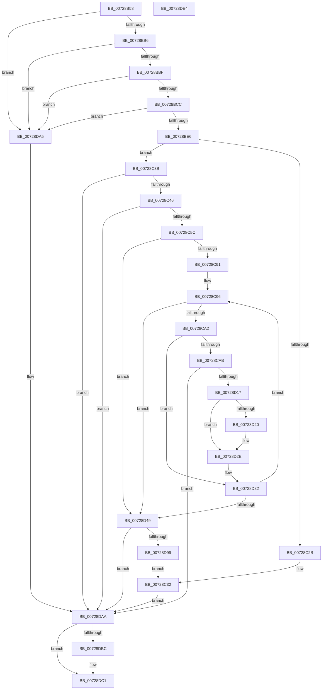

# PiCreateRegistryPath

- RVA: `0x00728B58`–`0x00728DE5` (길이 `653` bytes)
- VA: `0x0000000140728B58`
- 실행 섹션: `PAGE`
- PDB 이름 있음: `예`; PDB Function 태그: `아니요`
- unwind 정보 RVA: `0x0008FAA4`
- 디코드: `167`개 명령, `653/653` bytes 표시
- 미해석 바이트: `0` (있으면 어셈블리에 `.byte`로 보존)

> 이 문서는 커널 이미지의 기계어와 PDB 기호를 분석해 생성했습니다. 4번과 5번은 함수 원형과 자료형을 바이너리 사용 방식에서 추정한 C 해석이며 원본 소스 복구 결과는 아닙니다.

## 1. Dependencies

- 직접 호출 지점: **9**; 고유 호출 대상: **6**
- 직접 호출자로 확인된 함수: **1**
- RIP 상대 이미지 참조: **1**

### Outgoing calls
- `0x00728BA8` → [RtlInitUnicodeString](../../text/42/RtlInitUnicodeString_function_0042A780.md) (function, `0x0042A780`)
- `0x00728BD9` → [RtlPrefixUnicodeString](../8F/RtlPrefixUnicodeString_function_008F4F70.md) (function, `0x008F4F70`)
- `0x00728C20` → [ZwCreateKey](../../text/6A/ZwCreateKey_function_006AD470.md) (function, `0x006AD470`)
- `0x00728C4D` → [PnpConcatenateUnicodeStrings](../95/PnpConcatenateUnicodeStrings_function_00951ED0.md) (function, `0x00951ED0`)
- `0x00728D00` → [ZwCreateKey](../../text/6A/ZwCreateKey_function_006AD470.md) (function, `0x006AD470`)
- `0x00728D20` → [ZwClose](../../text/6A/ZwClose_function_006AD2B0.md) (function, `0x006AD2B0`)
- `0x00728D8E` → [ZwCreateKey](../../text/6A/ZwCreateKey_function_006AD470.md) (function, `0x006AD470`)
- `0x00728DAE` → [RtlFreeAnsiString](../9C/RtlFreeAnsiString_function_009C0800.md) (function, `0x009C0800`)
- `0x00728DBC` → [ZwClose](../../text/6A/ZwClose_function_006AD2B0.md) (function, `0x006AD2B0`)

### Direct callers
- [PiCreateServiceKeyUnderPath](PiCreateServiceKeyUnderPath_function_00728DEC.md) at `0x00728F54`

### Static image references
- `0x00728BCF` → RVA `0x00FD9DD8` (`PAGEDATA`; read)

## 2. Other-region calls and transfers

- 다른 실행 섹션으로 향하는 call: **6**
  - `0x00728BA8` → [RtlInitUnicodeString](../../text/42/RtlInitUnicodeString_function_0042A780.md) (`PAGE` → `.text`)
  - `0x00728C20` → [ZwCreateKey](../../text/6A/ZwCreateKey_function_006AD470.md) (`PAGE` → `.text`)
  - `0x00728D00` → [ZwCreateKey](../../text/6A/ZwCreateKey_function_006AD470.md) (`PAGE` → `.text`)
  - `0x00728D20` → [ZwClose](../../text/6A/ZwClose_function_006AD2B0.md) (`PAGE` → `.text`)
  - `0x00728D8E` → [ZwCreateKey](../../text/6A/ZwCreateKey_function_006AD470.md) (`PAGE` → `.text`)
  - `0x00728DBC` → [ZwClose](../../text/6A/ZwClose_function_006AD2B0.md) (`PAGE` → `.text`)
- 별도 외부 분기/꼬리 이동을 확인하지 못했습니다.

## 3. Assembly (complete function range)

```asm
00728B58  48 89 5C 24 10                  mov qword ptr [rsp + 0x10], rbx
00728B5D  48 89 74 24 18                  mov qword ptr [rsp + 0x18], rsi
00728B62  48 89 7C 24 20                  mov qword ptr [rsp + 0x20], rdi
00728B67  55                              push rbp
00728B68  41 54                           push r12
00728B6A  41 55                           push r13
00728B6C  41 56                           push r14
00728B6E  41 57                           push r15
00728B70  48 8B EC                        mov rbp, rsp
00728B73  48 81 EC 80 00 00 00            sub rsp, 0x80
00728B7A  0F 57 C0                        xorps xmm0, xmm0
00728B7D  33 C0                           xor eax, eax
00728B7F  48 8B F9                        mov rdi, rcx
00728B82  48 89 45 F0                     mov qword ptr [rbp - 0x10], rax
00728B86  45 33 ED                        xor r13d, r13d
00728B89  89 45 F8                        mov dword ptr [rbp - 8], eax
00728B8C  48 8D 4D C0                     lea rcx, [rbp - 0x40]
00728B90  4C 89 6D 30                     mov qword ptr [rbp + 0x30], r13
00728B94  33 D2                           xor edx, edx
00728B96  49 8B F1                        mov rsi, r9
00728B99  0F 11 45 D0                     movups xmmword ptr [rbp - 0x30], xmm0
00728B9D  4D 8B E0                        mov r12, r8
00728BA0  0F 11 45 E0                     movups xmmword ptr [rbp - 0x20], xmm0
00728BA4  0F 11 45 C0                     movups xmmword ptr [rbp - 0x40], xmm0
00728BA8  E8 D3 1B D0 FF                  call 0x14042a780
00728BAD  48 85 FF                        test rdi, rdi
00728BB0  0F 84 EF 01 00 00               je 0x140728da5
00728BB6  48 85 F6                        test rsi, rsi
00728BB9  0F 84 E6 01 00 00               je 0x140728da5
00728BBF  41 8D 5D 04                     lea ebx, [r13 + 4]
00728BC3  66 39 1F                        cmp word ptr [rdi], bx
00728BC6  0F 82 D9 01 00 00               jb 0x140728da5
00728BCC  41 B0 01                        mov r8b, 1
00728BCF  48 8D 0D 02 12 8B 00            lea rcx, [rip + 0x8b1202]
00728BD6  48 8B D7                        mov rdx, rdi
00728BD9  E8 92 C3 1C 00                  call 0x1408f4f70
00728BDE  84 C0                           test al, al
00728BE0  0F 84 BF 01 00 00               je 0x140728da5
00728BE6  4C 89 6C 24 30                  mov qword ptr [rsp + 0x30], r13
00728BEB  4C 8D 45 D0                     lea r8, [rbp - 0x30]
00728BEF  44 89 6C 24 28                  mov dword ptr [rsp + 0x28], r13d
00728BF4  48 8D 4D 30                     lea rcx, [rbp + 0x30]
00728BF8  45 33 C9                        xor r9d, r9d
00728BFB  4C 89 6C 24 20                  mov qword ptr [rsp + 0x20], r13
00728C00  8B D3                           mov edx, ebx
00728C02  C7 45 D0 30 00 00 00            mov dword ptr [rbp - 0x30], 0x30
00728C09  4C 89 6D D8                     mov qword ptr [rbp - 0x28], r13
00728C0D  C7 45 E8 40 02 00 00            mov dword ptr [rbp - 0x18], 0x240
00728C14  48 89 7D E0                     mov qword ptr [rbp - 0x20], rdi
00728C18  4C 89 65 F0                     mov qword ptr [rbp - 0x10], r12
00728C1C  4C 89 6D F8                     mov qword ptr [rbp - 8], r13
00728C20  E8 4B 48 F8 FF                  call 0x1406ad470
00728C25  8B D8                           mov ebx, eax
00728C27  85 C0                           test eax, eax
00728C29  78 10                           js 0x140728c3b
00728C2B  48 8B 4D 30                     mov rcx, qword ptr [rbp + 0x30]
00728C2F  48 89 0E                        mov qword ptr [rsi], rcx
00728C32  4C 89 6D 30                     mov qword ptr [rbp + 0x30], r13
00728C36  E9 6F 01 00 00                  jmp 0x140728daa
00728C3B  3D 34 00 00 C0                  cmp eax, 0xc0000034
00728C40  0F 85 64 01 00 00               jne 0x140728daa
00728C46  48 8B D7                        mov rdx, rdi
00728C49  48 8D 4D C0                     lea rcx, [rbp - 0x40]
00728C4D  E8 7E 92 22 00                  call 0x140951ed0
00728C52  8B D8                           mov ebx, eax
00728C54  85 C0                           test eax, eax
00728C56  0F 88 4E 01 00 00               js 0x140728daa
00728C5C  48 8B 4D C8                     mov rcx, qword ptr [rbp - 0x38]
00728C60  0F B7 05 71 11 8B 00            movzx eax, word ptr [rip + 0x8b1171]
00728C67  44 0F B7 7D C0                  movzx r15d, word ptr [rbp - 0x40]
00728C6C  48 D1 E8                        shr rax, 1
00728C6F  45 0F B7 F7                     movzx r14d, r15w
00728C73  48 FF C0                        inc rax
00728C76  66 41 D1 EE                     shr r14w, 1
00728C7A  48 8D 3C 41                     lea rdi, [rcx + rax*2]
00728C7E  48 8B C7                        mov rax, rdi
00728C81  48 2B C1                        sub rax, rcx
00728C84  48 D1 F8                        sar rax, 1
00728C87  66 41 3B C6                     cmp ax, r14w
00728C8B  0F 83 B8 00 00 00               jae 0x140728d49
00728C91  BA 5C 00 00 00                  mov edx, 0x5c
00728C96  0F B7 07                        movzx eax, word ptr [rdi]
00728C99  66 85 C0                        test ax, ax
00728C9C  0F 84 A7 00 00 00               je 0x140728d49
00728CA2  66 3B C2                        cmp ax, dx
00728CA5  0F 85 87 00 00 00               jne 0x140728d32
00728CAB  66 44 89 2F                     mov word ptr [rdi], r13w
00728CAF  4C 8D 45 D0                     lea r8, [rbp - 0x30]
00728CB3  45 33 C9                        xor r9d, r9d
00728CB6  4C 89 6C 24 30                  mov qword ptr [rsp + 0x30], r13
00728CBB  0F 57 C0                        xorps xmm0, xmm0
00728CBE  44 89 6C 24 28                  mov dword ptr [rsp + 0x28], r13d
00728CC3  48 8B C7                        mov rax, rdi
00728CC6  C7 45 D0 30 00 00 00            mov dword ptr [rbp - 0x30], 0x30
00728CCD  48 2B 45 C8                     sub rax, qword ptr [rbp - 0x38]
00728CD1  48 8D 4D 30                     lea rcx, [rbp + 0x30]
00728CD5  48 D1 F8                        sar rax, 1
00728CD8  41 8D 51 04                     lea edx, [r9 + 4]
00728CDC  66 03 C0                        add ax, ax
00728CDF  4C 89 6D D8                     mov qword ptr [rbp - 0x28], r13
00728CE3  66 89 45 C0                     mov word ptr [rbp - 0x40], ax
00728CE7  48 8D 45 C0                     lea rax, [rbp - 0x40]
00728CEB  48 89 45 E0                     mov qword ptr [rbp - 0x20], rax
00728CEF  C7 45 E8 40 02 00 00            mov dword ptr [rbp - 0x18], 0x240
00728CF6  F3 0F 7F 45 F0                  movdqu xmmword ptr [rbp - 0x10], xmm0
00728CFB  4C 89 6C 24 20                  mov qword ptr [rsp + 0x20], r13
00728D00  E8 6B 47 F8 FF                  call 0x1406ad470
00728D05  BA 5C 00 00 00                  mov edx, 0x5c
00728D0A  8B D8                           mov ebx, eax
00728D0C  66 89 17                        mov word ptr [rdi], dx
00728D0F  85 C0                           test eax, eax
00728D11  0F 88 93 00 00 00               js 0x140728daa
00728D17  48 8B 4D 30                     mov rcx, qword ptr [rbp + 0x30]
00728D1B  48 85 C9                        test rcx, rcx
00728D1E  74 0E                           je 0x140728d2e
00728D20  E8 8B 45 F8 FF                  call 0x1406ad2b0
00728D25  BA 5C 00 00 00                  mov edx, 0x5c
00728D2A  4C 89 6D 30                     mov qword ptr [rbp + 0x30], r13
00728D2E  48 8B 4D C8                     mov rcx, qword ptr [rbp - 0x38]
00728D32  48 83 C7 02                     add rdi, 2
00728D36  48 8B C7                        mov rax, rdi
00728D39  48 2B C1                        sub rax, rcx
00728D3C  48 D1 F8                        sar rax, 1
00728D3F  66 41 3B C6                     cmp ax, r14w
00728D43  0F 82 4D FF FF FF               jb 0x140728c96
00728D49  45 33 C9                        xor r9d, r9d
00728D4C  4C 89 6C 24 30                  mov qword ptr [rsp + 0x30], r13
00728D51  48 8D 45 C0                     lea rax, [rbp - 0x40]
00728D55  44 89 6C 24 28                  mov dword ptr [rsp + 0x28], r13d
00728D5A  4C 8D 45 D0                     lea r8, [rbp - 0x30]
00728D5E  66 44 89 7D C0                  mov word ptr [rbp - 0x40], r15w
00728D63  48 8D 4D 30                     lea rcx, [rbp + 0x30]
00728D67  C7 45 D0 30 00 00 00            mov dword ptr [rbp - 0x30], 0x30
00728D6E  41 8D 51 04                     lea edx, [r9 + 4]
00728D72  4C 89 6D D8                     mov qword ptr [rbp - 0x28], r13
00728D76  C7 45 E8 40 02 00 00            mov dword ptr [rbp - 0x18], 0x240
00728D7D  48 89 45 E0                     mov qword ptr [rbp - 0x20], rax
00728D81  4C 89 65 F0                     mov qword ptr [rbp - 0x10], r12
00728D85  4C 89 6D F8                     mov qword ptr [rbp - 8], r13
00728D89  4C 89 6C 24 20                  mov qword ptr [rsp + 0x20], r13
00728D8E  E8 DD 46 F8 FF                  call 0x1406ad470
00728D93  8B D8                           mov ebx, eax
00728D95  85 C0                           test eax, eax
00728D97  78 11                           js 0x140728daa
00728D99  48 8B 45 30                     mov rax, qword ptr [rbp + 0x30]
00728D9D  48 89 06                        mov qword ptr [rsi], rax
00728DA0  E9 8D FE FF FF                  jmp 0x140728c32
00728DA5  BB 0D 00 00 C0                  mov ebx, 0xc000000d
00728DAA  48 8D 4D C0                     lea rcx, [rbp - 0x40]
00728DAE  E8 4D 7A 29 00                  call 0x1409c0800
00728DB3  48 8B 4D 30                     mov rcx, qword ptr [rbp + 0x30]
00728DB7  48 85 C9                        test rcx, rcx
00728DBA  74 05                           je 0x140728dc1
00728DBC  E8 EF 44 F8 FF                  call 0x1406ad2b0
00728DC1  4C 8D 9C 24 80 00 00 00         lea r11, [rsp + 0x80]
00728DC9  8B C3                           mov eax, ebx
00728DCB  49 8B 5B 38                     mov rbx, qword ptr [r11 + 0x38]
00728DCF  49 8B 73 40                     mov rsi, qword ptr [r11 + 0x40]
00728DD3  49 8B 7B 48                     mov rdi, qword ptr [r11 + 0x48]
00728DD7  49 8B E3                        mov rsp, r11
00728DDA  41 5F                           pop r15
00728DDC  41 5E                           pop r14
00728DDE  41 5D                           pop r13
00728DE0  41 5C                           pop r12
00728DE2  5D                              pop rbp
00728DE3  C3                              ret
00728DE4  CC                              int3
```

## 4. C-style interpretation (structured pseudocode)

```c
__int64 __fastcall PiCreateRegistryPath(__int64 a1, int a2, __int64 a3, __int64 a4)
{
    __int64 result;
    __int64 v_r13;
    __int64 v_r14;
    __int64 v_rdi;
    __int64 v_rsp;
    unsigned __int64 v_stack_m28;
    unsigned int v_stack_m30;
    unsigned __int64 v_stack_m38;
    unsigned int v_stack_m40;
    unsigned __int64 v_stack_m48;
    unsigned __int64 v_stack_m50;
    unsigned __int64 v_stack_m58;
    unsigned __int64 v_stack_m60;
    unsigned __int64 v_stack_m68;
    unsigned __int64 v_stack_m78;
    unsigned int v_stack_m80;
    unsigned __int64 v_stack_m88;
    unsigned __int64 v_stack_p10;
    unsigned __int64 v_stack_p18;
    unsigned __int64 v_stack_p20;
    unsigned __int64 v_stack_p8;

    v_stack_p10 = v_rbx;
    v_stack_p18 = v_rsi;
    v_stack_p20 = v_rdi;
    v_rsp = (v_rsp) - (128);
    result = 0;
    v_stack_m38 = 0;
    v_r13 = 0;
    v_stack_m30 = 0;
    v_stack_p8 = 0;
    a2 = 0;
    v_stack_m58 = v_xmm0;
    v_stack_m48 = v_xmm0;
    v_stack_m68 = v_xmm0;
    result = RtlInitUnicodeString(v_stack_m68, a2, a3, a4);
    if (a1 == 0) goto loc_00728DA5;
    if (a4 == 0) goto loc_00728DA5;
    if ((*(unsigned __int16 *)(a1)) < ((unsigned __int16)(v_r13 + 4))) goto loc_00728DA5;
    result = RtlPrefixUnicodeString(v_rip + 9114114, a1, 1, a4);
    if ((unsigned __int8)(result) == 0) goto loc_00728DA5;
    v_stack_m78 = 0;
    v_stack_m80 = 0;
    a4 = 0;
    v_stack_m88 = 0;
    v_stack_m58 = 48;
    v_stack_m50 = 0;
    v_stack_m40 = 576;
    v_stack_m48 = a1;
    v_stack_m38 = a3;
    v_stack_m30 = 0;
    result = ZwCreateKey(v_stack_p8, (unsigned int)((unsigned int)(v_r13 + 4)), v_stack_m58, a4);
    if (sign_flag) goto loc_00728C3B;
    *(unsigned __int64 *)(a4) = v_stack_p8;
loc_00728C32:
    v_stack_p8 = 0;
    goto loc_00728DAA;
loc_00728C3B:
    if (((unsigned int)(result)) != 0xC0000034ULL) goto loc_00728DAA;
    result = PnpConcatenateUnicodeStrings(v_stack_m68, a1, v_stack_m58, a4);
    if (sign_flag) goto loc_00728DAA;
    result = (*(unsigned __int16 *)(v_rip + 9113969)) >> (1);
    result = (result) + 1;
    v_r14 = (unsigned __int16)(((unsigned __int16)(v_stack_m68)) >> (1));
    result = (v_stack_m60 + result * 2) - (v_stack_m60);
    result = (result) >> (1);
    if (((unsigned __int16)(result)) >= ((unsigned __int16)(v_r14))) goto loc_00728D49;
loc_00728C96:
    if ((unsigned __int16)(*(unsigned __int16 *)(v_stack_m60 + result * 2)) == 0) goto loc_00728D49;
    if (((unsigned __int16)(*(unsigned __int16 *)(v_stack_m60 + result * 2))) != 92) goto loc_00728D32;
    *(unsigned __int16 *)(v_stack_m60 + result * 2) = 0;
    a4 = 0;
    v_stack_m78 = 0;
    v_stack_m80 = 0;
    v_stack_m58 = 48;
    result = (v_stack_m60 + result * 2) - (v_stack_m60);
    result = (result) >> (1);
    result = (unsigned __int16)((result) + ((unsigned __int16)(result)));
    v_stack_m50 = 0;
    v_stack_m68 = (unsigned __int16)(result);
    v_stack_m48 = v_stack_m68;
    v_stack_m40 = 576;
    v_stack_m38 = v_xmm0;
    v_stack_m88 = 0;
    result = ZwCreateKey(v_stack_p8, a4 + 4, v_stack_m58, a4);
    *(unsigned __int16 *)(v_stack_m60 + result * 2) = 92;
    if (sign_flag) goto loc_00728DAA;
    if (v_stack_p8 != 0) {
        result = ZwClose(v_stack_p8, 92, v_stack_m58, a4);
        a2 = 92;
        v_stack_p8 = 0;
    }
loc_00728D32:
    v_rdi = (v_stack_m60 + result * 2) + (2);
    result = (v_rdi) - (v_stack_m60);
    result = (result) >> (1);
    if (((unsigned __int16)(result)) < ((unsigned __int16)(v_r14))) goto loc_00728C96;
loc_00728D49:
    a4 = 0;
    v_stack_m78 = 0;
    v_stack_m80 = 0;
    v_stack_m68 = (unsigned __int16)(v_stack_m68);
    v_stack_m58 = 48;
    v_stack_m50 = 0;
    v_stack_m40 = 576;
    v_stack_m48 = v_stack_m68;
    v_stack_m38 = a3;
    v_stack_m30 = 0;
    v_stack_m88 = 0;
    result = ZwCreateKey(v_stack_p8, a4 + 4, v_stack_m58, a4);
    if (sign_flag) goto loc_00728DAA;
    *(unsigned __int64 *)(a4) = v_stack_p8;
    goto loc_00728C32;
loc_00728DA5:
loc_00728DAA:
    result = RtlFreeAnsiString(v_stack_m68, a4 + 4, v_stack_m58, a4);
    if (v_stack_p8 != 0) {
        result = ZwClose(v_stack_p8, a4 + 4, v_stack_m58, a4);
    }
    return (unsigned int)((unsigned int)((unsigned int)(0xC000000DULL)));
}
```

## 5. (Beta) C Style

```c
int64_t PiCreateRegistryPath(int64_t Arg1, int32_t Arg2, int64_t Arg3, int64_t Arg4)
{
    int64_t result;
    int64_t local_r13;
    int64_t local_r14;
    int64_t local_rdi;
    int64_t local_rsp;
    uint64_t v_stack_m28;
    uint32_t v_stack_m30;
    uint64_t v_stack_m38;
    uint32_t v_stack_m40;
    uint64_t v_stack_m48;
    uint64_t v_stack_m50;
    uint64_t v_stack_m58;
    uint64_t v_stack_m60;
    uint64_t v_stack_m68;
    uint64_t v_stack_m78;
    uint32_t v_stack_m80;
    uint64_t v_stack_m88;
    uint64_t v_stack_p10;
    uint64_t v_stack_p18;
    uint64_t v_stack_p20;
    uint64_t v_stack_p8;

    v_stack_p10 = local_rbx;
    v_stack_p18 = local_rsi;
    v_stack_p20 = local_rdi;
    local_rsp = (local_rsp) - (128);
    result = 0;
    v_stack_m38 = 0;
    local_r13 = 0;
    v_stack_m30 = 0;
    v_stack_p8 = 0;
    Arg2 = 0;
    v_stack_m58 = v_xmm0;
    v_stack_m48 = v_xmm0;
    v_stack_m68 = v_xmm0;
    result = RtlInitUnicodeString(v_stack_m68, Arg2, Arg3, Arg4);
    if (Arg1 == 0) goto loc_00728DA5;
    if (Arg4 == 0) goto loc_00728DA5;
    if ((*(uint16_t *)(Arg1)) < ((uint16_t)(local_r13 + 4))) goto loc_00728DA5;
    result = RtlPrefixUnicodeString(v_rip + 9114114, Arg1, 1, Arg4);
    if ((uint8_t)(result) == 0) goto loc_00728DA5;
    v_stack_m78 = 0;
    v_stack_m80 = 0;
    Arg4 = 0;
    v_stack_m88 = 0;
    v_stack_m58 = 48;
    v_stack_m50 = 0;
    v_stack_m40 = 576;
    v_stack_m48 = Arg1;
    v_stack_m38 = Arg3;
    v_stack_m30 = 0;
    result = ZwCreateKey(v_stack_p8, (uint32_t)((uint32_t)(local_r13 + 4)), v_stack_m58, Arg4);
    if (sign_flag) goto loc_00728C3B;
    *(uint64_t *)(Arg4) = v_stack_p8;
loc_00728C32:
    v_stack_p8 = 0;
    goto loc_00728DAA;
loc_00728C3B:
    if (((uint32_t)(result)) != 0xC0000034ULL) goto loc_00728DAA;
    result = PnpConcatenateUnicodeStrings(v_stack_m68, Arg1, v_stack_m58, Arg4);
    if (sign_flag) goto loc_00728DAA;
    result = (*(uint16_t *)(v_rip + 0x8B1171)) >> (1);
    result = (result) + 1;
    local_r14 = (uint16_t)(((uint16_t)(v_stack_m68)) >> (1));
    result = (v_stack_m60 + result * 2) - (v_stack_m60);
    result = (result) >> (1);
    if (((uint16_t)(result)) >= ((uint16_t)(local_r14))) goto loc_00728D49;
loc_00728C96:
    if ((uint16_t)(*(uint16_t *)(v_stack_m60 + result * 2)) == 0) goto loc_00728D49;
    if (((uint16_t)(*(uint16_t *)(v_stack_m60 + result * 2))) != 92) goto loc_00728D32;
    *(uint16_t *)(v_stack_m60 + result * 2) = 0;
    Arg4 = 0;
    v_stack_m78 = 0;
    v_stack_m80 = 0;
    v_stack_m58 = 48;
    result = (v_stack_m60 + result * 2) - (v_stack_m60);
    result = (result) >> (1);
    result = (uint16_t)((result) + ((uint16_t)(result)));
    v_stack_m50 = 0;
    v_stack_m68 = (uint16_t)(result);
    v_stack_m48 = v_stack_m68;
    v_stack_m40 = 576;
    v_stack_m38 = v_xmm0;
    v_stack_m88 = 0;
    result = ZwCreateKey(v_stack_p8, Arg4 + 4, v_stack_m58, Arg4);
    *(uint16_t *)(v_stack_m60 + result * 2) = 92;
    if (sign_flag) goto loc_00728DAA;
    if (v_stack_p8 != 0) {
        result = ZwClose(v_stack_p8, 92, v_stack_m58, Arg4);
        Arg2 = 92;
        v_stack_p8 = 0;
    }
loc_00728D32:
    local_rdi = (v_stack_m60 + result * 2) + (2);
    result = (local_rdi) - (v_stack_m60);
    result = (result) >> (1);
    if (((uint16_t)(result)) < ((uint16_t)(local_r14))) goto loc_00728C96;
loc_00728D49:
    Arg4 = 0;
    v_stack_m78 = 0;
    v_stack_m80 = 0;
    v_stack_m68 = (uint16_t)(v_stack_m68);
    v_stack_m58 = 48;
    v_stack_m50 = 0;
    v_stack_m40 = 576;
    v_stack_m48 = v_stack_m68;
    v_stack_m38 = Arg3;
    v_stack_m30 = 0;
    v_stack_m88 = 0;
    result = ZwCreateKey(v_stack_p8, Arg4 + 4, v_stack_m58, Arg4);
    if (sign_flag) goto loc_00728DAA;
    *(uint64_t *)(Arg4) = v_stack_p8;
    goto loc_00728C32;
loc_00728DA5:
loc_00728DAA:
    result = RtlFreeAnsiString(v_stack_m68, Arg4 + 4, v_stack_m58, Arg4);
    if (v_stack_p8 != 0) {
        result = ZwClose(v_stack_p8, Arg4 + 4, v_stack_m58, Arg4);
    }
    return (uint32_t)((uint32_t)((uint32_t)(0xC000000DULL)));
}
```

## 6. Execution-region graph

[열기: 2D/3D 그래프와 함수 탐색 컨트롤 패널](../../../control-panel.html?section=page&rva=0x00728B58&view=graph)

- 2D 그래프는 위에서 아래로 흐르고, 3D 그래프는 빈 공간을 드래그해 회전합니다. Shift+드래그는 이동, 휠은 확대·축소, 함수 노드 선택은 대상 보고서 이동입니다.

### Static fallback


